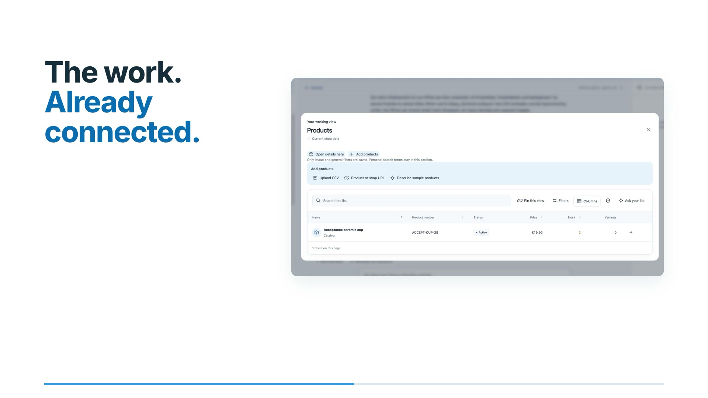

<p align="center">
  
</p>

<div align="center">

# VEYNDO

**Commerce, rebuilt for the AI era.**

[](https://github.com/sthamann/veyndo/actions/workflows/verify.yml)
[](https://veyndo.ai/docs/)
[](#current-boundaries)
[](LICENSE)

[Try one complete round](docs/first-tour.md) · [Watch the new product films](docs/video-tours.md) · [First contributions](docs/early-contributors.md) · [Feature guide](docs/features.md) · [Architecture](docs/platform-overview.md) · [Integrations](docs/service-integrations.md) · [Documentation](https://veyndo.ai/docs/)

</div>

**A new Rust commerce platform with AI woven into the business itself.**

Veyndo connects products, business knowledge, merchant work, agents, automation and
apps on one Rust foundation. People and agents use the same native operations;
prices, stock, permissions and revisions remain authoritative.

**Start here: [current status, tested scope and open acceptance](docs/status.md).**
This is a working prototype, built in public. Local implementation, CI results and
public acceptance are recorded separately.

## One idea, one connected business

| Work | What connects it |
| --- | --- |
| **Ask, review, act** | Describe the work and open a view with real records, native editing and private catalogue intake. Pin it for later; changes retain their approval path. [AI workspace](docs/agentic-workspace.md). |
| **Prepare the catalogue** | Inspect each product's enabled-language coverage and saved image-job progress, then open its native editor to repair missing content. [Catalogue preparation](docs/product-management.md#preparing-a-catalogue-together). |
| **Bring your shop** | The [Migration Assistant](docs/agentic-migration.md) connects versioned source profiles, saved background inspection, readable variant review and native imports into private previews. |
| **Build the business** | Describe an app with forms, uploads, settings and views. Connect materials and dimensions to company approval, checkout and reorder. Visual editing and coding agents share one versioned definition. [App Studio](docs/app-studio.md), [configurator](docs/furniture-configurator.md), [object extensions](docs/app-core-extensions.md). |
| **Shape the shop** | Drag components onto the actual preview, compare home and content pages, undo edits and review screenshot-based proposals. Original Storyfront powers connected Experiences. [Visual design](docs/personal-workspace-and-shop-design.md). |
| **Automate the work** | Repeat reviewed work as a Flow and compare rule drafts with recorded order inputs before saving. [Automation](docs/automation.md), [reusable work](docs/personal-workspace-and-shop-design.md#repeat-completed-work-as-a-flow), [rule comparison](docs/rule-history-comparison.md). |
| **Shop by intent** | Describe a gift, budget or comparison; edit the visual selection with real product cards, then use native variants, app configuration and checkout. [Shopper workspace](docs/ui-experience.md#standard-storefront-and-customer-account). |
| **Test before release** | Let fictional customers try private proposals with native baskets and simulated purchases. Review saved outcomes and configuration freshness beside selected changes. [Customer simulator](docs/customer-scenarios.md). |
| **Stay in control** | Current roles, private sandboxes, immutable versions, saved-data upgrade checks and selected publication govern changes. [Security](docs/security.md). |

[](https://www.veyndo.ai/docs/video-tours.html)

**Films:** [AI commerce · 1:56](docs/assets/showcase/product-films-20261030/veyndo-ai-commerce.mp4) · [Concept · 1:12](docs/assets/showcase/product-films-20261030/veyndo-concept.mp4) · [Product workspace · 1:36](docs/assets/showcase/product-films-20261030/veyndo-workspace.mp4) · [Consultation app · 1:24](docs/assets/showcase/product-films-20261030/veyndo-app-platform.mp4). English subtitles, no sound.

Films were refreshed on 30 October with actual UI captures from 29 and 30 October,
English subtitles and no sound. Demo data and simulated payments; timing is editorial.
[Latest public journey and screenshots](docs/status.md#current-product-films-and-screenshots) · [Film sources](docs/assets/showcase/product-films-20261030/README.md).

## Try one complete round

**Hosted:** [create a standard shop](https://start.veyndo.ai/start) or
[create a Storyfront Experience](https://experience.veyndo.ai/).
External models, payment providers and mail require their own configuration.
[Current public acceptance](docs/status.md#public-acceptance).

**Container tour:** Git, Docker Compose and OpenSSL; no local Rust/Node build.

```sh
git clone https://github.com/sthamann/veyndo.git
cd veyndo
./scripts/try.sh
```

Open `http://127.0.0.1:8788/`. Select a product, place a simulated order, inspect it
in Studio, change a product in a private sandbox and review a selected release.
[Complete tour and pinned image](docs/first-tour.md).

**Develop from source:** Rust stable 1.96+, Node.js 22+, Docker Compose, Python 3
for verification tooling. Run `./scripts/dev.sh` and open
`http://127.0.0.1:8787/#merchant`. Runtime commerce and connector services use Rust.
[Setup](docs/quickstart.md) · [Source owners](docs/source-map.md).

## Explore the platform

| Area | Start here |
| --- | --- |
| AI shopping channels and inward shop imports | [Cart transfer, consent and Shopify/supplier intake](docs/agentic-commerce.md) |
| Catalogue, customers, orders and documents | [Features](docs/features.md) · [Admin walkthrough](docs/admin-workflows.md) |
| Countries, languages, currency and taxes | [International commerce](docs/international-commerce.md) · [Currencies](docs/currencies.md) |
| POS, B2B, EDI and marketplaces | [POS](docs/pos.md) · [B2B](docs/b2b-commerce.md) · [EDI](docs/edi.md) · [Marketplaces](docs/marketplaces.md) |
| Apps, settings, storage and private releases | [App platform](docs/app-platform.md) · [Build five apps](docs/app-tutorials/README.md) · [Shared storage](docs/app-data-storage.md) |
| Agents and shared operations | [Connections](docs/connectors.md) · [Agent identities & limits](docs/agent-authority-controls.md) · [MCP workshop](docs/agent-workshop.md) · [UCP B2B](docs/b2b-ucp-negotiation.md) |
| Operation and verification | [Architecture](docs/production-architecture.md) · [Integrations](docs/service-integrations.md) · [Testing](docs/testing.md) · [Proof boundaries](docs/formal-verification.md) |

The [handbook on veyndo.ai](https://veyndo.ai/docs/) follows seven ordered chapters,
with full-text search and article navigation. Technical articles retain their
source language; the reading interface supports English, German, French and Spanish.

## Current boundaries

Veyndo is an experiment platform, not established production infrastructure.
Simulated native and embedded checkout have dated acceptance. Real payments/refunds,
each OAuth provider, disaster recovery and capacity require separate evidence. Selected Lean proofs cover named
pure policies, not the whole system. Source builds, app lifecycle completeness and
operational controls are tracked explicitly in [the current status](docs/status.md).

[Contribute](CONTRIBUTING.md) · [Discussions](https://github.com/sthamann/veyndo/discussions)
· [Report an issue](https://github.com/sthamann/veyndo/issues/new/choose) · [Changelog](CHANGELOG.md).

## License

Source-available under the **[Veyndo Sustainable Use License 1.0](LICENSE)**.
Run and customize your own stores, brands and apps. Competing shop platforms,
white-labeling and managed commerce/SaaS for independent merchants require a
separate written commercial license. This is not an OSI-approved open-source
license. Earlier MIT versions retain their rights; third-party terms remain intact.
[License examples](docs/licensing.md) · [Third-party notices](THIRD_PARTY.md).
