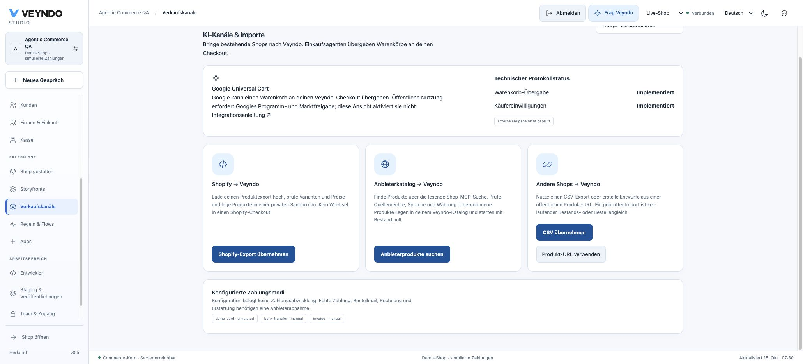

# AI channels and inward shop imports

Veyndo accepts a shopping agent’s cart and brings existing shop catalogues into
its own native commerce workflow. **The merchant retains the checkout, prices,
stock, order, permissions and publication decision.** There is no automatic
export into Shopify and no purchase at a supplier’s checkout.

Implementation status and hosted acceptance are separate: see [current status](status.md).

## Merchant entry

Open **Sales channels → AI channels & imports**. Select the sales channel to
inspect native Cart Transfer and buyer-consent support, configured payment modes
and links to the external onboarding instructions. Technical support is not
Google approval; the screen explicitly reports external approval as unverified.
Readiness needs `catalog.read`. Product import also needs current `catalog.write`
and the existing private environment grants. Changing channels never grants rights.

Choose an import source:

| Source | What happens | Boundary |
| --- | --- | --- |
| Shopify export | Upload the product CSV; priced variant rows become editable Veyndo drafts, with parent title, description and image inheritance | Up to 50 variants per review. Variants become separate native products. CSV prices are interpreted in the selected Veyndo base currency; verify them explicitly. No invented exchange rate, supplier stock or continuous sync |
| Supplier catalogue | Search the public Shop MCP catalogue, optionally limit by shop domain | Read-only `search_catalog`; up to 10 selected featured variants. Supplier currency must match Veyndo’s base currency. No supplier login, cart, wallet or purchase calls |
| Generic CSV | Upload the native name/description/price/product-number/image format | Existing deterministic import, no model required |
| Shop URL / product description | Use the existing bounded AI preparation | Requires configured inference and `assistant.use`; external text is untrusted |

Review and edit each draft, select a private sandbox, then approve creation.
The existing native save owner records revision/history/events and an idempotency
digest. Imported products start with **zero stock**. Explicitly check your right
to use the supplier’s text/images and sell the products, configure inventory and
fulfilment, then publish selected changes. Provenance identifies the source; it
is neither an authenticity certificate nor permission to resell. There is no
background supplier stock, order or price synchronisation in this importer.

Provider-specific parsers and network code live in
[`extensions/apps/catalog-import/`](../extensions/apps/catalog-import/README.md).
They use the existing shared egress admission and pinned public HTTPS client.
Private DNS, credentials in URLs, redirects, oversize responses, unsupported
currency and unsuccessful responses fail before a draft is accepted.
No per-app or per-shop database table is created.

## UCP Cart Transfer

`POST /ucp/v1/carts` accepts native product IDs in `line_items[].item.id`, positive
integer quantities and an optional supported currency/buyer. It recalculates
through the native channel, catalogue, stock, tax and price owners. Caller-supplied
prices or return origins have no authority.

The response contains native totals, an expiry and a canonical `continue_url`.
The browser continuation uses the existing ten-minute, single-use handoff in a
URL **fragment**, not a query-string bearer. The native consume endpoint rotates
the cart capability; foreign-tenant consumption and replay fail. The continuation pins the cart’s content language, so native names and shipping/payment
labels survive the handoff. The browser finishes in Veyndo’s existing checkout and payment lifecycle. Repeated order
submission retains the native idempotency contract.

Discovery is `/.well-known/ucp`. A `UCP-Agent` public HTTPS profile must intersect
the requested base capability: cart-only platforms need not claim checkout.
Profiles never grant merchant or customer authority. The existing separately
versioned Veyndo B2B negotiation extension remains optional and independently gated.

Google’s merchant enrolment and regional availability still apply. Shipping this
endpoint does not mean Veyndo has been admitted to Google surfaces. See the
[Google Cart overview](https://developers.google.com/merchant/ucp/guides/overview/cart-overview)
and [Merchant Center guidance](https://developers.google.com/merchant/ucp/guides/tools/merchant-center/overview).

## Explicit buyer consent

The optional negotiated `dev.ucp.shopping.buyer_consent` extension accepts four
registered purposes: analytics, preferences, marketing and sale/sharing. Requests
supply explicit `source: "platform"` boolean decisions, with the registered email
and SMS marketing segments. Descriptions and policy metadata belong to the server;
unknown purposes/segments and asserted business grants are rejected. Sale/sharing
is always disabled because Veyndo has no corresponding processing purpose.

Omitting consent preserves it; replacing an explicit purpose replaces its segment
choices. An unrelated update cannot revive a withdrawn or expired native grant.
Clearing the buyer revokes native optional processing. Consent and cart mutation
commit atomically through the native cart/privacy owners. Native merchant policy
can withhold a purpose even when a platform requests it. Required marketing contact
information must be present before completion. Completed orders retain an immutable
policy/consent snapshot; later revocation governs future processing without rewriting
historical orders. Consent is disabled unless a compatible platform profile selects it. Native
clients can explicitly pre-negotiate with `x-veyndo-ucp-consent-version: 2026-08-25`;
the legacy B2B version header alone never enables consent. An unnegotiated caller
receives no consent extension and cannot submit choices under it. No implicit tracking grant is created.

See the [UCP buyer-consent schema](https://ucp.dev/2026-08-25/schemas/shopping/buyer_consent.json)
and Veyndo’s [legal/privacy owner](european-operation.md).

## Browser agents share the actual cart commands

The standard storefront’s buttons and supported WebMCP tools share the same native
cart commands and serialized current revisions. Supported browsers can discover:

- `veyndo_search_catalog`: bounded public product search in the current shop/channel.
- `veyndo_get_cart`: product IDs/names, quantities and totals; no bearer or buyer details.
- `veyndo_update_cart`: replace items, using native validation and recalculation.
- `veyndo_review_checkout`: open checkout for the buyer to review and decide.

There is **no automatic order, charge or refund tool**. Registration uses
`document.modelContext` only when available and is removed on teardown; old shop
contexts cannot save into a newly selected shop. Unsupported experimental APIs
leave ordinary shopping available. These tools are not exposed to other origins.
See [Chrome’s current imperative API](https://developer.chrome.com/docs/ai/webmcp/imperative-api).

## Agent proposals and app diagnostics

Shop design still uses the app-owned, versioned page model and actual storefront
renderer. Each agent proposal now shows added/removed/repositioned blocks, changed
theme fields and form/app counts, with desktop/mobile preview entry points. These
are structural differences, not a claim that visual quality, accessibility or
app behavior was automatically accepted. Test forms, links and app components in
the sandbox before selected publication.

**App Studio → Versions & releases** shows declared placements, required installed
settings, models, explicitly enabled agent tools and business-example counts.
Each opens its existing editor. The shared assistant can prepare concrete success,
denial, retry and rollback tests. Counts do not claim that a test ran or a required
secret was entered; installed secrets retain their existing live-only encrypted owner.

## Verification and external gates

[Local acceptance and scope](evidence/agentic-commerce-local-2026-10-18.md).

The registered `agentic_commerce`, `checkout_handoff`, `b2b_ucp`, `catalog_management`
and `legal_privacy` suites exercise real Rust/HTTP/PostgreSQL paths. Frontend tests
cover channel rights, deterministic imports, current-revision commands, stale-shop
rejection, WebMCP lifecycle and real preview/editor handoffs. The private Shopware
Payments adapter can run with a local synthetic PSP: UCP transfer → native checkout
→ private provider → confirmed capture → partial refund and restart replay. This is
simulated money, never proof of real PSP settlement or live wallet acceptance.

Muse/Link partnerships, Google account admission, real PSP settlement, native
WebMCP availability in a specific browser and continuous authenticated supplier
synchronisation remain separate external capabilities. Do not label them connected
from a successful local import, protocol discovery or fixture.
