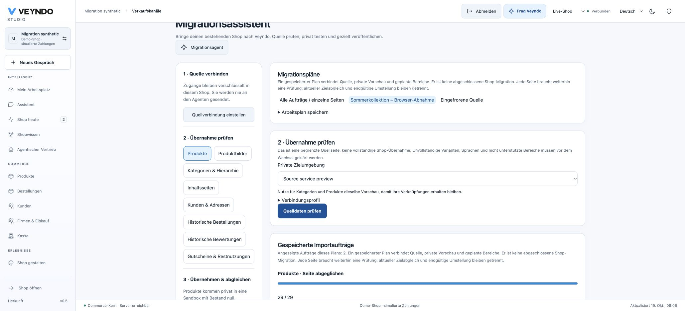
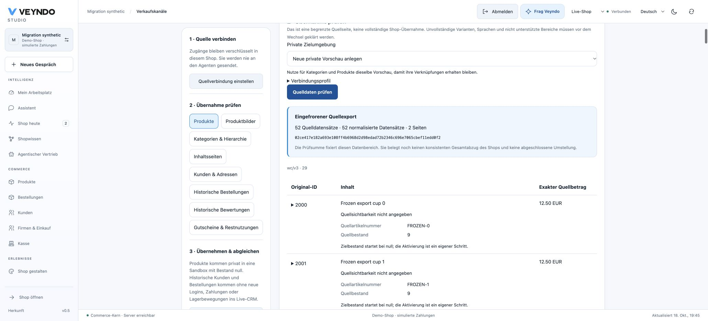

# Bring an existing shop into Veyndo

The Migration Assistant is an **independent Rust application** with a merchant
workspace under Sales channels. Source-specific code, controls, translations and
its deployment image live in `extensions/apps/migration/`. Core retains generic
native import admission, current authorization and the original domain writers.

This is an implementation and local acceptance record, **not a declaration that
all source shops or the entire migration concept are already accepted publicly**.
See [current status](status.md) for deployed journeys.

## Saved migration work plans



Studio can save a named work plan with its source profile, planned domains and an
existing private destination. Selecting it after a reload restores context, not
approval. When the first private import needs a new preview, Studio saves that
preview reference with the plan's current native record revision **before** queueing
an import. A conflicting plan edit stops that action; it does not overwrite another
administrator. Switching source/destination leaves the selected plan instead of
silently rewriting its meaning. The shared agent sees this same limited context.

Plans are private `migration/runs` logical app records in the existing four shared
storage tables. They contain no source rows, API credentials, second job queue or
per-app SQL objects. Native `list_runs`/`save_run` actions require current
`apps.manage`; the read action is available to the existing MCP/agent gateway.
Saving a plan neither imports records nor approves a batch. Unknown, duplicate,
empty or non-array domain selections fail the save action; the UI also rejects
malformed stored plans.

Source inspection and import jobs carry the generic, non-authoritative `jobGroup`
label. `GET /api/apps/APP/jobs?group=ID&limit=100&after=CURSOR` uses scoped keyset
pages and preserves current action/PII redaction. Studio shows older pages through
**Load older jobs** instead of silently losing everything beyond the latest 100.
If an anchor was archived before the next read, the API returns an explicit 409
asking the caller to reload, rather than a false end of history. It resolves a
present anchor once, so archival during that read cannot turn its position into
SQL NULL. Native retention remains **1,000 jobs per shop**; grouping does not remove
this limit. Durable page evidence is stored separately as described below.

A plan and its job labels are merchant metadata, not evidence that every source
record was imported exactly once. They do not freeze mutable connection settings,
bind a cross-domain snapshot, run final deltas or authorize cutover.
The separate current-field comparison below reads actual target values. Job success still applies to one exact reviewed batch;
replaying a batch must not be summed as additional migrated source records.


## Continue a reviewed migration and compare its actual target

A selected plan now guides the supported areas in dependency order: categories,
products, images, pages, customers, historical orders, reviews and coupons. Within
an area it follows the actual source cursor. **Review next page** opens source
inspection; every new page still needs deliberate approval. **Resume reviewed page**
reuses its saved exact digests/options and verifies the source again before writes.
A page with no source records can be explicitly acknowledged without creating data.
Referenced products must be deliberately published before their live historical
reviews; this workflow never silently publishes the catalogue.

Before queueing a plan's import, Studio saves `migration/batches` in the same native
private logical record store: run/profile/domain/target, source cursor, exact row
digests, reviewed options and a revision. The independent service verifies those
fields against the native job. Successful completion and its bounded comparison
record are committed in one native transaction, holding current job creator,
lease, cancellation, package and record-CAS fences. Only an explicitly approved
app callback identity can request the native evidence seal; a personal ordinary
save cannot mint one. The seal reuses platform authenticated encryption, bound to
tenant/app/entity/record/current package and normalized fields. Native
`job_evidence` verifies actual stored fields before Studio advances. Editing a
saved result, copying a token to another record or changing its package makes it
unverified. This authenticates the admitted service's observation, not arbitrary
third-party service correctness; SQL, crypto and service execution remain outside
the small extracted cancellation policy proof.
It retains the next cursor, original source/export context, job ID, approving actor
and package digest. A changed intent stops execution; a conflicting final save
stops completion instead of overwriting another editor. Unknown external outcomes
still require the existing explicit native job retry/review. There is no second
queue, source-row store or physical table.

Technical jobs can be archived after their page evidence is retained. Reopening
Studio reads the private page records and the service can resume after a process
restart. The UI does not infer completion from a truncated history/page list: load
remaining saved pages first. Native app storage limits still apply (including
8 KiB per JSON field and 64 MiB logical storage per shop/app); these are bounded
page intents, not copies of the original catalogue or customer records.

`POST /api/merchant/imports/inspect` and MCP `merchant.import.inspect` read the
current native target. They return `matching`, `missing` or `changed`, bounded field
paths and a timestamp, without source values or mutations. Each import job also
performs that read after all rows, including earlier rows of a resumed job.
**Check target again** queues a read-only run against the same reviewed page;
native callback admission refuses writes even if its service attempts one.
A successful technical job with differences remains a difference in Studio.
`reconciled=true` now requires every reviewed row's mapped current fields to match.

Comparison covers product name/description translations, original mapped price,
tax, SKU, visibility, category/variant relations and provenance; category hierarchy
and mapped content; actual stored image byte digests and their separate product
association; normalized managed page fields; CRM identity/profile/group and
address/default books (including identical explicit billing/shipping rows and
first-row defaults for shipping-only or additional-only books); historical order amount/lines/date/addresses/source snapshot;
review author/text/rating/date/product and inactive coupon mappings. It uses the
same native product/category mapping and price owner as creation. Runtime stock,
merchant-added metadata, new unrelated records and unsupported source/plugin fields
are outside this mapped-row comparison. Supported source counts and export hashes
remain separate evidence. It does not establish full source coverage, a globally
atomic observation, final deltas or cutover readiness.

Current domain read rights and the separate PII right apply to personal records.
Job callbacks additionally keep original creator/package/lease/record-digest/private
workspace fences. Durable summaries contain counts rather than private source values;
personal-domain path samples are omitted. The legacy settings read model now also
requires `orders.read` **and** `customers.pii` before returning full orders, closing
an alternative path to imported historical addresses/source snapshots.


## One connected workflow

1. Open **Sales channels → Migration Assistant** and review installation consent.
2. Select the original platform. Save its read-only connection in the existing
   encrypted app settings. Credentials are write-only in the browser and never
   form part of the agent prompt. Pin the applicable API profile/version.
3. Choose products, product images, categories, content pages, customers, original historical orders, reviews or coupons. Inspect the actual
   bounded source records and any mapping limitations. Source inspection itself is a
   saved background job: the page stays usable during slow reads, and completed
   source evidence can be reopened after reload without importing or approving it. Source language IDs require
   explicit locale mapping. Local historical dates require a confirmed IANA zone.
4. Review destination tax, original net/gross price basis or customer-group choices and explicitly approve the
   exact returned records. Products, images, categories and content pages share a selected
   private environment; products start with stock zero. Select the same environment
   across domains and after reloading. Content pages require the installed Shop design
   package; its exact destination digest is frozen in the reviewed job.
5. Follow the saved native job. Cancel stops subsequent writes. After an uncertain
   interruption, inspect the result and explicitly resume. Stable source identities
   prevent duplicates; changed snapshots produce a conflict rather than overwrite.
6. Open **Shop design**. The handoff selects the same private environment,
   opens its agent and pre-fills the reviewed source URL. Add screenshots and
   prepare the existing reference-design proposal against the actual private preview. Publish selected configuration through the existing
   release path. CRM customers and historical orders are operational data and are
   never sandbox release units. Stock activation is a separate deliberate action.

The contextual agent drawer embeds the existing Studio conversation and central
planner. It does not introduce another chat database, model gateway or execution
queue. The agent can prepare a plan; approving a source record and publishing a
shop remain distinct native actions. A generic migration prompt is not a claim of
automatic semantic equivalence for arbitrary third-party plugins or theme code.

## Current coverage

| Domain | Implemented path | Boundary |
| --- | --- | --- |
| Frozen export intake | Streamed original JSON lines → private immutable pages → separately authenticated pinned HTTPS reader → existing reviewed native jobs | Exact context/digest/count/cursor checks; one domain per package. Shallow references and truncated children stop. Immutable bytes are not a complete source transaction fence or whole-shop target parity. |
| Products | Shopify variants, WooCommerce simple and concrete variable products, PrestaShop/Magento/Shopware 5 source projections; native private product creation | Retains original amount/basis, known source stock and source metadata; active target stock starts at zero. Multiple Shopify/Shopware variants use native parents/options; category source IDs resolve to the native category tree. Complex/bundle/combinations still need complete domain mapping. WooCommerce families retain their original parent/child IDs, declared axes/options, explicit published/private status and child images. Missing/duplicate/foreign children, wildcard combinations, standalone variations, and separate hidden/search-only/catalog-only visibility require explicit mapping rather than silent simplification. |
| Product images | Public source URLs → frozen original-byte digests → native private asset store and ordered product media | PNG/JPEG/WebP, 1 byte–8 MiB each, up to 20 images/product and 10 images/reviewed slice. Source credentials are never forwarded to CDNs; unsupported signed URLs, private/relative source paths and unknown collection profiles require an explicit mapping/export. |
| Customers | All five local provider protocols → native billing/shipping/additional address books (up to 50 addresses) | Explicit country/subdivision codes, original contact fields and distinct defaults are retained. No password/account credential, marketing consent, verified identity or email-based historical ownership is invented. Existing email conflicts require a reviewed resolution. |
| Historical orders | All five local provider protocols → original lines, invoice/delivery addresses, exact minor-unit total and timestamp/number → immutable native history | No repricing, new payment attempt, ordinary purchase event, stock consumption or invoice allocation. Source payment status is a historical claim, never native PSP confirmation. |
| Categories | Native private tree with stable IDs, localized names/slugs and explicit parent references | Parents must exist before children; missing parents stop the write instead of flattening the tree. |
| Content pages | Source HTML → editable rich blocks → the installed Shop design model | Same package/schema, field/reference validation, history and private release owner. Unsafe links, executable embeds, unresolved media and unsupported markup stop import. No arbitrary PHP/Liquid/theme conversion. |
| Reviews | Original author/text/date/rating → native review moderation | Hidden until ordinary moderation; visible source origin, never a fabricated native verified purchase. Original verification is only a typed boolean claim. Private imported author/provenance requires current product-read and PII rights. |
| Coupons | WooCommerce percent/fixed-cart rules → inactive native promotions | Exact remaining-use snapshot; explicit review before activation, original currency only. Product/customer/shipping/plugin restrictions and malformed limits stop instead of becoming unrestricted. Other provider discount profiles still need explicit mapping. |
| Design | Handoff to the existing visual editor and central reference-design proposals | No copied PHP/Liquid/theme executable and no automatic parity certification. |
| Cutover | Per-page reconciliation and controlled private publication foundations | No source freeze, final delta, whole-shop cross-object reconciliation, automatic DNS switch or zero-downtime guarantee yet. |

The direct source profiles target Shopify versioned Admin GraphQL, WooCommerce REST
v3 / WordPress pages, PrestaShop webservice, Magento 2 REST and Shopware 5 REST.
Their local HTTP fixtures prove the implemented protocol paths, **not admission
against arbitrary installed versions, private plugins or real merchant credentials**.
Shopify protected customer data/older orders, third-party reviews and discounts can
need additional access or explicit exports. API errors and nested pagination gaps
remain visible; they are not counted as a completed extraction. REST page/count
evidence must be typed and agree with the requested offset and returned records.
A short nonterminal page cannot silently skip rows. Shopify root and requested
nested connections require explicit boolean pagination evidence.

## Frozen exports and interrupted large reads

The same Rust binary can stream original, expanded source JSON lines into a
private, immutable export package. It does not collect a full catalogue in memory:
only a bounded page plus the bounded set of source identities is retained. An
export is a source artifact, not a new job queue, SQL table or runtime spool.

```sh
cargo build --locked --package veyndo-migration --bin migration-assistant
# The directory must be new. JSON lines contain original source records,
# expanded with the references/children required by the selected adapter.
target/debug/migration-assistant pack woocommerce products EUR de-DE \
  https://original-shop.example wc/v3 ./new-private-export < products.jsonl
```

The command prints the SHA-256 of `manifest.json` after all records validate.
Source files are created with `0600`, the new directory with `0700` on Unix;
existing packages are never overwritten. Duplicate source identities or invalid
rows prevent manifest publication. Partial files after an interrupted preparation
are not an admitted package; prepare a new directory. Protect and remove source
PII according to the merchant's retention policy.

Serve this directory through a private HTTPS export endpoint with its **own**
read credential. In the existing encrypted migration settings, select **Read a
frozen source export**, enter its manifest URL, SHA-256 and separate credential.
Keep the original source system/URL/API version/currency/language above: exporting
through another host must not change native source identity. The original identity may be a legacy HTTP/on-prem URL; it is never fetched in
export mode. The actual export endpoint still requires admitted HTTPS. An export-only
connection does not require the original shop API secret. Its secret is never
forwarded to the export server. Settings keys are `export_manifest`,
`export_digest`, `export_token`; operator `MIGRATION_SOURCES` profiles accept the
corresponding camelCase fields. Public/source-provided links cannot choose these
credentials or redirect the reader.

Before a review or write the service checks:

- The exact manifest bytes, complete original source context and selected domain.
- Every page's fixed name, SHA-256, size, source count and normalized count;
  listed pages must add up to the manifest totals.
- The original page bytes and adapter output count before any native intake.
- The cursor's pinned manifest digest; another export cannot silently reuse it.

The reader remains on the admitted export origin, without proxies/redirects,
through the existing pinned public-address transport. A changed/missing page,
mismatched language/currency/source or changed manifest stops at the current
cursor. Expanded pages still use native byte-bounded review slices and exact
reviewed record digests. The saved inspection and import result retain the export
hash/counts. The Studio shows this evidence before approval. Current app rights,
private destination, package/creator/lease fences and explicit per-page approval
are unchanged.

The package profile admits at most 500,000 original rows, 2,000,000 normalized
rows and 10,000 pages; each page has at most 50 original rows, 1 MiB raw data and
bounded expanded content. These are configured software bounds, **not measured
full-migration throughput or an assurance that every source row fits native review**.
Images continue to use their separately reviewed original bytes. One package is
one domain. A content checksum establishes immutable artifact bytes; it does not
prove the source database was transactionally frozen, that all domains were
exported, that the native target still matches, or that final cutover is ready.

Offline exports must already contain complete children and original references.
Shallow order summaries, missing Presta customer address lists/order geography or
currency references, and truncated Shopify nested connections are rejected before
manifest publication and again before reading a package. Export preparation is
not an implicit read of private on-prem databases or a generic provider-plugin
converter. Unsupported source profiles still require an explicit adapter.



## Original customers, addresses and order history

Customer imports retain separate billing/delivery addresses and additional source
addresses through the existing native CRM transaction. Every address uses the
same geography validation as manual entry. The bounded address book has at most
50 entries; unknown countries, unresolved subdivisions, absent referenced defaults
and ambiguous multiple shipping destinations stop before destination intake.
A malformed additional address rolls back the entire customer creation. Repeated
imports retain the native fingerprint and do not duplicate the address book.
Historical address intake emits its migration event without ordinary address-change
workflows. Manual address creation and editing keep their existing events.

Source-specific reads stay in the migration application:

- Shopware 5 customer/order list summaries are expanded through fixed numeric-ID
  detail endpoints, four concurrently. Detail identities must match the summary;
  omitted historical order items cannot appear as a successful complete import.
- PrestaShop customer addresses are read with customer/deleted filters. Each owner,
  country, state and order-currency reference is resolved and checked through the
  same pinned connection. Historical invoice and delivery addresses remain distinct.
- Magento default address references and the original shipping assignment are
  retained. Multiple order destinations require a dedicated mapping.
- Shopify uses the current `defaultEmailAddress` and paginated `addressesV2`
  fields, and explicitly requests order addresses. Nested truncation is rejected.
  Full historical intake checks actual `read_all_orders` access: the default
  recent-order window is not presented as complete source history.

The Studio review exposes original emails, addresses, subdivisions, historical
positions and amounts before approval, under the same current domain/PII rights
as the saved job. No imported email becomes a verified login or purchase owner.
Local five-provider HTTP fixtures demonstrate these implemented shapes; real
merchant credentials and arbitrary source versions/plugins still need admission.
Provider contracts: [Shopware 5 orders](https://developers.shopware.com/developers-guide/rest-api/api-resource-orders/),
[PrestaShop orders](https://devdocs.prestashop-project.org/8/webservice/resources/orders/),
[Shopify customers](https://shopify.dev/docs/api/admin-graphql/latest/objects/Customer)
and [Shopify original-order access](https://shopify.dev/docs/api/admin-graphql/latest/objects/Order).

Native callback errors are distinct from source API failures. Import conflicts
name Veyndo and explain how to reuse original options/destination or review an
explicit change; they never suggest changing source access for a native conflict.
Saved recovery guidance ships in English, German, French and Spanish. Response
bodies and credentials are not copied into diagnostic messages.

## Slow sources and variable families

Source inspection and import both use the existing native `app_jobs` and outbox.
The generic app request still keeps its five-second transport timeout; it returns
a job acknowledgement immediately rather than holding a browser request open for
source pagination. The merchant can reopen a saved inspection, review exact records
and then separately approve an import. Current domain/PII rights also protect saved
results: revocation redacts the job list and denies its detail. Cancellation is
checked again before returning inspected records, as well as before import writes.

WooCommerce variation reads use fixed positive-ID paths and the same admitted,
authenticated source connection. At most four families are read concurrently;
each family has at most 100 declared variations, fetched in pages of 50. The
complete delivered ID set and every concrete axis/option must match its parent.
An incomplete family never becomes an apparently complete simple product. Private
parents dominate child visibility; explicitly private children remain inactive
through native selected publication. Separate source search/direct visibility is
not flattened into this active/inactive model.

Native review pages have adaptive byte bounds, not a promise of exactly 100 rows.
There are at most 100 records (10 images), 20 KiB estimated record payload, 28 KiB
returned evidence and 32 KiB stored job result. Native rich-document result depth
uses the existing bounded document validator; callback metadata/checkpoints retain
the stricter app-input budget. A single oversized record stops with an explicit
split-export requirement. Source cursor, offset and full-page digest bind every
slice, so following pages neither silently omit variants nor shift after a change.

## Publication state in every source profile

Product visibility is read separately from inventory and remains part of the frozen
record digest. Shopify drafts/archived products and products with no online-store
publication remain inactive. `ACTIVE` alone does not prove publication; the direct
GraphQL query includes `onlineStoreUrl`. `UNLISTED` needs a separate mapping rather
than becoming discoverable in the target. This follows the provider's distinction
between [product status and channel publication](https://shopify.dev/docs/api/admin-graphql/latest/enums/ProductStatus).

PrestaShop active flags accept explicit JSON booleans or 0/1; Magento uses enabled 1 /
disabled 2, and Shopware 5 uses explicit boolean parent/child flags. A false parent or
child stays false. Separate PrestaShop catalogue/search visibility and Magento
visibility 1–3 stop instead of being flattened into native active=true. Source
schemas remain authoritative: [PrestaShop products](https://devdocs.prestashop-project.org/8/webservice/resources/products/),
[Magento status](https://github.com/magento/magento2/blob/2.4-develop/app/code/Magento/Catalog/Model/Product/Attribute/Source/Status.php)
and [Magento visibility](https://github.com/magento/magento2/blob/2.4-develop/app/code/Magento/Catalog/Model/Product/Visibility.php).
Missing source publication data is shown as unknown in review; it is not claimed
as proof of original public availability. Public target stock still starts at zero.

## Reviewed tax basis and provider-to-native intake

Veyndo's stored base price is gross. The source amount remains exact in its declared
currency, with original amount and basis retained as provenance. For a declared
net source, the reviewed native import invokes the existing PHP-compatible tax
calculator (`gross=true`, `calculated=false`) at the configured currency precision;
it does not introduce an adapter-side tax engine or a model-generated conversion.
For example, 12.50 EUR net at reviewed 19% becomes 14.88 EUR gross. Existing native
B2B presentation then derives net amounts through its ordinary pricing path.

PrestaShop declares its source amount as net. Studio displays that known basis and
requires an explicit choice if the source projection does not declare one. Changing
an unknown basis clears approval. A mismatch with a known declaration is refused
natively. Existing older native requests without a declared basis preserve their
legacy gross interpretation; that compatibility is not evidence of source-tax
parity. Amounts with nonzero precision beyond the currency minor unit still stop
for explicit source-rounding review.

The original PrestaShop tax warning can now be confirmed after its basis/rate are
visible. Other unresolved warnings still block the Studio import. An explicitly
reviewed warning union is narrowed to each frozen record's actual warnings inside
the existing job guard; the native exact-warning check stays in force. This avoids
one record borrowing another's warning approval or changing replay identity based
on unrelated rows. There is no blanket warning suppression.

Actual local fixtures now exercise all five HTTP source transports through saved
review, exact approval, native jobs and private product creation. PrestaShop net
conversion, preserved disabled publication, missing/mismatched basis, replay and
configured zero-/three-decimal currencies have native controls. These fixtures do
not replace real provider credentials, complete field mapping or final cutover.

## Original images and selected publication

Image review downloads bounded bytes to freeze their digest, MIME and length. A job
refetches and verifies those exact bytes before sending bounded chunks to the native
asset owner. Images use the existing asset quota/table; there is no migration file
store or source token in the browser. Source image positions survive interleaved
batches while existing manual media keep their slots.

The native owner commits immutable bytes before the ordinary product-media CAS.
A failed association therefore may leave one known, private, unassociated asset.
After resolving the native media limit or edit conflict, explicit replay attaches
the same asset rather than duplicating bytes. This is recoverable two-step behavior,
not an atomic claim across both writes.

Selected publication writes product parents before variants and images. A product
with a local image cannot publish unless its public attachment already exists live
or is included in that same transaction. A protected download cannot masquerade
as a product image. Live delivery URLs and actual database defaults are captured
in the publication baseline, so a later content release still compares correctly.
Stock is never copied by image or content publication.

## Original reviews and coupons

Reviews enter the existing moderation owner with their original timestamp, author,
content and rating. They start hidden and unverified, even if the original platform
claims a verified purchase. The normal native moderation UI shows that origin;
the storefront exposes only an imported label, never the private provenance object.
Settings-only users cannot read imported review data. Current `catalog.read` and
`customers.pii` must both be present, including after role changes.

WooCommerce percent/fixed-cart coupons become ordinary versioned native promotions,
initially inactive. Their original usage count is subtracted from the original limit;
no historical purchase is inserted into the native redemption ledger. Explicit null
or integer zero means source-unlimited. Wrong types, negative limits, unsupported
product/customer/shipping restrictions and plugin metadata are rejected. Review the
conditions and remaining uses in the native promotion editor before enabling.

Imported coupons apply **only in their original currency**. This immutable source
restriction prevents nominal minimum/maximum spend amounts from being compared
against another checkout currency. It is visible in the native editor and retained
through ordinary edits/publication. Automatic currency conversion of source spend
rules and arbitrary source-plugin discount semantics are not claimed.

## Run the Rust application

```sh
cargo build --locked --package veyndo-migration --bin migration-assistant
printf '%s\n' '{"id":9,"name":"Ceramic cup","price":"19.90"}' \
  | target/debug/migration-assistant normalize woocommerce products EUR en-GB source-shop
```

The CLI reads newline-delimited source JSON and writes version-1 canonical JSON.
Each line is bounded to 1 MiB, each normalized record to 512 KiB. Non-EUR sources
require the currency scale argument. PrestaShop language IDs can be set through
`MIGRATION_LANGUAGE_MAP='{"1":"de-DE","2":"en-GB"}'`; local SQL timestamps need
`MIGRATION_SOURCE_TIMEZONE=Europe/Berlin`. Ambiguous/nonexistent DST times require
an explicit source offset; the assistant does not guess. Magento's UTC source
format and WooCommerce's GMT field become explicit UTC timestamps.

For the separate service configure:

- `MIGRATION_GATEWAY_TOKEN`: private gateway token, at least 32 characters.
- `MIGRATION_CALLBACKS`: operator-bound tenant map with `coreUrl` and a revocable
  native migration app callback `token`, pinned to its reviewed package digest.
- `MIGRATION_SOURCES`: optional operator-bound tenant/profile map. Normal merchant
  setup uses the existing installed settings instead. Source URLs and credentials
  cannot be supplied in ordinary action arguments.
- `MIGRATION_BIND`: listener, default `127.0.0.1:8809`.

Run `migration-assistant serve`, or build
`extensions/apps/migration/Dockerfile` with the repository as context. The runtime
image contains the Rust binary and CA certificates, no Python interpreter.
Use current consent, a bounded key expiry and least privileges for the domains
actually being migrated. `settings.read` on this **app callback** explicitly maps
to native `team.manage`; only the app-bound claim can receive encrypted installed
settings. Personal job claims never return source secrets.

Source HTTP requires admitted HTTPS, pinned DNS, no proxies/redirects and bounded
streamed responses. `MIGRATION_ALLOW_FIXTURE=1` is only for synthetic loopback tests;
it is not a production on-premise network bypass. Private installations can provide
read-only exports to the Rust normalizer; a production private-network reader and
large source bulk-export orchestration remain separate work.

## Storage, recovery and authority

There are **no new per-shop/app/model database tables**. Native `app_jobs` and its
existing outbox own claims, leases, cancellation, explicit retries and small durable
checkpoints. Source pages are streamed/transient; raw catalogues are not placed in
the bounded managed app-record store. Existing native categories, products, managed pages, CRM and orders own
the imported business objects and their provenance. Product identity metadata retains
bounded source identity, record digest and known source stock; translated descriptions
remain in the native translation fields instead of being duplicated into the 8 KiB
identity object. This is not an archive of every ignored provider field.

A reviewed job contains source profile/cursor, target/options and canonical row
hashes. IDs are scoped to the admitted live shop, including private imports; separate
private environments retain the same source IDs without sharing their stored rows.
Selected publication preserves those IDs. Variant-expanded pages are sliced into batches of at most 100 native
records (10 for images). A slice binds the original source cursor, offset and full-page digest;
changed source pages cannot silently shift the next slice. Expanded normalization
and returned batches have explicit byte bounds. This is bounded execution, **not
a measured claim of arbitrary catalogue size or whole-shop snapshot consistency**.

The generic Core callback rechecks current creator/role, native compound rights,
app consent/digest, job lease, exact record hash and same-live-shop target while
holding their fences. Only the native coordinator reads the child-environment
binding under bounded system SQL authority; the actual domain write uses the
admitted target actor scope. No external process receives a database role.
A process admission reserve prevents nested guard/native-owner transactions from
exhausting the supported small pool; this is not fleet-wide throughput isolation.

Historical orders emit `migration.record.imported`, rather than `order.placed`.
Do not register this as evidence of a new sale. Existing source totals stay exact
in minor units and a decimal provenance string; old UI compatibility amounts do
not become a new payment or settlement. No unverified contact email becomes an
immutable native order-customer binding.

## Reproduce acceptance

```sh
cargo test --package veyndo-migration
python3 extensions/apps/migration/tests/normalization.py
python3 extensions/apps/migration/tests/transport.py
python3 scripts/verify_integration.py --only migration_assistant app_jobs app_callbacks admin_creation
TEST_SIGNED_HTTP_SUITES=migration_assistant python3 scripts/verify_integration.py --only signed_runtime
```

Tests use isolated synthetic shops, local HTTP sources and actual Rust/Core/
PostgreSQL writes. They cover source money/identity, all five protocol fixtures,
private products/images/categories/pages, native variant/category relations, CRM addresses,
immutable historical orders, moderated reviews, inactive coupons, explicit activation,
malformed usage-limit controls, current PII role revocation and cross-currency
coupon denial, replay/conflicts,
foreign denial, frozen hashes, cancellation, resume checkpoints and concurrent
callbacks. Image checks include a 3 MiB transfer, failure after binary persistence,
explicit replay recovery, unchanged manual image slots and atomic rejection of
missing image assets or protected downloads. Variant publication rejects a missing
parent and accepts jointly selected parents/categories regardless of input order. Studio regressions exercise approval, target reuse and PII gating.
The real service/outbox test also publishes one selected imported product and its original image, reads the
public bytes, repeats a later content release, explicitly
activates its stock and completes/replays a simulated native buyer purchase. Stock
decrements once and a fresh buyer cart is empty; the original completed cart remains
immutable evidence. This API acceptance does not replace a Storyfront browser test.
Eight concurrent editor/import first writes cover the shared page route/record lock
order; unknown-field replay and changed destination-package digests are rejected.
A green local test does not establish public deployment, real provider access,
whole-shop completeness or large-scale performance.

## Separate service image and hosted acceptance

The `migration-image.yml` workflow builds the independent Rust Dockerfile, runs
its actual non-root health endpoint and checks there is no Python interpreter.
After a main push it publishes an immutable
`ghcr.io/sthamann/veyndo-migration:sha-SOURCE_SHA` tag. Core/Studio publication does
not start this separate service automatically. Configure its private gateway and
per-shop revocable callback identities, then approve the same package digest in
Core's existing `APP_SERVICES` entry. Keep source credentials in the installed
app's encrypted settings. No service receives a database connection.

Hosted acceptance must verify actual source inspection, an explicit reviewed
private import, current-field comparison, reload/resume and selected publication
with simulated checkout on that deployed source tag. The current 19 October local
evidence does not establish that hosted deployment; see the single
[current status](status.md).

A small public, credential-free source is available under
[`extensions/apps/migration/examples/`](https://github.com/sthamann/veyndo/tree/main/extensions/apps/migration/examples).
It is a three-product frozen domain export for hosted acceptance, not a real shop
or full-domain migration. Use an immutable raw commit URL plus the exact manifest
hash; its README explains separate explicit review/publication and simulation.
