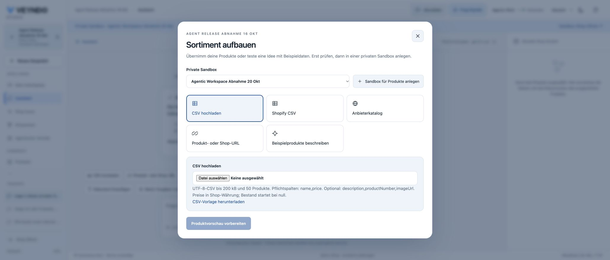
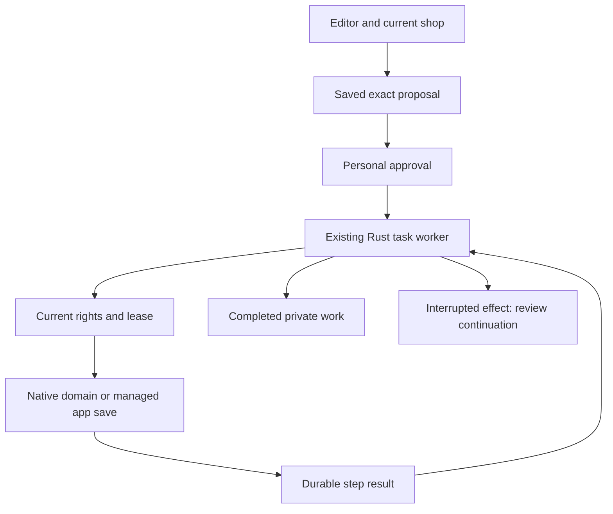
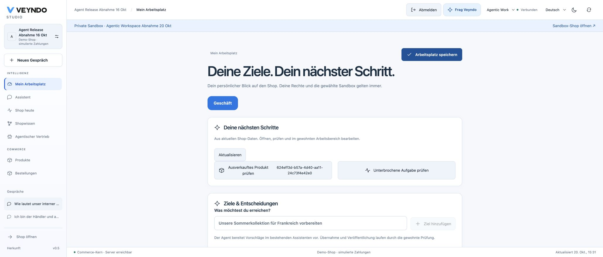

# A connected AI-first workspace

The merchant agent now carries the current editor into a conversation, discovers
installed apps by relevance and prepares bounded work that the merchant can
review. App Studio, graphical editors, native operations and private previews
continue to own the actual data. This guide follows the original 20 October
workspace and the publicly accepted collection/catalogue extensions through
22 October; [current status](status.md) records each deployed journey.

Prepare missing translations and images in the
[catalogue-preparation grid](product-management.md#preparing-a-catalogue-together),
check an app's connections in App Studio and try a saved private change with the
[customer simulator](customer-scenarios.md). These entry points use the same
native editors, current rights and selected publication path.

## 1. Start from the work you are doing

Open a product, order or customer and choose **Ask Veyndo / Frag Veyndo**. The
composer shows the originating view and selected ID. Shop, private environment,
language and channel come from the authenticated request. Selection is a hint,
not permission to read that object. Changing account or environment fences old
responses and retry keys include the selected context.

The conversation offers the existing CSV import, source-shop URL and AI demo
catalogue entry points. **Add a document / Dokument hinzufügen** opens the same
private source editor used in Shop knowledge, including its PDF/text upload.
Design screenshots and reference URLs use **Shape shop → Agent** and the existing
image/reference intake. Product pictures use the catalogue's media intake; a
PDF upload is not silently treated as a design image.

Installed apps are no longer selected only by alphabetical position. The agent
can search all admitted packages with `merchant.apps.search`, follow its cursor
and read an explicitly discovered model with `merchant.apps.read`. Search returns
bounded metadata and schemas; data reads retain the app's current domain rights,
MCP opt-out and knowledge declarations. Managed save metadata is reviewable,
never executed by a read tool. App records use the existing shared storage.

## 2. Approve a real sequence of work

In a **private workspace**, ask for a small catalogue, category, Flow or managed
app-data change. For example:

> Create two categories, Care Instructions and Material Guide, in English and
> German in this private workspace. Prepare both for review; publish nothing. /
> Lege zwei Kategorien, Pflegehinweise und Materialwissen, auf Englisch und
> Deutsch in dieser privaten Umgebung an. Bereite beide zur Freigabe vor;
> veröffentliche nichts.

The saved proposal lists every operation and its exact arguments. Category plans use
the canonical native input contract and current configured language checks before
they can be reviewed; an invalid model object does not become approved work. One approval
by the original personal actor queues that exact sequence in the existing Rust
agent worker. Progress shows completed actions and survives reopening the conversation.
Current task identity fences delayed responses from an older run. There is no second queue or
model-controlled SQL/shell executor.

Supported configuration operations are product/category creation and revision-bound
editing, `automation.save`, and admitted managed app saves. Plans have at most
12 steps; creates require stable IDs and edits require native revisions. Work
cannot publish a sandbox, configure live data, call arbitrary services or make a
payment through this path. Existing payment, order, import and release workflows
retain their own explicit native admission. Dedicated budgeted planning keys keep
their read-only scope.

**21 October collection extension, publicly accepted:** reviewed work can also prepare translation
drafts for exact selected product IDs, including products created earlier in the
same plan. The existing translation worker retains original task authority and
returns a real job link. The parent waits for ready drafts, stops on child failure
and resumes only after explicit continuation. Draft review/apply and selected
publication remain separate. See [the delivery tracker](connected-merchant-followups.md)
for the actual source and [public collection acceptance](evidence/release-history-through-2026-10-21.md#21-october-connected-collection-preparation-runs-publicly).
The workspace screenshots above retain their 20 October capture date.

Managed app writes and their step receipts commit in one PostgreSQL transaction.
A killed worker cannot leave an app write without its completion receipt. Native
domain commands retain their own transaction and stable-ID/CAS checks; a crash
between that commit and its receipt is uncertain and is never blindly retried.
Explicit continuation reuses completed receipts. Cancellation and current authority
are checked before each next step; a cancelled task cannot start another one.
An already admitted native command may finish after cancellation; its matching
admission token records the completed step without reviving the task. A late
completion after lease expiry likewise records its outcome without renewing the
expired lease. Admission and domain calls do not hold nested connections, including
when PostgreSQL is reached through a one-backend transaction pool.
Partial completed work is visible; execution is not one all-or-nothing transaction.

## 3. Generate and test a complete native app

In App Studio's assistant choose:

- **Improve the current app / Bestehende App verbessern** for bounded edits.
- **Extend the complete app / Die ganze App erweitern** for a coherent proposal
  adding models, fields, settings, native controls and surfaces together.

A useful instruction is: “Add a private care-note library, a region setting, a
list and a form with validated saving. Preserve the existing product editor.”
The result is an immutable version, shown as a comparison before adoption.
Existing field kinds, core references, data visibility, handlers, settings and
accepted workflows remain protected. New setting declarations do not contain
credentials. The same canonical Manifest validation gates visual edits and
imported Codex/Claude Code results.

**Test this version privately / Diese Version privat ausprobieren** starts that
proposal in the existing actor-private native preview before adoption. Select a
surface, save a record, reload it and exercise validation. Installation diagnostics
can be returned to the same composer to prepare a repaired proposal. The existing
version comparison, staging and selected-publication controls remain separate.
An old proposal cannot replace a manually changed draft. If native validation
rejects a generated candidate, the server asks the same provider for one bounded
repair with that error and the original manifest. The repaired candidate must pass
the same checks; a conflict, denied permission or provider failure is not retried.
The versioned prompt and rendered context have provenance in inference evidence.

The public acceptance generated a care-note library with its own multilingual
records, a region setting and a private Studio entry. The installed app saved
English and German content on the same record. Selected publication moved only
the package into the synthetic live shop; its private records stayed private.
The central Apps panel then saved `region = EU`, retained after a full reload.
Installed settings belong to the live app owner and are not copied from sandboxes.

Immediate preview runs declarative native apps. Event-driven services, schedules
and payments use reviewed staging and their existing service owners. Export/import
for coding agents is a real reviewed artifact workflow; it does not execute arbitrary
Rust/TypeScript source or start an external coding agent automatically.

## 4. Move between language and real editors

“Show open orders for Synthetic Alex” can produce a reviewed native grid view.
**Open editable list / Bearbeitbare Liste öffnen** applies those criteria to the
usual server-backed order grid. Filters remain editable by hand. Product and
customer views use the same path, with current catalogue/customer/PII rights.
The list opens only on a click and performs no commerce mutation.

Personal search terms remain in a short-lived in-memory handoff; pinned saved
views retain their existing safe-criteria projection. Shop/account transitions
clear handoffs. Unknown identity fields and SQL are rejected by the native grid
schema, and app filters use their normal per-field admission.

Flow and shop/app design proposals keep using their existing graphical editors,
canonical state, undo/history, private review and selected publication. An agent
proposal does not replace those editors with a separate generated interface.

## 5. Work from current facts and remember explicit preferences

The personal workspace shows a bounded selection of actual work: sold-out products,
the actor's failed/uncertain runs, prepared translations and failed jobs of active
apps. Each opens its native owner. Resolved stock work disappears on refresh;
users without a domain's right receive neither its IDs nor its counts. This is a
sample of current work, not a forecast or a complete business-health score.

Choose **Remember my instructions / Meine Vorgaben merken** to save explicit
shop-wide preferences as a private `guidance` source. For example:

> Use a calm, precise brand voice. Do not assert environmental certifications
> without evidence. / Verwende einen ruhigen, präzisen Ton. Behaupte keine
> Umweltzertifizierungen ohne Nachweis.

The next merchant task receives bounded current guidance with source ID, hash and
revision, even when the task uses different search words.

 Source history, editing
and archiving use the ordinary knowledge owner. Archive to withdraw a preference;
changed/withdrawn sources invalidate an in-flight saved evidence snapshot. Guidance
cannot be published to shoppers and never grants permissions or bypasses approval.
Only a personal merchant decision can create guidance; external documents are
never silently promoted into this category.

## Verification and extension

[The acceptance record](evidence/agentic-workspace-2026-10-20.md) records the native
HTTP/PostgreSQL, worker interruption and UI checks alongside dated public browser
results. Provider fixtures exercise the
real adapters without paid calls; they are not evidence of a live model's reasoning.
See [saved runs](durable-agent-runs.md), [App Studio](app-studio.md),
[knowledge](knowledge-workspace.md), [grids](agentic-grids.md) and
[visual shop editing](personal-workspace-and-shop-design.md) for the owning contracts.
