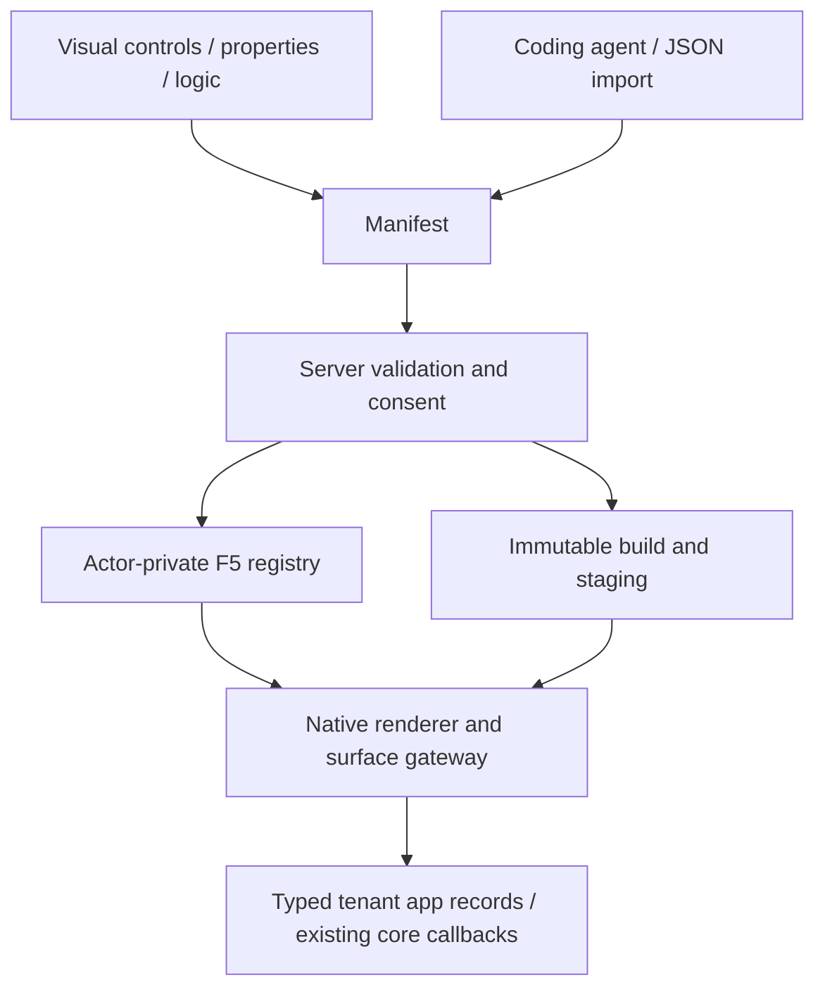

# Visual App Studio

First-app AI preparation uses typed native field constraints for lengths, numeric
bounds and item counts. Required flags and status choices remain their own field
properties. The versioned `app-brief@2` contract constrains provider output before
the ordinary native Manifest checks; it does not bypass validation or change the
existing-app editing and advanced package-import contracts.

See the [connected AI workspace](agentic-workspace.md) for the 20 October context,
reviewed private execution, complete app composition, real preview, editable list
handoff and remembered merchant-guidance workflow. [Current status](status.md).

**12 October workbench update:** editable app patterns, explicit AI/agent proposal review, native control generation, approved catalogue translation jobs and scoped personalization. [How to use it, ownership and verification boundaries](connected-workbench.md).

App Studio and coding agents edit one Manifest. The same renderer, action gateway,
permissions and model schema power private previews and published apps. Open Studio
→ **Developers**; choose a guided app type or click an existing app's **Edit** card.

**Start building:** [five illustrated workshops](app-tutorials/README.md) take you
from a working pattern or assistant to product advice, private returns, customer
fields, scheduled flows and an ERP service contract. They include current English
screenshots, practical tests, agent prompts and the shared version/release loop.

**Connected business pattern:** [configurable furniture](furniture-configurator.md) joins material records, dimensions, bounded surcharge rules, native company approval and saved-input reorder. Its local integration evidence and outstanding hosted checks are explicit.

## Start from a description

Open **Developers → New app**, name the app and describe the information, people
and next steps. **Try a consultation app** fills an editable example with product
requests, a design upload, review status and a responsible-team setting. **Prepare
with AI** starts an ordinary private draft and opens the shared agent. If the shop
has no sandbox yet, the same action creates its first private stage.

For an empty private app, the model describes data, setting declarations and
registered admin placements. The host connects the corresponding lists, forms and
validated save buttons in the existing Manifest. Review the proposal, open the
private preview, select a real test product and exercise the upload and saved
record before publication. Continue editing any generated control in Design.

Installation settings are declared in **App settings**; configure their values
under **Apps → the installed app** after publishing. Product-bound uploads remain
private. Package-only release leaves test records in their private environment.
Restoring an earlier interface creates a new immutable version and preserves
compatible current records. [Observed complete local journey](evidence/guided-app-2026-10-29.md).

## The development loop

1. Choose a frontend/admin/combined/payment/shipping/integration/event/cron app
   assistant. It creates normal entities, actions and surfaces, not a hidden blueprint.
2. In **Design**, use a 12-column form raster. Drag controls from the toolbox, snap
   positions, resize by handles, use Ctrl/Command for multi-selection and align or
   distribute selected controls. Narrow screens render the same layout as a stack.
3. Press **F4** for properties: translated caption/tooltip, geometry, visibility,
   enablement, tab order, model/field/context binding. Geometry properties can be
   sorted alphabetically or by their defined category. Tab-order mode assigns order
   by clicking controls. An optional Classic appearance affects the designer only.
4. Double-click an input/button for **code-behind**. Visual instructions, BASIC and
   typed JSON edit the same bounded AST. Completion buttons insert current actions,
   form validation and refresh targets. Calls still need the surface allowlist.
5. In **Data models**, add rich field types and validation. The relationship diagram
   accepts dragging a field onto a target model. **Create workspace from model**
   adds a grid, linked record form and a validated save button.
6. Press **F5** for a private one-hour preview. It creates actual actor-private logical app
   models/records through the existing registry. Changes hot-reload after validation.
   No saving/staging/publishing is required to try a draft. Preview services cannot
   send external events, place orders or execute live payment/provider actions.
7. Use the debugger to pause before instructions or at a numbered step, continue,
   stop and inspect bounded operation metadata. It does not log customer records or
   credentials. This debugger controls UI instructions, not a remote process.
8. Save an immutable semantic version, use **Check before installing** to inspect its migration against the selected stage, review and install it in staging, then release
   the selected app package. App records require their own explicit release selection.

Server drafts autosave after 500 ms with optimistic revisions. They are private to
the actor and shop, restored before edits and bounded to twenty drafts/user and
64 KiB/draft. Unsaved or failed saves retain a before-unload warning. Ctrl/Command+Z
uses manifest undo/redo; F4/F5 use the same controls as the toolbar. Immutable saved
versions and recoverable App Studio trash are separate from autosaved drafts.


These 8 October captures use the actual browser, Rust gateway and isolated
PostgreSQL instance; see [capture provenance](assets/feature-tour/README.md).

## Controls and behavior

Text, TextBox, ComboBox, CheckBox, DatePicker, Button, table/cards/form, Image,
Frame/Tabs, KPI and Chart are host-native controls. Tables can enable inline record
editing with real optimistic revisions. Image/file fields use the searchable asset
picker and private preview; uploads are available in product-bound editors.
Timers are persistent UTC **Schedules**, not uncontrolled browser loops.

The AST has `Set`, typed `If`, `Call`, translated `MsgBox`, `Navigate`, `Refresh`
and `Validate`. It is loop-free, bounded in depth/count and independently validated
by Rust against current blocks/actions/model fields. It is not JavaScript `eval`,
VBA or an unrestricted scripting language. BASIC source is a convenient encoding of
that AST; structured object expressions use the visual/JSON editor.

```vb
Validate guide_form
Call save_guides(guide_form.Record)
guide_grid.Refresh
MsgBox {"en":"Saved","de":"Gespeichert","fr":"Enregistré","es":"Guardado"}
```

The **Menus & surfaces** editor reuses views in Studio navigation or existing
product/customer/order editors. Each mount has one translated label, its team
permission and explicit allowed actions. Public mounts allow only public reads.

**Server modules** edits typed WIT component source and the four commerce hooks.
Components read bounded immutable cart/product/app-record snapshots, with no network
or SQL imports. Source must implement the published ABI; invalid components fail
before installation. The snapshot-pricing example provides executable source.
The browser does not compile arbitrary PHP/Rust, deploy an external service or launch
Codex/Claude shell commands. Those use the existing external app/development task path.

## Shared contract and translation



The dynamic generation schema is `fixtures/app-studio-schema.json`, exposed by
`GET /api/developer/schema` and MCP `developer.task`. Rust specializes text maps
using every enabled shop language. One selected content language edits captions,
fields, menus and messages; missing translations inherit the shop main language.
OpenAI strict fixed-object wire schemas encode dynamic JSON as a string, restore
it on the server and then run domain validation; Claude/local adapters preserve
native JSON. This adaptation does not bypass the shared manifest contract.

**Improve the current app** uses bounded JSON Patch against the current Manifest.
**Extend the complete app** instead prepares a coherent new immutable version,
including new models, settings and native views together while preserving the
existing contracts. Identity and version stay host-controlled; native validation,
access preservation and proposal review still run before staging. Patch values are
JSON-encoded only on the model wire. No-op, unauthorized and conflicting edits are
rejected. If a generated candidate fails native validation, the same provider may
make **one bounded repair** with the exact error and original Manifest, under the
same quota/lease. The result must pass the same admission; this is not an open
repair loop. Prompt `app-generation@4` and rendered-context provenance identify it.

Use **Test this version privately** to try the proposed immutable build in the
actor-private native runtime before adoption. The [connected workspace guide](agentic-workspace.md#3-generate-and-test-a-complete-native-app)
records the configured-model care-note example, real multilingual record writes,
selected package-only publication and central settings after reload. Existing
[workbench test boundaries](connected-workbench.md) retain their dated scope.
The assistant can add a missing native order/quote review workflow; proposal
review displays its steps, conditions and additional rights. Existing workflows
remain protected from AI patches. See [native app workflows](app-native-lifecycles.md)
for deliberate version changes, consent and the connected verification boundary.

An extra input for an existing record joins its form's local buffer only when
the model and record ID identify exactly one form. Saving still uses that form's
validated action and record revision. Two possible forms, different models or
records, and protected core-reference fields never create an implicit binding.

For Codex or Claude Code, export a credential-free development task with the current
Manifest, schema, guides and MCP bridge configuration. Import the result, review
permission additions and stage it through the same operations.

## Limits and tests

Sixteen views, 32 blocks/view, twelve models, sixteen fields/model and 24 actions/
routes keep previews and parsing bounded. Per-app storage has database-enforced
row/byte quotas; file quotas remain with the existing product asset owner.
Schema migrations are explicit and atomic; larger/relation changes are offline.
[Full platform and trust boundaries](app-platform.md), [security](app-security.md).

Frontend regressions exercise real designer edits, undo, private autosave/conflicts,
AST calls/validation, read-only surfaces and pinned UI loading. Registered
`app_studio`, `app_preview`, `app_callbacks`, `app_schema`, `app_assets`, `app_jobs`,
`app_components`, `app_distribution` and existing staging/payment suites exercise
actual Rust/PostgreSQL paths. Browser rendering and SQL/asynchronous adapters are
not covered by the extracted Lean proofs.

### Map app data into the knowledge graph

In **Connections → Knowledge graph mapping**, first enable AI access for a model
with a native list action. Choose the selected fields and an app-owned node type.
For product/customer/order or app-record references, optionally choose an app-owned
relationship type. The label uses the same content-language selector and inheritance
as all app fields. The coding agent edits this same `intelligence.ontology` manifest.

The [care knowledge example](../extensions/apps/ontology-care/README.md) demonstrates
current records through API, MCP and authorized planner context. This projection
retains native record revisions and tenant rights; it does not turn app text into
confirmed public product claims. Deleting or renaming a draft model updates mappings;
removing a field drops its mapping without silently exposing another field.

## Native POS surfaces

POS channels expose `admin.pos.catalog`, `admin.pos.cart` and `admin.pos.receipt`
through the same visual designer and coding-agent Manifest. These are private
merchant surfaces requiring `pos.use`; catalog/cart receive `salesChannelId`,
and receipts receive `orderId`. Existing app record scopes, explicit install
consent and native order references remain authoritative. Service apps may
subscribe to projected `pos.sale_created` / `pos.sale_completed` events.
[Register setup, full commerce call path and limits](pos.md).

## Modular B2B and EDI — 12 October 2026

Native company units, current employee rights, private catalogs, currency-bound
budgets, separate approval, RFQ negotiation, quick order and repeat lists reuse
the existing checkout, inventory, order, document and Flow owners. The Studio and
customer account use the same API/MCP contracts. [Setup, source owners and precise
B2B comparison](b2b-commerce.md). The independent `extensions/apps/edi/` package owns
bounded EDIFACT/UBL/cXML parsing, mapped private requisition import and immutable
native document export; no Core codec or second ledger. [EDI profiles, deployment
and network/certification limits](edi.md).

## Current concept and implementation status

The [app-system status](app-system-status.md) distinguishes the working visual/agent
builder from the complete business-capability programme. Immutable development
"builds" validate and store a Manifest; they do not compile arbitrary Rust/TypeScript
source in an isolated build service. Frozen decision examples are synthetic cases,
not historical order replay.

## Connected App Studio workbench

See the [illustrated workbench guide](app-studio-workspace.md) for multiple placements, compact adjustable panels, the contextual AI drawer, model-backed form editing, shared Flow visuals, installed app settings and scoped integration keys. These extend the existing native Manifest, runtime and release owners.

## Add fields to native shop objects

In **Data models → Extend a shop object**, select Product, Customer, Order or Company. The same versioned model then supplies private native detail fields and optional directory columns. Read [core object extensions](app-core-extensions.md) for current rights, exact indexed filters, agent context and the separation of configuration from live customer/order data.
