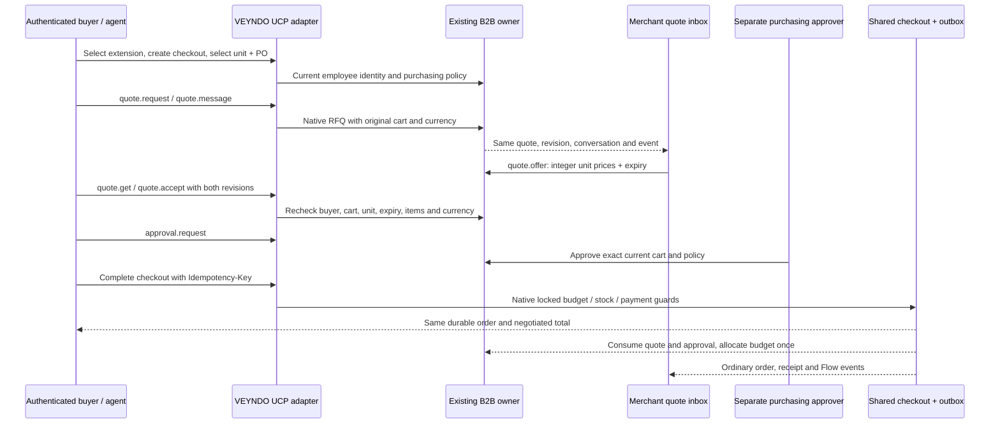

# B2B negotiations through UCP

A buying agent can request an offer, exchange counterproposal messages, inspect a
merchant's revised prices, accept that offer and request purchasing approval on a
UCP checkout. VEYNDO's **existing** B2B quote, budget, tax, stock, payment and order
owners execute the work. Studio's existing quote inbox shows the same RFQ; no second
negotiation database or agent-only pricing engine exists.

## What is standard and what is VEYNDO

[UCP 2026-08-25](https://ucp.dev/2026-08-25/specification/overview/)
standardizes discovery, capability/version negotiation and extension composition.
That capability negotiation selects compatible software contracts; it does not
itself negotiate a product's price. Commercial negotiation has been discussed in
[the upstream proposal](https://github.com/Universal-Commerce-Protocol/ucp/discussions/502),
but VEYNDO does **not** claim to implement a ratified `dev.ucp.*` negotiation capability.

Our discoverable extension is **`ai.veyndo.app.shopping.b2b_negotiation`**, version
**`2026-10-13`**, extending **`dev.ucp.shopping.checkout`**, version **`2026-08-25`**.
The schema is served from the corresponding namespace authority:
`https://app.veyndo.ai/ucp/2026-10-13/b2b-negotiation.json`.
Its `$defs["dev.ucp.shopping.checkout"]` composes with the official checkout schema
using `allOf`. This is a selected VEYNDO UCP adapter, not whole-protocol certification.
The immutable, secret-free schema has a precise public route; its admission exception
does not include checkout sessions, future schemas or B2B commands.
Shipping/payment terms still use native checkout selection; delivery contracts,
credit agreements, autonomous price bargaining and AP2 mandates are not added here.



## Setup and discovery

Configure a company, purchasing unit and existing customer employees in Studio.
Give the buyer `buy` and `quotes`, and another employee `approve` if policy requires
approval. The merchant uses `b2b.manage`; reading the merchant quote inbox additionally
requires `customers.pii`. [Full B2B setup](b2b-commerce.md).

Read `GET /.well-known/ucp` in the intended tenant/channel context. The checkout
endpoint uses the configured Studio origin, retaining its tenant query; it no longer
advertises localhost in hosted deployments. Calls retain native `x-tenant`,
`sw-sales-channel-id`, `x-customer-token` and `sw-context-token` boundaries.
A cart token or platform profile alone never signs in a company employee.

Two explicit opt-in transports are supported:

- **UCP profile:** `UCP-Agent: profile="https://agent.example/profile.json"`.
  The profile must advertise the exact checkout and extension versions, extension
  parent and published schema URL. Profiles are read over the shared public HTTPS
  transport: pinned public DNS, no private addresses, proxies, redirects or forwarded
  merchant/customer credentials; five-second request timeout and 32 KiB body limit.
  Missing parent/protocol compatibility fails; unsupported vendor versions cannot
  invoke B2B commands. There is no persistent platform-profile cache.
- **Pre-negotiated VEYNDO client:** `x-veyndo-ucp-b2b-version: 2026-10-13`.
  This vendor-specific shortcut explicitly selects the known published contract.
  It is useful for direct clients and offline/local integration tests; it is **not**
  a replacement for UCP's interoperable platform-profile advertisement. Supplying
  both headers is rejected. Existing clients with neither retain the checkout slice
  and receive no negotiation capability or extension fields.

Example platform profile fragment:

```json
{
  "ucp": {
    "version": "2026-08-25",
    "capabilities": {
      "dev.ucp.shopping.checkout": [{"version": "2026-08-25"}],
      "ai.veyndo.app.shopping.b2b_negotiation": [{
        "version": "2026-10-13",
        "extends": ["dev.ucp.shopping.checkout"],
        "schema": "https://app.veyndo.ai/ucp/2026-10-13/b2b-negotiation.json"
      }]
    }
  }
}
```

The fragment illustrates the adapter's selection inputs; supply a complete platform
profile for other UCP implementations. The adapter supports this pinned protocol
release rather than negotiating arbitrary older/future protocol versions.

## Real commands, not another workflow engine

First create `POST /ucp/v1/checkout-sessions` with native UCP `line_items`, `currency`
and `buyer`, retaining the returned `context_token` and checkout `id`. A current
customer token binds the cart to that customer at creation.

Every buyer operation uses:

`POST /ucp/v1/checkout-sessions/{checkoutId}/b2b/{operation}`

| Operation | Native arguments and outcome |
| --- | --- |
| `contexts` | `{}` — currently admitted company units |
| `select` | `unitId`, `purchaseOrder`, `revision` — native company/cart selection |
| `quote.request` | Current cart `revision`, `message` — new RFQ |
| `quote.current` | `{}` — at most 20 current-cart RFQs, newest first |
| `quote.get` | Quote `id` — one RFQ belonging to this buyer, unit and original cart |
| `quote.message` | Quote `id`, current quote `revision`, `message` — buyer counterproposal |
| `quote.reject` | Quote `id`, current quote `revision`, optional `message` |
| `quote.accept` | Quote `id`, quote `revision`, `cartRevision` — bind the offered prices |
| `quote.release` | Current `cartRevision` — release the accepted offer |
| `approval.request` | Current cart `revision` — native purchasing approval request |
| `checkout.handoff` | Current cart `revision` only — existing ten-minute single-use native checkout transfer |

The response is the same checkout plus `b2b_negotiation`: `checkout_revision`,
`purchasing`, current-cart `quotes`, optional `quote_limit` and the native command
`result`. The native RFQ uses `grossMinor` **per unit**, with the unit's currency scale;
UCP totals use the existing calculator's final currency amounts. VAT is not computed
again in the protocol adapter. Final order prices remain their immutable checkout
snapshot; terminal response purchasing metadata describes current company policy.

The merchant revises prices through the existing command:

```http
POST /api/b2b/quote.offer
Authorization: Bearer <current merchant credential>
```

```json
{
  "id": "<rfq-id>",
  "revision": 2,
  "message": "EUR 50 gross per lamp, warranty as agreed.",
  "data": {
    "lines": [{"id": "lamp", "quantity": 2, "grossMinor": 5000}],
    "validUntil": "2026-11-01T12:00:00Z"
  }
}
```

Use a future expiry within one year. Each counterproposal or offer increments the
same RFQ revision. A different authorized approver uses the existing
`/store-api/b2b/approval.decide` or matching MCP command. The buyer UCP route
cannot issue merchant offers, change company grants or approve its own purchase.

Complete through `POST /ucp/v1/checkout-sessions/{id}/complete` with
`Idempotency-Key`. The native locked transaction rechecks current budget, approval,
policy, catalog, tax, stock and payment methods. Approval/budget problems are exposed
as `requires_escalation` with stable `b2b_approval_required` / `b2b_budget_exceeded`
message codes. Readiness is informational, not a stock/budget reservation or a promise
that a later concurrent purchase will succeed. Canonical continuation/order links
preserve the tenant and channel. To transfer the actual cart to a person, explicitly
request `checkout.handoff` and open its returned `continue_url`. The secret remains
in the URL fragment; consumption requires the same customer and rotates the cart
token. Generic GET continuation links are navigation only and carry no cart/session
credential. A handoff is not purchase approval or payment evidence.

## API, MCP, apps, events, history and staging

`b2b.quote.get` and `b2b.quote.current` are also registered native Store API/MCP
commands. The UCP adapter calls those same domain operations; app and Flow event
delivery retains existing consent, scope and PII projections. Standard
`b2b.quote_requested`, `b2b.quote_changed`, `b2b.quote_selected` and
`b2b.purchase_completed` events use the existing transactional outbox. Studio's
quote conversation and native history show those same versions and actors.

Company/unit configuration can be privately staged and selectively published.
RFQs, conversations, approvals and spent budgets are live operational records;
they cannot be cloned/released or rolled back as configuration. No app files move
into core directories. Native B2B is core; protocol adapters live in `src/ucp/`.

## Verification and boundaries

`python3 scripts/verify_integration.py --only protocols b2b b2b_ucp tenant_isolation`
uses a disposable real PostgreSQL database. The B2B/UCP test executes discovery,
version denial, private-profile target denial, employee selection, RFQ messages,
merchant counteroffer, stale revisions, foreign buyer/tenant/original-cart denial,
separate approval, native total parity, an idempotent simulated order, inventory
movement, terminal quote and immediate membership revocation. Existing B2B tests
cover budget contention, catalog restrictions, history and staging.

Rust tests cover profile parsing/intersection and operation/readiness decisions.
No actual charge or autonomous LLM negotiation is claimed by those tests. Real
external agent profile hosts and production payment credentials require separate
acceptance; simulated checkout does not prove payment-provider settlement.
