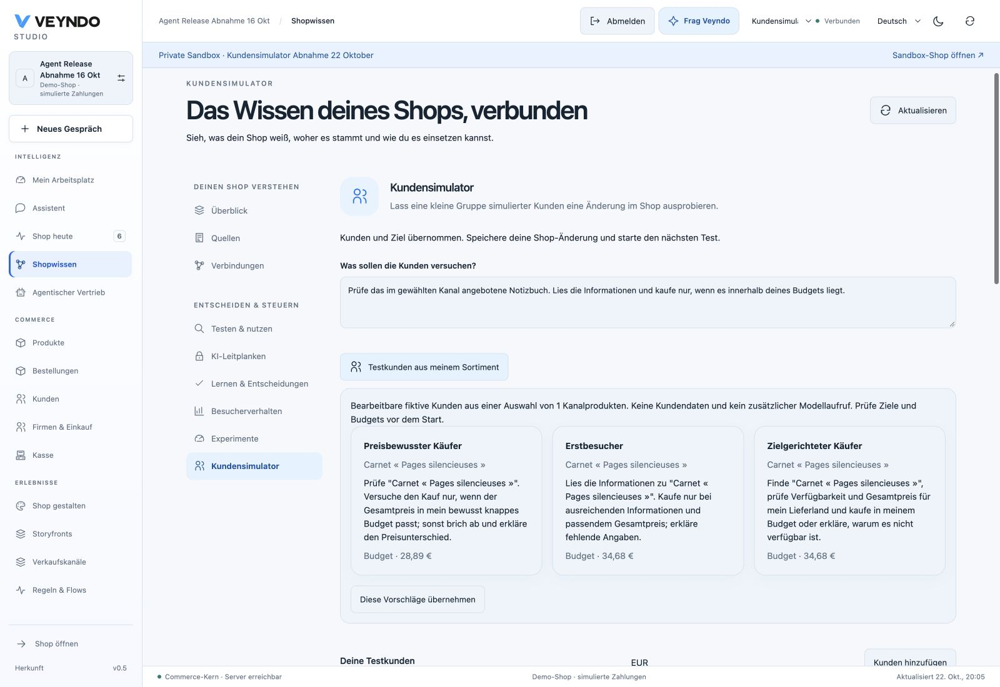
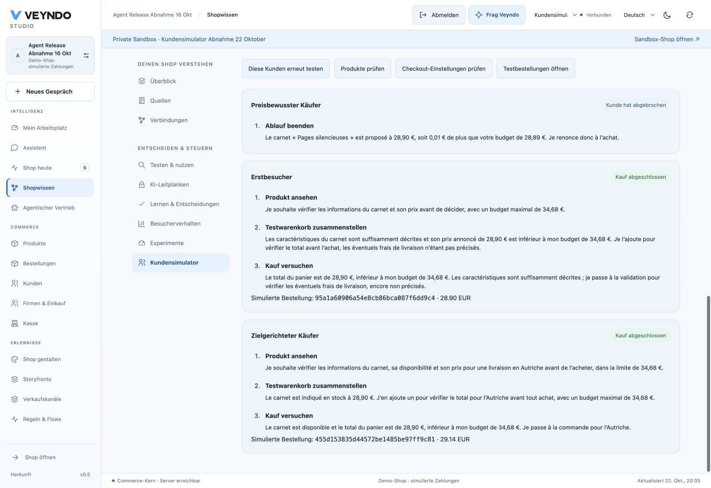

# Customer scenario simulator

Test a private shop change with a small group of fictional customers. Give them a
shopping goal, adjust their budgets and languages, and inspect what actually
happens in native search, the basket and simulated checkout.

## Try it

1. Open a **private sandbox** and save the product, rule, app or channel changes
   you want to test. The live shop remains outside the simulation.
2. Open **Shop knowledge → Customer simulator**. You can also enter from **Shop
   design**, the current App Studio sandbox, or a migration's private target.
3. Describe a concrete goal, for example: “Find a desk lamp, read its product
   information and buy only if the final price fits your budget.”
4. Choose **Test customers from my catalogue**, review the three suggestions and
   adopt them, or edit the initial profiles manually. Keep one to six customers;
   their names, goals and budgets remain editable. Languages, countries and currency
   come from the selected shop channel.
5. Start the test. Up to two customers progress concurrently. Each gets its own
   native basket, bounded model calls and a saved action journal.
6. Inspect the results. A purchase has a real **private, simulated order ID** and
   native total. A failed budget, stock or shipping check has an observed error.
   The customer's explanation is shown separately from that native result.
7. Open products, checkout settings or test orders directly to investigate. Choose
   **Use these customers again**, save the intended change and repeat. Compare the
   two saved runs without manually re-entering the profiles.

The model receives the current channel's bounded catalogue sample and can search
for more products. Profiles are fictional test instructions, not inferred people
or a claim about the shop's actual customer demographics. No real customer data
is needed. You may use any enabled content language for a profile; the workbench
controls are available in English, German, French and Spanish.

## Start from the selected catalogue

Choose **Test customers from my catalogue** to review three editable suggestions
before adopting them. They use a bounded sample of up to twelve visible products
from the selected private channel, with the native localized names, stock and
minor-unit prices. This is not a claim that the sample represents a large catalogue
or actual customer demographics. An empty sample keeps manual profile editing available.

- A price-conscious customer deliberately has one minor unit less than the sampled
  product price, with a minimum budget of one minor unit, to exercise the native
  budget guard where the product price permits it.
- A first-time visitor checks product information and has a suggested 20% price
  allowance. A second enabled content language is selected when available.
- A focused buyer checks the highest sampled price point and a second enabled
  destination when available. Out-of-stock products stay testable.

Review the names, goals, budgets and countries, then choose **Use these suggestions**.
Your overall task stays unchanged; adopting profiles does not start a run or replace
saved results. All profile fields remain editable before **Let customers test**.

The suggestion preview uses no customer records and makes no additional model call.
Studio may stay in your interface language even when the chosen channel serves a
different language. Profiles use only that channel's enabled shopper languages;
its type, activation and ordinary native shopper admission still apply.
The existing AI shopper tasks make their own bounded decisions only after explicit
start; actual checkout totals, shipping, tax, availability and exact budget enforcement
remain native. A suggested 20% allowance is not a calculated delivery quote.

A channel switch discards the previous channel's sample and edited draft. If the
shop main language is excluded from this channel, profiles use an enabled channel
language. Currency scales of zero, two and three digits keep their native minor units.
The same sample is available through HTTP and MCP `merchant.scenario.list` under
the existing private-sandbox and catalogue/order rights.

In the public 22 October acceptance, a German Studio prepared a French-only
notebook channel. The EUR 28.89 profile declined the EUR 28.90 notebook; the two
EUR 34.68 profiles completed native simulated orders for Germany (EUR 28.90) and
Austria (EUR 29.14). Reload retained both orders and their journals; **Use these
customers again** restored the exact original task and profiles without starting
another purchase. [Exact deployment and browser evidence](evidence/customer-scenarios-2026-10-22.md#public-catalogue-profile-acceptance).

## What a comparison means

Matching goals, profiles, inference selection, channel and currency are identified
by a shared comparison digest. Each customer also records its starting observed
catalogue, settings/revision and installed app/rule/flow/promotion/channel version
stamp. Pending snapshots remain pending; they are not reported as shop changes.

A changed snapshot is a useful diagnostic, **not a controlled experiment**. These
are sequential runs in a working private shop. Earlier test orders consume private
stock, other sandbox edits may occur, and model output may vary. Use equivalent
starting conditions when comparing a change and read the individual actions.
There is no conversion forecast or causal revenue estimate.

This version exercises the **native commerce API**. It does not render the shop,
judge a screenshot, click a mobile UI or run an authenticated company-buyer journey.
A design change still needs browser testing. The simulator can already find native
catalogue, price, stock, country/shipping and purchase failures beneath that design.

## Resume and control

Runs reuse Veyndo's durable agent tasks and inference accounting. Leaving Studio
or reloading does not restart a customer. Choose the saved test to inspect it again.
An interrupted or uncertain model call requires explicit continuation. A confirmed
order is recovered after a lost response instead of purchasing a second time.

Each customer has at most eight actions. Stop an individual run in its result card;
the shop's existing emergency stop and identity revocation apply to all runs.
Stopping prevents subsequent mutations, including a checkout waiting on a database
lock. It does not silently undo an already completed private order.

The native engine checks the exact total against the budget. Model input carries
an explicit decimal amount and currency so that 100 cents is presented as EUR 1.00.
Even an incorrect model decision cannot authorize spending above the profile limit.

## Apps, migration and publication

The scenario uses the **currently installed apps in the selected sandbox** through
normal native commerce operations. Install a saved app version there before testing;
opening a test does not activate an old build. App-owned code stays in its package.

Migration opens the same simulator for its authorized private target and channel.
Imported products and configured rules therefore use the same cart and checkout
owners as other products. Publication remains a separate, selected staging review.
A successful customer test never grants publication rights or publishes a package.

See [App Studio](app-studio.md), [migration](agentic-migration.md),
[shop design](personal-workspace-and-shop-design.md) and
[recorded rule comparison](rule-history-comparison.md) for the adjacent workflows.

## Shared contract and isolation

| Operation | HTTP | Purpose |
| --- | --- | --- |
| `merchant.scenario.create` | `POST /api/agent/scenarios` | Idempotently enqueue one to six profiles in a private environment. |
| `merchant.scenario.list` | `GET /api/agent/scenarios` | Actor-private history and selected channel configuration. |
| `merchant.scenario.status` | `GET /api/agent/scenarios/{id}` | Current saved observations and customer task states. |

MCP and HTTP share the capability registry and handlers. Existing
`merchant.run.cancel` / `merchant.run.resume` operations control the individual
tasks using current revisions. Required rights are `assistant.use`, `catalog.read`,
`channels.read`, `environments.manage`, `orders.read`, `orders.write` and
`knowledge.read`. App principals cannot start these merchant simulations.

The server rejects live shops and personal read-only previews, verifies sandbox
membership, current original scopes and the owning agent identity, and keeps reports
actor-private. Model tools are a closed shopper action set: search, detail, add,
checkout and finish. Merchant mutations, arbitrary URLs and credentials are absent.
The existing stage restrictions prohibit real payment/provider egress. Reports and
prompts never contain cart capabilities or provider credentials.

`src/agent_runs/scenarios/` owns only the cohort and shopper adapter. Native commerce
owns calculations, inventory, legal acknowledgement, idempotent orders and app
hooks. PostgreSQL `tasks`, the existing checkpoints, quotas and worker leases own
execution; there is no new queue, table per app, payment implementation or Python
production worker. The prompt is registered as `customer-scenario@1` with its hash.

## Verification

Local regression uses the actual Rust server and isolated PostgreSQL with controlled
provider responses: private admission, two concurrent customers with a two-connection
pool, exact budgets, injection rejection, multi-product baskets, stock failure and
repair, lost-response cold restart, cancellation while checkout waits on a product
lock, lease expiry while waiting on the task lock, revoked rights and emergency stop.
The same native path is also checked with separate restricted database connections.

Browser acceptance and actual-model observations are recorded separately in
[the scenario evidence](evidence/customer-scenarios-2026-10-22.md).
[Current status](status.md) remains authoritative for public delivery.
