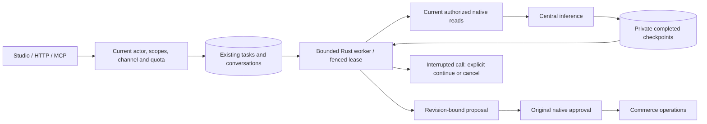

# Saved agent work: resume without losing control

Merchant conversations submit work to the existing PostgreSQL `tasks` owner.
The Rust worker prepares the same revision-bound proposal as before. Closing the
browser or losing its HTTP response does not delete the task. A proposal still
needs native approval. Planning continuation prepares a proposal; an explicitly approved private work sequence can execute its already-reviewed native steps. [Connected work guide](agentic-workspace.md).

PR 135 passed both exact-head verification runs and is publicly deployed on
15 October. A hosted read-only task completed after browser reload and reopening
its saved conversation, reporting the actual post-purchase stock (18 and 20).
The [release evidence](evidence/database-enforcement-2026-10-15.json) records this
separately from the local worker-kill test. It does not claim unrestricted autonomous goals,
general app-write checkpoints or exactly-once model billing.

## What the merchant sees

Send an instruction in Studio. The conversation and message are saved immediately;
a compact card shows queued, running, ready, stopped or uncertain progress.
Reloading the conversation restores its saved run. Completed model-step counts
report stored responses, not invented percentages or internal reasoning.

The personal workspace uses this same card after approving a saved task. Its
bounded task list retains approved work while queued, running or stopped; the
read-only `executionStarted` marker reconnects progress after a reload without
sending another approval. Original actor, tenant and current-scope checks still
filter every list result. Planning runs without a finished proposal remain in
their original conversation until ready. A
`queued` approval response is an acknowledgement, not a completed change. It
observes the original run until completion or interruption and exposes the
existing revision-checked continue/cancel actions. A status outage remains an
error with explicit refresh; it never becomes a success or another approval.

An interrupted in-flight provider call is **uncertain**: the provider may have
accepted or charged it. Veyndo does not automatically repeat that call. Continue
explicitly to permit another attempt, or cancel. Completed earlier responses are
reused. Changing account, shop, sandbox or conversation fences late UI responses.

## One native contract

| Operation | HTTP | Behavior |
| --- | --- | --- |
| `merchant.run.create` | `POST /api/agent/runs` | Save an instruction; optional `requestId` deduplicates retries. |
| `merchant.run.status` | `GET /api/agent/runs/{id}` | Safe progress and completed preview, with current original scopes. |
| `merchant.run.cancel` | `POST /api/agent/runs/{id}/cancel` | Require `approve: true` and current `revision`; fence the worker. |
| `merchant.run.resume` | `POST /api/agent/runs/{id}/resume` | Explicitly continue failed/uncertain work using the same credential kind. |

These operations use the common capability registry. Studio submits native chat
with `background: true` to the same queue. Legacy planning calls wait for a bounded
interval and retain synchronous failure responses. A pending run can outlive that
wait; no second planner is introduced.

`requestId` belongs to tenant, original human actor and authenticated agent identity (or personal identity). An identical accepted retry
returns its original task, conversation and message, including at the daily quota.
Changed input with the same ID conflicts. Only new work consumes the shared attempt
quota; explicit continuation consumes another attempt. This is not token/spend accounting.
Native create/resume admission commits the shared live-shop quota and saved work
in one system transaction after checking the actor and permissions. It never
holds a tenant transaction while waiting for a second database connection, so
one-backend transaction poolers remain supported. Rejected or rolled-back work
does not consume an attempt; admitted provider failures still do.

## Authority and operation

- Store only the credential digest, personal/integration kind and initial scope
  ceiling. Recheck current session/key, membership, shop and private-preview owner
  and expiry on continuation. Broader later grants never widen the saved run.
- Conversations and checkpoints are actor-private. Original evidence scopes apply
  to history reads and new turns. A current personal owner can stop a colleague's
  run without reading its private continuation. Proposal approval retains existing
  collaboration and current domain rights.
- Reauthorize previously read evidence before reuse. Withdrawn/changed sources or
  app context stop continuation before more inference. Model output cannot grant
  its own permissions or expected revisions.
- Revalidate the exact document chunks actually supplied to the model against their
  current tenant, revision, hash, product association, locale and text. Search/index
  readiness or changed ranking alone does not invalidate frozen evidence. An archived
  source still stops the run; omitted prompt-budget records disclose no source text.
  If withdrawal prevents checkpointing an already called provider, retain explicit
  uncertainty and no executable proposal; never automatically repeat that call.
- Migration 100 extends existing tasks/conversations under forced RLS and signed
  SQL policies. Runs are operational, never configuration releases.
- `PROCESS_ROLE=agent-worker` starts a separate Rust worker; `all` includes these
  loops. Two loops per process, one running task per tenant, twenty active/uncertain
  tasks per tenant and bounded requests/checkpoints limit execution. Existing central
  inference admission still applies. Worker-only roles expose no HTTP listener.
- Claim/checkpoint/final writes require the current unexpired lease. No SQL
  transaction stays open during a model call. A dead worker between calls can
  requeue; a pending call needs explicit review. `intelligence.run.changed` outbox
  progress contains IDs/state, never private context.

The planner supports bounded read-tool rounds and one native proposal. This is
not a general durable executor for arbitrary writes/external effects. Lean proofs
remain separate from SQL, authorization and provider integration. Purpose-separated
keys now have [planning-only identities, explicit model allocations and live-shop stop](agent-authority-controls.md). Historical business replay and general external-effect execution remain tracked work.

## Actual acceptance

`durable_agents` uses real PostgreSQL, HTTP/MCP and two Rust process roles with a
synthetic local provider. It kills the worker during inference, starts another,
checks uncertainty, resumes explicitly and proves only native approval changes
price. The disposable job and killed worker's model lease clocks are advanced to keep the test short; this
is not a measured 240-second recovery SLA.

Cases cover parallel retries, quota-bound retries, HTTP restart, tenant/same-shop
actor isolation, credential/role withdrawal, cancellation, withdrawal of a separately
discovered source and synchronous HTTP/MCP errors. Frontend tests cover late
responses, retained conversations, revision controls and send-success/refresh-failure.
Approved private work also runs through a real one-backend PgBouncer fixture.
Paused native category writes exercise cancellation and lease expiry: completed
effects retain their receipts, cancelled work cannot start step two, and explicit
continuation does not duplicate step one. A killed managed-save worker verifies
the atomic app-write/receipt boundary. The signed-runtime fixture repeats these
paths with separate restricted tenant/system logins.
No real paid provider, mail, payment or private customer data is used by these tests.

## Correcting invalid proposals

The planner supplies the current installed managed-save fields, required flags,
localization, choices and validation constraints separately from sampled app records.
Shop-page nested content/theme guidance stays with the site-builder package and is
shared with external coding-agent handoffs. App contracts contain no settings or secrets.

If native proposal admission returns invalid input (HTTP 400), the same saved run
can request **one** correction under `merchant-repair@1`. It receives the original
instruction, completed authorized reads, rejected candidate and native validation
error. It uses the same provider choice, central budget and checkpoint owner.
Every corrected proposal traverses the complete original native admission again.
Permission failures, revision conflicts and ambiguous provider effects are not
validation retries. A second invalid candidate stops the task; a failed correction
can be explicitly resumed, reusing completed model calls. Nothing is written to
commerce or app records before ordinary personal approval.

Earlier saved prompts and read-response shapes remain unchanged, so an existing
failed task can reach this correction without replaying its completed model calls.
The proposal evidence identifies the repair prompt, original provider/model/usage
and validation error. This is bounded correction, not unrestricted autonomous execution.

## Reading saved-work progress

Approval can return queued work before any changes complete. Studio reports that
the work was accepted and shows the persisted step progress; only a confirmed
applied result reports completed changes. Native operation failures are shown as
execution interruptions, separately from model failures. Explicit continuation
uses the existing saved work and retains confirmed completed steps. A late
approval response cannot update the conversation or notice in another shop.

Translation draft navigation stays inside the current Studio session and private
environment. It does not reload the page into the live shop.

## Review work prepared by a Flow

The direct Flow history uses the same native task progress and explicit continuation
as the personal workspace. A completed Flow proposal is distinct from completed
approved work: queued/running work stays visible, and only its native completion
receipt marks the operation finished. Reloading the history retains that state
without another approval. Current `automation.manage` controls approval, continuation
and cancellation; the task owner still rechecks original identity and domain rights.
Translation results open their existing editor in the selected environment. Older
immediate proposals remain reviewable without requiring a durable run endpoint.

The personal workspace loads tasks and sends approvals in the selected environment.
Its saved layout belongs to the parent shop, so changing the sandbox keeps your
arrangement while changing the actual work under review. A late response from a
previously selected environment is discarded.

The **AI proposal** action, both directly and inside a graphical pipeline, saves
its result as a ready task in the same merchant work area. Open the task, inspect
the proposed changes and approve them using your personal session. In a private
environment, approved native steps use the existing durable executor, revision
checks and replay receipts. Preparation alone never changes shop data.

The Flow retains its current owner's identity and initial permission ceiling.
Membership, private workspace access and the live shop's emergency stop are checked
before inference and again before storing its result. The task contains no invented
personal session or execution credential; approval binds the real current session.
The stop also applies to scheduled proposals in the shop's private environments.
The task records its originating Flow job. Saving the result locks that job in the
same transaction and requires an unexpired running lease. A delayed model response
cannot create a ready task after expiry or after another worker marks the job
uncertain; recovery does not silently repeat the inference.

The registered `durable_agents` test follows an actual product update through the
outbox and Flow worker, opens its task, approves it and confirms one private category
write, replay protection and unchanged live data. It also covers the graphical
pipeline, a stop before/during inference, permission withdrawal during inference,
and expired direct/pipeline jobs with and without a second recovery worker.
These are local HTTP/PostgreSQL tests with a synthetic model, not public acceptance.
Separately, [public browser acceptance on 21 October](evidence/flow-native-work-2026-10-21.md)
uses the configured OpenAI provider and original saved proposal on `09b1aa35`:
one explicitly approved private category write, revision one, completed progress
retained after reload and unchanged parent live categories.
Flow inference still follows its existing job/uncertainty handling; this connection
does not add durable model checkpoints to legacy Flow calls or turn arbitrary
accepted work into a parameterized automation automatically.
