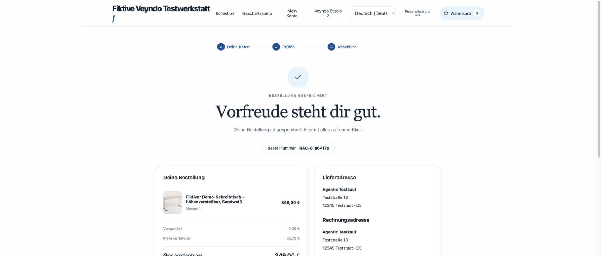
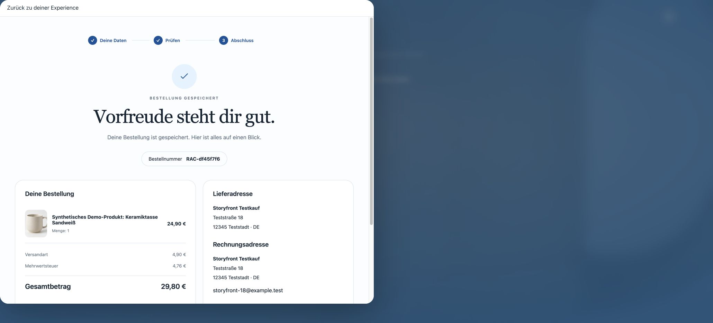
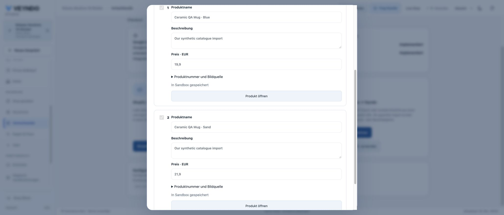
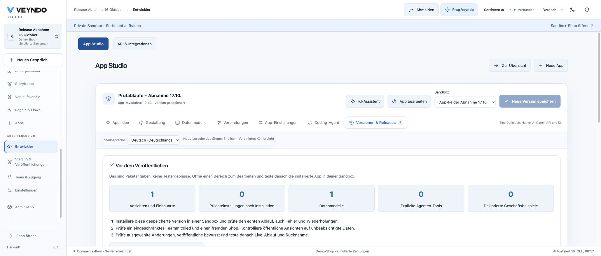

# Inward agentic commerce: public acceptance — 18 October 2026

The public Core now accepts native agent carts and prepares inward shop imports.
The following are actual public browser journeys with fictional data. This record
complements the [local acceptance](agentic-commerce-local-2026-10-18.md) and
[feature handbook](../agentic-commerce.md); it does not certify unrelated features.

## Delivered source and checks

- Production source: `d5c4724d6bf1d5b595300896d01f6ae586434c37`.
- Northflank Core image: `smiling-driving-6446`; deployment `vendune-core-58f5569684`.
  One running replica, zero restarts and passing readiness were observed.
- Full required [verify run](https://github.com/sthamann/veyndo/actions/runs/39103569441)
  passed on `dd19c226d406c3c7c3c70075014c04bbe7ed761f`: all **101 integration
  suites**, **657 frontend tests**, Rust workspace/Clippy, contracts, localization,
  Lean/conformance and negative mutation controls, PHP differentials and unchanged
  coverage gates. Those formal checks retain their documented selected-policy scope.
- [PR 166](https://github.com/sthamann/veyndo/pull/166) merged after the required
  check passed, as `1bb2e5ef0db7d7c9976745973f7532429740a75e`.
  All twelve production input trees match between image source, tested head and
  merged main. The last pre-merge change only repairs the handoff test expectation.
- The tested candidate was deployed for public acceptance while final CI completed;
  final merge waited for the unchanged required gate. No production migration,
  database privilege change or private Experience rollout was needed.
- The original Experience remains `b40b386`, image `educated-sort-2532`.

## Agent cart → native purchase → empty cart

Public UCP discovery advertised `dev.ucp.shopping.cart`. An actual
`POST /ucp/v1/carts` in the synthetic Release Abnahme shop returned native totals
and a canonical single-use continuation. The continuation opened the German native
checkout; no ticket or bearer value is published in this receipt.

A fictional contact/address, pickup and the explicitly simulated native demo-card
completed order **RAC-81a64f7e**, quantity one, **EUR 349.00**. The German product
name and amount were retained; the receipt identified simulated authorization.
Returning to the shop and reloading both showed **Warenkorb 0**.

## Original Storyfront → embedded native checkout → original empty bag

On the public Lumen Story Lab Experience, the original bag began empty. Adding
one synthetic ceramic mug opened the actual native Veyndo checkout inside the
Storyfront iframe, including visible contact/address, shipping, payment and review.

The fictional purchase used the native demo-card: goods EUR 24.90, shipping
EUR 4.90, total **EUR 29.80**. Order **RAC-df45f7f6** retained the German product
name and quantity. The original Storyfront bag changed to zero after verified
completion. The receipt's return closed the iframe and retained the original
Experience product URL. A full page reload and reopening the original bag still
showed zero and its empty-bag message. No user-operated test or browser security
bypass was used.

The earlier [18 October receipt](storyfront-checkout-hosted-2026-10-18.md)
retains the preceding image and order; this is a new acceptance on the new Core.

## Shopify CSV → private native products

The normal existing Google sign-in opened the merchant Studio. In **Sales channels
→ AI channels & imports**, the Shopify action opened native catalogue preparation.
A new private sandbox, **Sortiment aufbauen**, received the uploaded synthetic CSV.
Two priced variants were reviewed and explicitly saved:

| Native product | Price | Initial stock |
| --- | --- | --- |
| Ceramic QA Mug · Blue | EUR 19.90 | 0 |
| Ceramic QA Mug · Sand | EUR 21.90 | 0 |

Both rows showed **In Sandbox gespeichert**. Opening the Blue variant in the
normal native product editor showed revision one, price, configured tax and zero
stock, along with the already installed native Product Notes app fields.
An independent live catalogue query still returned exactly the original three
products; neither imported variant was published.

## App diagnostics and contextual agent

The existing app's **Versions & releases** view showed the new declaration counts
and explicitly distinguished package declarations from executed tests. Its test-plan
action opened the shared contextual AI drawer, preserved the app identity and
prepared positive, denial, retry and rollback instructions. No model call was sent
in this hosted inspection and no app draft was changed.

## Shopware Payments: actual adapter, synthetic provider

At the user's request, the separately held actual private Rust Shopware Payments
adapter was tested against this Core and a local synthetic PSP. The UCP transfer,
native consume, scoped hosted session, verified capture, partial refund,
duplicate/restart replay, authorization/void and SEPA checks passed. No real money
was charged. Private source and partner configuration remain outside this repository.

The two public browser purchases above used the **native demo-card**. They are
not represented as public Shopware Payments purchases. Real PSP settlement,
wallet/3DS redirects and a publicly configured Shopware Payments provider remain
separate acceptance work.

## External and experimental boundaries

Google merchant admission, Muse partnerships, provider regional availability,
continuous supplier stock/order synchronization and native WebMCP execution in a
particular browser are not established by these journeys. Shared browser-agent cart
contracts and feature detection passed automated tests; no browser-engine tool call
was claimed. Inward supplier preparation remains read-only until explicit native
draft creation and selected publication. All screenshots use fictional test data.
