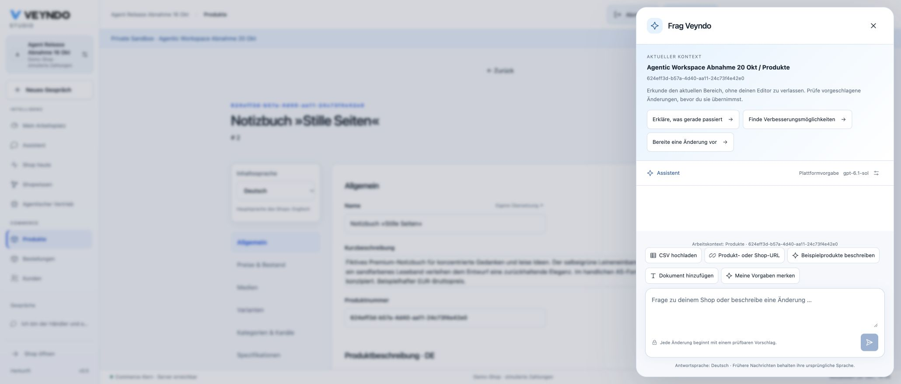
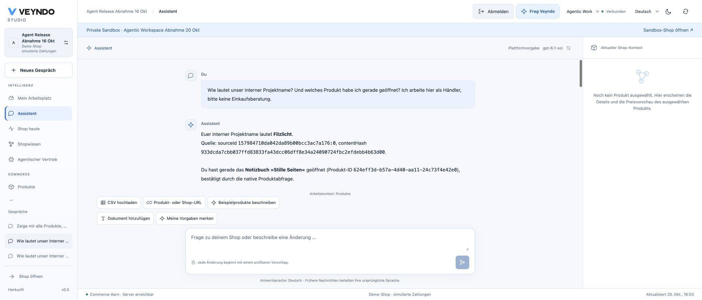
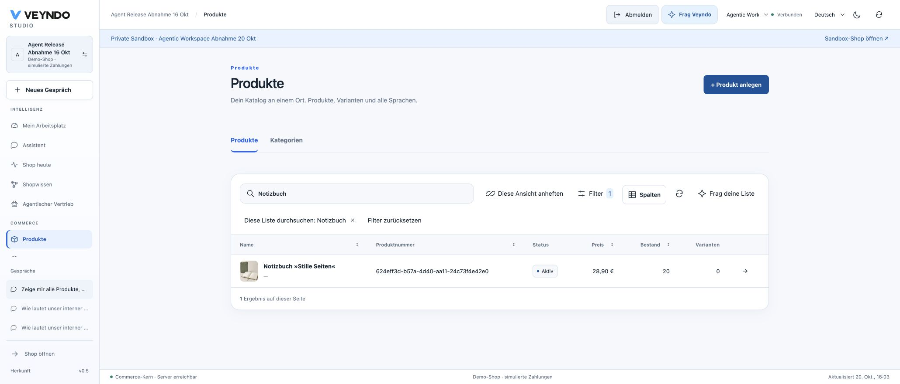
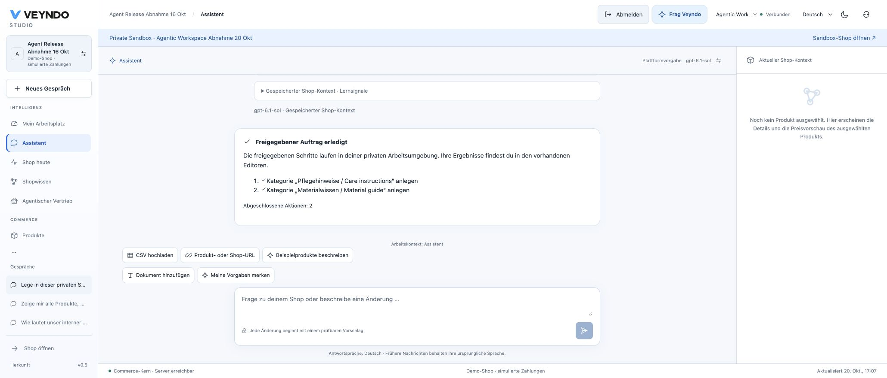
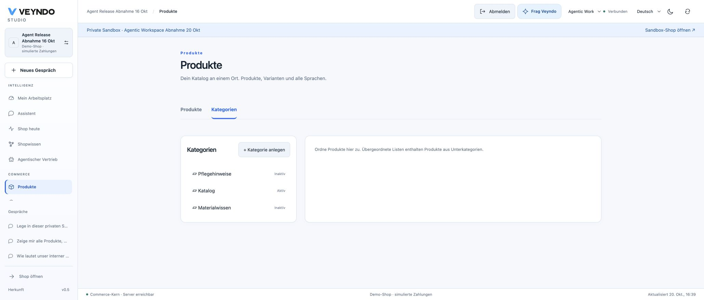
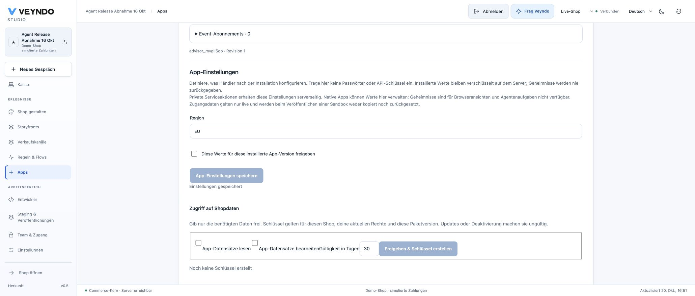
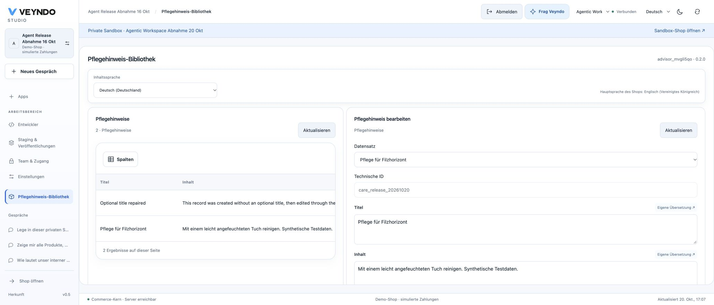

# Connected AI workspace: acceptance, 20 October 2026

Base `cf0a87bf`; development branch `feat/agentic-workspace`, stacked on the service
integration work. The original checks below use separate disposable PostgreSQL databases and synthetic merchant accounts. Hosted rollout and browser observations are recorded separately at the end; the local fixtures do not establish hosted model behavior.

## Demonstrated paths

- App discovery finds a relevant package after nine alphabetical fillers; metadata
  does not disclose sampled records. Actual reads use its managed action. Foreign
  shops, oversized pages and forged workspace identities are rejected.
- One exact approval saves two private managed records through the native Rust
  worker. Repeated approval does not repeat them; live records remain unchanged.
  Changing a target after review rejects approval. Live configuration and
  unadmitted operations are denied before a write.
- A filtered order view retains native criteria and originating context. Unknown
  tenant criteria fail. UI handoff reaches the real grid request; manual editing
  remains available and personal filters are excluded from persisted pins.
- Full app composition adds a model and setting, installs the proposed version in
  the real private preview and writes/reads an actual record. The existing lifecycle
  fixture still stages, publishes only its package and runs a simulated order review.
- Explicit private merchant guidance reaches the actual provider request with
  revision/hash provenance. Public publication fails and archiving withdraws it.
- Work suggestions reflect actual stock, disappear when stock is replenished and
  return no IDs/counts after the actor's rights narrow.

## Reproducible checks

Use the existing isolated suite runner with a disposable PostgreSQL connection:

```sh
python3 scripts/verify_integration.py --only users providers app_generation durable_agents knowledge_workspace app_preview automation app_studio
cd frontend && npm test && npx tsc --noEmit && npm run build
```

The provider/model servers are local fixtures, with no paid calls. The real Rust
HTTP routes, native operation registry, PostgreSQL transactions, app records,
staging owners and workers execute the tested effects. Fixtures do not prove a
live model understands every request. Native command and receipt transactions are
separate; interrupted unknown native effects require review, not automatic replay.

The independent full-diff review found five concrete edge cases: agent opt-out,
existing guidance demotion, custom action name collision, conversation ownership
and translated-title/body inheritance. All five were repaired and re-reviewed.

Local verification passed: 718 frontend tests, 298 Rust workspace tests, strict
TypeScript, Clippy, the affected native suites, prompt immutability, route rights,
source ownership, frontend architecture and four-language interface checks. The
existing formal gate passed 61 extracted policies with 156,705 conformance cases
and zero mismatches; its mutation suite rejected 174 broken policies plus the
syntax/binding/axiom negative controls. These proofs do not cover the new async
execution adapters. The complete site build covers 296 Markdown documents in
303 pages with local links/assets and search checked. No blanket full-platform certification,
external coding-agent execution or general exactly-once provider guarantee is claimed.

## Final pool and interruption regression

The full native follow-on exposed two nested-connection waits: work approval held
its task transaction during native rebinding, and native execution held its task
transaction during the domain owner's write. Both now release that connection
before the nested owner runs; approval compares the locked task revision and stop
state again before queueing. Native category creation now preserves validated
reviewed IDs instead of discarding them.

The actual `durable_agents` suite passes both directly and through PgBouncer with
one backend. It creates two private categories once, checks live isolation, kills
a managed-save worker, and resumes without duplicate records. A paused native
write followed by HTTP cancellation retains one completed receipt while the
second category remains absent. A paused native write followed by accelerated
lease expiry retains its outcome without renewing the expired lease. Matching
admission tokens fence old workers; cancellation remains terminal. Independent
focused review accepted these receipt and transaction changes.

The same durable cases also pass with the actual separate restricted tenant and
system logins. This exposed and repaired a parent-shop stop-control read during
private approval: the existing trusted coordinator now performs only the final
stop/revision/queue transaction, after actor-scoped authorization and exact
rebinding. Parent control is locked before the task, matching global stop; worker
domain access remains under its original scope. No SQL grants or RLS bypass were
added. Remaining app/provider/native follow-on suites passed locally, including
app secrets, events, export, signed distribution, shared-storage migration,
generation, ERP/EDI, marketplaces, shipping, grids and the visual workspace.


## Hosted rollout and initial browser checks

PR #172 merged as `34e272b73bb124a321fde39db33f23dc390f46ed`, with the exact same
Git tree as the tested `06b22f80`. Full CI run
[39420300367](https://github.com/sthamann/veyndo/actions/runs/39420300367)
passed all 102 registered suites, the restricted-login and pooler repetitions,
718 frontend tests, 298 Rust tests and coverage floors.

The existing Core and connector were released from that source. A fresh 6 GB
PostgreSQL disk snapshot `agentic-workspace-20261020-34e272b` completed before the
migration. The migration job's Kubernetes events confirm completion, followed by
the Core release. A waiting automatic workflow was stopped before this controlled
manual sequence during Northflank's reported control-plane incident. No new
provider credentials, database grants or paid service activation were introduced.
The separately prepared migration service remains a separate acceptance item.

Public checks use the synthetic shop **Agent Release Abnahme 16 Okt** and private
workspace **Agentic Workspace Abnahme 20 Okt**. They already demonstrate:

- The product drawer carries the actual selected product and private workspace,
  and offers CSV, URL, demo catalogue, document and explicit-guidance entry points.
- A new German guidance source is stored privately under an English-main shop,
  with revision 1 and a source fingerprint in the ordinary Shop knowledge owner.
- Setting a private product's stock to zero creates its actual work suggestion.
  Opening it reaches that product editor. Restoring stock to 20 removes the work
  suggestion. Live product stock was not changed.



The configured public `gpt-6.1-sol` exposed a strict-wire mismatch absent from the
older fixtures: optional `operations` and app `lifecycles` arrived as `null`, while
the native schema treats them as absent arrays. Those requests stopped before
approval or persistence. PR #173 (merged as `e191ed83` after complete green CI run
[39432103191](https://github.com/sthamann/veyndo/actions/runs/39432103191))
repairs the shared OpenAI wire restoration,
with a failing-first unit case and actual local provider/native app regressions.
Required nulls and explicitly nullable/dynamic data remain unchanged for domain
validation. That source was deployed as `a673816b` (build `deep-snail-5542`) after snapshot
`agentic-wire-20261020-a673816` and a successful 26-second migration job. The
configured public model then correctly recalled the private guidance's project
name, source ID and hash, identified the selected notebook through the native
product read, and retained its merchant role.

The same live model prepared `search: Notizbuch`; **Open editable list** reached
the native grid with exactly the notebook. Editing that filter to `Stiftehalter`
loaded exactly the pen holder. No product or order mutation was involved.





A subsequent two-category plan failed safely at native execution because the
operation advertised an untyped object. It saved no categories and the old task
was explicitly cancelled. App composition exposed an invalid nested-container
candidate, also without saving a draft. These observed failures led to PR #174:
canonical category DTO/configuration admission before review, saved-task polling
with late-response fences, and one bounded native-validation repair for generated
app proposals. No native permission or validation check was relaxed.

Failing-first regressions reproduce all three problems, including a historical
poll response resolving after the current task loads in the same React batch.
The repaired path passes 720 frontend tests, 299 Rust workspace tests, Clippy,
TypeScript/build, actual OpenAI protocol fixtures with private app record writes,
and native multi-step work through direct and one-backend pools. The complete
restricted system/tenant-login pooler run also passes. A first local wrapper
attempt used a broken Homebrew Node library after its native checks; the full
wrapper was repeated successfully with the bundled Node runtime. Formal and
mutation checks remain green; the async adapters are not new proved policies.

Public work/app repeat on that exact follow-on image is recorded below after
release; these intermediate results do not claim all hosted flows passed.


## Follow-on release preparation

The reviewed correction is commit `458ead3679e3c8c3b7d88033df0a11d6bb063286`,
build `divergent-start-8447`. Integrating the now-merged parent creates
`fe0595b5f0804efc040607e2dd85e7e3c4cd27c3` with **the identical Git tree**
`7f7805aded857296578fe95805e5cd80f93cf7f6`; it introduces no new runtime changes.
Required verification runs against that up-to-date branch without bypassing main
protection. Snapshot `agentic-plans-20261020-458ead3` completed at 16:16:55 CEST
(6 GB, 66 seconds). The older `e191ed8` automatic run
`c54780bd-b1ba-440b-8100-987287cf2714` was stopped before backup/migration/deployment
so it cannot overwrite the follow-on image. Automatic workflow configuration and
security checks were not disabled.

The exact follow-on migration run `c7fe2884-68e4-4e06-bbec-5c59bc731fa0`
completed successfully in 23 seconds (pod `vendune-migrate-6ad77ad21299d82764c6431f-9785k`).
Core rollout `vendune-core-75f89cb6bf` starts at 16:31:02 CEST from that same build.

The new public Core pod `vendune-core-75f89cb6bf-cgllv` reached 1/1 passing
with zero restarts; the previous pod terminated normally. The 20 October public
model repetitions below use the worker and generation endpoints from this image.
The merchant work tab was reloaded before the fresh two-step request.


## Public two-step work acceptance

The configured public model prepared two canonical native category creates under
the private workspace: `c81292e4-953b-432a-bba6-1628eb9f8a01` (Care instructions /
Pflegehinweise) and `d923a3f5-a64c-443b-8cb7-2739fca09b02` (Material guide /
Materialwissen). The exact review includes positions, explicit inactive/hidden
flags and English/German translation maps. One approval completed both actions.

After a full browser reload, selecting the private workspace and reopening the
saved conversation still shows **completed actions: 2** with no second approval.
The ordinary category editor shows both inactive categories beside Katalog. The
Live-Shop category editor still shows only Katalog; neither new category was
published.





The same model successfully generated native app version 0.2.0 with `care_notes`,
a `region` setting and a private list/form/save view. Trying an optional record
without a translated title then exposed a shared renderer crash. The focused PR #175, incorporated into PR #174, fixes
the record selector's missing-title fallback without changing save admission or
translations. The failing-first regression reproduces the exact existing-record
selection crash and then edits/saves it with the original revision. Focused
independent review, 721 frontend tests, build, architecture and localization pass.
The corrected public record journey is accepted below after release.

The saved generated version was recovered through **Versions & Releases → View
version** without another model call, then installed in the selected private
workspace. Its ordinary Studio sidebar now exposes **Pflegehinweis-Bibliothek**.
The generated `care_notes.title` and `content` are optional translatable fields;
the empty-field crash was not a bypass of a declared required field.

Through that ordinary installed native UI, record `care_release_20261020` was
saved with English title/body, then updated with German title/body. The table
refreshes to the persisted German values and the same selected record remains
editable. The package stays version 0.2.0 with two models and three views; no
package or record was published live.


## Selected package release and actual configuration

The Studio release review selected only `app:advisor_mvgli5qo` (review digest
`591e7bd259b6`). The native owner confirmed **Selected changes published**.
The synthetic live shop then listed the active 0.2.0 package with two models,
four actions, three surfaces and **zero records**. Private care notes and the two
categories were not included. Its central Apps panel accepted the non-secret
setting `region = EU` under the existing package-version approval and retained
that value after a full browser reload. No API key, credential or additional
permission was created. All installed app settings remain live-owner configuration;
the private settings controls intentionally remain disabled.




## Final shared-renderer rollout

The final image is `b0811f8a88a56a0d111874e9198457511654ab81`, build
`plant-horses-6593` (8m59s). Snapshot
`agentic-native-ui-20261020-b0811f8` completed at 16:54:01 CEST
(6 GB, 55 seconds), including the successful synthetic app/configuration state.

Two native maintenance starts (`49719a43-6f27-459b-af74-81ab26c787ee` and
`f8d4d837-79ab-42a8-ba0d-06a60d8471d6`) failed closed on the initial
Qdrant request. The running shop was kept on its healthy previous image. A
read-only diagnostic in the same existing job resolved the private DNS name and
returned Qdrant HTTP 200. Running the unchanged native binary after a bounded
Qdrant health check passed the full maintenance setup: zero new namespace aliases,
**Migration-only setup complete**, exit 0 and job Success in 23 seconds
(`64ee068c-dd71-48bc-951e-6a36e7bf6d39`). Its first health attempt timed out;
the bounded retry reached the existing service. This is a network-start observation,
not evidence of a database or Rust domain change.

The existing maintenance-job owner now retains a bounded, fail-closed
`curl` health check using its existing `QDRANT_URL`, before `exec /app/veyndo`.
It retries connection/startup failures twice (5-second connect / 10-second request
limits) and does not bypass any native migration, database-role or alias check.
There is no new service, credential, permission or deployment queue.

The Core rollout starts at 17:03:28 CEST as `vendune-core-6cc7f557d9`.
Final readiness and browser read-back are recorded after confirmation below.


## Final public read-back and optional-title regression

Core pod `vendune-core-6cc7f557d9-gnbq5` reached 1/1 passing with zero
restarts; the previous pod terminated normally. After a full Studio reload the
private `care_release_20261020` record remained visible. Selecting English showed
**Care for Filzhorizont** and its original English body; selecting German showed
**Pflege für Filzhorizont** and its distinct German body.

The ordinary installed private form created `care_optional_title_20261020` with
no optional title or body. It stayed usable, selected that stored record by its ID,
then accepted **Optional title repaired** and an explicitly entered English body
on the same record. The table and record selector refreshed; there was no blank
screen, lost revision or recreated package.




The retained job configuration was then tested with **no temporary overrides**.
Run `4f9000d7-1436-49cd-a4cd-2c08645bcd15` completed with job **Success**
in 30 seconds (pod 20 seconds). The native process and all checks remained in
place. After another complete browser reload, both private app records and the
completed two-step merchant task were still present; the latter still reported
**completed actions: 2** and did not require approval again.


On the final public image, the conversation's CSV button opens the existing native
**Build catalogue** dialog with **Agentic Workspace Abnahme 20 Okt** already
selected. Switching its URL/demo-description tabs retains that private target.
**Add a document** opens the ordinary localized private knowledge-source editor
with its PDF/text upload. These are actual entry/navigation checks; no additional
CSV, URL crawl or demo generation was submitted in this final navigation repeat.


The final configured model also received the original ambiguous request,
“Stelle eine kompakte Leseecke unter 300 € zusammen”, from the actual notebook
editor without an added merchant-role hint. It stayed with the available catalogue:
furniture/lighting were missing and a sub-300-euro selection could not be supported.
It did not offer an unrelated external shopping plan or mutate products. The
verified CSV/URL/described-demo entry points remained directly below the response.
This is one actual configured-model response, not a guarantee of every future
ambiguous request.


## Final required verification and merged source

[Required full CI 39441599258](https://github.com/sthamann/veyndo/actions/runs/39441599258)
completed successfully on `b0811f8a88a56a0d111874e9198457511654ab81`.
It passed 721 frontend tests, 299 Rust workspace tests and all 102 registered
integration/browser-contract suites, including restricted system/tenant logins
and one-backend pooler repetitions. Formal/mutation checks and unchanged coverage
floors also passed. This full sensitive-renderer run was not replaced with a
frontend-only check or a branch-protection bypass.

PR #174 merged normally at 15:30:34 UTC as
`2aadf62c4ad95f05abad32baf320619a3dea45dd`. Both source trees are exactly
`d2da868b450a698ee54edadb7ea7d0ecc9513387`. The already accepted public
`plant-horses-6593` image therefore contains the merged runtime source. The
redundant main-triggered workflow `50ab6021-340d-4b7a-86e0-947983f00c1f`
was stopped at its build stage, before backup, migration or service replacement;
workflow configuration and required verification remain enabled.

The separately reviewed documentation updates touch no production Docker COPY
inputs. They refresh README, the homepage, App Studio/workspace/operations guides,
canonical status and actual screenshots through the normal Pages publication.
The complete site check covers 296 Markdown sources in 303 pages, local
links/assets, full-text search, sitemap and metadata. Browser inspection confirms
the guide's actual Mermaid SVG and no broken article images.
