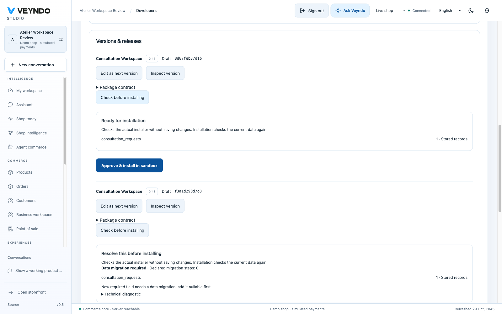

# Native app upgrade admission

Observed locally on 29 October 2026 against isolated PostgreSQL/Qdrant and headed
Chromium. The hosted Core is a separate deployment and is not claimed here.

The consultation app from the description-led acceptance was still installed as
`0.1.2`. A private stage contained one actual request, `upgrade_review_1`. Candidate
`0.1.3` added a required review code without a migration. **Check before
installing** reported the stored record count, required migration and zero declared
steps. There was no activation button for that rejected candidate.

Candidate `0.1.4` made the same field optional. Its check was ready, then the actual
**Approve & install in sandbox** control installed it. The private request remained
unchanged. The live shop retained package `0.1.2` and its separate `review_live_1`
request. The check itself committed no package or record change.

## Shared admission

The existing package review endpoint invokes the real transactional installer and
rolls everything back. It checks deferred constraints before rollback. Counts,
required migration and structured diagnostics are returned; app record contents,
setting values and credentials are excluded. The report is non-binding: actual
installation repeats admission and still requires current rights and candidate
digest consent. Owned-stage inspection also checks developer rights and native
stage ownership.

The actual installer now validates active Flow consumers under the existing
automation lock. It shares app-step construction and native argument/field
validation with Flow configuration. Removing an action or making its current
inputs incompatible rejects all installation transports and selected release.
The stored actor is reloaded on the same transaction connection and checked for
current primary/additional action rights and native core-extension access. An
owner cannot approve an update that strands a restricted member's active Flow.
Existing dependency, immutable version, package consent and private preview owners
remain authoritative. No additional migration executor or queue is introduced.

## Tests

The registered `app_schema` HTTP suite first failed because the report was missing.
The frontend consent test first failed because blocked installation was enabled.
The final tests cover compatible optional fields, new required fields, explicit
rename/remove/convert/fill migration, failed conversion of a real saved value,
rollback without recovery history, foreign shops/stages and candidate changes after
consent. Definition restoration uses new immutable versions and preserves records.

The registered furniture workflow checks a changed Wasm rule against saved examples:
unchanged expectations block review/import; corrected expectations pass. Its
existing selected release and frozen order checks still run. Active Flow removal
and incompatible required inputs reject without changing the installed package.
The broader app, consent, signed distribution, service and automation suites retain
current rights, isolation and queued-package fences.

Independent branch review identified three further admission gaps. The registered
HTTP regressions reproduced them against the previous binary: stricter field rules,
changed Flow actor rights and removal of an enabled payment provider were reported
ready. The shared owners now reject those updates. Explicit field migration checks
the old value, refuses an invalid value, leaves the previous package intact and
accepts the same migration after a native record repair. Provider tests cover
whole-contract and method removal, currency/country narrowing, channel-only
activation, compatible widening and disabled methods. Review and failed installs
leave settings/packages unchanged and make no provider calls. Existing attempt
contracts still pass the ordinary capture/authorization/void/refund fixture.

Frontend tests also fence changed account requests and stages. All interface
vocabulary is EN/DE/FR/ES; native diagnostics use shared translated guidance with
an expandable technical explanation. Complete local checks cover 842 frontend
tests, 339 Rust tests, strict Clippy, source boundaries and the generated handbook.
The independent findings were fixed in one consolidated pass. Required CI and
hosted runtime delivery remain separate. The implementation merged with complete
required CI through [PR #228](https://github.com/sthamann/veyndo/pull/228).
The subsequent public first-installation review exposed the restricted-database
metadata issue addressed by PR #232; its final execution is recorded in the
[public journey](platform-followups-hosted-2026-10-29.md#public-description-led-app-generation).
