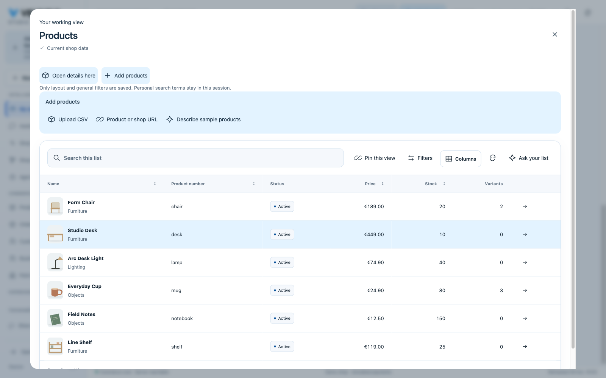
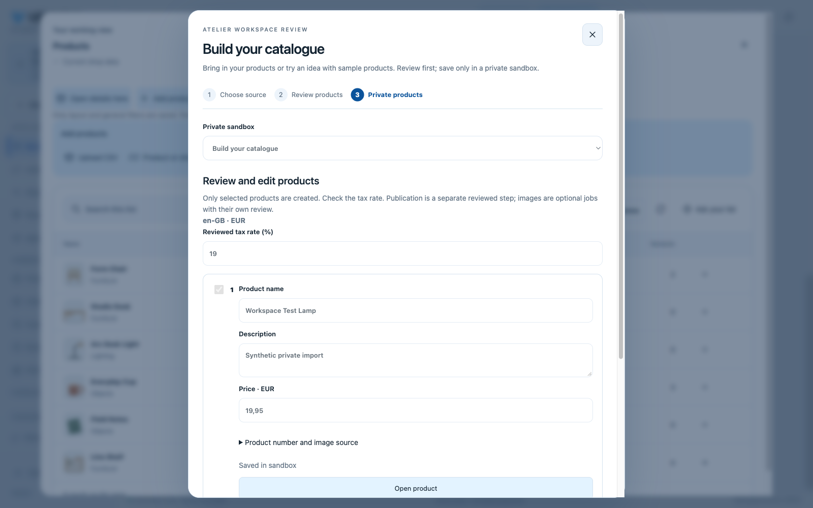

# Composed Studio working views: 29 October 2026

This acceptance uses a disposable local shop, the real Rust server and PostgreSQL,
and a headed Chromium browser at 1600 × 1000. Payments remain simulated. It is not
a hosted rollout acceptance. The current public runtime is recorded in [Status](../status.md).

## Actual model and native UI

The configured local Ollama model `qwen3.6:35b` received a request for a product
working view. The existing merchant planner returned `entity: products`, empty
criteria and `components: [records, details]`. No commerce change was proposed.
The model selected two components; product intake was enabled manually in the
resulting native view.

The actual Studio opened six native product rows with current prices, stock and
images. A saved pin retained records, details and intake after a full reload.
Opening the desk used the existing product editor. Closing with a changed name
showed an unsaved-change confirmation; cancelling retained the edited draft.
Returning the name to its original value allowed navigation without a mutation.

The CSV journey uploaded a real synthetic file, created a private catalogue
sandbox, reviewed a EUR 19.95 product and its explicit tax rate, then saved it.
API readback confirmed one `workspace-lamp` product in that sandbox and zero in
the live catalogue. No publication was performed.

## Contracts and regression coverage

The schema permits only registered records/details/intake bindings. Unknown
components, rows, tenant fields, duplicated components and non-product intake
reject before an executable view is saved. Historic views retain the records
default. Personal workspace persistence preserves existing CAS/history and
excludes private searches or authority fields. Current domain and PII rights
remain required for API data; layout preferences grant no access.

The complete frontend suite passes 829 tests. Tests cover real directory rendering,
revoked rights, synchronous request-context fencing, pin CAS and private-filter
exclusion, dirty editor navigation and nested modal confirmation. The native workspace suite, strict Clippy and formal extraction checks pass.
Actual Rust/PostgreSQL HTTP checks pass for users (20 cases), provider/planner
contracts (53 cases) and visual workspace/publication. These include role
revocation with the original session, rejected injected compositions, personal
pin CAS/history and foreign-tenant denial. The provider wire checks use synthetic
HTTP providers; the separate Qwen/browser journey above uses the actual local model.
Final CI and hosted delivery are recorded as they complete.

## Public follow-through

The configured public `gpt-6.1-sol` model prepared the native working view on
29 October. Open, pin, full reload, reuse, CSV preview, private product creation
and the actual native editor were observed. The imported product then completed
a simulated public sandbox purchase with return and an empty basket.
[Exact public steps and screenshots](platform-followups-hosted-2026-10-29.md).
