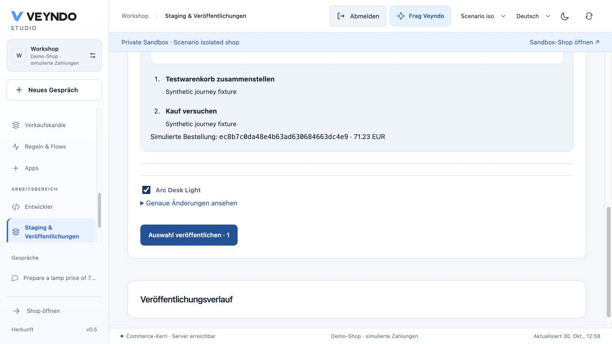
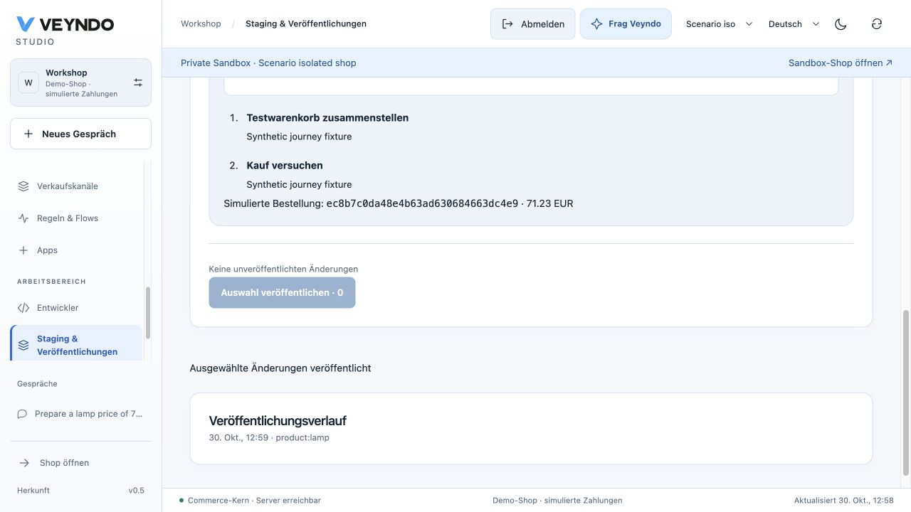
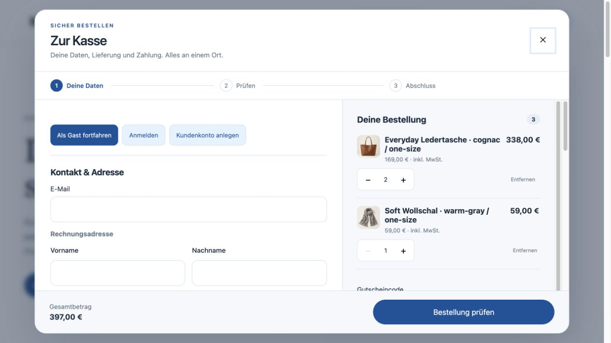
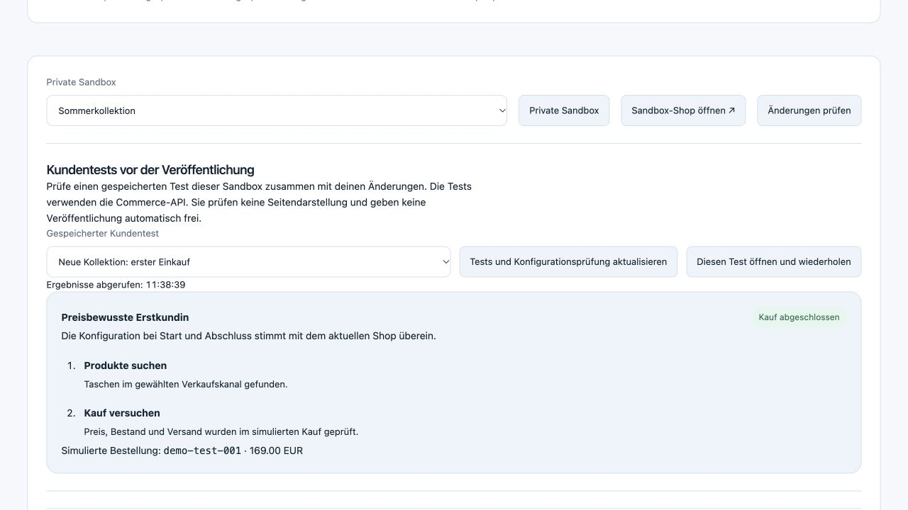
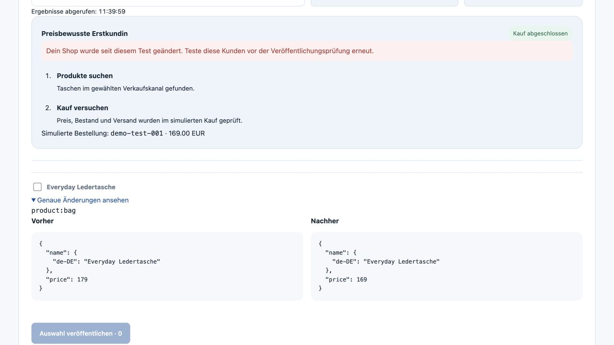
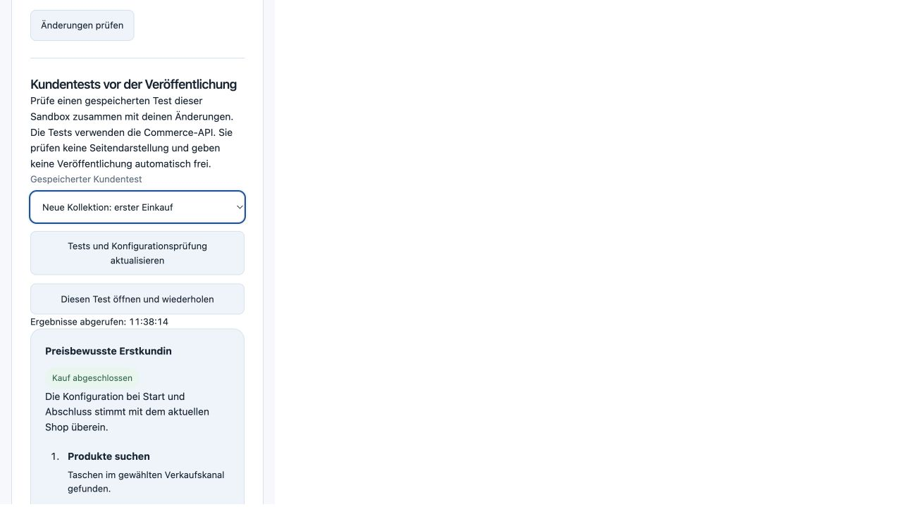

# Connected commerce: first implementation slice

30 October 2026. Branch `feat/connected-commerce-followups-20261030`, based on
`20dd5dad`. Local development evidence; public deployment has not been claimed.
The [13-area checklist](../plans/2026-10-30-connected-commerce.md) remains open.

## Native behavior

Applied native proposals open the existing customer simulator with the original
sales channel. Server-derived source IDs, revisions and proposal digests are
revalidated through the native task access owner. Customer tests retain their
existing actor, shop, private environment and current permission checks. Repeat
restores saved attribution; removing the reference preserves the editable brief.

Configuration evidence hashes the existing release projection at start and finish,
then compares against current configuration. Operational records, stock and secrets
stay excluded. The capture has a three-second overall timeout and short lock wait;
an unavailable complete projection produces `unverified`, not a failed purchase or
an unreadable saved report. A boundary comparison does not detect an edit that is
fully reverted between captures. No partial digest counts as current.

The independent review identified the large-app failure case before integration.
The corrected regression installs the native engraving app, creates 1001 actual
configuration records, reads the earlier successful report and completes another
native private purchase. Both remain usable with explicitly unavailable evidence.

## Checks

- Two Rust evidence-classification tests.
- Targeted scenario and agent-workspace UI tests: reference inclusion/removal,
  repeated-source attribution, retained briefs, stale context and evidence states.
- Actual Rust HTTP/PostgreSQL suite with separate restricted system and tenant
  logins and local deterministic inference: native purchase, exact budget,
  concurrent customers, idempotency, cold restart, cancellation, lock/lease fences,
  language/channel isolation, injection, source ownership/applied state,
  source changes during inference, changed/stale configuration, large app records,
  revoked rights and emergency stop.
- Generated TS/WIT/OpenAPI operation inputs derive from the compiled registry.
- Structural ownership/localization checks and a scoped Impeccable source scan.

The ownership and mid-inference mutation tests use a saved-task fixture. A second
case now exercises the actual merchant model wire, native price proposal, explicit
apply and an attributed private purchase. The proposal cannot start its customer
test before approval; the live price remains unchanged until the selected publication
described below. Only the provider response is synthetic in that case. Automatic
rendered customer journeys remain separate acceptance work.

## Native proposal through selected publication

The targeted `agentic_scenarios` suite now continues the same applied EUR 71.23
lamp proposal and attributed purchase through `/api/environments/{id}/release`.
It passed on 30 October against the compiled Rust server, isolated PostgreSQL
and separate restricted system/tenant logins. Only inference is deterministic.

- The exact reviewed `product:lamp` digest publishes and native storefront reads
  return EUR 71.23 in the live fixture.
- Full order data and every product's stock in both environments remain unchanged
  across publication. The private test order is not imported into live.
- Unselected channel and app changes retain the same keys and digests.
- The saved test still identifies its original proposal and order and reports
  current private configuration after publication.
- Missing approval returns 400; stale and replayed selections return 409; revoking
  the current actor's publication rights returns 403.
- The successful request creates exactly one native release and one
  `shop.release.published` outbox event; rejected requests add neither release.

The existing script owns the regression in `scripts/testing/scenario_source.py`.
The run also retained its cancellation, restart, source-fencing, foreign-sandbox
and emergency-stop cases. No full suite or real payment was run for this change.
These are API acceptance results, not an automatic rendered-customer recording.

## Actual Studio publication

The in-app browser then signed into a separate disposable native shop through the
normal password form. A model-fixture proposal and native private purchase were
prepared through the same handlers. In Studio, the saved result showed the order
for EUR 71.23 beside the real product diff from EUR 79.90 to EUR 71.23.

Opening **Open this test and repeat** retained the exact saved report, default
channel and private sandbox. Returning through **Staging & releases**, selecting
only the lamp and publishing produced the native success message and history row.
Reload retained that history and showed no remaining unpublished change in this
single-change fixture. A final native read confirmed live price EUR 71.23, exactly
one private order and zero live orders. The owned server/database were removed.

This browser fixture uses the supported HTTP-localhost development login profile.
The preceding API regression separately exercises strict signed SQL scopes and
restricted system/tenant logins. The strict profile intentionally rejects insecure
browser login; no production setting was changed to make this local UI test work.
The model response is deterministic. The browser exercises the merchant release
journey; the customer purchase remains a native API scenario, not a rendered agent.

## Rendered component review

Chrome rendered the actual report/source components at 1365 × 900 and 390 × 844.
The narrow content has matching client/scroll width (374 pixels), with readable
wrapped labels. Keyboard activation removes the setup reference while the saved
result attribution remains. Images deliberately label their synthetic display data.
These are component previews, not automatic browser-customer evidence.

## Remaining task 1 acceptance

Automatic rendered shopper journeys and captured screenshots, authenticated B2B
profiles, and the complete combined rendered proposal/preview/test/publication journey are still open. Saved API results and native diffs are now connected as described below.
The existing API simulation and these component images do not establish those
capabilities. The checklist records their acceptance separately.

## Home and content page overview

The existing editor now compares up to four real page renderers, with native
home fallback, current unsaved content, global/channel/page appearance and the
existing language scope. The inspector remains mounted while hidden so the typed
agent request survives toggling. Opening the same draft returns without resetting
its baseline or undo history; another page uses the existing discard confirmation.

The final affected designer/workspace suite passed 35 cases including the new
dirty/undo regression. TypeScript passed. The scoped source detector returned no
findings. The independent finish review scored the draft-preservation fix resolved;
documentation review confirmed the scoped behavior and completion boundaries.

Chrome desktop and mobile fixtures use actual components with labelled example
data. At the 390 × 844 viewport, browser measurements were inner width 390,
document client/scroll width 375 and body width 375, with no document overflow.
Native viewport image output is scaled to 375 × 812. Full-page mobile capture
caused reflow, so the retained evidence is the actual top and scrolled viewport.

These captures do not establish production deployment, product/category/cart
template editing or a rendered autonomous purchase.

## Browser-agent cart entry

The registered `veyndo_add_product` tool now uses the native UI command to create
an absent/completed cart and add items without replacing the current basket.
Twelve targeted command and React-hook tests pass: concurrent additions, invalid
IDs/quantities before creation, cancellation after creation, retained old handles
after changing shop, private-preview suppression, token exclusion and normal
shopping when `document.modelContext` is absent. TypeScript and frontend ownership
checks pass. Merchant-provided names are explicitly annotated as untrusted output.

The current Chrome imperative-API documentation was checked on 30 October.
The initial browser inventory timeout was resolved by selecting the existing
in-app browser directly. All five tools were then discovered and called through
the browser WebMCP capability against the actual local Rust server and a disposable
PostgreSQL database with restricted signed system/tenant connections.

The German catalogue returned the native bag product at EUR 169. Adding one bag
and one scarf returned EUR 228; changing the bag quantity to two returned three
items and EUR 397. Checkout review visibly displayed those same lines and total,
with contact/address fields and simulated payment selected. No order was submitted.
Negative quantity and an unknown product both failed without changing the basket.
The native update cleared the basket; reload showed zero and registered five tools
again. The test tab was closed and the owned local fixture stopped. This is local
browser acceptance, not public deployment or cross-browser certification.

## Saved tests beside selective publication

The native `EnvironmentManager` now reads saved customer tests through a
sandbox-scoped request and embeds the existing report renderer. No release path,
permission or publication gate is replaced. The exact sandbox/channel/report is
retained on return to the simulator. Changes in request scope hide earlier report,
history and selection state; late responses cannot repopulate another scope.

Targeted React checks cover compound rights and revocation, current/stale refresh,
late responses after a sandbox switch, retry after read/navigation failure, selected
changes cleared before the next diff arrives, exact saved-report navigation,
channel-scoped initial report loading and denied URL report access. TypeScript,
frontend architecture and all four interface language catalogues pass. Full suite
execution remains on the daily cadence. The 20 affected release-review, scenario
and navigation component tests pass. The scoped Impeccable detector reports no
findings; independent UI and documentation reviews returned ship at component scope.

The in-app browser rendered the actual components at 1280-pixel desktop width and
in a 390-pixel mobile iframe. The outer white area in the mobile capture is the
fixture page, not the component. Synthetic display data was used for this UI review;
selection, current/stale refresh, callback arguments and empty sandbox switching
were exercised. These images do not establish a native selected publication or an
automatic browser-customer journey.

