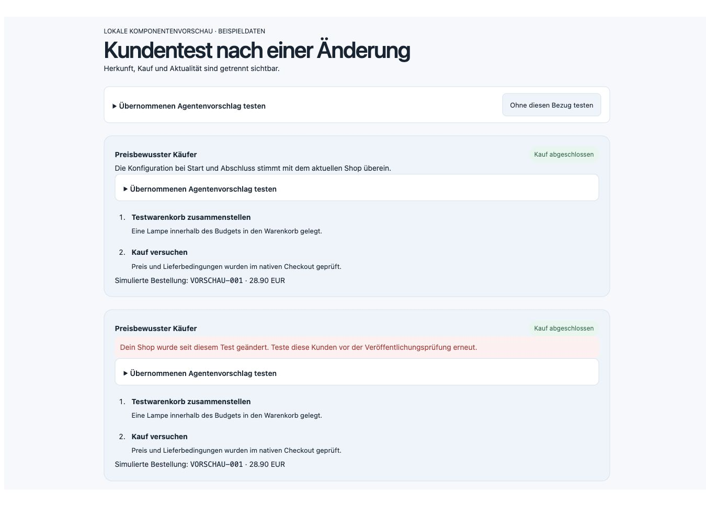
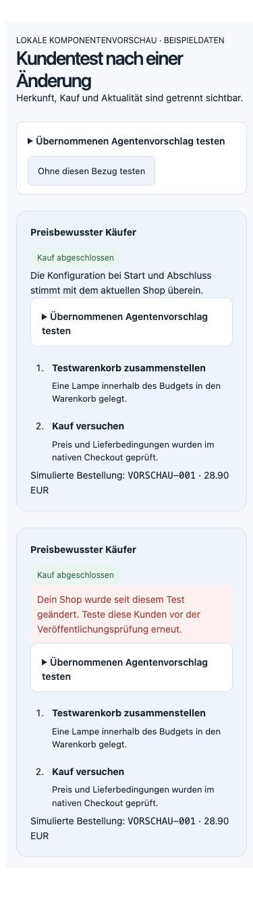
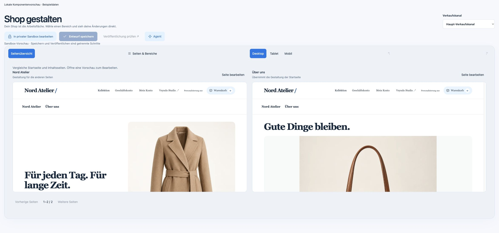
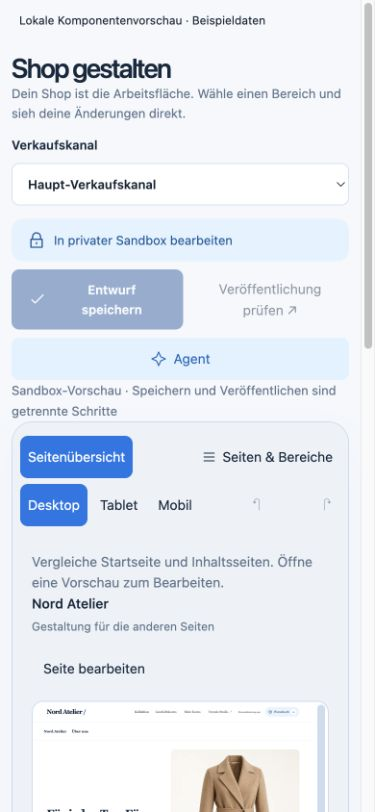
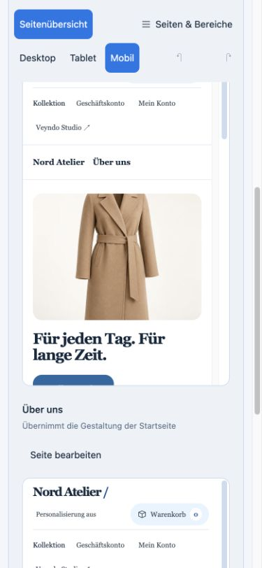

# Connected commerce: first implementation slice

30 October 2026. Branch `feat/connected-commerce-followups-20261030`, based on
`20dd5dad`. Local development evidence; public deployment has not been claimed.
The [13-area checklist](../plans/2026-10-30-connected-commerce.md) remains open.

## Native behavior

Applied native proposals open the existing customer simulator with the original
sales channel. Server-derived source IDs, revisions and proposal digests are
revalidated through the native task access owner. Customer tests retain their
existing actor, shop, private environment and current permission checks. Repeat
restores saved attribution; removing the reference preserves the editable brief.

Configuration evidence hashes the existing release projection at start and finish,
then compares against current configuration. Operational records, stock and secrets
stay excluded. The capture has a three-second overall timeout and short lock wait;
an unavailable complete projection produces `unverified`, not a failed purchase or
an unreadable saved report. A boundary comparison does not detect an edit that is
fully reverted between captures. No partial digest counts as current.

The independent review identified the large-app failure case before integration.
The corrected regression installs the native engraving app, creates 1001 actual
configuration records, reads the earlier successful report and completes another
native private purchase. Both remain usable with explicitly unavailable evidence.

## Checks

- Two Rust evidence-classification tests.
- Targeted scenario and agent-workspace UI tests: reference inclusion/removal,
  repeated-source attribution, retained briefs, stale context and evidence states.
- Actual Rust HTTP/PostgreSQL suite with separate restricted system and tenant
  logins and local deterministic inference: native purchase, exact budget,
  concurrent customers, idempotency, cold restart, cancellation, lock/lease fences,
  language/channel isolation, injection, source ownership/applied state,
  source changes during inference, changed/stale configuration, large app records,
  revoked rights and emergency stop.
- Generated TS/WIT/OpenAPI operation inputs derive from the compiled registry.
- Structural ownership/localization checks and a scoped Impeccable source scan.

The ownership and mid-inference mutation tests use a saved-task fixture. A second
case now exercises the actual merchant model wire, native price proposal, explicit
apply and an attributed private purchase. The proposal cannot start its customer
test before approval; the live price remains unchanged. Only the provider response
is synthetic in that case. A complete rendered journey and selected publication
remain separate acceptance work.

## Rendered component review

Chrome rendered the actual report/source components at 1365 × 900 and 390 × 844.
The narrow content has matching client/scroll width (374 pixels), with readable
wrapped labels. Keyboard activation removes the setup reference while the saved
result attribution remains. Images deliberately label their synthetic display data.
These are component previews, not automatic browser-customer evidence.

## Remaining task 1 acceptance

Automatic rendered shopper journeys and captured screenshots, authenticated B2B
profiles, and a combined proposal/diff/test/publication workspace are still open.
The existing API simulation and these component images do not establish those
capabilities. The checklist records their acceptance separately.

## Home and content page overview

The existing editor now compares up to four real page renderers, with native
home fallback, current unsaved content, global/channel/page appearance and the
existing language scope. The inspector remains mounted while hidden so the typed
agent request survives toggling. Opening the same draft returns without resetting
its baseline or undo history; another page uses the existing discard confirmation.

The final affected designer/workspace suite passed 35 cases including the new
dirty/undo regression. TypeScript passed. The scoped source detector returned no
findings. The independent finish review scored the draft-preservation fix resolved;
documentation review confirmed the scoped behavior and completion boundaries.

Chrome desktop and mobile fixtures use actual components with labelled example
data. At the 390 × 844 viewport, browser measurements were inner width 390,
document client/scroll width 375 and body width 375, with no document overflow.
Native viewport image output is scaled to 375 × 812. Full-page mobile capture
caused reflow, so the retained evidence is the actual top and scrolled viewport.

These captures do not establish production deployment, product/category/cart
template editing or a rendered autonomous purchase.
