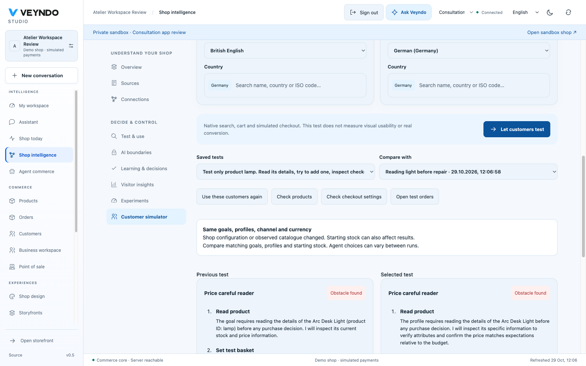
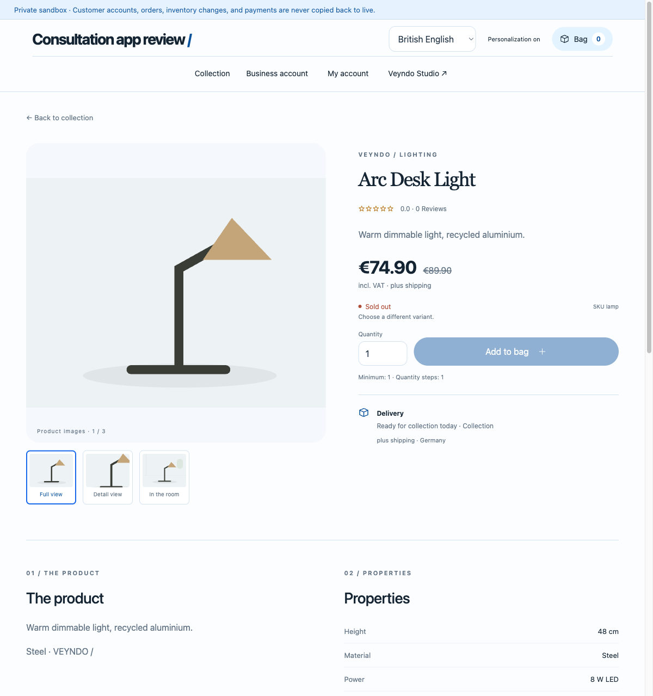
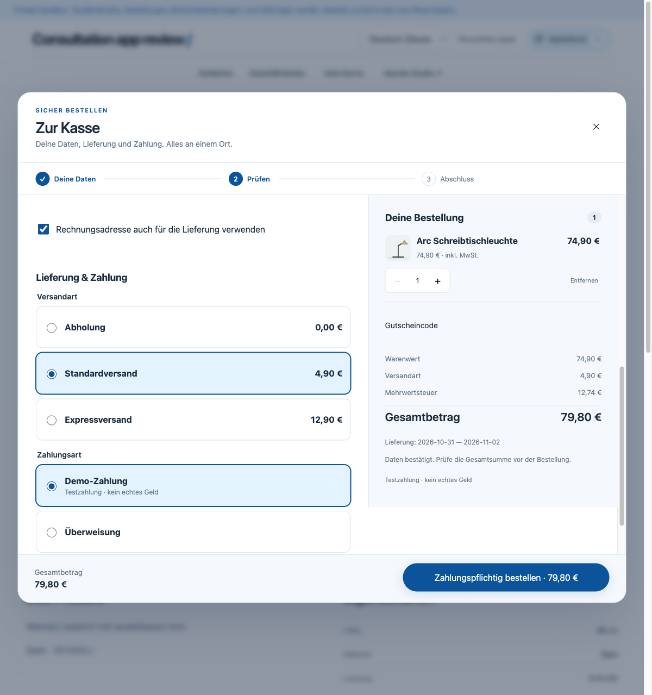
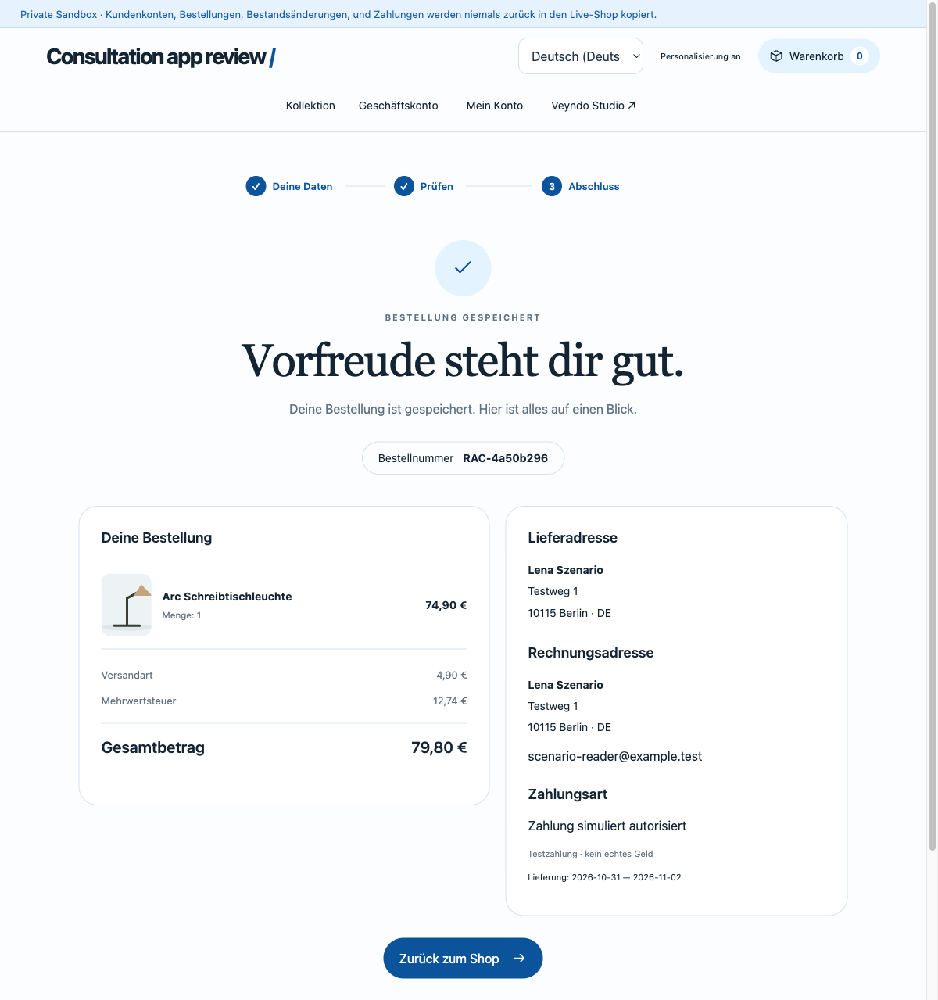

# Saved customer profiles and real browser acceptance

Observed locally on 29 October 2026 in headed Chromium against the native Rust
server, isolated PostgreSQL/Qdrant and the actual local Qwen3.6:35b model. All
customers and orders below are synthetic and private. This is not hosted delivery.

## Same saved profiles before and after a native repair

The sandbox `stage-39e44e4fcccf49619048` inherited the six-product catalogue.
`browser-before-20261029` saved two profiles: **Price careful reader**, English,
Germany, EUR 74.89; and **German reading corner**, German, Germany, EUR 100.00.
Both were instructed to inspect and buy only the Arc Desk Light, without substitutes.

| Observed state | Price careful reader | German reading corner |
| --- | --- | --- |
| Product revision 2, stock 0 | Native budget guard blocks checkout; no order | Model inspects unavailable product and ends the journey; no order |
| Product revision 3 after Studio repair, stock 40 | Same native budget guard blocks checkout; no order | Native simulated order `c7333fc479104d188449c52e7aaabe40`, EUR 74.90 with collection |

In Studio, **Check products** opened the existing private product grid. The actual
product editor's **Prices & stock** tab changed stock from 0 to 40 and saved.
Back in Customer simulator, the saved test was reopened and **Use these customers
again** restored both exact stored profiles, languages, budgets and inference
choice. **Let customers test** created `6bbc480f-c2c2-4e4b-9287-233cda715d03`.
The actual saved profiles were compared for equality. The interface shows matching
input identity and changed observed shop snapshots, with both journals alongside.
These are sequential observations, not a causal conversion estimate.

## Separate browser journey

The rendered English product page showed **Sold out**, EUR 74.90 and a disabled
**Add to bag** before the repair. After reload, the same private product had 40 in
stock and an enabled purchase control. EUR 74.90 already exceeds the first
profile's EUR 74.89 budget; that browser observation agrees with the native guard.

The German journey clicked the actual product, added one unit, entered synthetic
contact and address data, selected standard shipping and the native demo payment,
reviewed and completed the purchase. The rendered review showed EUR 74.90 plus
EUR 4.90 shipping, EUR 79.80 total. Order
`4a50b296c9664736b4980282d7375447` retained the German name **Arc
Schreibtischleuchte**, quantity one and **Zahlung simuliert autorisiert**. Returning
to the shop and reloading both showed **Warenkorb 0**.

The final private stock is 38 with exactly these two private orders. The parent
live shop still has stock 40 at revision one and no orders. Native customer tasks
remain `execution=native-commerce-api`; the browser journey above is separately
performed acceptance and is not labelled an autonomous browser-worker feature.

## Browser finding repaired

The first rendered sandbox journey unnecessarily requested the live Google
Analytics app configuration and logged a 404. The existing app-owned storefront
bridge now omits configuration discovery entirely for sandbox and channel-preview
journeys. Both component cases failed first, then passed. A rebuilt browser reload
observed zero Google Analytics/Tag Manager requests and retained the empty basket.
Server admission and ordinary live consent remain unchanged.
The initial browser build used entry `index-DKFgvMwP.js` from `6db15ee7`;
the repaired build used `index-Bi9gfFEo.js`. Stock repair and analytics repair
are separately identified changes, not a controlled comparison of design quality.

## Durable control and verification

The registered `agentic_scenarios` suite passes actual isolated native commerce
with its explicitly synthetic inference fixture: two customers on the minimum
pool, unavailable stock followed by repair, cold restart after a lost purchase
acknowledgement with no duplicate order/model call, cancellation during inference
and blocked checkout, expired leases, revoked rights, foreign sandbox and emergency
stop. Those checks validate task controls; they are not rendered-browser evidence.

## Delivery

The final source passed [complete required Linux CI](https://github.com/sthamann/veyndo/actions/runs/40870949354)
and reached public Core through PR #229. A separate public cohort subsequently
retained its German budget refusal and English native test order across reload;
the public browser then completed a localized simulated purchase after a design
revision and returned to an empty basket. [Public observations and screenshots](platform-followups-hosted-2026-10-29.md).
