# Private customer scenarios — 22 October 2026

## Local acceptance

The compiled Rust Core, real PostgreSQL and Chrome were used with a disposable
synthetic shop. The sandbox was `stage-698dee6ea85a41a1aa69`; all buyers use
`example.test` addresses. This is local evidence, not a public deployment claim.

The browser goal was: find a desk lamp, inspect its product information, stay
within the customer's budget and purchase only if the native total fits. Three
editable profiles used German content and Germany: a budget buyer with EUR 1.00,
a first-time buyer with EUR 300.00 and a focused buyer with EUR 300.00.

The actual local Ollama model `qwen3.6:35b` chose the actions. In the final run:

- The EUR 1.00 buyer finished without buying: even the cheapest observed product
  exceeded its budget.
- The first-time buyer inspected the Arc desk lamp, added it and completed native
  simulated order `eaf1dedb714242238f8f3ffdff0be0cb` for EUR 79.90.
- The focused buyer inspected the lamp, added it and completed native simulated
  order `4673d92ab8de496088f320136dbc58ed` for EUR 79.90.

Both orders appeared in the ordinary sandbox order grid. Full browser reload
retained the saved test history. Reusing a test restored its exact profiles,
instruction and model selection. Baseline and selected results appeared together;
the interface warned that changed starting stock and model decisions affect the
comparison. Desktop and 390 × 844 mobile controls were inspected.

## Defects found and fixed during acceptance

The first real-model run interpreted `budgetMinor: 100` as EUR 100. The native
checkout nevertheless rejected that attempted purchase because the true budget
was EUR 1. The model input now receives the exact decimal `budgetAmount` and an
explicit currency, without the ambiguous minor-unit field. The repeated run
above correctly stopped before checkout. This preserves the failed observation
instead of treating the first run as successful model reasoning.

Independent review and native races also found and repaired nested database-pool
acquisition during checkout, cancellation while waiting for a cart lock, and a
lease expiring while waiting for the task lock. The final transaction fence checks
current authority and the lease after those waits. UI regressions cover stale
scope/selection responses, resumed polling and incomplete comparison snapshots.

## Automated verification

- 796 frontend tests across 134 files passed; the seven simulator tests include
  private admission, retained edits, shop changes, exact repetition, continuation,
  late-control responses and pending comparisons.
- Rust unit tests, Clippy, formatting, source/permission/localization boundaries,
  generated operation contracts and the production formal checks passed. The
  formal checks concern extracted policies, not a proof of the entire simulator.
- The registered `agentic_scenarios` suite used actual native HTTP/PostgreSQL
  transactions: idempotent cohorts, exact budgets, two-connection concurrency,
  injected catalogue text, lost checkout acknowledgement/cold restart, multiple
  products, stock failure then repair, cancellation, lease expiry, foreign access,
  revoked rights and emergency stop.
- Restricted signed system/tenant roles were tested with two replicas and the
  workspace-role, durable-agent and scenario paths. This was a focused signed-role
  run, not a repetition of every HTTP suite under that configuration.
- Connected suites passed: checkout review, staging, developer documents,
  automation lifecycle, catalogue management, configured business capability,
  agentic commerce and the five-source migration assistant. Qdrant was started in
  an isolated local store after an earlier dependency-unavailable failure.

The agent journey uses native APIs. The screenshots prove the merchant workbench
was rendered in Chrome; they do not imply customer agents navigated a browser or
that synthetic purchase rates predict real conversion. No real payment or mail
delivery was performed. Public rollout and acceptance are recorded separately.

## Connected catalogue and app follow-through

The follow-up adds **Products → Prepare catalogue** over the same paged native
product read, with explicit enabled-language name/description coverage, latest
image-job state and direct native text/media editor links. Chrome verified the
private Workshop catalogue, including an explicitly injected failed-provider
fixture for `chair`, reopening the media tab and its retained German failure
message. Other saved product images remained present. No paid image call was made.
Legacy main-language source columns are counted exactly as in the native editor.

The catalogue HTTP/PostgreSQL/MCP suite passed with failure persistence, foreign-shop
absence, unauthorized denial and selected publication. Image UI regressions cover
locale refresh during creation, delayed post-commit reconciliation, keeping writes
blocked through that reconciliation, and discarded results from a previous scope.
The app diagnostics now identify missing view/model/action references, nested calls,
API routes and Intelligence references, with direct links to the existing editors.
They remain draft feedback; native authorization and installation validation apply.

The native Product Advisor template was saved and installed privately in Chrome.
Its app review panel and **Customer simulator** button opened the same private
scenario workbench. A 390 × 844 check found and repaired intrinsic grid overflow;
the repeated check measured a 390 px page and a 358 px preparation area. The shared
table keeps its own horizontal scroll.

## Native intent-to-purchase browser journey

After the connected changes, Chrome completed an ordinary shopper journey on the
same private local shop. The actual Ollama `qwen3.6:35b` model compared the Field
notebook (EUR 12.50) and Terra cup (EUR 24.90) as gifts within EUR 40. The shopper
opened the notebook's native product detail, added it to the native cart, entered
synthetic `example.test` contact data, selected free pickup and completed the
explicitly simulated payment.

Order `RAC-c29bc2b9` retained the German notebook name, EUR 12.50 total and EUR 0.82
VAT. Returning to the shop and fully reloading both showed **cart 0**. The earlier
optional-privacy rejection remained in effect without a repeated prompt. The
privately installed Product Advisor view was present on the native detail page.
This acceptance concerns the native shopper route; it is not a fresh certification
of the separate Storyfront iframe or of real settlement/mail delivery.

The final connected frontend run passed 805 tests across 137 files, including the
image-job reconciliation and app-reference diagnostics regressions. Rust unit
checks, Clippy, operation contracts, source inventory, structure checks and the
extracted formal-policy/conformance checks passed again for that branch.

## Public rollout and customer-scenario acceptance

After the complete required [GitHub verification](https://github.com/sthamann/veyndo/actions/runs/39781601614)
passed, [PR 195](https://github.com/sthamann/veyndo/pull/195) merged as `bbb8b5ab`.
Northflank Core was updated at **15:43 CEST on 22 October** from
`sunset-spoon-5707` (`defac3dc`) to the already-built `distinct-giants-7353`
(`2253a627`). The new instance passed its health check with zero restarts. There
was no schema migration or change of database credentials for this release.

Chrome resumed the existing merchant session on `app.veyndo.ai`. All acceptance
below uses the separate full private sandbox `stage-62ddd2bbd80642e38c4f`, named
**Kundensimulator Abnahme 22 Oktober**. No catalogue/stock change was published.
The actual configured `qwen3.6:35b` model chose the shopper actions.

The shared goal was to buy only **Notizbuch »Stille Seiten«**, inspect details,
check stock and the complete price, and choose no substitute. Profiles used
German/Germany, with budgets of EUR 1.00, EUR 100.00 and EUR 100.00.

1. Set the notebook's private stock to zero. All three customers stopped without
   buying. The budget buyer also correctly identified EUR 28.90 as over EUR 1.00.
2. Restore only that private stock to 20. **Use these customers again** restored
   the exact goal, profiles, budgets, languages and inference selection.
3. In the repeated run the budget buyer still stopped. The first-time and focused
   buyers inspected the notebook, created separate native carts and completed
   simulated orders `da90888b26e0456ca681b37dbcd6b265` and
   `c6b82f0fe7274034af388e9977cafbcc`, each for **EUR 28.90**.
4. The comparison identified matching inputs and a changed observed catalogue.
   The ordinary private order grid contained exactly those two orders. Opening
   `RAC-c6b82f0f` showed the German product name, quantity one, Demo payment,
   pickup and the native `order.placed` Flow history.

Full Studio reload, reselecting the same sandbox and reopening saved groups
`b0055539-5fd2-4439-9d50-5a8665384d5a` and
`37ab55ad-c97a-4ca0-b0a6-3a1303aacda5` restored both action journals and the original
order IDs without starting another customer. The public 390 × 844 viewport had a
390 px document and 358 px scenario area; editable cards and selectors remained
inside that area. Temporary viewport emulation was cleared after the check.

### Public native shopper regression after the rollout

A separate Chrome tab rejected optional tracking, asked the real shopper assistant
to compare the notebook and Stiftehalter »Tonruhe« within EUR 40, followed the
notebook's returned native detail link and bought one notebook with synthetic
contact/address data. The assistant correctly quoted EUR 28.90 and EUR 34.50,
and rejected the pair's EUR 63.40 as over the combined budget.

The normal checkout completed **`RAC-90aa93a4`**, EUR 28.90 including EUR 4.61 VAT,
with the German product name and explicitly simulated payment. Return and full
browser reload both retained **cart 0**, optional personalization remained off,
and no repeated privacy prompt appeared. The admin then contained exactly three
orders: the two simulator orders plus this separate browser purchase.

These are public native API/checkout observations in a private sandbox. They do
not constitute visual customer-agent navigation, a controlled conversion study,
real provider settlement or mail delivery. A separate original Storyfront check
is recorded below.

### Original Storyfront iframe regression on the simulator Core

The separate original Lumen Experience was tested against Core `2253a627` as well.
A fresh extension-controlled tab timed out with an empty iframe on its first open
and ordinary retry; no console error was captured. Its unpurchased diagnostic
basket item was removed afterward. This observation is retained as a browser-control
reliability limit rather than labelled a successful first load.

A separately reloaded native Chrome incognito session then added the synthetic
**Kleine Tischleuchte Mattblau**. Its first ordinary Checkout action loaded the
embedded native privacy/contact/address form. Native browser input completed
**`RAC-cf96e844`**, quantity one, German product name, EUR 59.90 total and EUR 9.56
VAT, using pickup and explicitly simulated payment. The receipt return closed the
iframe and the original Storyfront bag showed the order-confirmed message and no
purchased item. A full reload, hydration and reopening the original Bag retained
**Nothing yet**. No manual user test, separate-checkout purchase, interception or
browser security-setting change was used for this accepted journey.

## Editable visual shopper selection

The follow-up replaces text-only product links with native product cards and a
reversible shortlist. Local Chrome and the real `qwen3.6:35b` model compared Field
Notizbuch (EUR 12.50) and Terra Becher (EUR 24.90). The cards displayed native
images, descriptions, stock and prices. Removing the cup changed only the
shortlist; opening the notebook and returning preserved that removal. Restore
returned both cards without changing the basket.

The selected notebook used its ordinary detail page, including the installed
Product Advisor slot, then native checkout. Simulated order **`RAC-fcbe27c7`**
completed for EUR 12.50 including EUR 0.82 VAT with the German product name. Return
and full browser reload retained **cart 0**. A 390 × 844 check measured a 390 px
document and 312 px selection. Switching to Spanish removed the preceding German
answer immediately. Temporary device emulation was cleared.

All **810 frontend tests across 138 files**, TypeScript, production build,
localization and structure checks passed. Targeted regressions verify native
product facts, duplicate/missing IDs, reversible removal, detail/back retention
and rejection of late provider results and errors after a scope change. Independent
review confirmed the navigation and stale-error repairs. This section records
local browser acceptance; public delivery is recorded separately.

The complete catalogue/app follow-up CI also passed on `6b314459`
([run 39789784144](https://github.com/sthamann/veyndo/actions/runs/39789784144)),
including its actual database/provider suites and coverage gates. Its delivery
is consolidated with visual shopping in PR 199 rather than landing intermediate
release branches separately. The shared runtime tree at `db6acdb4` is identical
to the built source `aa1dd115`; only merge ancestry changed.

### Readable profile destinations

A presentation follow-up uses localized locale names and the shared searchable
country picker, while retaining the native channel's exact allowed codes. Its
**811 frontend tests across 139 files** passed, including destination search,
original payloads, exclusion of unavailable countries and prior-scope dismissal.
Local Chrome selected the German profile language and searched Germany by name
and by ISO alias. At 390 × 844, the document and cards stayed at 390 px / 358 px;
the expanded picker stayed between x=37 and x=353. Device emulation was cleared.

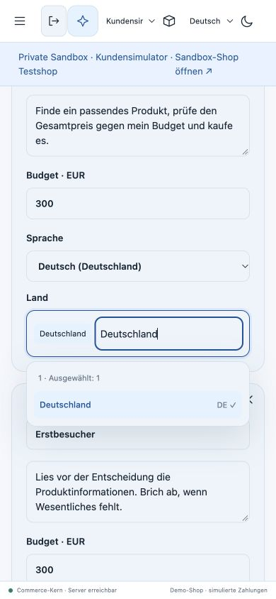

## Final combined public rollout

The complete [PR 199 verification](https://github.com/sthamann/veyndo/actions/runs/39797001796)
passed. It merged as `c948bccb`. The profile-label follow-up passed its complete
frontend/coverage lane again after the strict branch update
([run 39802944161](https://github.com/sthamann/veyndo/actions/runs/39802944161))
and [PR 200](https://github.com/sthamann/veyndo/pull/200) merged as `07812240`.
The full runtime tree of `07812240` is identical to the built source `f74d8ff9`.
The intermediate PR 196 and 197 implementations are included in PR 199; their
separate delivery branches were closed as superseded.

Northflank activated **`affluent-week-4541` / `f74d8ff9` at 17:20:12 CEST on
22 October**, deployment `vendune-core-66fcd94d4c`. Immediately before this rollout,
the service showed `teal-farm-4382` / `bbb8b5ab`, the unchanged merged PR 195 tree,
activated at 15:54:30. The first simulator deployment at 15:43 and the earlier
observations above retain their dates. No schema, credential, permission or
resource-size change was needed for this final rollout.

One automatically triggered post-merge main verification was explicitly cancelled
as a duplicate: `c948bccb` and the fully verified `db6acdb4` have identical complete
Git trees. The required PR check was successful, not bypassed. The separate UI and
documentation changes retain their own required checks.

### Public acceptance after the final rollout

The new Core passed its health check with PostgreSQL, knowledge retrieval and
explicitly simulated payment; its pod was running with 1/1 checks passing and
zero restarts. Full Studio reload retained the authenticated merchant and selected
private environment. Saved baseline `b0055539` and comparison `37ab55ad` retained
their original observations and order IDs across that restart.

The public profile editor now shows readable enabled language names and the shared
country search, including **Deutschland**. The catalogue-preparation grid shows
all five enabled content languages and actual saved-image state. For example,
the notebook has four completed languages and missing Italian; the test chair
has only English and no saved image. **Bild ergänzen** on that chair opened its
correct native product's **Medien** editor, retaining the private environment.
No image-generation request or paid retry was submitted for this check.

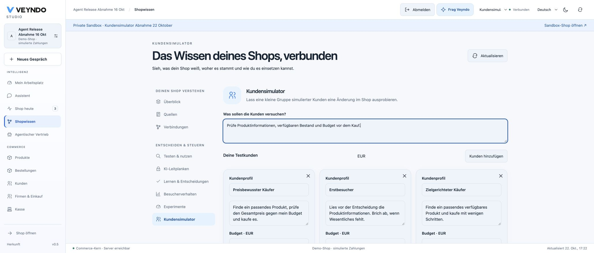

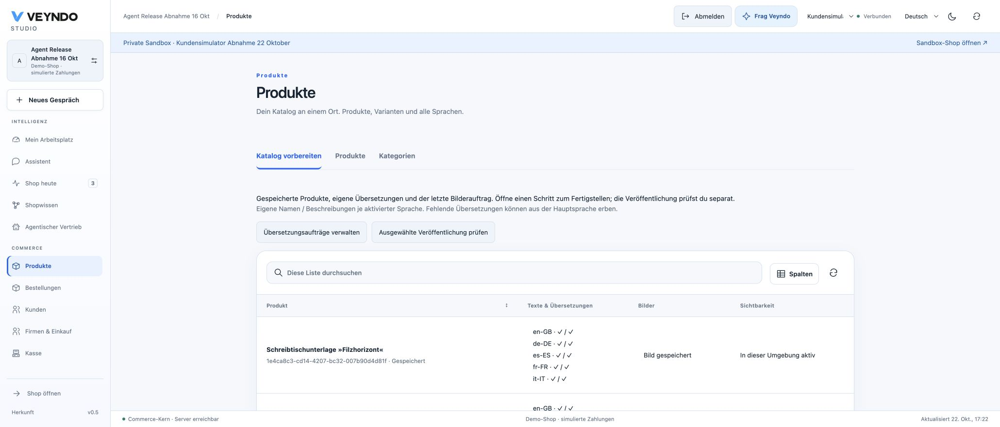

The existing Furniture Configurator's release view displayed its new connection
diagnostics: one view, one model, four agent tools, seven declared examples and
no unresolved references. Those counts describe the package; they do not by
themselves prove successful execution. Its existing unsaved draft kept the
scenario-launch button disabled, preserving the save-before-testing control.
The draft was neither overwritten nor discarded during this read-only check.

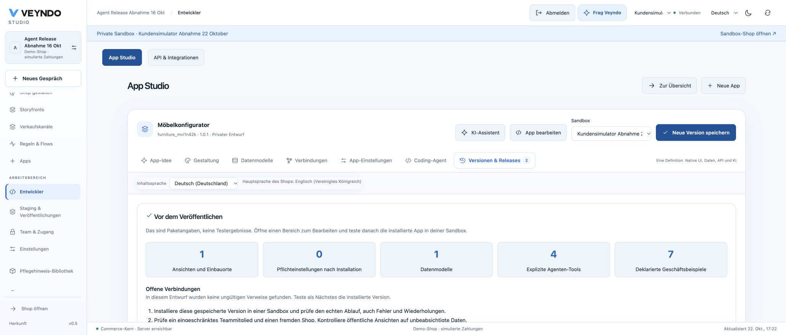

The actual configured `qwen3.6:35b` model answered the German request for a notebook
and pen holder under EUR 70 with **Notizbuch »Stille Seiten«** (EUR 28.90) and
**Stiftehalter »Tonruhe«** (EUR 34.50): EUR 63.40 before shipping. Native cards
displayed their stored images, descriptions, stock and prices. Removing the holder,
opening the notebook and returning retained the one-item selection; Restore
returned both cards without adding anything to the cart.

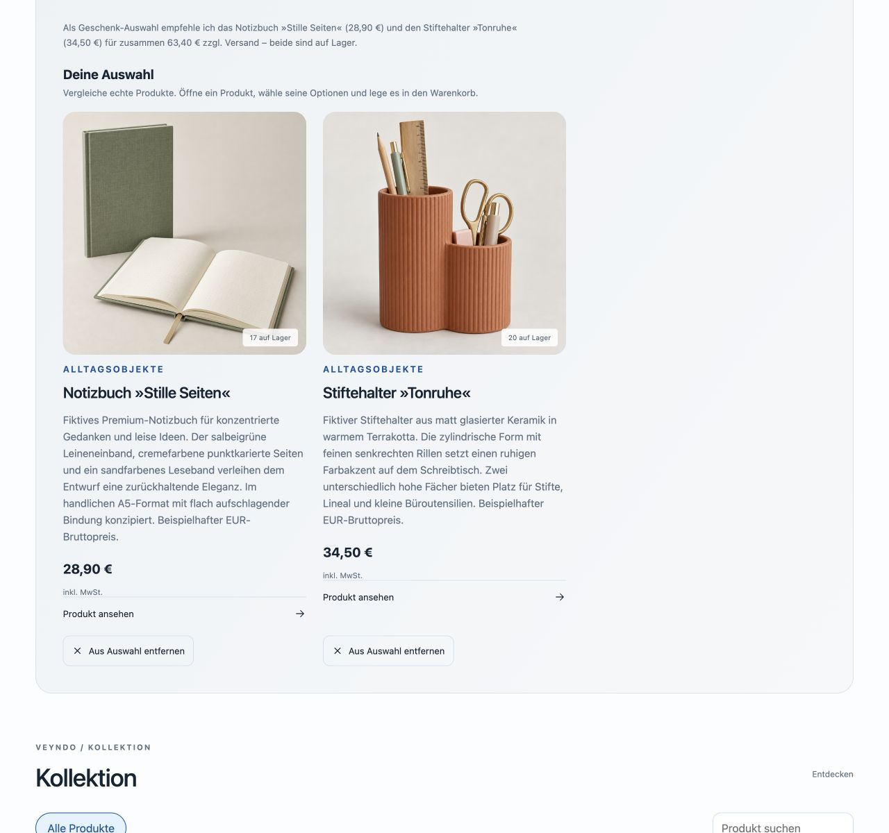

Opening the notebook card, adding quantity one and completing the ordinary native
checkout produced **`RAC-eb78b7d7`**, EUR 28.90 including EUR 4.61 VAT, German
product name, pickup and simulated payment. Return and full reload retained
**Warenkorb 0**, optional personalization off and no repeated privacy prompt.
Temporary device emulation was cleared before the purchase.

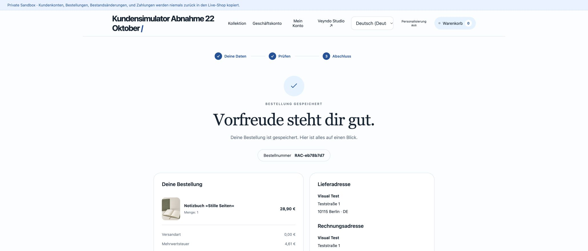

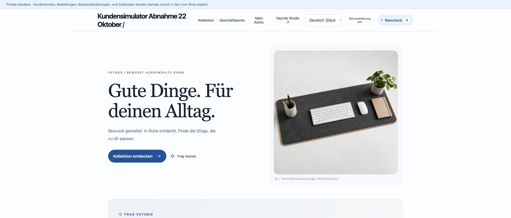

The original Lumen Storyfront was then tested again against this final Core,
using ordinary native Chrome input in the existing incognito session. Its first
Checkout action loaded the embedded privacy and contact/address steps. After
rejecting optional processing, **`RAC-3b44ea85`** completed for one German-named
demo lamp, EUR 59.90 including EUR 9.56 VAT, pickup and simulated payment. Receipt
return closed the iframe and showed the original bag's order-confirmed message
with no item. Full reload and reopening Bag retained **Nothing yet**. There was
no separate-checkout navigation, user manual test or security-setting change.
The earlier controlled-tab blank-load observation remains recorded above.

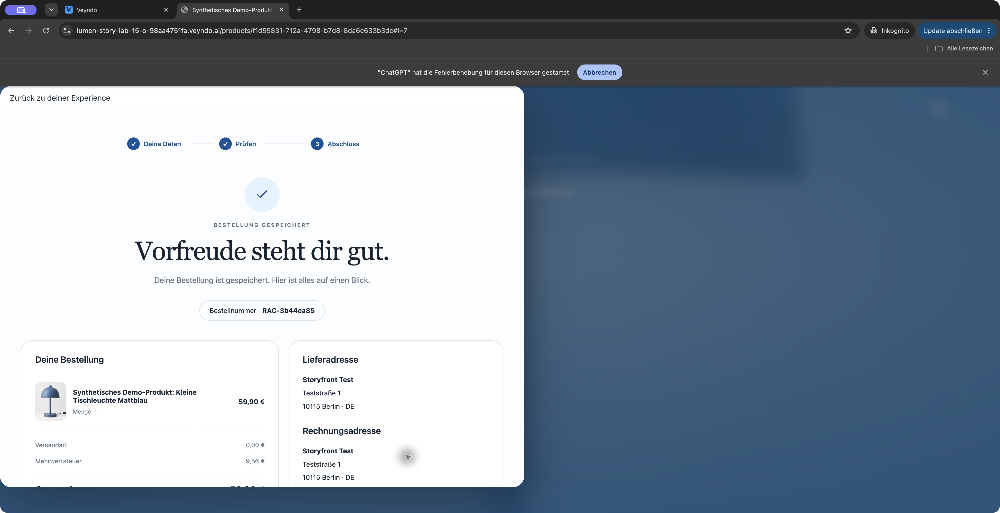

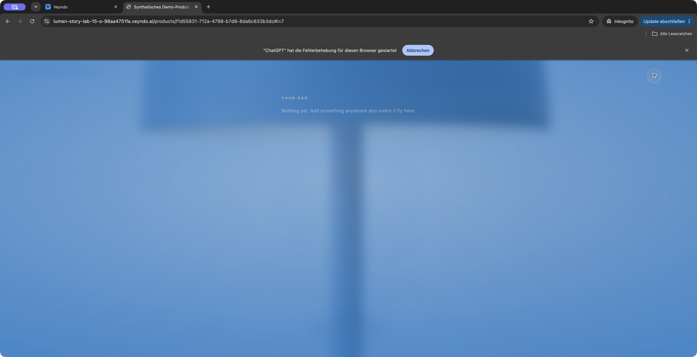

### Public homepage follow-through

A final apex check found that the React homepage is served by the separate private
Experience application, not the public Core static index. Its shared four-language
homepage was therefore updated in [Experience PR 77](https://github.com/sthamann/veyndo-experience/pull/77),
merged as `e53ae44a`. It explains private customer scenarios, catalogue readiness
and editable native shopping, with the actual saved public comparison screenshot
and links to these published instructions. The original Storyfront submodule pin,
identity, creation, provider and checkout code are unchanged.

The exact committed tree passed `bun run check` in an isolated temporary export:
TypeScript, 255 module boundaries, 951 localization keys, **249 tests in 58 files**
with 1,254 assertions, and the production frontend/team build. GitHub's separate
private application jobs did not start: the account annotation reports failed
recent payments or an insufficient spending limit. No test step ran there, no
workflow control or billing setting was changed, and that failed admission is not
labelled a successful CI run. Public Core CI and documentation deployment passed
independently.

The existing Northflank native build `adorable-mist-5131` from `e53ae44a` succeeded
in 1 minute 21 seconds, including both original Astro applications and the shared
homepage. It used the existing Dockerfile, runtime configuration and persistent
volume; no service, provider or credential was added.

A later Core observation showed `golden-horse-2498` from main `07812240`, activated
at 17:40:48 CEST, with 1/1 health checks and zero restarts. That source has the same
complete runtime tree as the originally accepted `f74d8ff9` artifact above.

The Experience artifact activated at **17:50:35 CEST**, deployment
`vendune-experience-675fc75c96`. After its ordinary startup the pod was Running,
1/1 checks passing with zero restarts. A request during the replacement briefly
returned **no healthy upstream**; the healthy-state public reload then displayed
the new section and the real comparison image. English and German rendered copy
was inspected. At 390 × 844, the document stayed at 390 px and the section at
350 px; the image loaded at its native width of 2,060 px. Device emulation was
cleared. Its three cards link to the simulator, native catalogue preparation and
shopper UI guides, while the evidence link opens this acceptance.

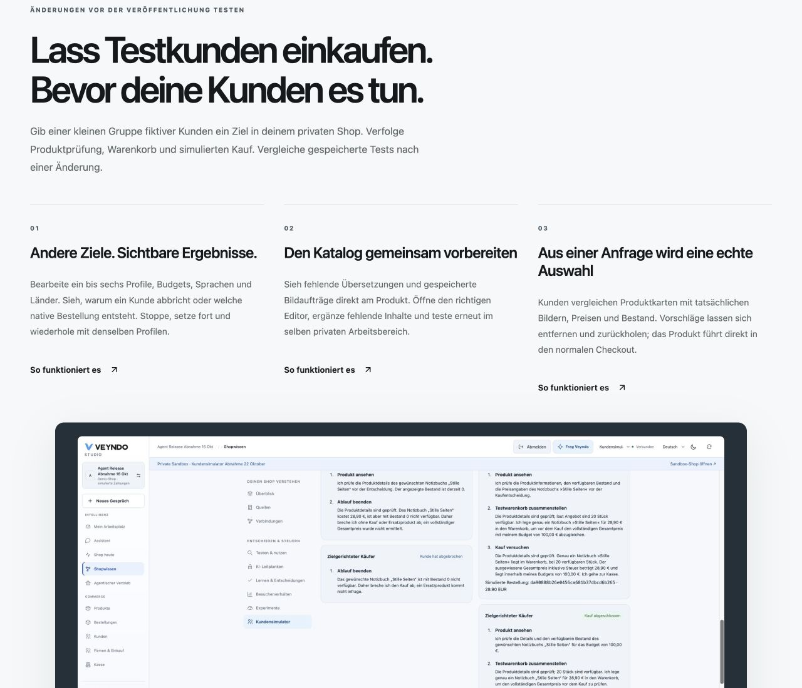

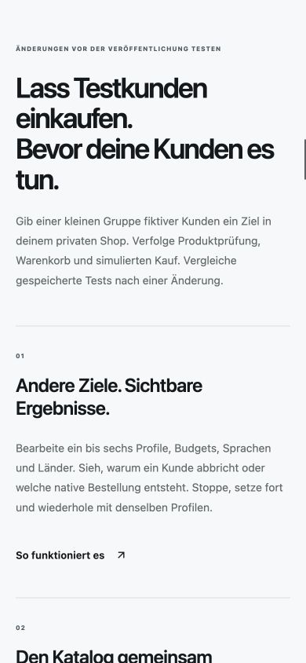

After the Experience restart, the original Lumen page was fully reloaded and its
retained one-item bag opened the embedded native checkout on the first action.
The new cart displayed its optional privacy choice; optional processing was
rejected for this purchase. **`RAC-b39c3fe0`** completed for one German-named demo
lamp, EUR 59.90 including EUR 9.56 VAT, pickup and simulated payment. The receipt
return closed the iframe and emptied the original bag. A second full page reload
and reopening Bag retained **Nothing yet**. This final repetition used ordinary
native input with synthetic contacts and no user manual test.

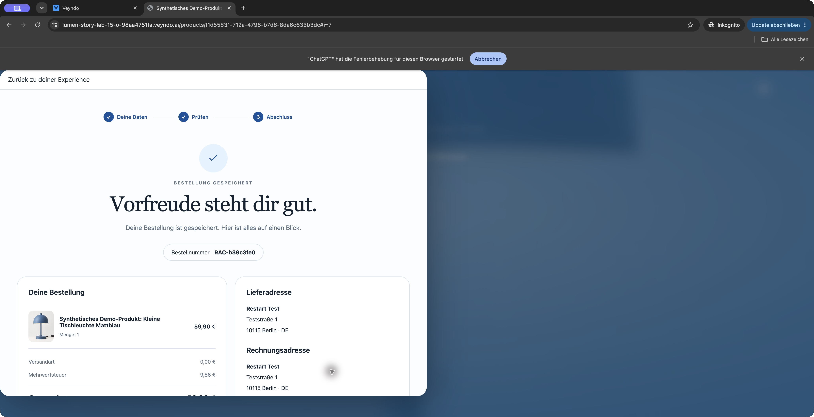

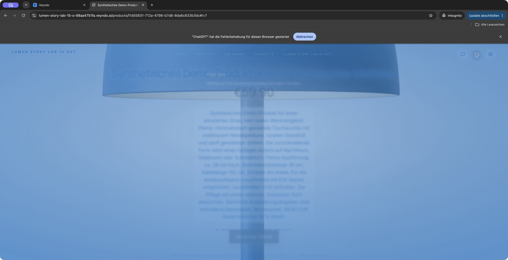

## Catalogue-based profile drafts: local follow-up

The follow-up adds a reviewed profile preview to the existing customer workbench.
Native HTTP/PostgreSQL verification checks the bounded product sample against the
actual public catalogue projection, restricts a second channel to one lamp, verifies
HTTP/MCP equality and confirms zero model requests during suggestion preparation.
The existing suite also repeats simulated purchases, exact-budget refusal, stock
failure/repair, cold restart after a lost checkout acknowledgement, permission
withdrawal and cancellation/lease expiry during native lock waits.

The new field projection has separate Rust checks for allowed fields, bounded size,
wrong currency, invalid prices and zero/two/three-digit scales. UI regressions cover
preview-before-adoption, retained merchant brief, explicit start, channel replacement,
empty samples and enabled-language fallback. A German-interface request also prepares
the French-only channel and completes its French-profile native purchase; English
profiles are rejected before queueing. Public deployment of this follow-up
remains separate from the earlier accepted release above until recorded here.

### Actual local model and browser result

Chrome used the real local Rust application and a new disposable PostgreSQL shop.
The suggestion preview showed six sampled channel products; adoption retained the
merchant's original task and populated editable goals, budgets, native languages
and destinations. Explicit start used the existing `agent-worker` with actual
Ollama `qwen3.6:35b`, not the synthetic provider fixture.

- The price-conscious profile stopped: Field Notes costs EUR 12.50 and its suggested
  budget was EUR 12.49. No order was created for that profile.
- The first-time German profile purchased the notebook for EUR 12.50, native private
  order ID `69f57816331f40579b6e2e1e14d789e2`.
- The focused Austria profile purchased the desk for EUR 452.77, native private
  order ID `e996ee766d6b432bb774df786791a5cc`. The engine's total differs from the
  model's earlier EUR 449 explanation; the native order is authoritative.

The private database contains exactly two orders and the parent live shop zero.
The 390 × 844 browser view has document width 390 px and suggestion width 358 px;
the temporary viewport override was cleared. These are local acceptance captures,
not a public rollout or real-customer conversion estimate. The full frontend suite
passes 816 tests across 140 files.

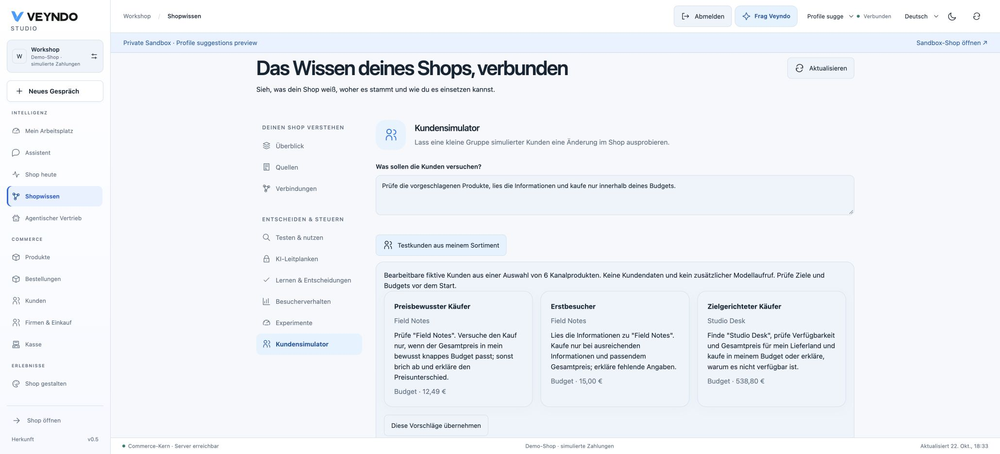

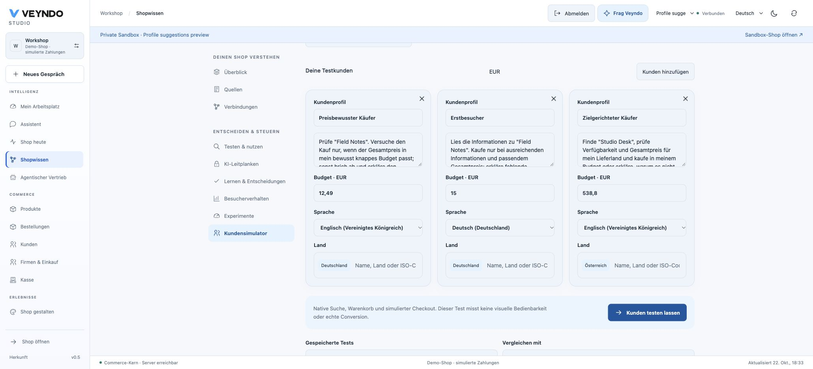

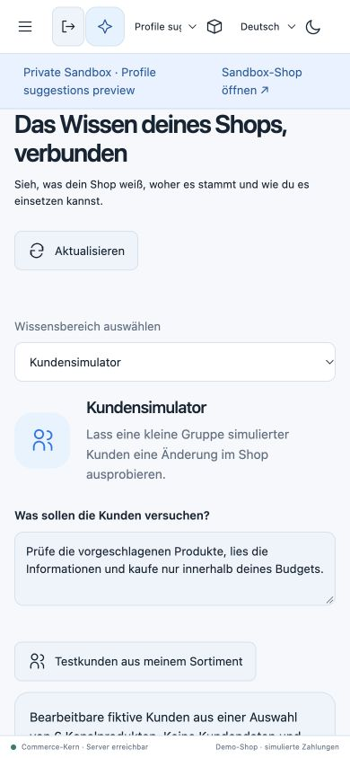

## Public catalogue-profile acceptance

The follow-up from [PR #203](https://github.com/sthamann/veyndo/pull/203) was tested
on the actual public Core and Studio. The exact feature image was activated while
the final required GitHub run continued. That [complete run](https://github.com/sthamann/veyndo/actions/runs/39824617289)
passed on `2bb5a99f` at **20:27:09 CEST**; regular protected merge followed at
20:27:28 CEST as `35755608472bff2690d77f76f7317bf146100084`. Git comparison
confirmed that the complete feature and merge trees are identical
(`fb25173baf3a24e49c4f009a7ef6c0a122178018`).

| Rollout step | Observed result |
| --- | --- |
| Core image | `loyal-line-5143`, source `2bb5a99f8776d0d9bbcd6da4ef32f1fae6a19a7c`; native Docker build completed in 8 min 32 sec. |
| Fresh backup | Disk snapshot `scenario-profiles-20261022-2bb5a99`, successful in 1 min 2 sec. Existing backups and schedules retained. |
| Existing migration-only job | Run `58ff1939-f4fd-4de4-a22f-e2817fc98cfc`, same image; native setup complete, exit 0, 20 sec. No new schema change or credential. |
| Public activation | `vendune-core-5d6dc8bffb`, 22 October 19:55:49 CEST, Running 1/1, health check passing, zero restarts. |
| Public model | Existing configured Ollama `qwen3.6:35b`; actual model decisions, not the controlled test-provider responses. Payment remains explicitly simulated. |

The existing authenticated Studio session survived the rollout and full reload.
Inside private sandbox `stage-62ddd2bbd80642e38c4f`, the native channel wizard
created **FR Customer Scenarios 22 October**, ID `shop_72a18e285109`, with only
French enabled and only the notebook product
`624eff3d-b57a-4d40-aa11-24c73f4e42e0`. This channel was not published to the live
shop. The Studio interface stayed German throughout.

**Testkunden aus meinem Sortiment** showed three fictional profiles from the one
native product, **Carnet « Pages silencieuses »**. The preview and explicit
adoption retained the merchant's original instruction. All shopper profiles used
French; Germany and Austria came from the enabled destinations. Only the later
**Kunden testen lassen** action started the actual model tasks.

Saved cohort `4b450a8a-31bd-4f04-9284-f51a9304cb7e` produced these outcomes:

| Profile | Budget | Observed native result |
| --- | --- | --- |
| Price-conscious buyer | EUR 28.89 | Stopped: the EUR 28.90 notebook exceeds the budget by one cent. No purchase for this profile. |
| First visitor, Germany | EUR 34.68 | Completed `RAC-95a1a609`, full order ID `95a1a60906a54e8cb86bca087f6dd9c4`, EUR 28.90. |
| Focused buyer, Austria | EUR 34.68 | Completed `RAC-455d1538`, full order ID `455d153835d44572be1485be97ff9c81`, EUR 29.14. |

The native private order grid increased from four existing orders to **exactly
six**; both new IDs appeared alongside the original four. Opening the Austria
order showed quantity one, the French product name, the Austrian destination,
EUR 29.14, simulated payment, pickup and the native `order.placed` Flow history.
The model's earlier prose mentioned EUR 28.90; the engine's country-specific
EUR 29.14 total is authoritative. These fictional addresses do not establish
physical shipping-provider validation or real settlement.

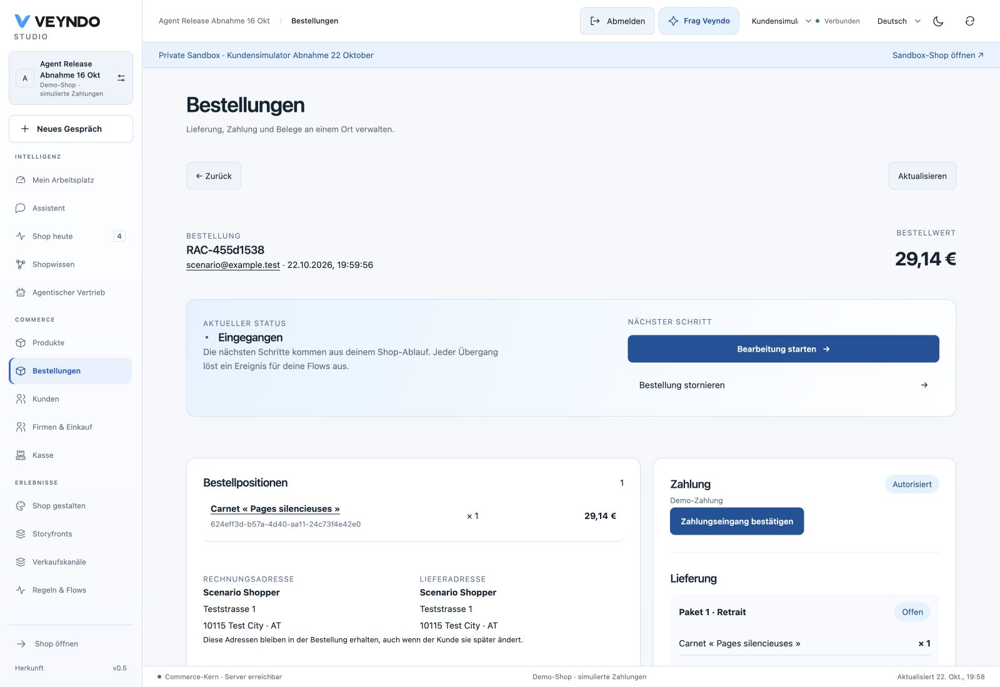

After a complete browser reload, selecting the saved cohort retained its original
two order IDs, journals and outcomes. **Diese Kunden erneut testen** restored the
original instruction, all three profiles and budgets, French, Germany/Austria,
without starting another cohort. No additional purchase was requested.

At 390 × 844, document width stayed 390 px and the suggestion panel measured
358 px. The temporary device override was cleared afterwards.

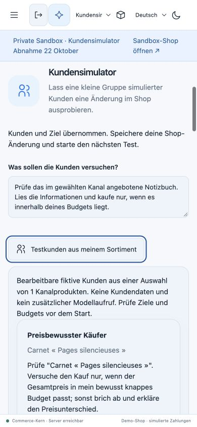

Local verification on this exact source includes the full **816-test frontend
suite**, TypeScript, production build, four-language localization, Rust format
and clippy, native projection unit tests, formal contracts and mutation negative
controls. Actual PostgreSQL integration repeated scenario cancellation, lease/
rights guards, cold restart, HTTP/MCP parity, native channel management,
international commerce and tenant isolation. Its German-interface request
prepared and purchased from the French-only channel, while English profiles were
rejected before queueing. The latest-head full CI run independently passed Rust,
formal, differential, frontend, native PostgreSQL/provider, signed runtime,
transaction-pooler and coverage gates. It took 47 min 37 sec; native integration
accounted for 34 min 40 sec. The earlier successful run on `1a60d6b8` is retained
as prior evidence, separate from this final result.

### Regular main rollout

The existing main-triggered workflow
`a9bbbf4b-8d1e-4c4a-aef7-e77e12130d94` then rebuilt exact main `35755608` as
`jovial-steel-7373` (8 min 56 sec), completed disk snapshot
`26-10-22-183633-backup` (1 min 12 sec) and ran the same image in the existing
migration-only job `acf281e1-917f-41a2-a931-27cbbf63bd9c` successfully (25 sec).
Core deployment `vendune-core-76ff6f475d`, created at **20:38:11 CEST**, reached
Running with **1/1 health checks passing and zero restarts**. The preceding pod
terminated normally. The full workflow completed successfully at 20:39:20 CEST.
No resource, provider, credential or permission setting was added.

A complete public Studio reload retained the authenticated private workspace,
all three saved cohorts and the French-only channel's language restriction.
Reopening the accepted cohort retained the budget refusal and the same two order
IDs. No customer test was started again after the main rollout.
