# Private customer scenarios — 22 October 2026

## Local acceptance

The compiled Rust Core, real PostgreSQL and Chrome were used with a disposable
synthetic shop. The sandbox was `stage-698dee6ea85a41a1aa69`; all buyers use
`example.test` addresses. This is local evidence, not a public deployment claim.

The browser goal was: find a desk lamp, inspect its product information, stay
within the customer's budget and purchase only if the native total fits. Three
editable profiles used German content and Germany: a budget buyer with EUR 1.00,
a first-time buyer with EUR 300.00 and a focused buyer with EUR 300.00.

The actual local Ollama model `qwen3.6:35b` chose the actions. In the final run:

- The EUR 1.00 buyer finished without buying: even the cheapest observed product
  exceeded its budget.
- The first-time buyer inspected the Arc desk lamp, added it and completed native
  simulated order `eaf1dedb714242238f8f3ffdff0be0cb` for EUR 79.90.
- The focused buyer inspected the lamp, added it and completed native simulated
  order `4673d92ab8de496088f320136dbc58ed` for EUR 79.90.

Both orders appeared in the ordinary sandbox order grid. Full browser reload
retained the saved test history. Reusing a test restored its exact profiles,
instruction and model selection. Baseline and selected results appeared together;
the interface warned that changed starting stock and model decisions affect the
comparison. Desktop and 390 × 844 mobile controls were inspected.

## Defects found and fixed during acceptance

The first real-model run interpreted `budgetMinor: 100` as EUR 100. The native
checkout nevertheless rejected that attempted purchase because the true budget
was EUR 1. The model input now receives the exact decimal `budgetAmount` and an
explicit currency, without the ambiguous minor-unit field. The repeated run
above correctly stopped before checkout. This preserves the failed observation
instead of treating the first run as successful model reasoning.

Independent review and native races also found and repaired nested database-pool
acquisition during checkout, cancellation while waiting for a cart lock, and a
lease expiring while waiting for the task lock. The final transaction fence checks
current authority and the lease after those waits. UI regressions cover stale
scope/selection responses, resumed polling and incomplete comparison snapshots.

## Automated verification

- 796 frontend tests across 134 files passed; the seven simulator tests include
  private admission, retained edits, shop changes, exact repetition, continuation,
  late-control responses and pending comparisons.
- Rust unit tests, Clippy, formatting, source/permission/localization boundaries,
  generated operation contracts and the production formal checks passed. The
  formal checks concern extracted policies, not a proof of the entire simulator.
- The registered `agentic_scenarios` suite used actual native HTTP/PostgreSQL
  transactions: idempotent cohorts, exact budgets, two-connection concurrency,
  injected catalogue text, lost checkout acknowledgement/cold restart, multiple
  products, stock failure then repair, cancellation, lease expiry, foreign access,
  revoked rights and emergency stop.
- Restricted signed system/tenant roles were tested with two replicas and the
  workspace-role, durable-agent and scenario paths. This was a focused signed-role
  run, not a repetition of every HTTP suite under that configuration.
- Connected suites passed: checkout review, staging, developer documents,
  automation lifecycle, catalogue management, configured business capability,
  agentic commerce and the five-source migration assistant. Qdrant was started in
  an isolated local store after an earlier dependency-unavailable failure.

The agent journey uses native APIs. The screenshots prove the merchant workbench
was rendered in Chrome; they do not imply customer agents navigated a browser or
that synthetic purchase rates predict real conversion. No real payment or mail
delivery was performed. Public rollout and acceptance are recorded separately.

## Connected catalogue and app follow-through

The follow-up adds **Products → Prepare catalogue** over the same paged native
product read, with explicit enabled-language name/description coverage, latest
image-job state and direct native text/media editor links. Chrome verified the
private Workshop catalogue, including an explicitly injected failed-provider
fixture for `chair`, reopening the media tab and its retained German failure
message. Other saved product images remained present. No paid image call was made.
Legacy main-language source columns are counted exactly as in the native editor.

The catalogue HTTP/PostgreSQL/MCP suite passed with failure persistence, foreign-shop
absence, unauthorized denial and selected publication. Image UI regressions cover
locale refresh during creation, delayed post-commit reconciliation, keeping writes
blocked through that reconciliation, and discarded results from a previous scope.
The app diagnostics now identify missing view/model/action references, nested calls,
API routes and Intelligence references, with direct links to the existing editors.
They remain draft feedback; native authorization and installation validation apply.

The native Product Advisor template was saved and installed privately in Chrome.
Its app review panel and **Customer simulator** button opened the same private
scenario workbench. A 390 × 844 check found and repaired intrinsic grid overflow;
the repeated check measured a 390 px page and a 358 px preparation area. The shared
table keeps its own horizontal scroll.

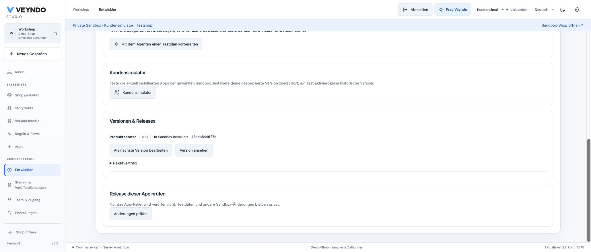

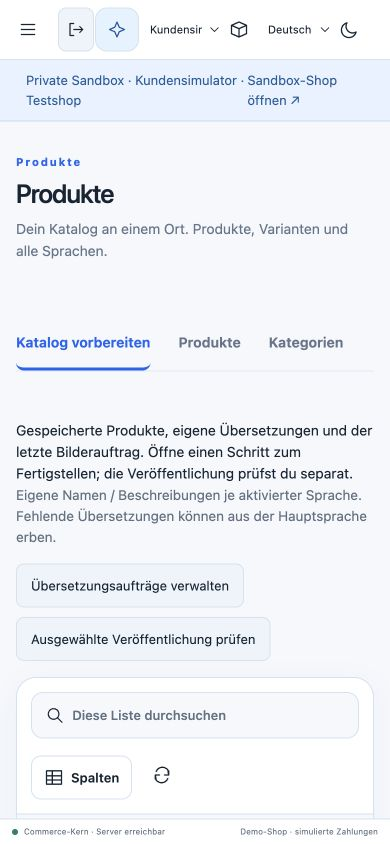

## Native intent-to-purchase browser journey

After the connected changes, Chrome completed an ordinary shopper journey on the
same private local shop. The actual Ollama `qwen3.6:35b` model compared the Field
notebook (EUR 12.50) and Terra cup (EUR 24.90) as gifts within EUR 40. The shopper
opened the notebook's native product detail, added it to the native cart, entered
synthetic `example.test` contact data, selected free pickup and completed the
explicitly simulated payment.

Order `RAC-c29bc2b9` retained the German notebook name, EUR 12.50 total and EUR 0.82
VAT. Returning to the shop and fully reloading both showed **cart 0**. The earlier
optional-privacy rejection remained in effect without a repeated prompt. The
privately installed Product Advisor view was present on the native detail page.
This acceptance concerns the native shopper route; it is not a fresh certification
of the separate Storyfront iframe or of real settlement/mail delivery.

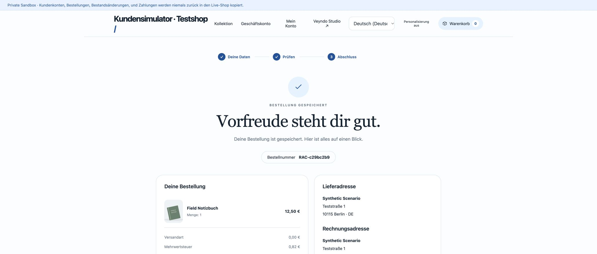

The final connected frontend run passed 805 tests across 137 files, including the
image-job reconciliation and app-reference diagnostics regressions. Rust unit
checks, Clippy, operation contracts, source inventory, structure checks and the
extracted formal-policy/conformance checks passed again for that branch.

## Public rollout and customer-scenario acceptance

After the complete required [GitHub verification](https://github.com/sthamann/veyndo/actions/runs/39781601614)
passed, [PR 195](https://github.com/sthamann/veyndo/pull/195) merged as `bbb8b5ab`.
Northflank Core was updated at **15:43 CEST on 22 October** from
`sunset-spoon-5707` (`defac3dc`) to the already-built `distinct-giants-7353`
(`2253a627`). The new instance passed its health check with zero restarts. There
was no schema migration or change of database credentials for this release.

Chrome resumed the existing merchant session on `app.veyndo.ai`. All acceptance
below uses the separate full private sandbox `stage-62ddd2bbd80642e38c4f`, named
**Kundensimulator Abnahme 22 Oktober**. No catalogue/stock change was published.
The actual configured `qwen3.6:35b` model chose the shopper actions.

The shared goal was to buy only **Notizbuch »Stille Seiten«**, inspect details,
check stock and the complete price, and choose no substitute. Profiles used
German/Germany, with budgets of EUR 1.00, EUR 100.00 and EUR 100.00.

1. Set the notebook's private stock to zero. All three customers stopped without
   buying. The budget buyer also correctly identified EUR 28.90 as over EUR 1.00.
2. Restore only that private stock to 20. **Use these customers again** restored
   the exact goal, profiles, budgets, languages and inference selection.
3. In the repeated run the budget buyer still stopped. The first-time and focused
   buyers inspected the notebook, created separate native carts and completed
   simulated orders `da90888b26e0456ca681b37dbcd6b265` and
   `c6b82f0fe7274034af388e9977cafbcc`, each for **EUR 28.90**.
4. The comparison identified matching inputs and a changed observed catalogue.
   The ordinary private order grid contained exactly those two orders. Opening
   `RAC-c6b82f0f` showed the German product name, quantity one, Demo payment,
   pickup and the native `order.placed` Flow history.

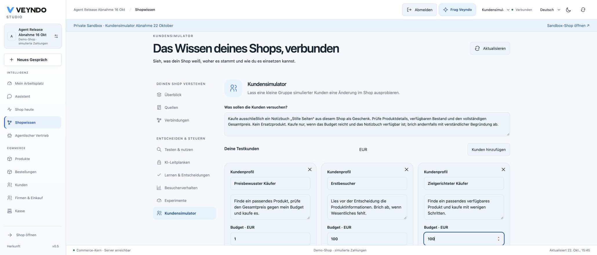

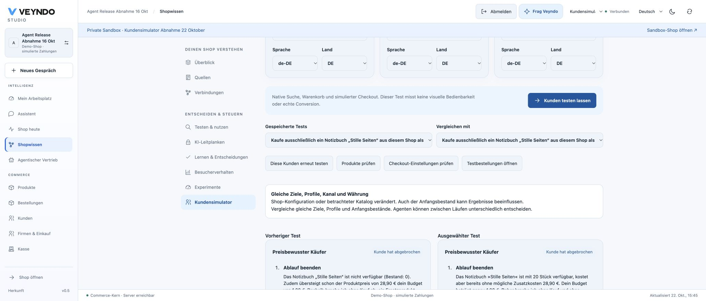

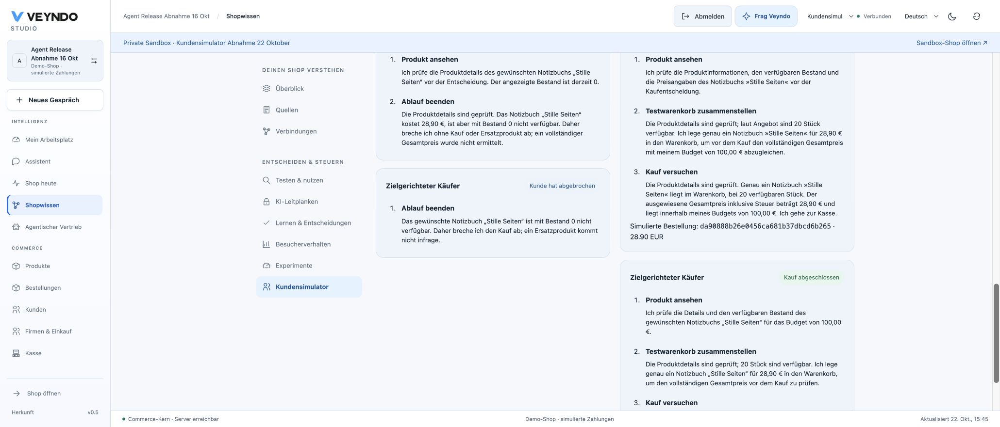

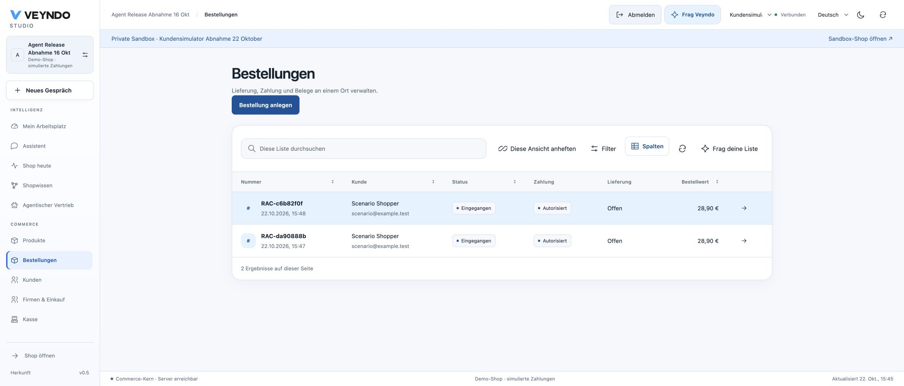

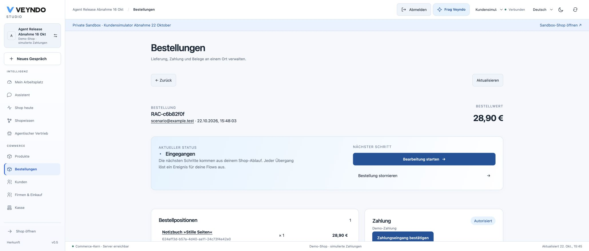

Full Studio reload, reselecting the same sandbox and reopening saved groups
`b0055539-5fd2-4439-9d50-5a8665384d5a` and
`37ab55ad-c97a-4ca0-b0a6-3a1303aacda5` restored both action journals and the original
order IDs without starting another customer. The public 390 × 844 viewport had a
390 px document and 358 px scenario area; editable cards and selectors remained
inside that area. Temporary viewport emulation was cleared after the check.

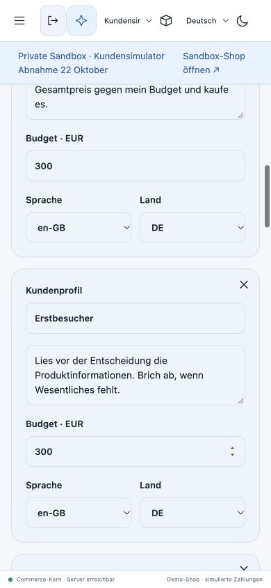

### Public native shopper regression after the rollout

A separate Chrome tab rejected optional tracking, asked the real shopper assistant
to compare the notebook and Stiftehalter »Tonruhe« within EUR 40, followed the
notebook's returned native detail link and bought one notebook with synthetic
contact/address data. The assistant correctly quoted EUR 28.90 and EUR 34.50,
and rejected the pair's EUR 63.40 as over the combined budget.

The normal checkout completed **`RAC-90aa93a4`**, EUR 28.90 including EUR 4.61 VAT,
with the German product name and explicitly simulated payment. Return and full
browser reload both retained **cart 0**, optional personalization remained off,
and no repeated privacy prompt appeared. The admin then contained exactly three
orders: the two simulator orders plus this separate browser purchase.

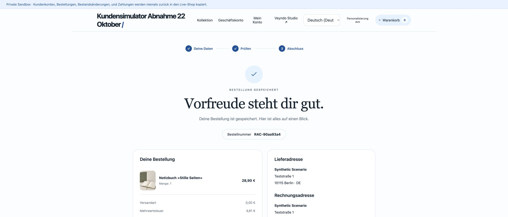

These are public native API/checkout observations in a private sandbox. They do
not constitute visual customer-agent navigation, a controlled conversion study,
real provider settlement or mail delivery. A separate original Storyfront check
is recorded below.

### Original Storyfront iframe regression on the simulator Core

The separate original Lumen Experience was tested against Core `2253a627` as well.
A fresh extension-controlled tab timed out with an empty iframe on its first open
and ordinary retry; no console error was captured. Its unpurchased diagnostic
basket item was removed afterward. This observation is retained as a browser-control
reliability limit rather than labelled a successful first load.

A separately reloaded native Chrome incognito session then added the synthetic
**Kleine Tischleuchte Mattblau**. Its first ordinary Checkout action loaded the
embedded native privacy/contact/address form. Native browser input completed
**`RAC-cf96e844`**, quantity one, German product name, EUR 59.90 total and EUR 9.56
VAT, using pickup and explicitly simulated payment. The receipt return closed the
iframe and the original Storyfront bag showed the order-confirmed message and no
purchased item. A full reload, hydration and reopening the original Bag retained
**Nothing yet**. No manual user test, separate-checkout purchase, interception or
browser security-setting change was used for this accepted journey.

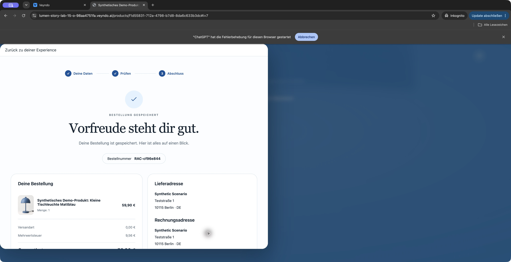

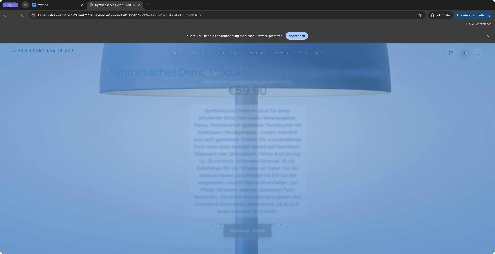

## Editable visual shopper selection

The follow-up replaces text-only product links with native product cards and a
reversible shortlist. Local Chrome and the real `qwen3.6:35b` model compared Field
Notizbuch (EUR 12.50) and Terra Becher (EUR 24.90). The cards displayed native
images, descriptions, stock and prices. Removing the cup changed only the
shortlist; opening the notebook and returning preserved that removal. Restore
returned both cards without changing the basket.

The selected notebook used its ordinary detail page, including the installed
Product Advisor slot, then native checkout. Simulated order **`RAC-fcbe27c7`**
completed for EUR 12.50 including EUR 0.82 VAT with the German product name. Return
and full browser reload retained **cart 0**. A 390 × 844 check measured a 390 px
document and 312 px selection. Switching to Spanish removed the preceding German
answer immediately. Temporary device emulation was cleared.

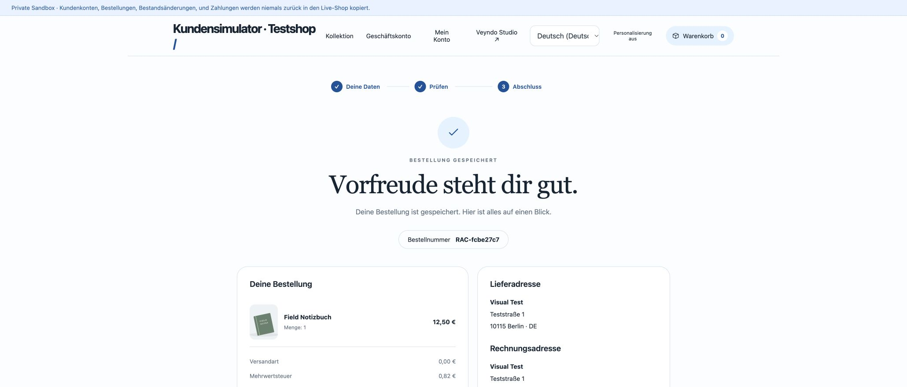

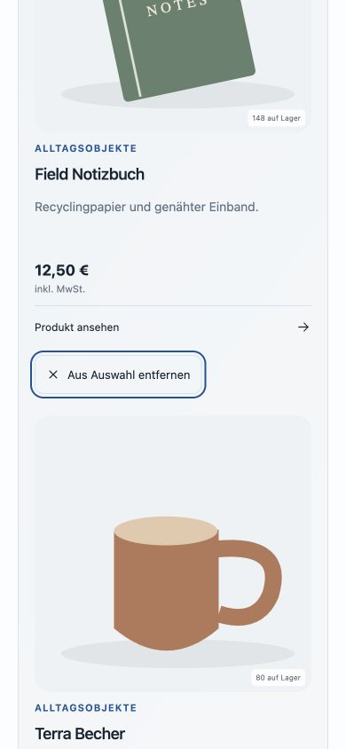

All **810 frontend tests across 138 files**, TypeScript, production build,
localization and structure checks passed. Targeted regressions verify native
product facts, duplicate/missing IDs, reversible removal, detail/back retention
and rejection of late provider results and errors after a scope change. Independent
review confirmed the navigation and stale-error repairs. This section records
local browser acceptance; public delivery is recorded separately.

The complete catalogue/app follow-up CI also passed on `6b314459`
([run 39789784144](https://github.com/sthamann/veyndo/actions/runs/39789784144)),
including its actual database/provider suites and coverage gates. Its delivery
is consolidated with visual shopping in PR 199 rather than landing intermediate
release branches separately. The shared runtime tree at `db6acdb4` is identical
to the built source `aa1dd115`; only merge ancestry changed.
