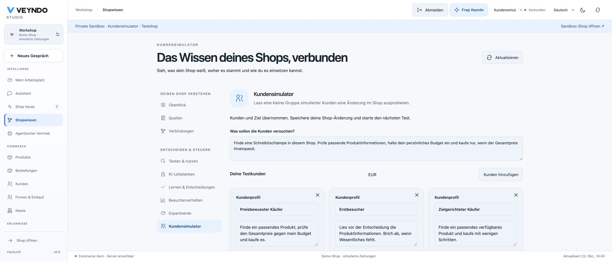
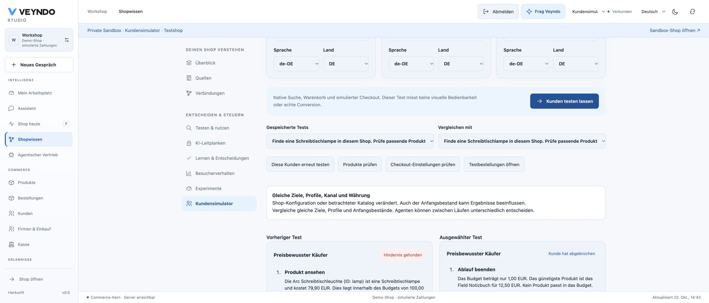
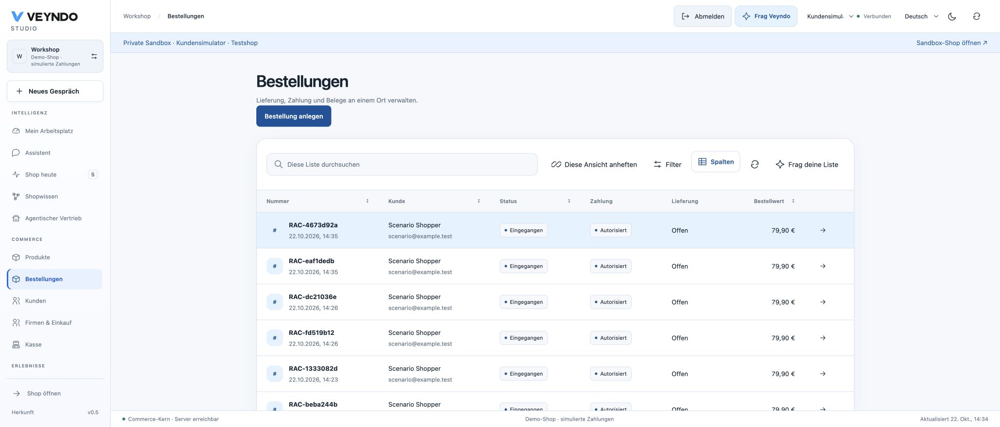
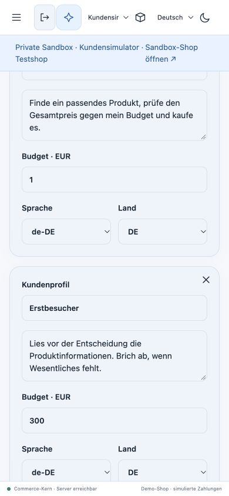
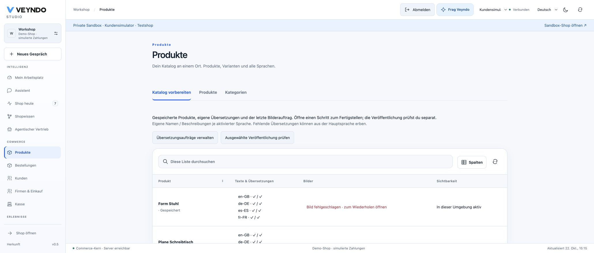

# Private customer scenarios — 22 October 2026

## Local acceptance

The compiled Rust Core, real PostgreSQL and Chrome were used with a disposable
synthetic shop. The sandbox was `stage-698dee6ea85a41a1aa69`; all buyers use
`example.test` addresses. This is local evidence, not a public deployment claim.

The browser goal was: find a desk lamp, inspect its product information, stay
within the customer's budget and purchase only if the native total fits. Three
editable profiles used German content and Germany: a budget buyer with EUR 1.00,
a first-time buyer with EUR 300.00 and a focused buyer with EUR 300.00.

The actual local Ollama model `qwen3.6:35b` chose the actions. In the final run:

- The EUR 1.00 buyer finished without buying: even the cheapest observed product
  exceeded its budget.
- The first-time buyer inspected the Arc desk lamp, added it and completed native
  simulated order `eaf1dedb714242238f8f3ffdff0be0cb` for EUR 79.90.
- The focused buyer inspected the lamp, added it and completed native simulated
  order `4673d92ab8de496088f320136dbc58ed` for EUR 79.90.

Both orders appeared in the ordinary sandbox order grid. Full browser reload
retained the saved test history. Reusing a test restored its exact profiles,
instruction and model selection. Baseline and selected results appeared together;
the interface warned that changed starting stock and model decisions affect the
comparison. Desktop and 390 × 844 mobile controls were inspected.

## Defects found and fixed during acceptance

The first real-model run interpreted `budgetMinor: 100` as EUR 100. The native
checkout nevertheless rejected that attempted purchase because the true budget
was EUR 1. The model input now receives the exact decimal `budgetAmount` and an
explicit currency, without the ambiguous minor-unit field. The repeated run
above correctly stopped before checkout. This preserves the failed observation
instead of treating the first run as successful model reasoning.

Independent review and native races also found and repaired nested database-pool
acquisition during checkout, cancellation while waiting for a cart lock, and a
lease expiring while waiting for the task lock. The final transaction fence checks
current authority and the lease after those waits. UI regressions cover stale
scope/selection responses, resumed polling and incomplete comparison snapshots.

## Automated verification

- 796 frontend tests across 134 files passed; the seven simulator tests include
  private admission, retained edits, shop changes, exact repetition, continuation,
  late-control responses and pending comparisons.
- Rust unit tests, Clippy, formatting, source/permission/localization boundaries,
  generated operation contracts and the production formal checks passed. The
  formal checks concern extracted policies, not a proof of the entire simulator.
- The registered `agentic_scenarios` suite used actual native HTTP/PostgreSQL
  transactions: idempotent cohorts, exact budgets, two-connection concurrency,
  injected catalogue text, lost checkout acknowledgement/cold restart, multiple
  products, stock failure then repair, cancellation, lease expiry, foreign access,
  revoked rights and emergency stop.
- Restricted signed system/tenant roles were tested with two replicas and the
  workspace-role, durable-agent and scenario paths. This was a focused signed-role
  run, not a repetition of every HTTP suite under that configuration.
- Connected suites passed: checkout review, staging, developer documents,
  automation lifecycle, catalogue management, configured business capability,
  agentic commerce and the five-source migration assistant. Qdrant was started in
  an isolated local store after an earlier dependency-unavailable failure.

The agent journey uses native APIs. The screenshots prove the merchant workbench
was rendered in Chrome; they do not imply customer agents navigated a browser or
that synthetic purchase rates predict real conversion. No real payment or mail
delivery was performed. Public rollout and acceptance are recorded separately.

## Connected catalogue and app follow-through

The follow-up adds **Products → Prepare catalogue** over the same paged native
product read, with explicit enabled-language name/description coverage, latest
image-job state and direct native text/media editor links. Chrome verified the
private Workshop catalogue, including an explicitly injected failed-provider
fixture for `chair`, reopening the media tab and its retained German failure
message. Other saved product images remained present. No paid image call was made.
Legacy main-language source columns are counted exactly as in the native editor.

The catalogue HTTP/PostgreSQL/MCP suite passed with failure persistence, foreign-shop
absence, unauthorized denial and selected publication. Image UI regressions cover
locale refresh during creation, delayed post-commit reconciliation, keeping writes
blocked through that reconciliation, and discarded results from a previous scope.
The app diagnostics now identify missing view/model/action references, nested calls,
API routes and Intelligence references, with direct links to the existing editors.
They remain draft feedback; native authorization and installation validation apply.
