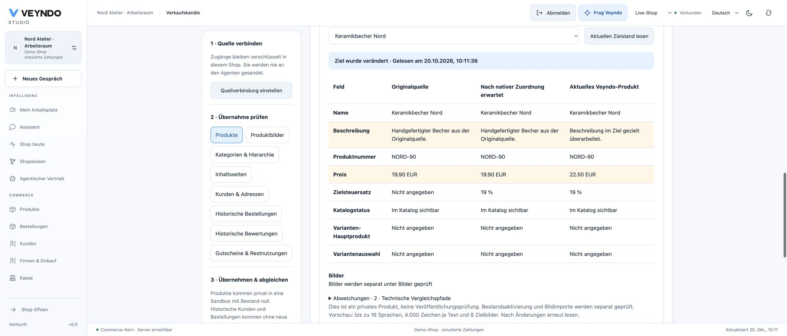

# Guided design and current product comparison — local acceptance, 20 October 2026

Scope: implementation branch `feat/design-onboarding-migration-review`, based on
`9524af8c`. This is local synthetic acceptance, not a public service release.

## User journeys

- Actual Chrome/HttpOnly merchant login on an isolated native Core; live shop
  remains visible in Shop design. Select an existing private workspace, review
  the actual Shop design and Forms inbox packages separately, then return to the
  previously selected Agent with enabled reference URLs and image upload. Setup
  neither saves a page nor publishes it.
- Actual independent Rust migration service reads a synthetic WooCommerce source
  into an ordinary native leased review job. The browser selects the private
  target, confirms source tax basis and destination rate, and reads the missing
  native product. The reviewed source page is then imported through the existing
  native job/callback path. The German source and private target main language
  are explicitly aligned; the live shop is unchanged and stock remains zero.
- Changing the private product through the native editor from 19.90 to 22.50 EUR
  and changing its German description appears as two differences in the browser's
  fresh comparison. A foreign/live lookup cannot see that private imported ID.
  Preview reads do not overwrite it. Saved historic completion evidence retains
  its original meaning and is not a claim about subsequent manual edits.

## Verification

| Check | Observed result |
|---|---|
| Full frontend unit suite | 122 files, 706 tests pass |
| TypeScript, production frontend build | Pass; existing bundle-size advisory remains |
| Rust workspace tests, clippy with warnings denied, formatting | Pass |
| Actual migration PostgreSQL/HTTP/MCP suite | Pass, including explicit preview, unchanged default, missing/foreign/current-role denial |
| Tenant isolation and migration suite under separate signed database logins | Pass |
| Native typed TS/WIT/OpenAPI inputs | Regenerated from compiled operation registry |
| Production contracts and negative mutations | Pass; projection/SQL/async remain explicitly unproved adapters |
| Structure, package ownership, localization and source inventory | Pass |
| Documentation site and complete local links | Built and checked |

The fresh whole-branch review found a delayed sandbox handoff after leaving the
editor. A failing regression reproduced it; mount/scope generation and a current
handoff predicate now fence both the creation reply and host environment refresh.
Pending home-section continuation also retains its original scope. Browser-observed
stale product comparison after import is discarded when job status changes; its
regression failed before the repair and passes afterward.

No paid inference, real source credentials, real payment, production database or
production hosting configuration is involved. The previously prepared hosted
migration service remains stopped at its separately held gateway-key entry.
