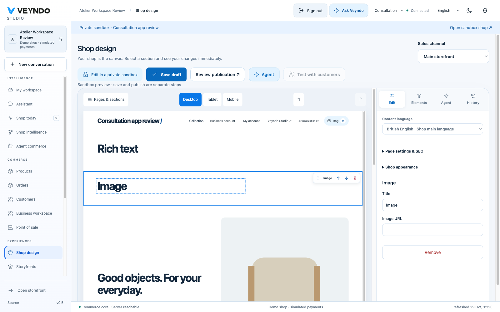
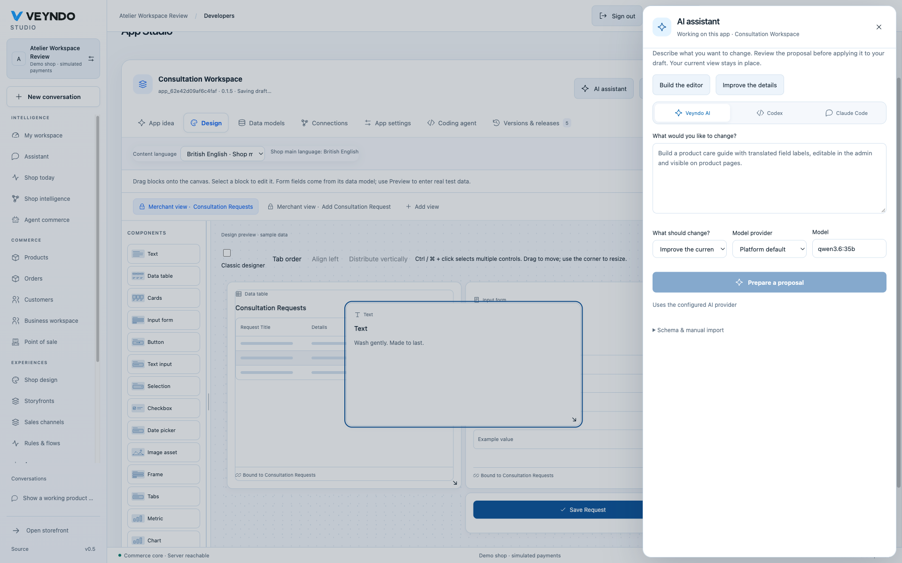
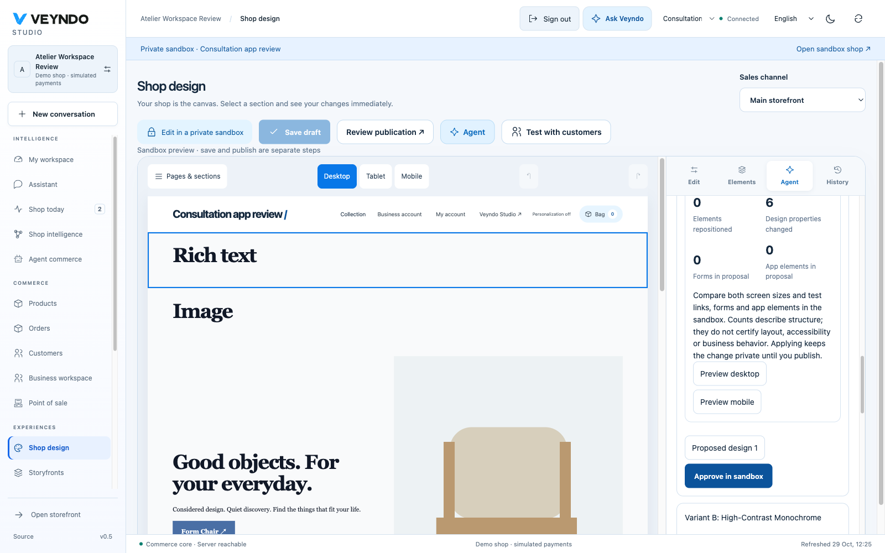
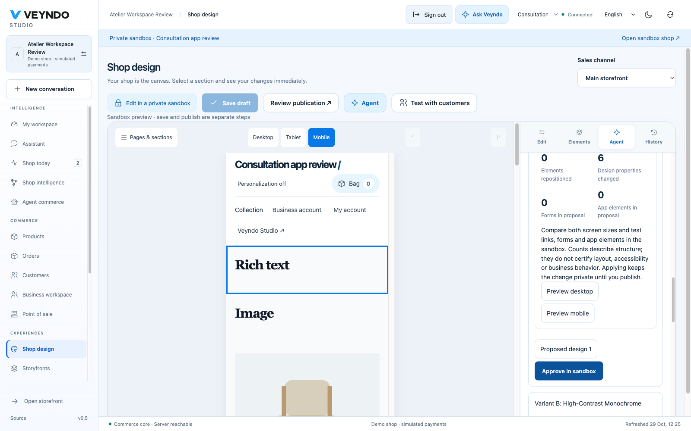

# Shop and app designer acceptance: 29 October 2026

This is local headed Chromium acceptance on the native Rust preview with the real
local `qwen3.6:35b` model. Hosted Core delivery remains separate. Test changes stay
inside the synthetic private shop; no real payments or external account changes.

## Actual editor gestures

In Shop design, dragging the illustrated Rich text card into the actual preview
inserted it before the hero. An Image drag then added a fourth section. The visible
placement status identified the target section before release. Dragging the Image
grip moved it between Rich text and the hero; Move down, Undo, Remove element and
Undo deletion all changed the rendered sections as expected. Save draft and reload
retained the native page. No script permission was added to the isolated preview.

In App Studio, a real palette Text drag added a fourth control to the existing
consultation form canvas. Dragging that control changed its native grid position
from column 4 / row 2 to column 7 / row 13; Undo restored the prior geometry.
The contextual AI assistant opens beside that same app with Veyndo AI, Codex and
Claude Code choices. This acceptance exercises existing app-owned editing; it does
not claim a new arbitrary source-code build service. A preview restart temporarily
showed a retry message; Refresh recovered the unsaved four-control draft.

## Selected target and screenshot reference

Selecting a section now defaults the design agent to that section. Explicitly
choosing Whole page persists until the selection changes. Colors, typography and spacing are page-wide theme properties. Selected sections
default to content editing and explain how to choose Whole page for style. A direct
unsupported section-only theme request rejects before model invocation or review
task creation. Independent review caught that combination; both the native and
component regressions failed before repair and passed afterward. The focused regression
also checks that a prepared Codex task carries the selected section ID.

The real image call initially failed with `Invalid design blocks`: a style-only
request unnecessarily asked the model to repeat the complete encoded page. The
host now preserves the native content itself when both content and structure are
deselected; the provider schema constrains the unused document to `{}`. Other
requests retain native document parsing and validation.

Uploading the already captured shop screenshot and requesting restrained blue
accents, whitespace and serif headings returned three alternatives. The model
reported what it recognized: editorial spacing, serif display headings and subtle
blue interaction accents. Desktop and mobile previews showed the actual proposed
style, with zero inserted, removed or repositioned sections and six theme changes.

Approving the first alternative in the sandbox saved page revision 4. A native API
comparison verified exact content equality with revision 3; only theme changed to
serif, blue `#4A6FA5`, background `#F9FAFB`, foreground `#111827`, spacing 32 and
radius 0. The parent live shop still has no site-builder installation.

`site-design@1` is an app-owned immutable prompt with a SHA-256 manifest. The
existing inference evidence records its ID/template digest and rendered prompt
digest in the normal reviewed task. Prompt checks cover app-owned manifests,
duplicate IDs and immutable history. References never grant write or publication
permission; ordinary current rights, page revisions and selected release remain.

## Verification

The selected-target component case and native style-only fixture failed before
the fixes and passed afterward. Full frontend verification passed 845 cases across
150 files; the Rust workspace passed 339 tests and strict Clippy. Registered
`visual_workspace` and `app_studio` suites passed against actual Rust/PostgreSQL.
Structure, localization, prompt governance and extracted formal policies passed;
Lean mutation controls rejected 184 broken policies with the baseline accepted.
The provider fixture checks transport/admission separately from the real image run.

## Delivery

The final source passed [complete required Linux CI](https://github.com/sthamann/veyndo/actions/runs/40870949354)
and reached public Core through PR #229. The public pointer gestures, selected
agent scope, three URL-based proposals, private revision adoption and subsequent
localized purchase retain their own [public screenshots and exact order](platform-followups-hosted-2026-10-29.md#public-designer-gestures-and-selected-agent-scope).
The actual local screenshot-derived run above remains distinct from that public
URL-derived run.
