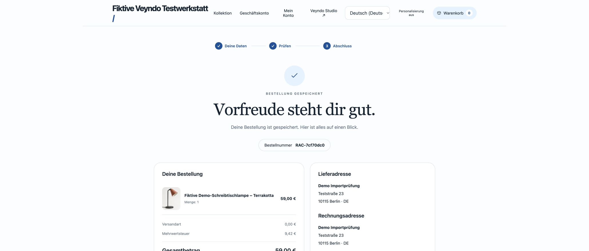
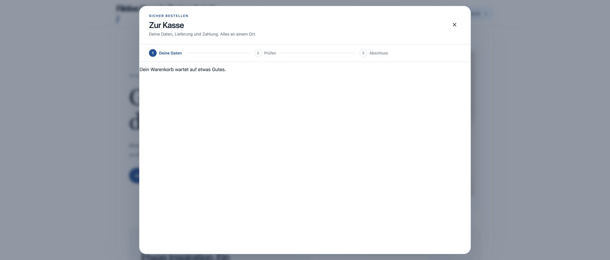

# External order batching, 23 October 2026

The generic Rust external-order intake resolves localized product names once per
order and indexes the already locked product rows by ID. Seller APIs, mappings,
credentials and the regression fixture remain in the marketplace app. No new
service, cache, migration or database table is required.

## Before and after

The same installed-app callback fixture ran first against the preceding native
binary and then against the changed binary, each using disposable PostgreSQL
data and local seller endpoints. SQLx debug statement traces measured completed
translation reads during each native request:

| Order lines | Before | After |
| --- | ---: | ---: |
| 1 | 1 | 1 |
| 20 | 20 | 1 |
| 24 | 24 | 1 |
| Idempotent replay | 0 | 0 |

The old binary passes the behavioral assertions and fails the new constant-query
assertion, providing a regression counterexample. The changed binary passes both.
These counts concern name lookup, not every SQL statement in an order. No
production throughput or latency improvement is inferred from them.

## Preserved behavior

- Italian, short-language and main-language fallback retain locale-first order.
  A requested-language parent name still precedes a main-language child name;
  a child wins when both match the same locale.
- NULL, empty-space and tab-only names retain their previous SQL/Rust fallback.
  Another shop with identical product IDs cannot supply an order's name.
- Catalogue edits do not change the names or exact payment amounts of an imported
  order. Replay returns the existing order without rereading translations.
- Each admitted order emits one native `order.placed` event. Existing Flow,
  guest projection, invoice/PDF, restricted-user and cross-shop cases still run.
- A final-line stock failure rolls back all effects. Two independently identified
  orders competing for one remaining unit admit exactly one purchase.
- The 24-line bound remains intact, and 25 lines are rejected before persistence.

## Verification and delivery

### Large-catalogue query plan

A separate disposable PostgreSQL 17.11 database repeated the native marketplace
fixture, then added 200,000 synthetic products and 200,000 translations to the
same test shop in batches of 1,000. Existing triggers and indexes stayed active.
The shop held 200,059 products and 200,057 translations when the 24-line query
was inspected with `EXPLAIN (ANALYZE, BUFFERS)`.

The plan reads exactly 24 products through `products_pkey` and resolves each
child/parent translation through `product_translations_pkey`. It contains no
sequential scan over either catalogue table. The [raw plan and context](external-order-batching-plan-2026-10-23.json)
retain the query digest, source, row counts and local timings. This is a query-plan
diagnostic under the local fixture role, not checkout throughput or signed-role
latency. The separate signed-runtime regression below verifies tenant isolation.
The disposable database was removed afterward.

### Local and CI verification

The changed native marketplace suite, all 322 workspace Rust tests, Clippy,
module/source ownership checks and extracted Lean contracts pass locally.
The website build validates 322 pages and all local links. Lean remains at 63 policies and
149 properties, with 156,741 compiled comparisons and zero mismatches. This SQL
batching change adds no whole-function proof.

The same marketplace fixture also passes through `signed_runtime` with actual
separate restricted system and tenant logins, signed tenant scope and forced RLS.
It again reports `[1, 1, 1]`. The local targeted run selects the `commerce` HTTP
suite and retains the mandatory checkout, tenant-isolation, worker, replica and
authority regressions; full CI uses the complete configured HTTP registry.

The local operating-system Node installation has a missing dynamic library;
the complete selected-suite run passes using the existing bundled Node runtime.
No live seller account was used for this fixture.

The [complete required Linux CI](https://github.com/sthamann/veyndo/actions/runs/39969771453/attempts/2)
passed on the final source: 322 Rust tests, 816 frontend tests, all registered
native database/provider suites, the signed runtime, both transaction-pooler
paths and all coverage gates. The new fixture reports `[1, 1, 1]` in both the
ordinary and signed-role runs. Measured line coverage is 86.64% for Rust, 69.92%
for the frontend and 80.82% for Python development/test tooling.

[PR #211](https://github.com/sthamann/veyndo/pull/211) merged normally as
`7bd37916b3c6507042a7670e2be2d38f63bdd8b8`. Its complete Git tree
`e098f78d87fed0838cf26e2fda65b827282ccda1` matches the tested branch head
`4b37a102d4e9cc0e2c8a44eb28409aee7a5e23c4`.

### Production delivery

The existing serialized Northflank workflow built `befitting-river-8632` from
merged source `7bd37916b3c6507042a7670e2be2d38f63bdd8b8`. Run
`04056c60-7c5a-4812-955c-27aa55711fe5` created fresh snapshot
`26-10-23-160408-backup`, then completed migration job
`ea81f5e3-6f6d-4fd8-add7-287f906d9d6a` successfully before releasing the same image
to Core. Deployment `vendune-core-59c65d96b` started on 23 October at
18:05:26 CEST. This change itself adds no migration or new database table.
The workflow completed successfully at **18:07:11 CEST**, with one running Core
instance and zero restarts. Anonymous `/health` retrieval returned `status: ok`
and `payment: simulated` afterward.

### Public purchase after rollout

The existing fictional release shop completed native order **`RAC-7cf70dc0`**
after the rollout, using the browser's ordinary guest checkout and its explicitly
simulated payment method. The confirmation retained the German product name
**Fiktive Demo-Schreibtischlampe – Terrakotta**, quantity one, **EUR 59.00** total,
**EUR 9.42 VAT** and free collection. The form used fictional contact/address data.

The receipt's return button opened the shop. A full browser reload retained zero
cart items and the existing disabled personalization choice. Opening the cart
showed its empty state. The user did not need to test manually.

This is the public native-checkout regression after deployment. Actual external
marketplace import semantics are covered by the app-owned callback fixtures above;
this purchase does not claim a live seller connection, real settlement or a new
Storyfront iframe acceptance. The [current status page](../status.md) keeps the
separately dated public journeys together.
