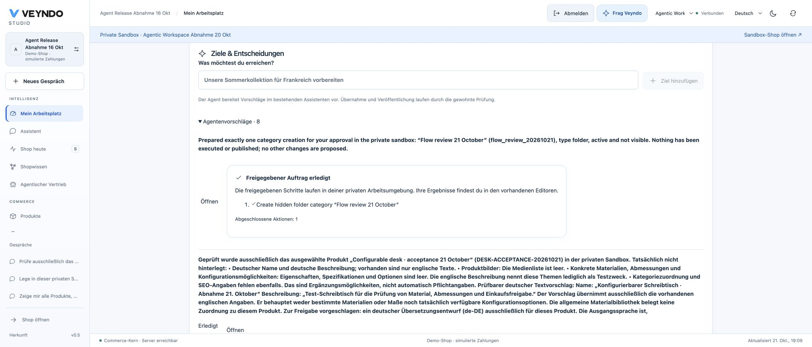
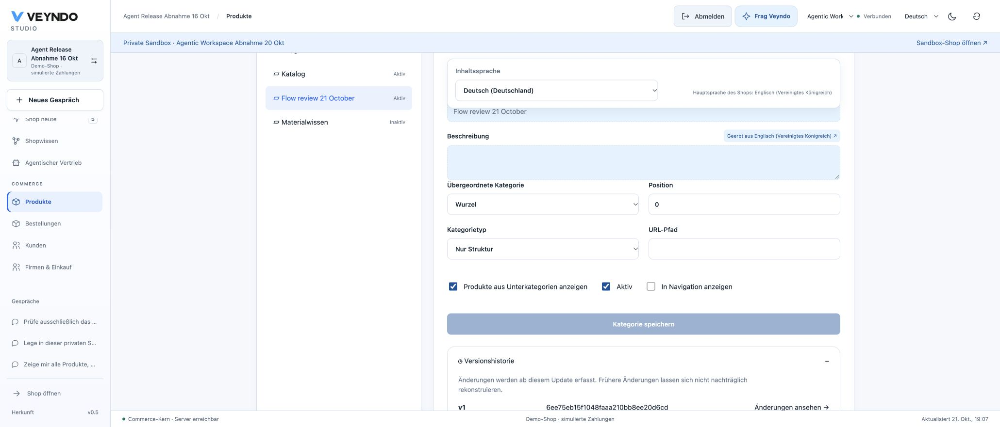
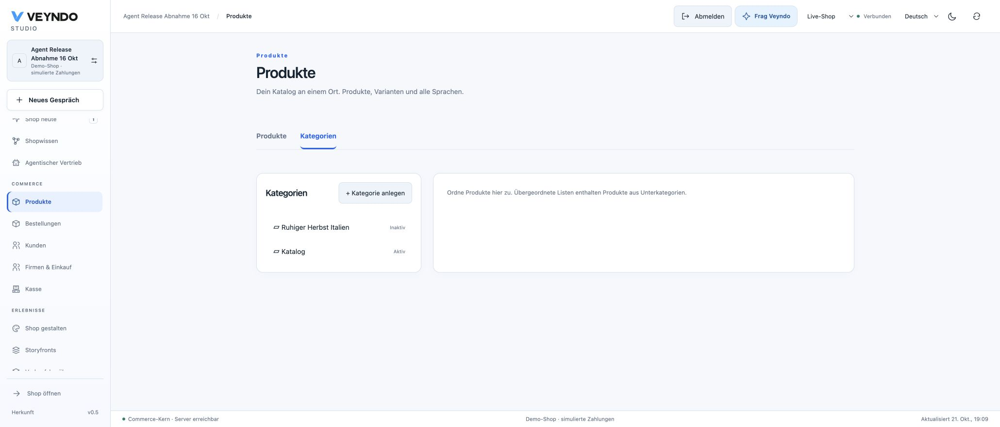

# Flow proposals in the personal workspace: 21 October 2026

This check uses the ordinary public Studio, its configured OpenAI provider and a
private synthetic shop. Local provider fixtures are listed separately below.

## Original event and retained proposal

In private workspace `stage-b6a9474f38cd4d53a73a`, a single edit to the test desk's
German short description emitted `product.updated`. Flow
`flow_native_work_20261021` prepared exactly one native operation:
`merchant.category.create`, ID `flow_review_20261021`, English name
"Flow review 21 October", active, hidden, type `folder`. The public Flow history
showed completion and the reviewable operation. Preparation did not create the
category. The Flow was then deactivated so later test cleanup cannot retrigger it.

Core/Studio `67bc91c` retained this proposal, but the personal workspace showed zero
proposals. The UI passed the parent shop request to the task list while its header
showed the private environment. The repair uses the selected environment for task
reads and approvals and the parent shop only for personal layout preferences.

Approved queued, running and interrupted tasks also remain in the original
actor's list after reload. A read-only execution marker reconnects the existing
progress card; it does not approve or execute the task again. Current tenant,
actor and permission-ceiling filters still apply.

## Public execution and reload

Public Core/Studio `09b1aa35`, image `giving-insect-7440`, started at 19:04 CEST
with one healthy replica and no restarts. A fresh Studio load showed the original
retained proposal in the selected private workspace. After inspecting its one
operation, one explicit approval completed the native task at 19:07:41 CEST.

- The original progress card reported **Approved work completed**, one completed
  action. A full browser reload restored that same completion without a new approval.
- The native category editor showed exactly one "Flow review 21 October" category:
  root folder, position zero, active, hidden from navigation, history revision one.
- Switching to the parent live shop showed only its original categories. The
  private category was absent. No publication was requested.
- The temporary product-description marker was removed and the original German
  text saved again. The Flow was already inactive, so cleanup cannot schedule a
  second proposal. The test desk remained EUR 349 with stock five.

This is an actual configured-provider proposal and native private write in public
Studio. It is not a simulated local model or a real payment acceptance.

## Regression verification

- 758 frontend tests, including rendered private approval versus parent layout
  storage, environment switching, stale responses, task reload and worker progress.
- All Cargo workspace unit tests, Clippy, production build, formatting, formal
  checks and mutation rejection passed.
- 27 actual PostgreSQL/HTTP durable-agent cases passed: original product event,
  direct/graphical Flow, queued/completed work, killed-worker continuation,
  cancellation, duplicate approval, unchanged parent data, current permissions,
  emergency stop and late model results after lease expiry.
- Four-language UI and source-boundary checks passed. Frontend checks ran from an
  identical temporary source/dependency copy because macOS esbuild stalled while
  opening the original Documents parent directory.

The observed public review also exposed a misleading read-only notice for accepted
or completed work. A shared review-card correction suppresses that notice and the
duplicate approval button once execution has started. Actual read-only review
remains blocked. The final frontend suite includes this distinction. A flaky
onboarding test now waits for the existing consent review to enable installation
before clicking; it does not weaken or skip the real consent check.

## Remaining scope

Turning accepted work into a configurable Flow with mapped event inputs is still
separate development. The current title-only shortcut does not implement that
workflow. Flow inference retains its existing uncertainty handling; durable model
checkpoints are not added to legacy Flow inference by this repair.
The direct Flow-history review still needs the same complete durable-progress
presentation; this acceptance covers review through the personal workspace.
