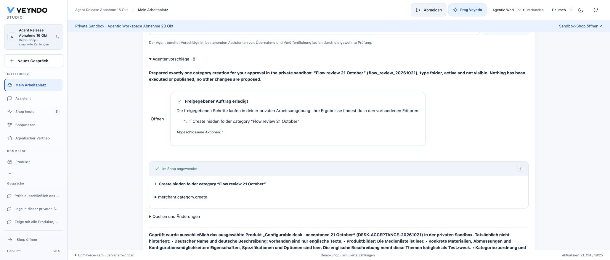
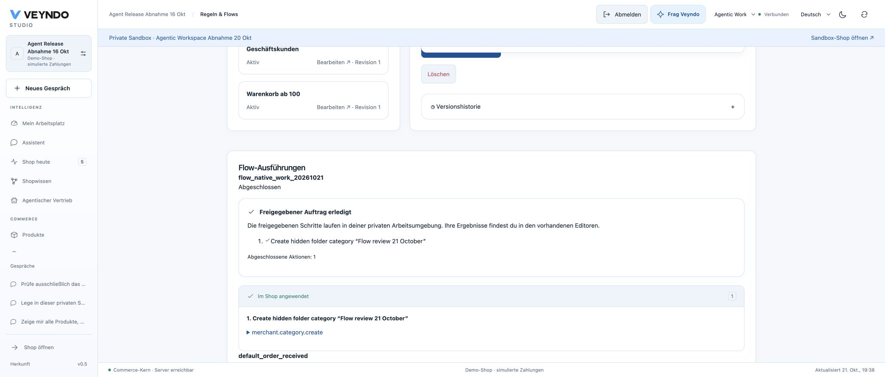
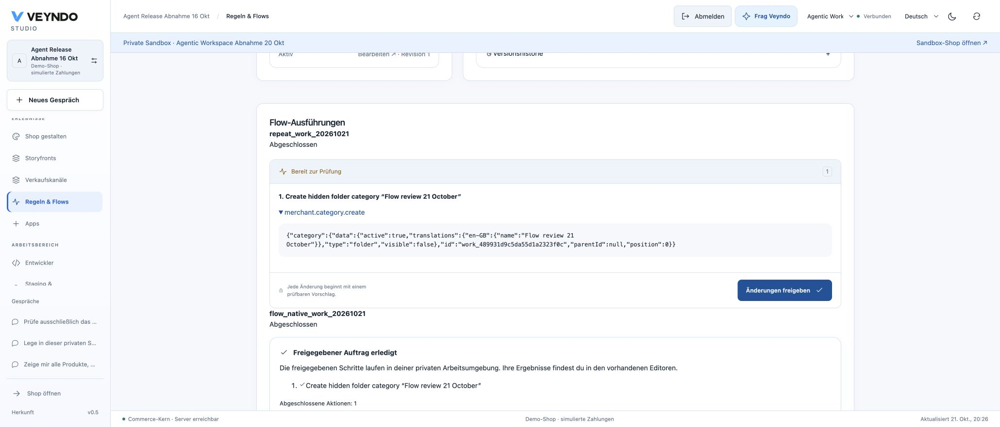
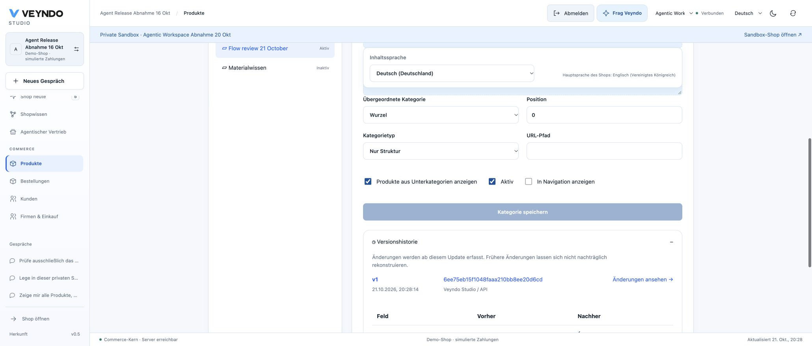

# Flow proposals in the personal workspace: 21 October 2026

This check uses the ordinary public Studio, its configured OpenAI provider and a
private synthetic shop. Local provider fixtures are listed separately below.

## Original event and retained proposal

In private workspace `stage-b6a9474f38cd4d53a73a`, a single edit to the test desk's
German short description emitted `product.updated`. Flow
`flow_native_work_20261021` prepared exactly one native operation:
`merchant.category.create`, ID `flow_review_20261021`, English name
"Flow review 21 October", active, hidden, type `folder`. The public Flow history
showed completion and the reviewable operation. Preparation did not create the
category. The Flow was then deactivated so later test cleanup cannot retrigger it.

Core/Studio `67bc91c` retained this proposal, but the personal workspace showed zero
proposals. The UI passed the parent shop request to the task list while its header
showed the private environment. The repair uses the selected environment for task
reads and approvals and the parent shop only for personal layout preferences.

Approved queued, running and interrupted tasks also remain in the original
actor's list after reload. A read-only execution marker reconnects the existing
progress card; it does not approve or execute the task again. Current tenant,
actor and permission-ceiling filters still apply.

## Public execution and reload

Public Core/Studio `09b1aa35`, image `giving-insect-7440`, started at 19:04 CEST
with one healthy replica and no restarts. A fresh Studio load showed the original
retained proposal in the selected private workspace. After inspecting its one
operation, one explicit approval completed the native task at 19:07:41 CEST.

- The original progress card reported **Approved work completed**, one completed
  action. A full browser reload restored that same completion without a new approval.
- The native category editor showed exactly one "Flow review 21 October" category:
  root folder, position zero, active, hidden from navigation, history revision one.
- Switching to the parent live shop showed only its original categories. The
  private category was absent. No publication was requested.
- The temporary product-description marker was removed and the original German
  text saved again. The Flow was already inactive, so cleanup cannot schedule a
  second proposal. The test desk remained EUR 349 with stock five.

This is an actual configured-provider proposal and native private write in public
Studio. It is not a simulated local model or a real payment acceptance.

## Regression verification

- 758 frontend tests, including rendered private approval versus parent layout
  storage, environment switching, stale responses, task reload and worker progress.
- All Cargo workspace unit tests, Clippy, production build, formatting, formal
  checks and mutation rejection passed.
- 27 actual PostgreSQL/HTTP durable-agent cases passed: original product event,
  direct/graphical Flow, queued/completed work, killed-worker continuation,
  cancellation, duplicate approval, unchanged parent data, current permissions,
  emergency stop and late model results after lease expiry.
- Four-language UI and source-boundary checks passed. Frontend checks ran from an
  identical temporary source/dependency copy because macOS esbuild stalled while
  opening the original Documents parent directory.

The observed public review also exposed a misleading read-only notice for accepted
or completed work. A shared review-card correction suppresses that notice and the
duplicate approval button once execution has started. Actual read-only review
remains blocked. The final frontend suite includes this distinction. A flaky
onboarding test now waits for the existing consent review to enable installation
before clicking; it does not weaken or skip the real consent check.

## Public review follow-up

Public image `oval-station-7696`, commit `4ec94006`, passed its health check on
21 October. A full browser reload and opening the original completed proposal
showed one completed operation and “Im Shop angewendet”, without another approval
button or the misleading read-only notice. The private environment remained selected.

## Direct Flow-history acceptance

Public Core/Studio `4c0392ae`, image `pure-minute-7985`, started on 21 October at
19:37 CEST with one healthy replica and no restarts. After a full Studio reload,
the direct Flow history showed the original task as **Freigegebener Auftrag
erledigt**, one completed action and **Im Shop angewendet**. The original private
workspace remained selected. No new approval, model request or commerce write
was needed. The direct history and personal workspace now use the same durable
progress card and current-permission control checks.

The final regression run passed 761 frontend tests, 27 actual PostgreSQL/HTTP
durable-agent cases and 43 tenant-isolation cases, plus workspace Rust tests,
Clippy, formatting, formal checks, mutation rejection and source boundaries.
Rendered tests cover queued approval, completion, explicit continuation after
failure, withdrawn controls and legacy immediate proposals. This public check
covers the direct Flow history; nested graphical-pipeline result presentation is
not separately claimed by this screenshot.

## Reusing completed work: public acceptance

Core/Studio `650529c7`, image `aromatic-voyage-2152`, was deployed on 21 October
at 20:22 CEST. Northflank reported one passing replica with no restarts. The public
Studio journey used the existing **Agentic Workspace Abnahme 20 Okt** private shop
and the completed category task above; no new identity or access was created.

1. **Als Flow wiederverwenden** opened an inactive native Flow draft. The source
   category ID was mapped to a generated per-run reference. The daily limit was
   explicitly set to one. `repeat_work_20261021` saved inactive at revision one,
   then activated at revision two.
2. A reversible German description edit on `DESK-ACCEPTANCE-20261021` emitted the
   ordinary `product.updated` event. The Flow history showed one fresh **Bereit
   zur Prüfung** proposal with the new category ID
   `work_489931d9c5da55d1a2323f0c`. It had its own approval button; preparation did
   not apply the change or reuse the original approval.
3. Personal approval started the existing native worker. A full browser reload
   retained **Freigegebener Auftrag erledigt**, one completed action and **Im Shop
   angewendet** in direct Flow history.
4. The native category editor and its history showed the generated ID at revision
   one, created at 20:28:14 CEST, active and hidden. The original category remained
   separately present. The parent live category list contained neither Flow test
   category.
5. The Flow was deactivated at revision three before restoring the product's
   original German description. Product price remained EUR 349 and stock five.
   No publication, payment or external message was part of this test.

Local verification passed 768 frontend tests, 31 actual HTTP/PostgreSQL
durable-agent cases and 43 tenant-isolation cases, plus Rust workspace checks,
Clippy, formatting, formal/mutation and structure/localization checks. The native
cases additionally cover typed event mappings, replay, original-source privacy,
missing event values, foreign workspaces, withdrawn rights, stop and two workers
competing for the final daily preparation slot. These checks are additional
evidence; the public screenshot journey itself used one generated reference and
one native category operation.

## Remaining scope

Repeatable native work is a direct Flow action for private configuration tasks.
It stores a protected source reference, not copied private inputs; source tasks
are neither publication units nor transferred to other shops. Every new proposal
needs personal approval. It does not establish arbitrary autonomous live writes
or historical order replay. The new preparation path needs no model call. Legacy
Flow inference retains its existing uncertainty handling; this extension does
not add durable model checkpoints to that inference path.
