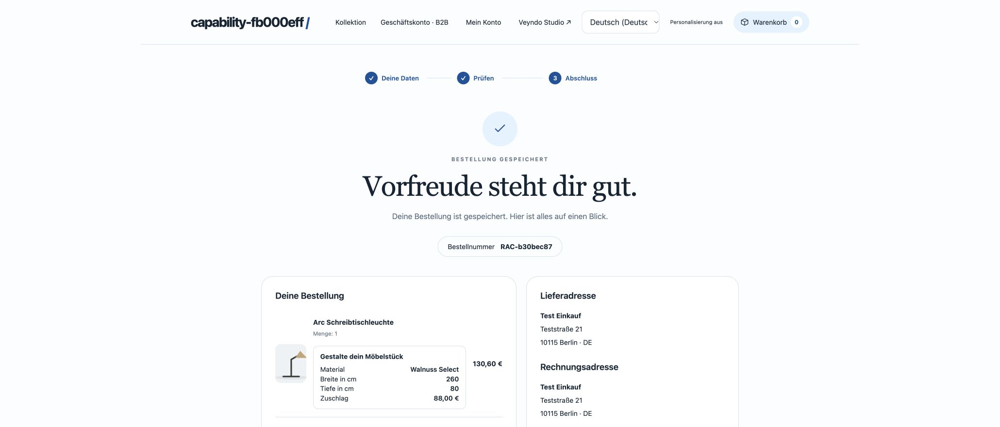
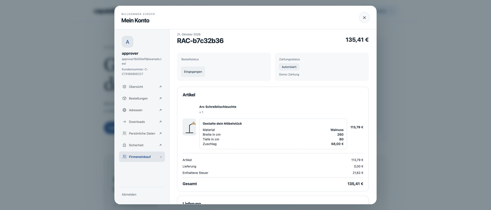
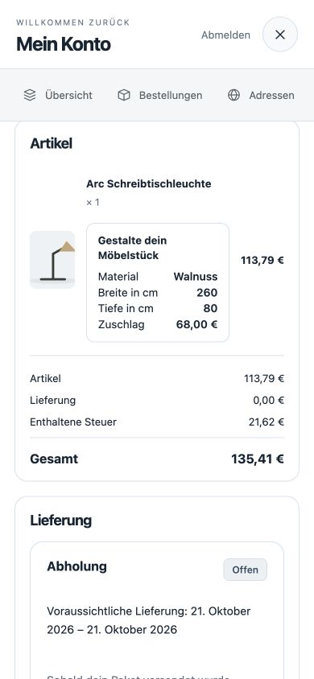
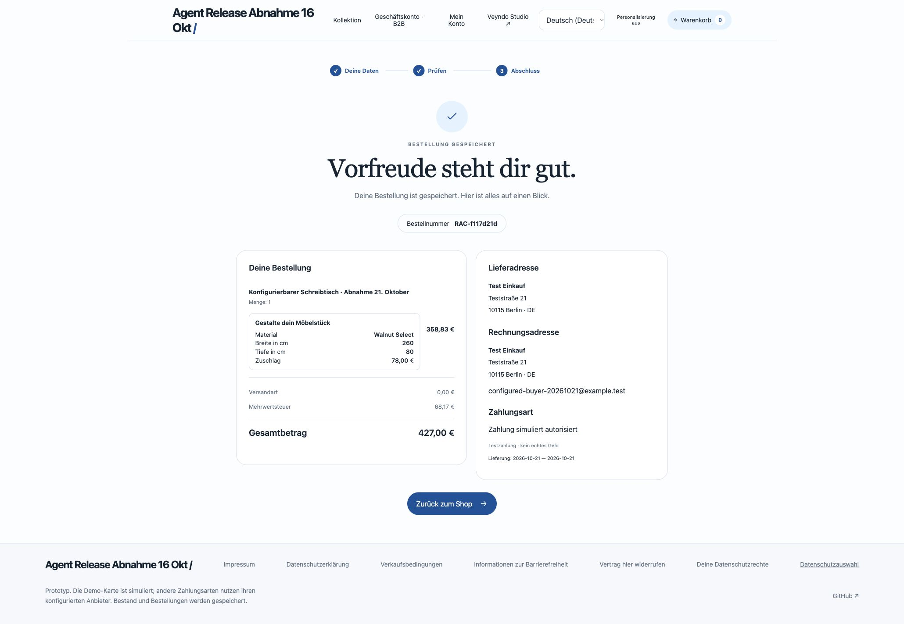
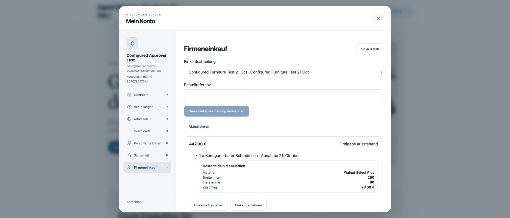
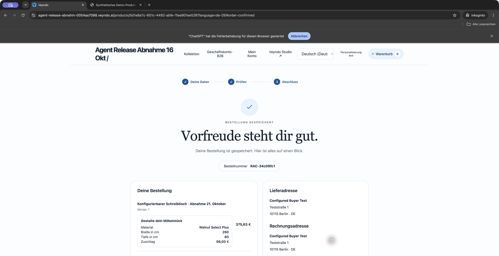
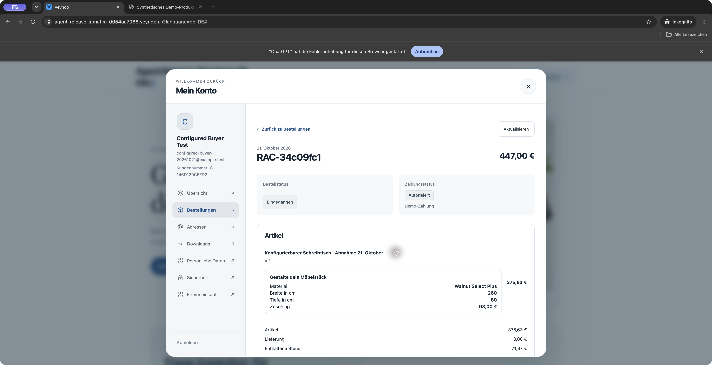
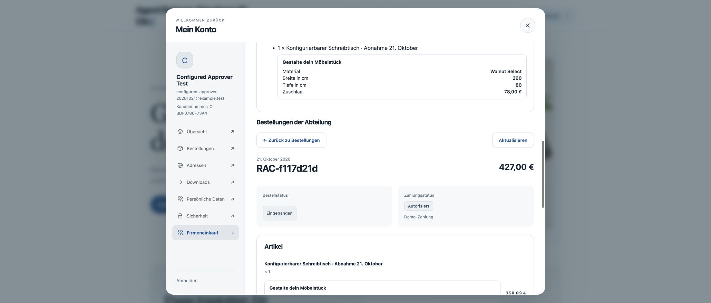

# Furniture configuration: hosted private browser acceptance, 21 October 2026

The ordinary public Studio created app `furniture_mvi1n42k` from the app-owned
`1.0.1` pattern, saved its immutable version and installed it into private
`stage-b6a9474f38cd4d53a73a`. F5 preview records and installed sandbox records
remained separate. All identities, products and payments below are synthetic.

This record follows the successive checks in order. Earlier gaps describe that
specific observation; the later sections record their subsequent public checks.

## Observed purchase and immutable order

The native product editor created desk `5d1e8a7c-651c-4492-abfe-1fae901ee526`
with EUR 349 base price and stock 10. The installed material library supplied
Walnut at EUR 20. Configuring 260 x 80 cm added EUR 48 for oversize. The real
browser checkout completed simulated order `RAC-38fed56b` for EUR 417 at
13:47:54 CEST. Confirmation and native Studio order inspection retained material,
dimensions and EUR 68 surcharge. Return displayed an empty cart, stock became 9,
and the existing order.placed Flow wrote its fulfillment note at 13:47:55.

Changing the installed material to Walnut Select / EUR 30 did not rewrite that
order: it still displays Walnut / EUR 68 surcharge / EUR 417. After reload, a new
260 x 80 configuration displays EUR 427. No real provider was charged.

## Continuation defects and regression coverage

Without reload, the configuration form still sent the completed cart's revision.
The correction routes configuration through the existing serialized storefront
commands, which create a fresh open cart and preserve current native CAS. A queued
add uses the configured revision. Tests reject stale conflicts without retry and
late results after a shop switch.

Studio reload also discarded the sandbox choice. The correction remembers only
the environment identifier per live shop and browser tab. Native access is checked
again; a denied sandbox stays closed. An explicit Live shop action remains
available to recover. Tests cover reload, changed shops, revoked access, explicit
return to live and unavailable browser storage.

Public image `shallow-place-4222` (`fa33a003`) started as deployment
`vendune-core-647d66b84d` at 14:13 CEST, with one passing replica and zero restarts.
The hosted browser completed another simulated order, `RAC-6c9f8c4f`, at 14:17:51:
Walnut Select, 260 x 80 cm, EUR 78 surcharge, EUR 427 total and EUR 68.17 VAT.
The German product label, native order record and order.placed Flow note agree.
Return showed cart zero. Without reloading, a new 180 x 80 cm configuration and
add-to-cart succeeded at EUR 379 with the correct EUR 30 surcharge. The previous
completed-cart conflict no longer occurs. The Studio orders page also retained
the private workspace and both original amounts across a full browser reload.

That continuation exposed a remaining presentation bug: replacing a completed
cart cleared the configuration controls even though the native selection and
new cart were correct. The follow-up preserves controls while refetching prices
for a new cart token, but resets them for a different buyer, country, currency or
company. A rendered regression first reproduced the empty field, then passed both
cart rollover and changed-buyer reset. The full frontend suite passes 744 tests with unchanged coverage gates.

Image `tangible-cat-3650` (`b0b8cba7`) is now running as deployment
`vendune-core-5457d5668b`, with one passing replica and zero restarts. An early
observation during the rolling deployment still showed empty controls; it is
retained as a failed observation rather than attributed to a speculative cause.
After explicitly reloading the storefront, simulated order `RAC-1c51b79e`
completed at EUR 379 (Walnut Select, 180 x 80 cm, EUR 30 surcharge). Return
showed an empty cart. Without another reload, the shopper reopened the product,
changed width to 240 cm and saved. Material, width, depth and the saved message
remained visible after cart renewal and the repeated privacy choice. Adding the
product retained all three values and EUR 379 in the native checkout. Observed
order/cart responses retained the same customer, country and currency context.
This verifies the control-preservation fix in the loaded public build. The
repeated privacy prompt on a new cart remains a separate usability issue.

This browser session does not yet accept independent B2B approval or the
saved-input reorder journey; those have separate local HTTP/PostgreSQL coverage.

## Saved inputs before adding a product

A further public browser check found that reloading after saving a configuration,
before adding the product, retained the native price but displayed empty input
fields. The configuration was stored in the cart; the form restored inputs only
from cart line items, which did not yet exist.

The follow-up extends the existing cart response with `savedConfigurations`:
accepted fields identified by app and product. It does not expose fee/rule
snapshots or introduce another persistence or calculation path. The form restores
the matching entry, with the line-item representation as a compatibility fallback.
Rendered tests reject entries for a different app or product and clear values for
a new cart. The actual HTTP/PostgreSQL app workflow verifies saving with no line
items, a fresh cart read, and isolation from a second cart.

Public image `dainty-ray-8892` (`fb8d54e0`) started at 15:00:54 CEST as
`vendune-core-5fb6c677cb`, with one passing replica and zero restarts. Before
deployment the browser saved Walnut Select, 250 x 80 cm with no line items.
After deployment and an explicit full reload, all three controls and EUR 427
remained visible without reentry. Adding and reviewing retained those inputs.
Simulated order `RAC-2246a373` completed with EUR 78 surcharge, EUR 427 total
and EUR 68.17 VAT. Return showed cart zero and product stock five.

This verifies the saved-input reload repair on the named public image. It does
not replace the separate independent B2B approval or saved-list reorder check.

## Saved-list reorder and separate approval: local browser, 21 October

An isolated local shop `capability-fb000eff` was prepared through the existing
app-owned HTTP/PostgreSQL workflow. Its furniture package was upgraded from
1.0.0 to 1.1.0, the material renamed to Walnut Select and its fee updated. The
saved order list retained material ID and dimensions, rather than an old price.
The fixture deliberately uses the small native lamp catalogue item to exercise
the generic app contract; the hosted desk journey is documented above.

Two ordinary Chrome tabs used separate local origins and existing synthetic
buyer/approver accounts. The buyer selected the company unit and purchase-order
reference, restored the saved list, and reviewed Walnut Select, 260 x 80 cm,
EUR 88 surcharge and EUR 155.41 total. The purchase action remained disabled
until the different customer approved that exact request. Refresh then enabled
purchase. Simulated order `RAC-b30bec87` completed; receipt return and full reload
showed an empty cart. No real payment provider was used.

The browser exposed two presentation gaps: the approver inbox and reopened
customer/company order detail omitted the stored app configuration. Both now use
the existing read-only `ConfigurationSummary`, displaying only the accepted
snapshot already returned by the native owner. There is no extra app lookup,
new permission, pricing path or mutable reconstruction of historical labels.
Rendered regressions cover a separate approver, current request revision,
fifth-language fallback, source currency and reopening an immutable order.

After the UI repair, the local browser showed the original order
`RAC-b7c32b36` still at EUR 135.41, with Walnut and EUR 68 surcharge. The newer
approval showed Walnut Select and EUR 88. This is local browser acceptance;
the combined independent-approval/reorder journey is not yet a hosted acceptance.

The repaired reopened-order summary also passed a 390 × 844 browser check: the
material, 260 × 80 cm dimensions and original EUR 68 surcharge remain visible,
with no horizontal document overflow. The test viewport was restored afterward.

## Public configured company purchase and saved-list reorder

On 21 October, public Core/Studio `ef093e7a` (`brave-produce-7557`) completed
the connected journey in the synthetic shop `agent-release-abnahm-0054aa7088`.
The merchant published furniture app `furniture_mvi1n42k` version 1.0.1 through
the existing package review, then selected only its test material and desk in
the sandbox release. Unrelated private drafts were not selected. The product's
test stock was set through the native live product editor.

The buyer and approver are separate synthetic customer accounts. The buyer has
buy/list rights; the approver has approval/company-order rights. The buyer used
the ordinary storefront to select Walnut Select, 260 x 80 cm, save a private
order list and request approval with a purchase-order reference. A separate
approver session used the native Store API to review and approve the frozen
quote. An attempted approval with the buyer identity returned HTTP 403.

| Observed step | First purchase | Saved-list reorder |
| --- | --- | --- |
| Material label | Walnut Select | Walnut Select Plus |
| Dimensions | 260 x 80 cm | 260 x 80 cm, restored from saved inputs |
| Accepted surcharge | EUR 78.00 | EUR 98.00 |
| Total / VAT | EUR 427.00 / 68.17 | EUR 447.00 / 71.37 |
| Approval request | `c8fde9d1ff6c414c8456f89282148c43` | `0af69ad2c7f149e08d0a5cd1d1d6775d` |
| Simulated order | `RAC-f117d21d` | `RAC-39436999` |
| Return and full reload | Empty cart | Empty cart |

Between purchases, the merchant renamed the same material and changed its base
fee from 3,000 to 5,000 minor units through the installed app's native material
editor. Restoring the list recalculated the existing dimensions against that
current record. The original approval could not authorize the changed order:
the checkout remained disabled until the new independent approval was fetched.
The first frozen approval retained its original label, dimensions, EUR 78 fee
and EUR 427 total after the update.

Both purchases used the explicit **Demo payment** method. They are persisted
native orders, not evidence of real external payment processing. This hosted
acceptance combines browser purchase/reorder with independent native API approval;
the initial all-browser check was the local run above. The later public repetition
below verifies the additional approval-inbox/reopened-order presentation. The repeated privacy prompt on a fresh cart remains
a separately observed usability issue.

## Public two-account browser acceptance after the combined release

[PR #191](https://github.com/sthamann/veyndo/pull/191) merged as `7f0d4266` after
the [complete required verification](https://github.com/sthamann/veyndo/actions/runs/39665097450):
779 frontend tests in 133 files, Rust workspace tests, native HTTP/PostgreSQL,
formal controls and coverage checks. Northflank built `offbeat-mind-8124`, waited
for snapshot `26-10-21-204633-backup`, ran the migration successfully and started
deployment `vendune-core-6dfdf567bb` at 22:47:53 CEST. The new instance passed
readiness with zero restarts. No migration, permission or pricing rule was changed
by the configuration-display repair.

The same saved list was restored in a private Chrome buyer session. A normal
Chrome session held the separately signed-in approver account. The buyer's
`PO-HOSTED-BROWSER-20261021` request stayed disabled before approval. On the new
public version, the approver inbox displayed **Walnut Select Plus, 260 × 80 cm,
EUR 98 surcharge and EUR 447 total**, and its ordinary approval button succeeded.
The buyer refreshed approval through the checkout UI; only then did the purchase
button become available. This repetition used no API shortcut for approval.

Simulated order **`RAC-34c09fc1`** completed with those exact values and EUR 71.37
VAT. Return and a full reload showed cart zero. After reloading the new frontend,
the buyer reopened the order and saw the frozen configuration in its item detail.
The approver separately reopened the original **`RAC-f117d21d`**: it still showed
Walnut Select, 260 × 80 cm, EUR 78 surcharge and EUR 427 total. Thus the new
presentation displays historical accepted values rather than today's material
record. These observations close the public inbox/reopened-order presentation
gap from the earlier local check.

The fresh-cart privacy choice appeared again and was explicitly declined. All
accounts and addresses were synthetic, payment was the explicit Demo method,
and no real charge, email delivery or newly issued invoice was accepted here.

