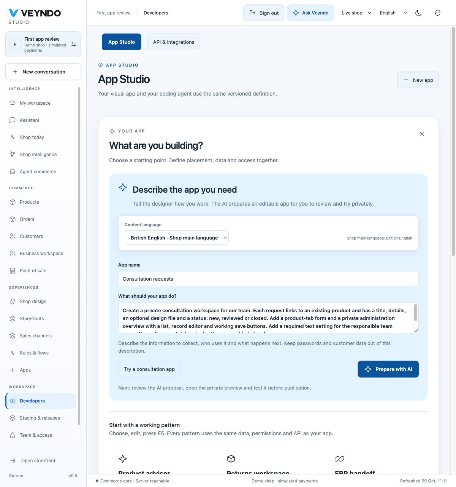
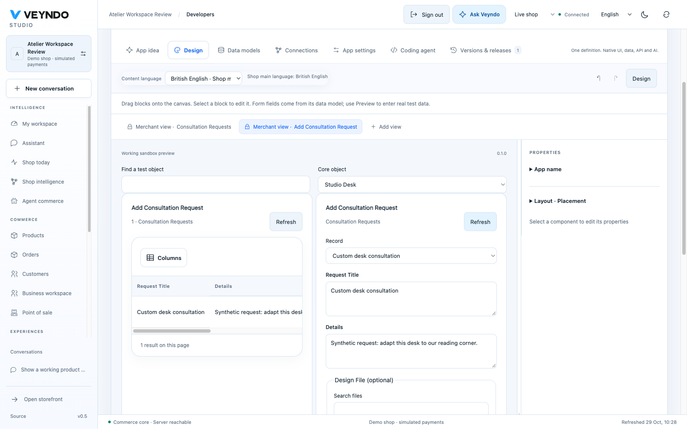

# Description-led native app acceptance

Observed locally on 29 October 2026 in an isolated PostgreSQL/Qdrant fixture and
headed Chromium. This is source and local runtime evidence; public Core delivery
and required remote CI are separate checks.

## Merchant journey

The merchant entered a description in App Studio for private product consultation
requests: product relation, title, details, optional design file, review status,
responsible team setting, product tab and administration overview. The configured
local Qwen3.6:35b model produced a real proposal under `app-brief@1`. Its canonical
app ID was `app_62e42d09af6c4faf`, version `0.1.0`. The merchant reviewed and accepted
that proposal through the actual Studio controls.

In the actor-private F5 preview, the tester selected Studio Desk, uploaded
`consultation-design.txt`, saved **Custom desk consultation**, changed its status
from New to Reviewed, and refreshed the original record editor. The list and
editor retained the request, private file reference and status. This uses the
existing asset parser/store and scoped surface grant, not a fake upload.

The tester approved installation into **Consultation app review**, reviewed the
exact app-only diff and published that package to the synthetic shop. The live
administration overview initially contained zero records. The F5 record and file
were not copied by package publication. Under **Apps → Consultation Workspace**,
the tester set **Responsible Team Name**, approved the installed package binding
and saved it through the normal central settings UI.

The published native overview then saved **Live desk review**, linked to Desk,
with Reviewed status. A real package-only update to `0.1.1` changed the save
button; full reload displayed **Save reviewed request** and the existing live
record. The original interface was restored as new immutable version `0.1.2`.
Full reload displayed **Save Request**, with the same record and Reviewed status.
This restores an earlier definition through the ordinary approved stage/release
path; it does not downgrade a version, rewind orders or replay external effects.

A separate fresh account with no sandbox also followed the description entry in
the browser. The action created exactly one private stage and retained the brief
in the shared agent. A second actual Qwen generation returned another valid,
reviewable proposal. This verifies the first-app entry independently of the
preconfigured review workspace above.

## Why generation changed

Real full-manifest generations failed on missing handler operations, missing form
bindings, invented action names and invalid placements. These failures were kept
as diagnostic findings rather than treated as accepted apps. A new empty private
draft now asks the model only for bounded private models, setting declarations,
translated labels and registered admin placements. The shared host compiler
creates ordinary native list/form/save views and exact context bindings. Existing
apps continue to use the existing reviewed edit/composition path.

The same canonical native validator, scoped action gateway, package consent,
current actor permissions, saved versions and selected publication apply. The
compiler retains explicitly restricted surface action lists and rejects invalid
or public write bindings. It never executes model-authored JavaScript or creates
SQL objects. The common asset-action declarations live in the shared SDK; no
consultation-specific business model is implemented in the Rust core.

## Validation and delivery

- Complete local suites passed 839 frontend tests and 339 native Rust tests. Strict
  Clippy, source boundaries, prompt hashes, Lean/conformance and the complete
  generated handbook are checked separately from required remote CI.
- Native tests cover real Manifest validation, exact record-input AST, unknown
  bindings with view/block/property pointers, preserved allowlist restrictions,
  private/context admission, semantic version reuse and regional content languages.
- Frontend tests cover the merchant description, complete-app seed, first private
  sandbox preparation, account/environment changes and localized binding guidance.
- Registered HTTP suites exercise native App Studio, F5 isolation and actual
  product-bound file upload/save/reload, with public and foreign-shop rejection.
- Operational setting values remain live-only and package-bound. They are not
  copied from preview or restored by changing a UI definition.

Independent whole-branch review found two defects. Import completion widened
explicit surface asset grants, and a non-main app translation could produce an
empty or oversized first-sandbox name. Both were reproduced as failing tests and
fixed. Import completion now preserves surface grants and package permissions;
only new empty-app construction declares initial asset access. The stage name is
a bounded interface translation, independent of the merchant's app translations.
The registered provider fixture exercises the bounded proposal schema and actual
private upload/save/reload; an imported list/save-only form refuses uploads.

Local complete checks, independent review and complete required Linux CI passed.
The final first-app schema correction also passed its own
[required CI](https://github.com/sthamann/veyndo/actions/runs/40879150077)
and reached public Core as `db0ab308`, image `decorous-sail-719`, on 29 October.
The same original merchant brief then generated a valid native package using
the configured public `gpt-6.1-sol` provider. The subsequent selected-sandbox
review finding, repair and final public record journey are recorded in the
[connected public acceptance](platform-followups-hosted-2026-10-29.md#public-description-led-app-generation).
This section's local package publication, operational setting and restoration
observations retain their original environment.
