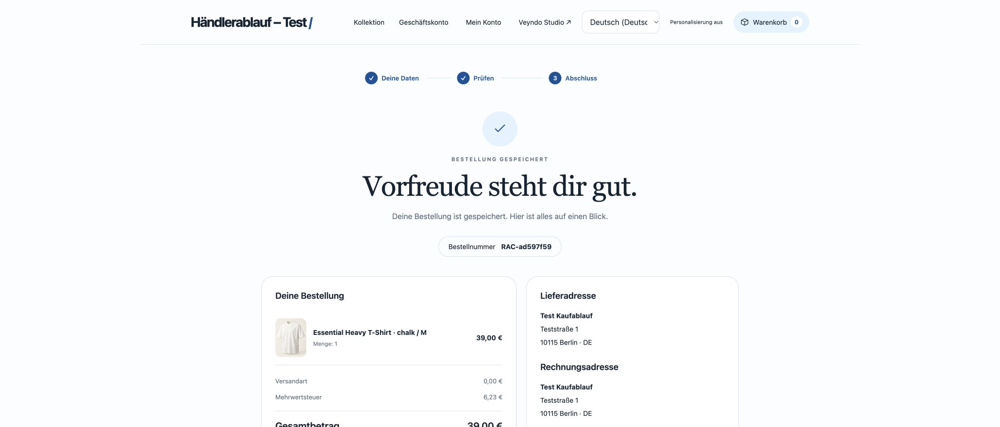
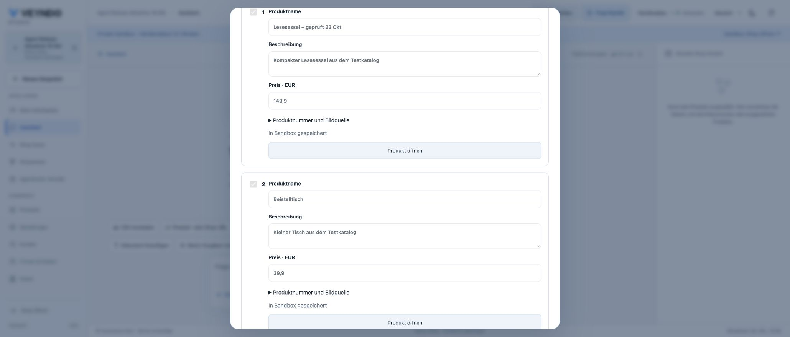
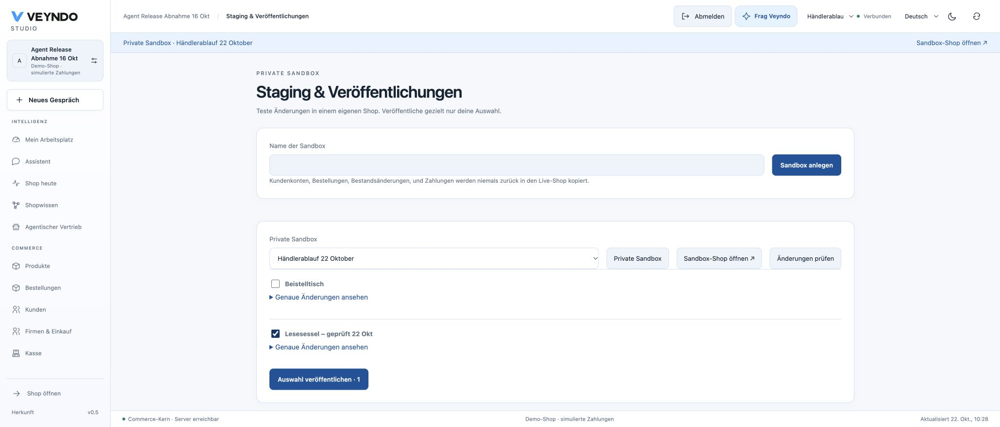
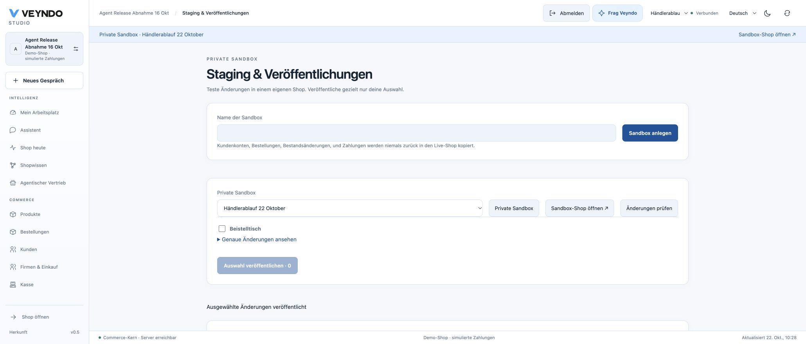
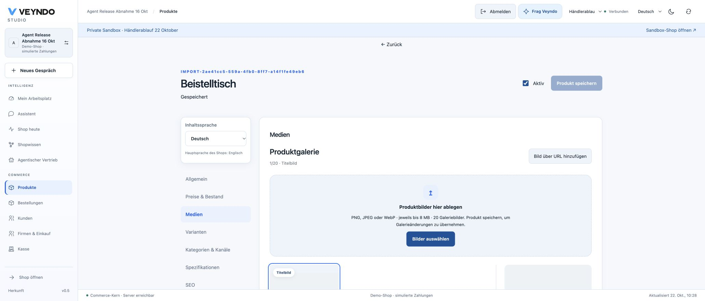
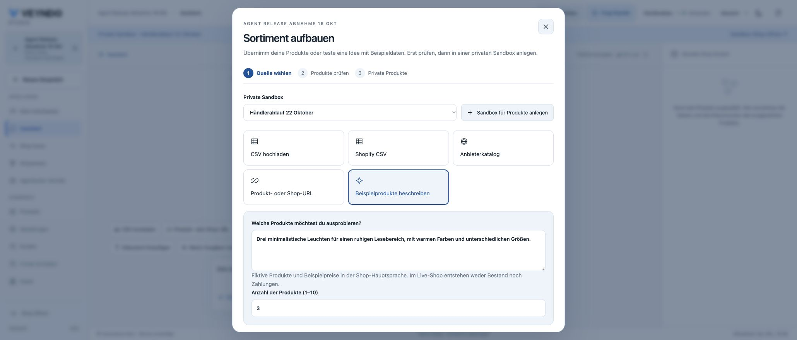
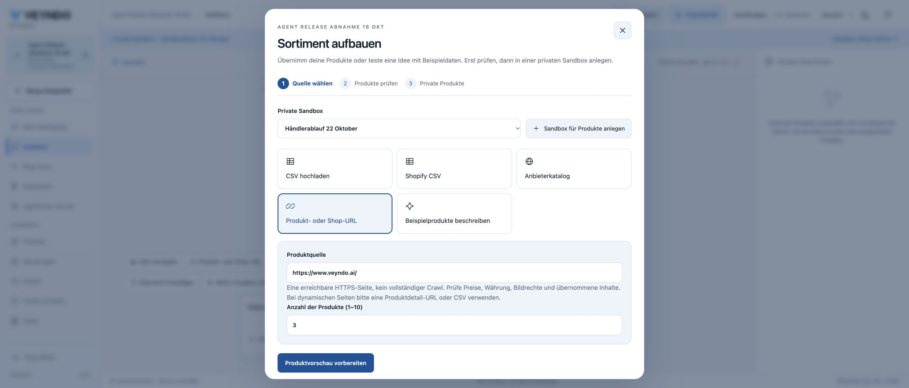
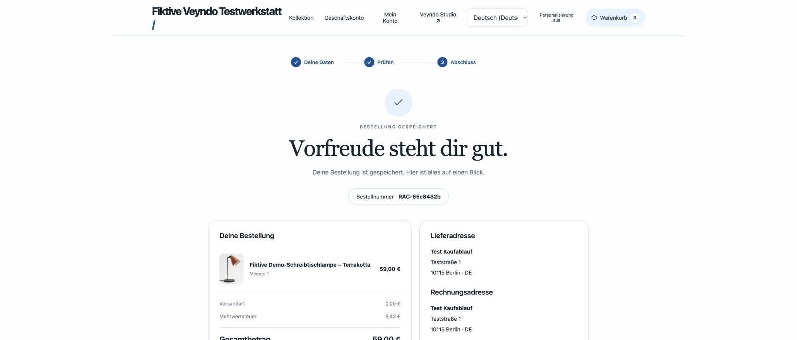

# Merchant catalogue and purchase continuation — 22 October 2026

## Local native browser journey

Chrome, compiled Rust Core and isolated PostgreSQL database. All shop/product/customer
values are synthetic. No paid provider or real payment was used. This section is
local acceptance; the public runtime remains recorded in [current status](../status.md).

1. Attach a UTF-8 CSV in the ordinary merchant conversation, with a reading chair
   and side table. The existing private catalogue dialog reads the actual file.
2. Review both rows, rename the chair to **Lesesessel – geprüft**, explicitly select
   the synthetic fixture tax rate and save both products into **Produkte prüfen**.
3. Open publication review from that result. The same sandbox is selected and the
   two products have understandable names. Select only the chair; publication
   succeeds and the side table remains a private change.
4. Open the private side table in the native product editor, add the existing demo
   illustration `/media/desk-front.svg`, and save. The gallery shows one image and
   the editor confirms **Gespeichert**. This was manual media editing, not a claim
   of successful image generation by a paid provider.
5. Enter a lighting description in the conversation and open **Describe sample
   products**. The text and quantity three are shown in the source form. Repeat
   with a complete HTTPS URL and the corresponding URL form. No products are
   created just by opening either form.

## Actual native purchase and revocation checks

The registered HTTP/PostgreSQL suites execute real local transactions. The legal
journey buys a product, creates a fresh empty cart using the original capability,
retains the exact privacy receipt/deadline, and verifies that legal terms were not
copied. A second purchase uses the same root receipt rather than a reference chain.
Withdrawing through a successor revokes earlier and later carts and erases their
private preference graph. Six simultaneous successor requests and a withdrawal
leave every cart denied. Forced root expiry and a policy edit invalidate existing
references and prevent continuation. Session strings alone, open carts, a changed
session and foreign shops cannot carry a grant.

The existing UCP company journey completes its native quote, independent purchasing
approval and order. The same authenticated buyer retains the privacy choice in a
fresh empty native cart without company approval/quote state. Missing/wrong customer
identity and revoked purchasing membership are rejected; successor withdrawal also
changes the original receipt.

Targeted frontend tests cover real file bytes, stale context/rights, source handoff,
main-language release labels, stale privacy responses and the next-cart command.
All 789 frontend tests with coverage, 227 Rust unit tests, Clippy, structure/localization, native catalogue,
tenant isolation, legal/privacy, company/UCP and behavior checks passed locally.
The formal boundary remains the existing extracted policies; SQL, alias resolution
and browser code are tested but are not mathematically proved by those policies.

The initial full CI exposed two UI test defects. The business-account fixture
declared a decided privacy choice without its required expiry, and the site-builder
test clicked its app-review control before loading enabled it. The corrected fixture
uses a future expiry and names the account dialog explicitly; app-review tests wait
for the actual enabled state. Production privacy admission and loading controls were
not weakened. The complete frontend suite then also passed in GitHub.

A further local Chrome purchase completed as **RAC-ad597f59**, EUR 39.00, with a
synthetic buyer and simulated payment. Receipt return and a full page reload showed
**Warenkorb 0** without reopening the privacy prompt. Opening privacy settings from
the footer still showed all optional purposes denied and allowed editing the choice.

## Public delivery and acceptance

[PR #193](https://github.com/sthamann/veyndo/pull/193) merged as `8ffb2ca4` after
the [complete required CI](https://github.com/sthamann/veyndo/actions/runs/39740606634)
passed in 53m53. The deployed immutable image is `jolly-love-1426`, built from
`a287814c`. That source and merged main differ only in two test files; runtime
sources and build inputs match. No second runtime build was needed for the test fixes.

Before migration, snapshot `merchant-journey-20261022-a287814` completed at
09:14:57 CEST. Existing migration job run `a8927c8f-86f8-4bfa-90fe-65f39a147515`
completed successfully in 15 seconds at approximately 10:25 CEST, with
`Migration-only setup complete` and exit code zero. Migration 108 extends the
existing privacy receipt table. Core deployment `vendune-core-7859855574` started
at 10:27:17 CEST and reached one healthy instance with no restarts. Existing
restricted runtime roles and resource settings were retained.

The following public Chrome journey then used **Agent Release Abnahme 16 Okt** and
the new private workspace **Händlerablauf 22 Oktober**:

1. Reload Studio after rollout. The composer exposes **Produkt-CSV anhängen**.
   Attach the actual two-row CSV via that control; the source dialog shows the
   filename and the correct private workspace.
2. Prepare the preview, rename the first row to **Lesesessel – geprüft 22 Okt**,
   explicitly choose the synthetic fixture's 19% rate, and create both native
   products privately. Both rows confirm **In Sandbox gespeichert**.
3. Open **Veröffentlichung prüfen** directly from that result. Select only the
   named chair. The publication succeeds and the side table remains an unpublished
   private change. Publication records product `a9374f4d-d530-4f7d-8053-c4fa551f0746`.
4. Open the private side table in the native product editor, add the existing demo
   illustration `/media/desk-front.svg`, and save. The editor confirms
   **Gespeichert**, with one gallery image. This is native image editing, not a
   claim that a paid image provider ran.
5. Carry the lighting description from the ordinary composer into the sample
   source form, then carry a complete HTTPS URL into the URL form. Both retain
   quantity three and the selected private environment. This checks the handoff;
   it does not establish extraction quality for arbitrary external shops.

Public purchase **RAC-65c8482b** then completed in **Fiktive Veyndo Testwerkstatt**
for one **Fiktive Demo-Schreibtischlampe – Terrakotta**, EUR 59.00 including
EUR 9.42 VAT, with simulated payment and a synthetic buyer. The original optional
privacy rejection was recorded before rollout. Receipt, return and full reload
retained **Warenkorb 0** and **Personalisierung aus**, without a new privacy prompt.
The footer's privacy settings still opened with all optional purposes denied and
editable. No real payment, external mail or provider refund was performed.

The same session also completed public Google entry through `start.veyndo.ai`,
workspace selection and the single-use Studio handoff before rollout. Reload after
rollout retained that authenticated merchant workspace. Password sign-in's last
recorded public acceptance remains 16 October; it was not repeated in this run.

## Apple remains a separate open step

The existing Apple Service ID configuration is prepared with `start.veyndo.ai` and
`experience.veyndo.ai` and each `/api/onboarding/oauth/apple/callback` URL. Final Save
is awaiting the requested action-time confirmation. A saved callback configuration
alone would not establish successful Apple sign-in.

Apple sign-in is therefore not part of the successful public acceptance above.
