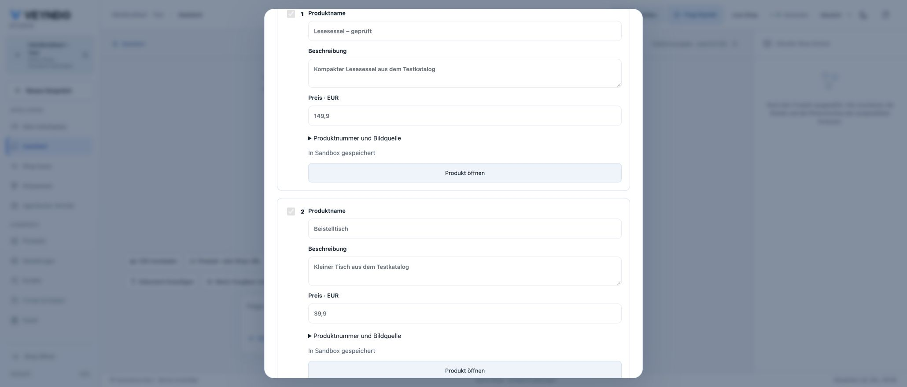
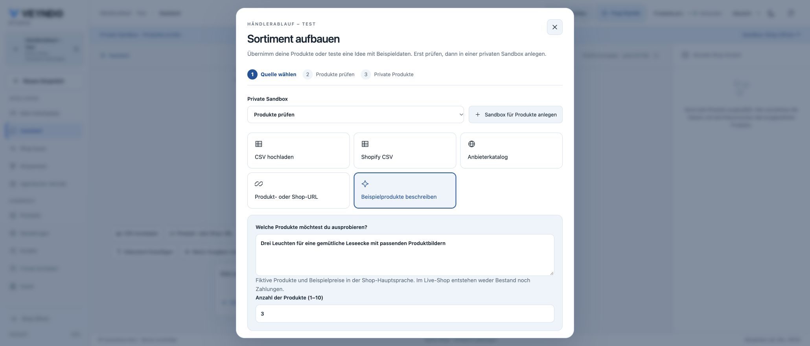

# Merchant catalogue and purchase continuation — 22 October 2026

## Local native browser journey

Chrome, compiled Rust Core and isolated PostgreSQL database. All shop/product/customer
values are synthetic. No paid provider or real payment was used. This section is
local acceptance; the public runtime remains recorded in [current status](../status.md).

1. Attach a UTF-8 CSV in the ordinary merchant conversation, with a reading chair
   and side table. The existing private catalogue dialog reads the actual file.
2. Review both rows, rename the chair to **Lesesessel – geprüft**, explicitly select
   the synthetic fixture tax rate and save both products into **Produkte prüfen**.
3. Open publication review from that result. The same sandbox is selected and the
   two products have understandable names. Select only the chair; publication
   succeeds and the side table remains a private change.
4. Open the private side table in the native product editor, add the existing demo
   illustration `/media/desk-front.svg`, and save. The gallery shows one image and
   the editor confirms **Gespeichert**. This was manual media editing, not a claim
   of successful image generation by a paid provider.
5. Enter a lighting description in the conversation and open **Describe sample
   products**. The text and quantity three are shown in the source form. Repeat
   with a complete HTTPS URL and the corresponding URL form. No products are
   created just by opening either form.

## Actual native purchase and revocation checks

The registered HTTP/PostgreSQL suites execute real local transactions. The legal
journey buys a product, creates a fresh empty cart using the original capability,
retains the exact privacy receipt/deadline, and verifies that legal terms were not
copied. A second purchase uses the same root receipt rather than a reference chain.
Withdrawing through a successor revokes earlier and later carts and erases their
private preference graph. Six simultaneous successor requests and a withdrawal
leave every cart denied. Forced root expiry and a policy edit invalidate existing
references and prevent continuation. Session strings alone, open carts, a changed
session and foreign shops cannot carry a grant.

The existing UCP company journey completes its native quote, independent purchasing
approval and order. The same authenticated buyer retains the privacy choice in a
fresh empty native cart without company approval/quote state. Missing/wrong customer
identity and revoked purchasing membership are rejected; successor withdrawal also
changes the original receipt.

Targeted frontend tests cover real file bytes, stale context/rights, source handoff,
main-language release labels, stale privacy responses and the next-cart command.
35 frontend tests, 227 Rust unit tests, Clippy, structure/localization, native catalogue,
tenant isolation, legal/privacy, company/UCP and behavior checks passed locally.
The formal boundary remains the existing extracted policies; SQL, alias resolution
and browser code are tested but are not mathematically proved by those policies.

## Apple and public delivery

The existing Apple Service ID configuration is prepared with `start.veyndo.ai` and
`experience.veyndo.ai` and each `/api/onboarding/oauth/apple/callback` URL. Final Save
is awaiting the requested action-time confirmation. A saved callback configuration
alone would not establish successful Apple sign-in.

Public Core rollout and live acceptance have not yet been recorded for this change.
