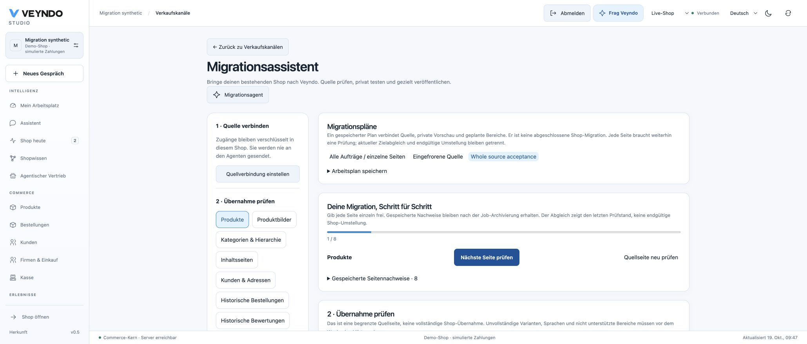

# Migration continuation and current-target acceptance — 19 October 2026

This is **local synthetic acceptance**, not public hosting, a real source shop,
final delta/cutover, paid settlement or measured fleet capacity.

## What was exercised

| Journey | Observed result |
| --- | --- |
| All eight supported domains | Actual source HTTP → independent Rust service → native outbox/job → current domain owner → mapped-current-field comparison |
| Manual target price/text edit | Successful idempotent replay alone is insufficient; current comparison reports changed field paths and does not overwrite the edit |
| Missing image association | Actual stored image bytes and the separate product association are checked independently |
| Customer address edge cases | Identical explicit billing/shipping remain two rows; shipping-only/additional-only native defaults match the shared creation plan |
| Connected plan | Saved private page intents follow domain dependencies and source cursor order with explicit per-page review |
| Archival/restart | Technical jobs are actually archived and the independent Rust service actually restarted; page evidence remains in native app records |
| Recheck after restart | Changed price remains changed; restoring through the normal native editor makes the new read-only comparison match |
| Forged saved success | Ordinary edits and forged/reused evidence tokens fail native verification and cannot advance Studio progress |
| Completion authority | Personal/unscoped/stale/CAS/revoked-job-creator requests fail; native success and private evidence commit atomically |
| PII | Settings/order projections require paired PII rights; current-role revocation redacts or denies historical source payloads |
| Native purchase regression | Selected imported product/image publication, explicit stock activation and simulated purchase/replay decrement stock once and leave the new buyer cart empty |
| HTTP/MCP | The current-target operation uses the same native read owner and advertises a read-only MCP effect |

The independent review identified false address differences and forgeable,
non-job-bound evidence. A real identical-address case first failed on `/addresses`;
the shared native address creation plan resolves all three edge cases. Completion
now uses the existing native transaction, current creator/package/lease fences,
record CAS and platform authenticated encryption. Its verification reads actual
stored fields and current package bindings. This authenticates the admitted
service observation; it does not prove arbitrary service correctness.

## Reproduction

Run from the repository root against the explicitly selected disposable test
PostgreSQL configuration; the integration runner creates its own database:

```sh
cargo build --locked -p veyndo -p veyndo-migration --bin veyndo --bin migration-assistant
python3 scripts/verify_integration.py --only migration_assistant app_jobs app_callbacks admin_creation
TEST_SIGNED_HTTP_SUITES=migration_assistant python3 scripts/verify_integration.py --only signed_runtime
cargo test --locked --workspace
cargo clippy --locked --workspace --all-targets -- -D warnings
python3 scripts/formal.py
python3 scripts/formal/mutations.py
```

The signed-runtime acceptance uses actual separate tenant/system database logins,
checks foreign-scope denial and signing-key rotation/restart, and runs the migration
journey through those logins. The extracted cancellation policy covers all four
Boolean assignments; 61 total policies / 131 theorem audits and 156,705 Rust/Lean
comparison cases pass. Negative verification rejects 174 broken policies, 14
unsupported syntax mutations, three stale/disconnected bindings and nine proof
shortcuts. SQL, AES-GCM, HTTP, service execution and hosted deployment remain
outside those formal claims.

Frontend: 121 test files / 692 tests, production build and formatting pass.
Documentation: all 279 Markdown sources render into 286 pages; over 29,000 local
links/assets pass. See [current status](../status.md) for hosted acceptance.

## Browser recovery

The actual German Studio browser reopened a saved eight-domain plan after job
archival. Its deliberately edited product receipt was unverified, so progression
stayed at 1/8 despite eight stored pages. **Quellseite neu prüfen** opened a fresh
source inspection rather than retrying the old hashes. A reconfigured source
profile produced the new actual source page; it was not automatically approved
or silently adopted. This is a recovery/authority check, not a completed eight-domain
browser migration. The complete eight-domain path above is native HTTP acceptance.


