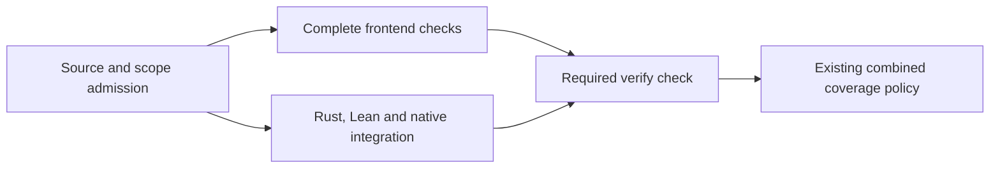

# Independent frontend verification, 23 October 2026

The required verification workflow now reports the complete frontend result while
Rust, Lean and native database/provider checks continue independently. PR #213
changes CI and its regression tests; it does not change the deployed commerce
runtime or renew any dated public purchase/provider acceptance.

## Work that moved, and work that stayed together

The diagram shows a full verification run. The same conservative classifier still
selects documentation-only and ordinary frontend scopes. Missing history, unknown
paths and security-sensitive frontend changes require full verification.

The native job keeps Rust unit tests, instrumented HTTP integration and their
coverage profiles on one runner. It builds the real frontend assets locally for
the native tests. Database state and application processes are freshly created;
they are never transferred from an earlier run. The complete frontend unit suite
runs once, in the independent frontend job.

The final required check runs even if a dependency fails. It checks the actual
results of all selected jobs, retrieves their exact immutable artifact IDs, verifies
the source commit, workflow run and report digests, and then applies the unchanged
coverage policy. Failed, cancelled, unexpectedly skipped or missing work cannot
produce a green required check.

## Complete GitHub run

Source: `225f9106007067c5d85df92eff9ed43ec82ca8ab`.
Tested merge: `f0bdcf2c78bcf2d38a7f250a5ee6c5b44550e786`.
[Implementation PR](https://github.com/sthamann/veyndo/pull/213).
[GitHub run](https://github.com/sthamann/veyndo/actions/runs/39986225985).

Attempt 1 passed completely. The native job completed at **17:10:27 UTC** and
required `verify` completed at **17:10:48 UTC**. It passed **322 Rust tests**,
all **104 registered integration/browser-contract/tooling suites**, the original
PHP differentials, strict signed database roles and transaction-pooler checks.
Combined coverage had no policy violations: **86.65% Rust lines**, **69.92%
frontend lines** and **80.97% Python-tooling lines**. These remain separate source
scopes with the existing explicitly unmeasured areas.

Frontend and native jobs started together at **16:22:50 UTC**. The frontend job
completed at **16:26:28 UTC**, after 3m38s in that job and 3m59s from workflow
creation. It passed all **816 tests in 140 files**, formatting, TypeScript/Vite
build, architecture and localization checks. Frontend line coverage was **69.92%**;
the existing branch/function/statement and module requirements also passed.

Formal evidence passed with **63 production policies, 149 Lean properties and
156,741 compiled Rust/Lean comparison cases**, without mismatches, `sorry`, custom
axioms or native-decision axioms. All seven proof domains remained registered.

The mandatory structure checks retained the existing limits across **712 Rust
modules** and **836 frontend modules**. Generated contracts, operation permissions,
plugin ownership and source-inventory checks stayed required.

## Timing comparison

The preceding sequential full run was
[39969771453, attempt 2](https://github.com/sthamann/veyndo/actions/runs/39969771453/attempts/2).
Its required job took **52m14s**, and the frontend result arrived **10m36s** after
that job started. Native database/provider integration alone took **41m02s**.

| Observation | Previous sequential run | New parallel run |
| --- | ---: | ---: |
| Frontend feedback from first job start | 10m36s | 3m55s |
| First job start to required verification completion | 52m14s | 48m15s |
| Sum of non-skipped job durations | 52m14s | 51m49s |
| Native database/provider integration step | 41m02s | 38m54s |

Wall duration excludes initial queue time. Summed job durations measure observed
runner occupancy, not rounded billing. The additional native frontend asset build
took 32 seconds. Native integration also varied by 2m08s between the runs, so the
entire 3m59s wall reduction must not be attributed to the workflow change.

These are two observed runs, not a controlled performance benchmark. The clear
structural change is that frontend feedback no longer waits for Rust compilation
and formal mutation checks. Native integration still determines most of the full
run's duration. No database or security suites were removed to make it faster.

## Failure and retry checks

The actual personalization unit test was run against two deliberately broken
implementations. Removing the ranking result failed the ordering test; ignoring
the shopper's personalization consent failed the privacy test. Both passed again
after the exact original source was restored. Neither mutation is in the commit.

Nine new required-job/report-transfer tests cover all three scopes, unsuccessful
dependencies, missing artifacts, wrong source/run, modified reports and invalid
producer attempts. Five existing scope tests and nineteen existing tooling tests
also passed. The real CLI returns a failure for a skipped required frontend job.

After the complete success, only frontend job `120526132921` was requested again
with `gh run rerun 39986225985 --job 120526132921`.
[Attempt 2](https://github.com/sthamann/veyndo/actions/runs/39986225985/attempts/2)
passed without repeating native execution. Its new frontend job ran from
**17:11:14 to 17:14:34 UTC**; the required check completed at **17:14:55 UTC**,
**3m41s** after the rerun frontend started.

The aggregate downloaded new frontend artifact **`12519410603`** from attempt 2
and original native artifact **`12518846295`** from attempt 1. Source/run/digest
validation and the unchanged coverage policy passed again. GitHub retained the
native execution timestamps **16:22:50–17:10:27 UTC**; the native report was reused
rather than recomputed.

A successful earlier job may be reused only within the same workflow run and
source commit, through the exact artifact ID emitted by that job. A future attempt,
another run or a changed report is rejected. Each new attempt has its own artifact
name, so retrying never overwrites previous evidence.

## Delivery

PR #213 merged normally as **`1beea11ff65d019103f50c162678154e84e85c8c`**
on 23 October at **17:15:23 UTC**, after both successful attempts. The merged Git
tree is identical to the reviewed/tested source branch. The workflow is now in
`main`; the documentation follow-up publishes these measured results in the
handbook and current status.

Runtime delivery and simulated purchase evidence remain in the
[current status](../status.md) and retain their actual dates. This change improves
the development/release feedback path; it does not claim a new live payment,
authentication or Storyfront acceptance.
