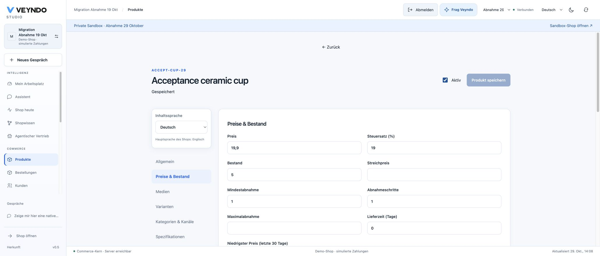
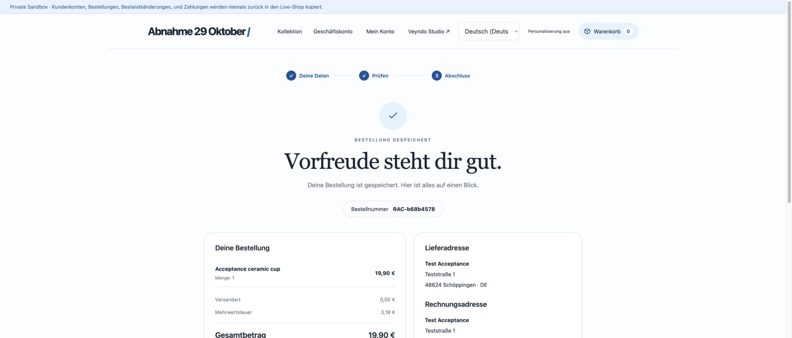
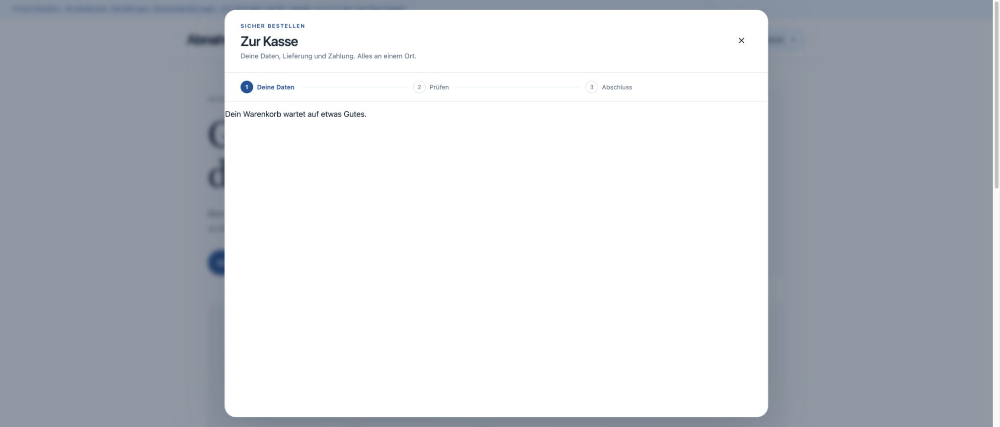
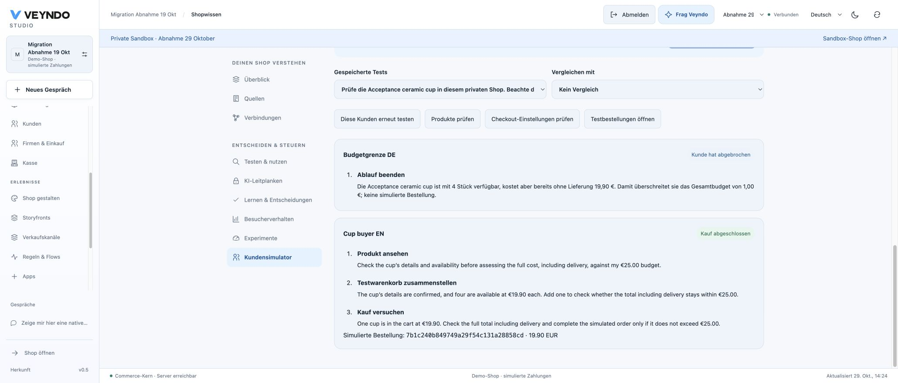
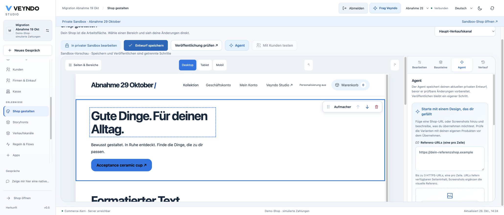
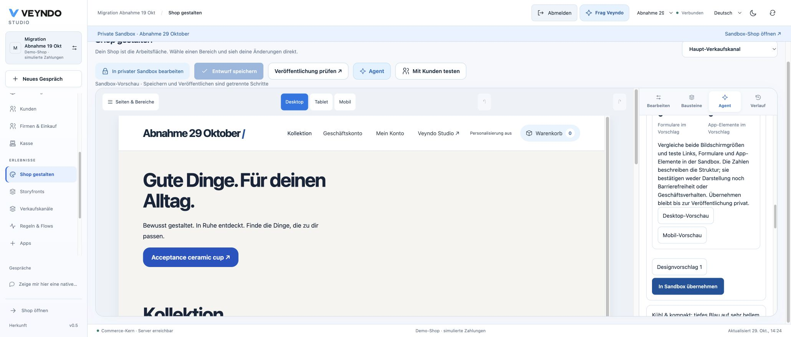
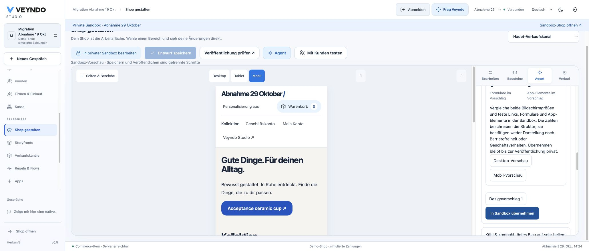
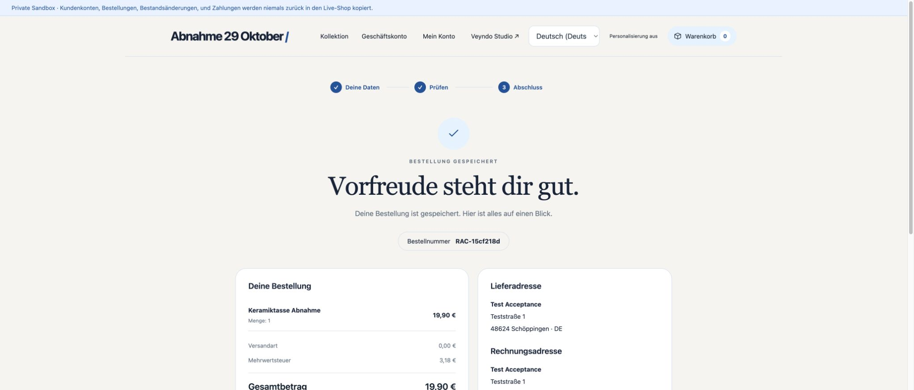
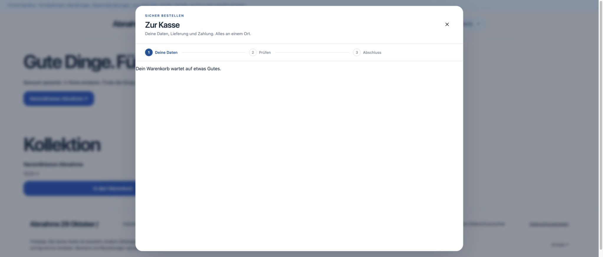

# Connected platform follow-ups: public acceptance

Observed on 29 October 2026 against the public Veyndo services in Chrome. All
records below are synthetic and remain in the private **Abnahme 29 Oktober**
sandbox of the existing acceptance shop. Payments are explicitly simulated.

## Source and rollout

The initial public import and browser purchase below ran after Core
`48f97c39e934fc1a2d56d80f270a5b7ab1b345f0`, image `forlorn-planes-560`, had
completed its snapshot-backed migration and health-checked release. The next
release, `fc4489c900038d76f0509baec44f75024c03d557`, image `rare-north-926`,
started Core at **14:21:47 CET**, 29 October. Its fresh snapshot
`26-10-29-132028-backup`, successful 12-second migration job and 1/1 passing Core
instance with zero restarts were observed. The customer simulation and public
designer/reference journeys below ran on that latter release.

The complete required Linux checks passed for
[PR #229](https://github.com/sthamann/veyndo/actions/runs/40870949354),
[PR #230](https://github.com/sthamann/veyndo/actions/runs/40875606396) and
[PR #231](https://github.com/sthamann/veyndo/actions/runs/40879150077).
The first-app correction merged as `db0ab30891ac3be1e828bf3209f7765e39615837`.
Image `decorous-sail-719` started Core at **14:49:26 CET**. The release completed
at **14:50:33 CET**, after snapshot `26-10-29-134807-backup`, an 11-second
successful migration job and one healthy Core instance with zero restarts.
The original description-led app request then succeeded publicly, as recorded
below. Subsequent source fixes retain separate rollout evidence.

## Native working view and catalogue intake

The public Google entry returned to the existing shop through the ordinary
single-use Studio handoff. The tester created one private sandbox through Studio.
The configured public `gpt-6.1-sol` model then received this merchant request:

> Zeige mir hier eine native Arbeitsansicht mit unserer Produktliste, den
> Produktdetails und dem Katalogimport. Ich möchte Produkte öffnen und per CSV
> hinzufügen können. Ändere keine Shopdaten.

The task finished after three model steps and offered **Arbeitsansicht öffnen**.
Opening it displayed the native product grid, details and catalogue intake.
**Diese Ansicht anheften** saved the view in **Mein Arbeitsplatz**. Following a
complete reload, the **Produkte** pin reopened the same native view and its CSV
entry. The authenticated session and selected sandbox survived the rollout.
An old lazy-loaded bundle displayed the explicit reload recovery during that
rollout; using it recovered the view without an unsaved commerce change.

The CSV contained one synthetic **Acceptance ceramic cup**, product number
`ACCEPT-CUP-29`, EUR 19.90 and its plain description. The preview required an
explicit tax rate. The tester selected 19%, saved the selected product privately
and opened the actual native product editor. It retained the product number,
price, description and zero initial stock. Setting stock to five saved through
the ordinary revisioned product editor. No catalogue release was performed.

## Native purchase, return and empty basket

The sandbox storefront displayed the imported product at EUR 19.90 with five in
stock. A guest purchase used synthetic contact/address data, pickup, 19% VAT and
**Demo-Zahlung · Testzahlung · kein echtes Geld**. The review confirmed the final
amount before submission.

Order **RAC-b68b4578** completed for **EUR 19.90**, including **EUR 3.18 VAT**.
The confirmation retained the product, quantity one and simulated authorization.
**Zurück zum Shop**, a full reload and opening the basket again showed zero items
and the empty-basket message. The optional tracking rejection also survived. Studio then showed exactly one
private order with the same product, amount and authorization, plus the existing
`order.placed` Flow entry in its persisted history.

## Public saved customer scenarios

From **Shop gestalten → Mit Kunden testen**, the tester prepared two fictional
profiles for the same private cup: **Budgetgrenze DE**, German, EUR 1.00; and
**Cup buyer EN**, English, EUR 25.00. Both used Germany and the same bounded goal
including delivery in the budget. The actual configured public model ran the
existing native-commerce simulation.

The first profile stopped because the product alone cost EUR 19.90. The second
read product details, created a test basket and completed exactly one simulated
order, `7b1c240b849749a29f54c131a28858cd`, for EUR 19.90. The results retain their
steps and actual order reference. A full reload and selecting the saved test
reopened both profiles’ recorded outcomes and the same order reference. This is the existing native API simulation;
the separate manual browser purchase above verifies the rendered checkout.

## Public designer gestures and selected agent scope

In the same private sandbox, the tester reviewed and installed the first-party
**Shop gestalten 1.0.0** package with only its own `data.read`/`data.write` grants.
Preparing the private draft retained the actual cup in the native shop preview.
The graphic palette displayed compact illustrated component choices.

A real pointer drag inserted **Formatierter Text** between the existing hero and
product list, increasing the sections from two to three. Dragging its grip moved
it above the hero; its upward arrow became disabled at the first position. The
downward arrow moved it back, deletion removed it, and Undo restored it. The agent
rail defaulted to **Ausgewählter Bereich**, enabled content/structure and disabled
page-wide style with explicit guidance. Three further Undo actions returned to
the original two-section saved draft with no unsaved changes. No design release
was performed.

### Public reference proposal and private revision

The tester supplied `https://www.veyndo.ai/`, requested three blue style variants
and selected style only. The actual public model returned three proposals and
explicitly explained that the fetched reference was limited HTML, so it could not
visually verify the source typography or blue styling. Each candidate reported
five changed theme properties and zero inserted, removed or moved elements.

Desktop and mobile previews retained the actual cup, native content and page
structure. Applying the first reviewed proposal saved private page revision two;
the history shows revision one at `13:26:30 UTC` and revision two at
`13:32:15 UTC`. This was not published to the parent live shop. The URL-based
public acceptance is separate from the local screenshot-based journey linked
below.

### Purchase after adopting the generated design

The actual sandbox storefront loaded the saved style revision. The tester added
an explicit German product-name translation through the native product editor;
reload resolved both the hero product link and live product list to
**Keramiktasse Abnahme**. No stock instruction was sent with that text edit.
The actual product grid showed three remaining units after the first browser
purchase and the one successful AI purchase.

Buying from the adapted page completed simulated order **RAC-15cf218d**, quantity
one, EUR 19.90 including EUR 3.18 VAT, with that German product name in the stored
confirmation. Returning to the designed shop, fully reloading and opening the
basket showed zero items. The prior optional tracking rejection remained. Studio showed exactly three
private orders: the two observed browser purchases and the single successful
AI purchase. Reopening the first order still showed its original English name,
rather than rewriting historical order content after the new German translation.

## Public description-led app generation

The first public description-led consultation attempt reached the actual
configured `gpt-6.1-sol` provider but the native validator rejected its field
constraints with `Malformed action schema constraint`; a diagnostic clarification
then exposed an invalid field relationship. No generated app version was accepted.
The repair keeps native admission unchanged and constrains first-app generation to
five valid field families and typed field-validation keys under immutable
`app-brief@2`. The same original merchant brief subsequently produced a valid
saved app with the actual local Qwen model. Independent review and local native
checks and complete required Linux CI passed. The correction is merged through
[PR #231](https://github.com/sthamann/veyndo/pull/231).

After that public rollout, the tester repeated the original merchant brief,
without technical corrections or a replacement prompt. The actual configured
public `gpt-6.1-sol` provider produced **Beratungsbereich**, version `0.1.0`.
The native build was saved and adopted in Studio. Its private
`consultation_request` model contains five fields: a required existing-product
reference, translated title and description, an optional private design file and
the statuses new, reviewed and completed. The package includes a product tab,
a private administration view, native list/save/upload actions and the required
text setting `team_name`. Its generated labels cover the four enabled shop
languages. It does not grant MCP access implicitly.

The next ordinary **Vor Installation prüfen** action exposed a distinct problem:
the selected owned sandbox returned `Environment unavailable` under the separate
restricted tenant/system database connections. The original strict binary
reproduced that failure locally. [PR #232](https://github.com/sthamann/veyndo/pull/232)
moves the existing exact ownership check inside the existing bounded system
transaction before inspecting stage data. It adds no database grants or serving
bypass. Its regression checks distinguish private stage data from live data and
reject missing, foreign and actor-private environments and insufficient rights.
Local registered native suites, 340 Rust tests, strict Clippy, formal checks and
184 broken-policy mutation controls passed. Independent review found no issue.
Its final hosted installation and record acceptance is recorded separately below.

## Apple callback configuration

After explicit action-time approval, the existing `ai.vendune.web` Service ID
retained its old domains/callbacks and added `start.veyndo.ai` and
`experience.veyndo.ai` with their exact
`/api/onboarding/oauth/apple/callback` addresses. Saving and reopening the Apple
configuration confirmed all four domains and all four return addresses.

Both public entry routes now redirect to Apple's authorization page without
`invalid_request` or the previous invalid-web-redirect error. The browser shows
the ordinary Apple account sign-in form. An authenticated Apple account return
was not part of this observation.

## Related complete local journeys

- [Description-led consultation app, upload, settings, publication and restoration](guided-app-2026-10-29.md).
- [Upgrade admission against saved data, current consumers and migrations](app-upgrade-2026-10-29.md).
- [Saved customer profiles and actual browser before/after purchase](customer-browser-2026-10-29.md).
- [Shop/app drag and drop, undo and screenshot-derived design proposal](designer-2026-10-29.md).
- [Actual WooCommerce source, interrupted resume and purchase](woocommerce-source-2026-10-29.md).
- [150-table restore, restricted logins, local SMTP, invoice and simulated refund](restore-drill-2026-10-29.md).

These dated local journeys and the public observations above retain their own
scope. They do not turn the local database restore into a hosted snapshot restore
or a simulated payment into real settlement.
