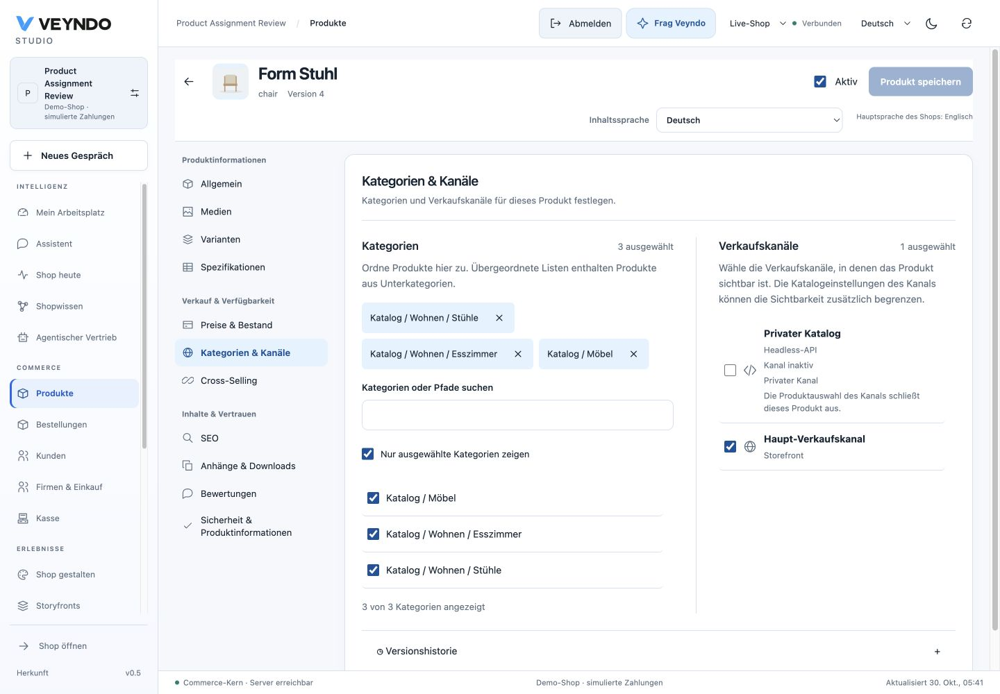

# Product assignments: native browser checks, 30 October 2026

## Change and owners

The product detail's existing category/channel section now uses `ProductAssignments`.
Category choices show translated ancestry, searchable paths and selected chips.
Search and selected-only filtering preserve choices outside the result list.
Only 50 matching rows render initially; subsequent batches use the already loaded,
natively bounded category tree. No second entity directory or catalogue API exists.

Channel names map the product editor's short content key to the unique enabled
regional locale before using the shared main-language fallback. The editor shows
kind, inactive/private state and explicit product-catalogue exclusion. A selected
checkbox is a product assignment, not a claim that the channel is publicly active.
Read-only users may search, but category removals, checkboxes and saving stay closed.

The unchanged Rust `product_channels` and native aggregate write own authoritative
visibility, tenant membership, current rights, revisions and outbox events. Existing
channel catalogue restrictions remain an additional admission condition.

## Actual native browser and consumer checks

The existing local Rust server on loopback port 8803 served the production frontend
build. A new isolated synthetic tenant, `assignments-9ff198a3`, contains the ordinary
seed catalogue, a nested Living/Chairs/Dining tree and a private inactive channel
whose explicit product list excludes the chair. The browser signed in through the
normal local merchant form. No hosted product records were changed.

- Searched for `wohnen`, selected Chairs and Dining, and retained Furniture outside
  the filtered results. Saved three category IDs and only the default channel.
- Saved an empty channel selection through the actual product editor. The ordinary
  Store API returned HTTP 404 for `chair` in the default channel.
- Selected the default channel again and saved. The same Store API returned HTTP 200.
  The native read retained revision 4, all three category IDs, exactly `default`,
  and the original stock 20. A full browser reload retained the same choices.
- The selected-only filter shows exactly the three saved categories. Full-locale
  German channel names, inactive/private status and explicit exclusion are visible.
- Inspected the rendered layout at 1440px and 390px. Mobile categories and channels
  stack, and viewport/document width both remain 390px. Restored the viewport.

[Mobile assignments](../assets/product-assignments-20261030/assignments-mobile.png).

## Targeted verification

Thirteen distinct product/editor tests cover filtered selection retention, current
channel visibility versus an explicit empty selection, full regional names, fifth
content-language fallback with a German main locale, read-only searches, bounded
rendering, malformed ancestry, and stock omission on the native aggregate save.
Frontend build/type checking, localization, mandatory source/ownership/inventory
checks and the Impeccable detector pass. Documentation is built and checked.
Full-suite and coverage verification retain the daily workflow cadence.

These captures and mutations are local native acceptance. The production rollout
and final public surface check are tracked separately on the associated pull request.
