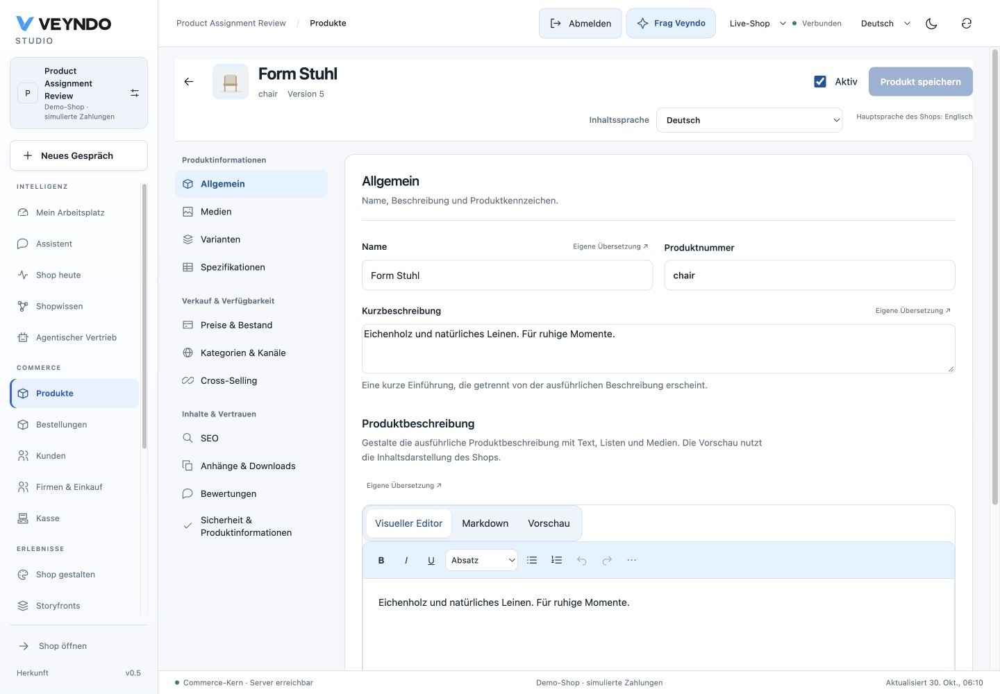

# Product content: native editing checks, 30 October 2026

## Change and owners

`ProductGeneral` groups the existing name, number, short text and full description.
Manufacturer, manufacturer number, GTIN and digital/free-shipping flags stay in the
same native aggregate, with a disclosure for optional fields. Existing values open
it immediately. Four-language guidance distinguishes short and full descriptions.

`product-content-model` resolves rich-document locale keys separately from plain
product text. A short-language product field can coexist with a regional rich key.
Creating an own translation clones the displayed source instead of dropping legacy
text. An own short description used as a starting point is labelled honestly.
Explicit blank rich content remains blank; absent content keeps ordinary fallback.

The shared `RichEditor` owns Visual / Markdown / Preview modes. Preview uses
`RichDescription` and hides mutation controls. Pending Markdown source blocks
preview until explicitly applied/discarded. No second content model, HTML renderer,
API, save or permission owner is introduced. Read-only product users see rendered
content without mutation controls; native rights and CAS remain authoritative.

## Actual native check

The existing local Rust server served the production frontend build on port 8803.
The isolated synthetic tenant `assignments-9ff198a3`, product `chair`, started at
revision 4 and stock 20. The browser adopted its localized short description as an
own full description, previewed it and saved through the ordinary product editor.
A full reload retained revision 5 and the German text. The merchant read and public
Store API returned that same rich block; stock stayed 20. The actual product page
rendered it in the description section. A temporary Markdown edit disabled preview
and product save; discarding that source restored the saved content without a write.
No hosted data was changed.

The layout was inspected at 1440px and 390px. The mobile document width equals the
390px viewport; description controls and optional details remain usable. The
viewport override was reset afterward.

[Mobile content editing](../assets/product-content-20261030/content-mobile.png).

## Scoped tests

Thirty distinct tests across product-content, product-workspace,
studio-product-upgrades and product-page cover legacy text preservation, regional
and fifth content languages, own/reset inheritance, explicit blank content,
read-only rendering, native stock omission, shared Markdown/preview behavior and
the actual product-page fallback. Frontend build/type checking, localization and
mandatory source/ownership/inventory checks pass. Full-suite/coverage verification
remains daily. Static Impeccable checks are supplemented by rendered inspection.

These captures and writes are local native acceptance. Public rollout and the
final hosted Studio observation are recorded separately on the associated PR.
