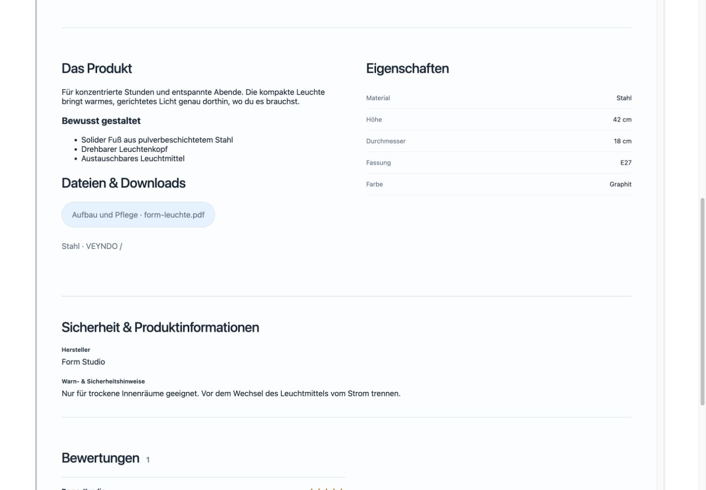
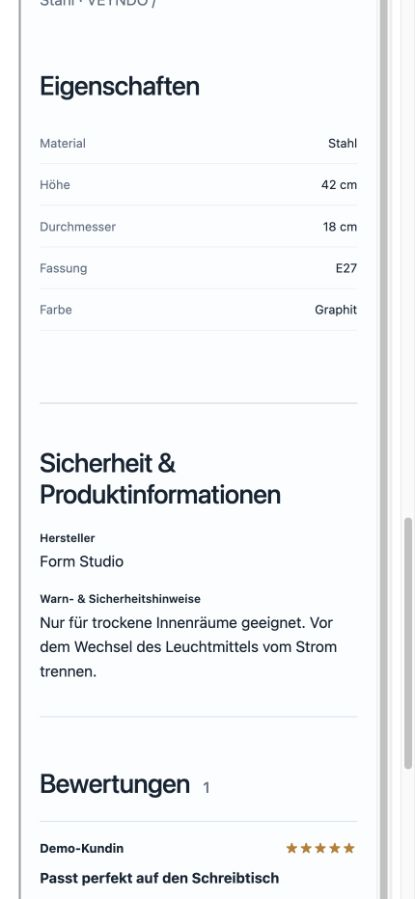

# Product information in the private design preview

Recorded 30 October 2026. This increment extends task 2 of the
[connected commerce checklist](../plans/2026-10-30-connected-commerce.md).
It is locally validated and has not been deployed to the public Core.

## What changed

The product preview now shows the native rich description, translated
specifications, public attachment metadata, safety information and published
reviews below the gallery and purchase presentation. The storefront and preview
share `ProductInformation`, `AttachmentList` and `PublishedReviews`; the native
shop retains its download transport and review form. No second product renderer,
commerce API, storage model, customer session or pricing implementation was added.

The editor explicitly supplies its current private workspace request, channel,
content language and shop main language. Attachment metadata uses the existing
`GET /store-api/product/{id}/attachments` endpoint. That endpoint already enforces
native product/channel admission and lists public attachments only. Downloading
files remains inactive in this preview. Failed metadata reads show the error and
an independent retry. Switching scope discards pending responses before display.

Exact regional rich content wins over base-language content. Missing content
inherits from the actual main language, and an explicit empty rich document stays
empty. The same resolver is used by the native product presentation. Reviews are
read-only in the preview; rich links and consent buttons do not navigate or open
the shopper consent dialog. Gallery selection remains available.

## Checks performed

- 21 targeted tests across `site-product-preview`, `site-product-details` and
  `product-page`: native gallery/variants/prices, live review submission, native
  configuration retention, no preview global transport/cart writes, failed-read
  retry, late-response fencing and selected/main-language behavior.
- Non-English main language and a fifth content language; regional separation,
  explicit blank specifications and empty rich descriptions.
- Frontend type check, production bundle, localization and source/ownership checks.
- Browser render of the actual preview inside `StorefrontCanvas`, with its static
  isolated frame and native stylesheet, at 1440 × 1000 and 430 × 932 viewports.
  The latter uses the actual 390 CSS-pixel mobile canvas. Product descriptions,
  specifications and safety text wrap correctly; no outer horizontal overflow
  or browser error logs were observed. Download labels remain readable while disabled.
- The targeted Impeccable source scan reported no findings. The existing full
  suite is not repeated for this focused increment.

The browser fixture supplied synthetic product, review and attachment responses.
These captures verify rendering and interaction boundaries, not a fresh database,
provider, payment or hosted deployment acceptance. The native API and publication
contracts were not changed. Recommendations, category/cart templates and editing
native product templates remain separate checklist work.

## Desktop and mobile captures

