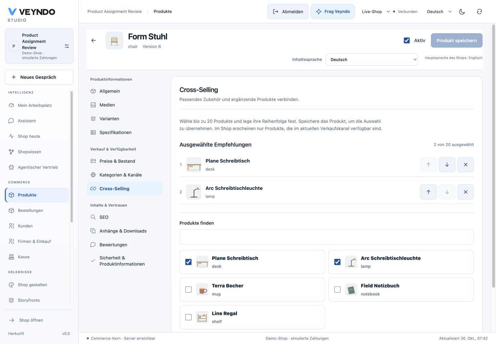

# Product recommendations: native journey, 30 October 2026

## Change and existing owners

The merchant recommendation editor keeps selected products separate from native
cursor-paginated search results. Current merchant detail reads resolve names and
images even when a selected product is outside the search. Missing or inaccessible
records remain explicitly removable. Arrows update the native array order; duplicate
and self additions are excluded from search choices, and selection stops at the
native limit of 20. Content locale is passed through the existing request option.
Read-only users can search while mutation controls remain disabled.

Manual storefront recommendations now reuse ProductTile and native product-detail
reads with the current cart token. Those reads retain active/channel/company
admission, localized metadata, contextual taxes/currencies and native tier pricing.
At most four reads run concurrently, over at most 20 distinct non-self IDs. A changed
buyer/cart/context hides previous results immediately and ignores late replies.
Unavailable products are omitted instead of rendering technical IDs or dead links.
The existing learned-association owner remains separate; no new recommendation
engine, pricing implementation, API or data store is introduced.

## Actual local native journey

The existing Rust runtime served the production frontend build on port 8803.
Synthetic tenant assignments-9ff198a3, product chair, started at revision 7 and
stock 20. The browser selected lamp and desk, moved desk first and searched for a
zero-result phrase. Both selected names remained visible. Native save/reload and
merchant read retained revision 8, crossSelling [desk, lamp] and stock 20.

The actual storefront rendered German desk and lamp cards, their native images,
prices 449.00 EUR and 74.90 EUR, stock and product links in that order. Clicking the
desk name opened its actual product page. Deactivating desk through the local
merchant editor hid only that recommendation; lamp remained visible. Restoring
desk to active made both reappear in order. The target finished active at revision
3, stock 10. No hosted product was mutated during this acceptance.

[390px selection](../assets/product-recommendations-20261030/recommendations-mobile.png) ·
[Actual storefront cards](../assets/product-recommendations-20261030/recommendations-storefront.png).

Rendered desktop and narrow-screen inspection supplements static Impeccable
detection. Temporary viewport overrides are cleared after capture.

## Scoped verification

23 affected tests cover retained selections, selected record resolution, missing
records, ordering, cursor pagination, retry, read-only behavior, selection limits,
real tile media/price/link presentation, rejected detail reads, buyer-context reset,
late responses and the four-read concurrency cap. Existing product-page/workspace
regressions remain green. Production build/type checking, complete localization,
source ownership/inventory and documentation checks pass. Complete tests and
coverage retain their daily cadence.

These writes and captures establish local native acceptance. Public image readiness
and the final read-only hosted Studio observation are recorded on the associated PR.
