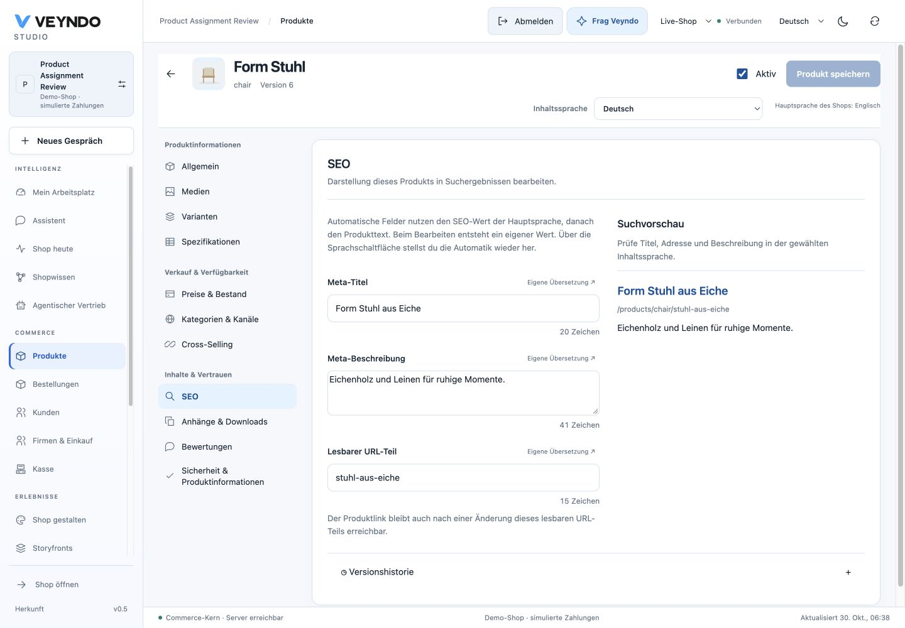

# Product SEO: native editing checks, 30 October 2026

## Shared behavior and owners

The product editor resolves one enabled content locale and uses the shared
LocalizedField inheritance controls. Optional SEO title, multiline description and
readable URL ending sit beside a search preview. Missing values inherit regional,
base or main-language SEO and then product text. Explicit empty values remain
empty. Viewing the preview never fabricates translations or saves a draft.

The shared product-seo module supplies storefront metadata and encoded product
paths as well as the editor preview. Product-page navigation now resets metadata
when the next product has no SEO. The browser mirrors native UTF-8 size and slug
separator validation for immediate feedback; the existing Rust save, authorization,
revision comparison and stock-safe aggregate remain authoritative.

## Actual native journey

The existing local Rust server served the production frontend build on port 8803.
The isolated synthetic tenant assignments-9ff198a3, product chair, started at
revision 5 and stock 20. German SEO title, description and a URL ending were edited.
The invalid ending stuhl/aus-eiche showed an inline error and Save left revision 5
unchanged. Correcting it to stuhl-aus-eiche saved revision 6. A complete reload
retained all three values, and the native merchant read retained stock 20.

The actual storefront product page used /products/chair/stuhl-aus-eiche. Its title,
meta description and canonical address matched the saved German values and actual
route. The page still showed stock 20. No hosted product was mutated.

[390px SEO form and preview](../assets/product-seo-20261030/seo-mobile.png).

Rendered checks at 1440px and 390px found no document overflow. The temporary
viewport override was cleared afterward. Static Impeccable checks supplement the
rendered inspection; their regex-only result is not a full accessibility audit.

## Scoped verification

41 distinct affected tests cover SEO edits/reset, explicit blanks, regional and
fifth content languages, invalid-save admission, untouched stock omission, product
paths, metadata reset between products, rich content and category assignments.
Production frontend build/type checking and structure/ownership checks pass.
Full-suite and coverage verification retain their daily workflow.

These writes and captures establish local native acceptance. Public artifact
readiness and the final read-only hosted Studio check are recorded on the PR.
