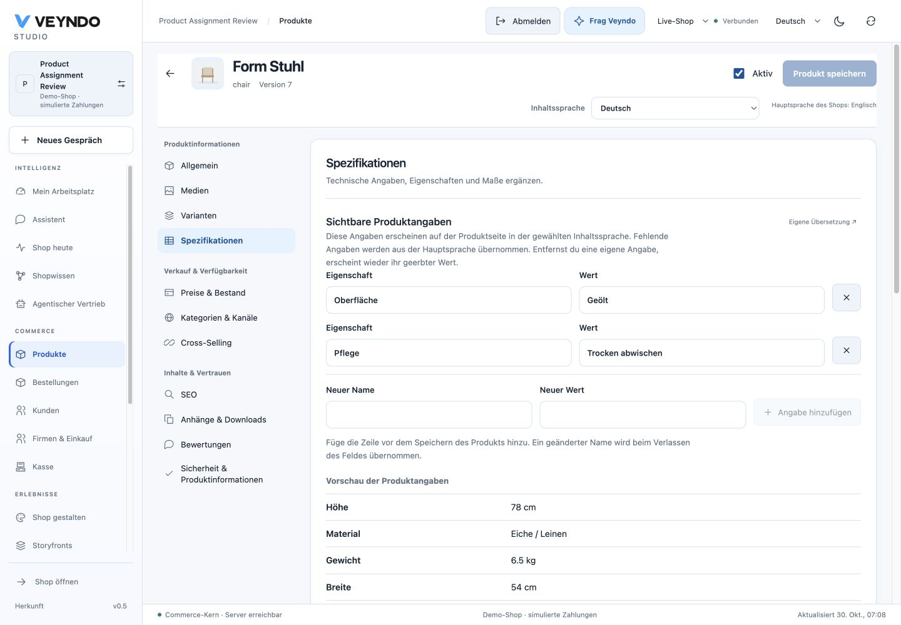

# Product specifications: native editing checks, 30 October 2026

## Behavior and ownership

The product specification workspace separates localized product details, shared
technical properties and structured weight/dimensions with kg/mm labels. Its
preview combines properties with effective translated details. The same shared
specification resolution is used on the product page. Missing fields inherit from
the configured main language; own empty strings remain empty. Removing an own key
restores that field's inheritance. Merely opening the view creates no translation.
Regional metadata keys are resolved independently from plain product translations.

The shared PairFields editor now creates a row only through Add detail and commits
renames on blur. Duplicate names keep both original values and explain the issue.
Names and values respect the native UTF-8 limits, and new rows stop at 40 entries.
This also protects the existing variant-option editor. Native permissions, revision
comparison and untouched-stock omission remain authoritative. No new API or Rust
business owner is introduced. Structured dimensions remain distinct from text
properties; editing a text property does not silently convert its units.

## Actual native journey

The existing local Rust server served the production frontend build on port 8803.
Synthetic tenant assignments-9ff198a3, product chair, began at revision 6, stock 20.
The browser added German Oberfläche = Geölt and Pflege = Trocken abwischen.
Renaming Pflege to Oberfläche was refused with both original names/values retained.
Weight 6.5 kg and width 540 mm were saved through the ordinary aggregate editor.
A complete reload and native merchant read retained revision 7, both de-DE entries,
the structured dimensions and stock 20. Existing automation metadata was retained.

The actual storefront product page rendered Geölt and Trocken abwischen under
properties. Existing inherited/shared properties were still present. No hosted
product was mutated. Desktop and 390px rendering were inspected; the narrow
layout stacks name/value controls and keeps removal beside the value. Document
width equals the 390px viewport. The temporary override was cleared afterward.

[Mobile product details](../assets/product-specifications-20261030/specifications-mobile.png).

## Scoped verification

35 distinct affected tests cover regional/fifth languages, main-language fallback,
explicit blanks, duplicate-name preservation, native row limits, UTF-8 byte limits,
prototype-like keys, read-only controls, stock-safe aggregate saving, existing
variant workflows and actual product-page rendering. Production frontend build,
type checking, complete UI localization and structure/ownership checks pass.
Static Impeccable detection is supplemented by rendered browser inspection.
Complete tests and coverage retain the daily workflow.

The captures and saved values establish local native acceptance. The associated
PR records public image readiness and the final read-only hosted Studio observation.
