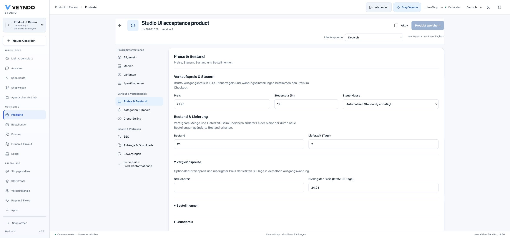

# Product workspace: local acceptance, 29 October 2026

This change reorganizes the existing native product editor. The header contains
product identity, revision, activation, save state and one shared content-language
picker. Grouped sections retain installed app tabs and the same product context.
Keyboard navigation uses manual activation. A grouped selector replaces the sidebar
at narrow widths. History belongs to the editing panel; standalone assets/reviews
keep their native behavior without nested card decoration.

## Actual browser checks

The existing local Rust server on loopback port 8803 served the built frontend.
An isolated synthetic merchant workspace was registered through the existing auth
API and signed in through the actual browser login form. No production data or
shared browser credentials were used.

- Opened the seeded chair, edited its German name and price to 199.95, saved through
  the native editor, reloaded and observed the new name, revision 2 and saved price.
- Created a separate inactive product through the actual form with an English main
  name, number UI-20261029, price 29.95 and stock 12. Reopened its price section and
  observed the saved price and stock.
- Opened media, specifications, category/channel assignments, related products,
  SEO, attachments and safety details. Each selected the correct panel without
  a visible error. Opened variants and review moderation as well.
- At 1440px the product header measured 118px and the editing panel began at 222px
  from the viewport top, including the shared Studio topbar. Document width was
  exactly the viewport width.
- At 390px document width remained 390px, desktop tabs were hidden and the native
  grouped selector opened review moderation. The Studio menu was closed for the
  capture. Inspected dark colors and kept theme-aware surfaces; selected navigation
  text uses the full foreground color on the dark hover surface.

[Mobile capture](../assets/product-workspace-20261029/general-mobile.png).

## Automated verification

- All 151 frontend test files and 849 tests passed with coverage. The existing
  coverage floors passed without lowering thresholds.
- Targeted regressions preserve stock-safe revision writes, conflict drafts,
  read-only access, keyboard/mobile selection and a fifth content language with
  a German main locale. Deferred creation-default tests cover both an untouched
  draft and input entered before defaults arrive. Review tests use the original
  publication endpoint and exclude another product's reviews.
- Corrected an existing asynchronous email test: a disabled save button can mean
  saving is still running. The secret-clearing assertion now waits for completion.
  The mail implementation and permissions are unchanged.
- Production frontend build, formatting, localization, architecture, exact source
  inventory and source structure checks passed. Documentation was built and checked.

This is local native/browser acceptance. It does not claim a production rollout,
real payment acceptance, exhaustive physical-device coverage or new app privileges.

## Price and availability follow-up

The native price panel groups selling price, tax rate and the actual configured
tax class together. Stock and delivery follow. Comparison prices, order quantities,
reference units, currency-specific prices and existing rule-based discount tiers
have named expandable sections. Existing configured values open their section.
No new pricing, tax, currency, inventory or permission owner is introduced.

In the same isolated local workspace, the browser opened synthetic product
`UI-20261029`, changed its gross base price to EUR 27.95 and its lowest 30-day
price to EUR 24.95, then saved through the ordinary native endpoint. A full
reload retained both amounts, revision 2 and stock 12; the comparison-price
section opened automatically. No hosted product record was changed.

At 390 × 844px the product section picker and individual fields remain inside the
viewport: both `innerWidth` and document width are 390px. The temporary viewport
was reset after the check. The main Studio menu was closed for the capture.

[Mobile prices](../assets/product-workspace-20261029/prices-mobile.png).

Targeted product/editor/currency checks passed: 22 distinct tests across the
three affected suites, including a moved tax-class write/read-only regression,
cent-step comparison editing and stock omission on content saves. Production
frontend build, localization and architecture passed; the Impeccable source
scan reported no findings. The daily complete test/coverage schedule is retained.
