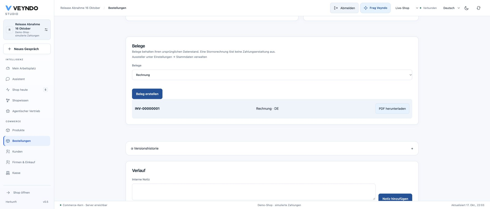
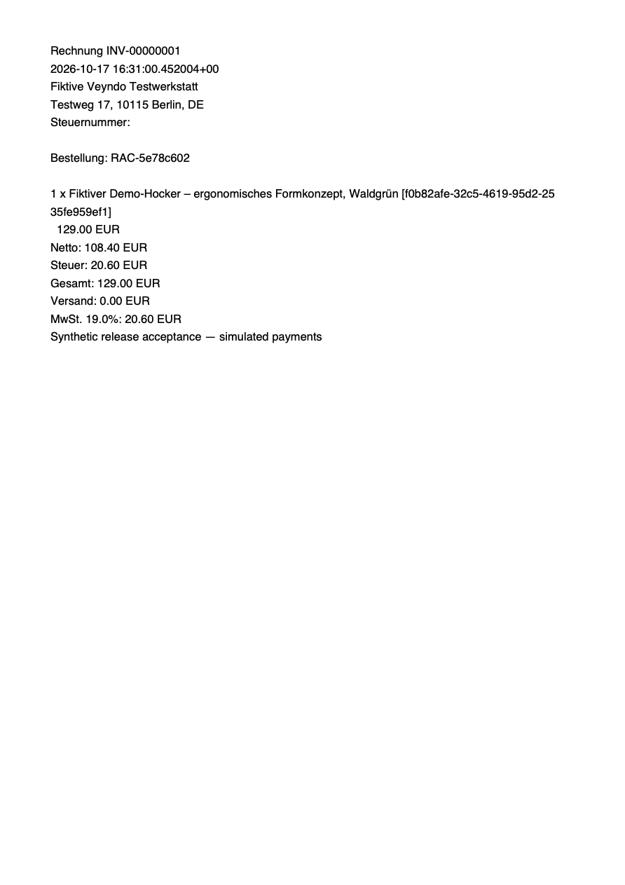

# Native receipt punctuation follow-up — 17 October 2026

This follow-up concerns the existing synthetic Release Abnahme 16 Oktober shop.
No real payment, external message, new invoice or physical printer is required for
the comparison: the original invoice INV-00000001 for RAC-5e78c602 is downloaded again.

## Reviewed change and checks

The PDF uses Helvetica / WinAnsi. The former serializer cast Unicode code points
to bytes and therefore replaced typographic punctuation with question marks.
The same native renderer now maps the declared Windows-1252 repertoire correctly.
Unsupported glyphs retain the explicit fallback; the immutable snapshot retains
its Unicode text. This is not a general Unicode font-rendering claim.

Source: `25b354e3009159c562652fb7963e25f4799ea1ca`, [PR 162](https://github.com/sthamann/veyndo/pull/162).
Image: `wise-authority-6674`, successful in 8m20s, same exact source.
Required CI: [39062003356](https://github.com/sthamann/veyndo/actions/runs/39062003356), successful: all 100 registered suites and 648 frontend tests. Line coverage: Rust 88.30%, frontend 67.59%, Python development/verification tools 84.19%; unchanged floors. The 59-policy / 156,693-case conformance and negative controls passed; this is not whole-system certification.

Merged as `1fa8f17fbb4985f7de82bd9d366940a7cefe3bb6`. Candidate, CI merge commit `750d1be48a66f5c28122a69d3b9655e8ab81ee60` and merged main share tree `53b23aff2228c1063a2e63c417fe93a3a2fa2eeb`.

Local evidence: the new renderer test failed on the original implementation and
passed with the fix; an actual HTTP/PostgreSQL invoice with typographic seller
text parses correctly through the existing bounded Rust extractor. Workspace
Rust tests, clippy and six affected integration suites passed. The initial HTTP
attempt raced the final executable build and retained the original punctuation
failure. A later structure subprocess hit broken system Node; the bundled Node
structure check passed. Formal conformance and negative controls passed without
changing any extracted policy, permission, money, invoice identity or idempotency.
All 263 Markdown sources / 270 pages / 26,907 links and assets passed locally.

## Public release and comparison

- Fresh disk snapshot `receipt-pdf-20261017-25b354e`: 6 GB, completed 21:53:09–21:54:09 Europe/Berlin.
- Core `vendune-core-56ff5fd887`, pod `vendune-core-56ff5fd887-677rs`, started 22:01:56 Europe/Berlin: one active instance, 1/1 passing, zero restarts; the preceding Core is 0/1. No migration, maintenance job, new credential or privilege was required.
- Redundant automatic workflow `b6650c86-9f27-4f9d-a9d1-c25413cda95d` stopped during its first build after 25 seconds; its database/maintenance/Core steps did not run. Child build `stoic-plot-1497` was also aborted, at 36 seconds.
- Public health 200, anonymous platform overview 401, direct public registration 403. After reload, the existing merchant session still opens the completed/delivered order, app version 0.1.3 and exactly one original invoice.
- The actual browser download at 22:03:47 produced `receipt (7).pdf`, 1,153 bytes / one page. The automation download event timed out, but the ordinary download arrived; only that newly generated local file was copied and parsed. No browser warning/interception was bypassed.
- [Parsed comparison](receipt-pdf-comparison-2026-10-17.json): invoice `INV-00000001`, order `RAC-5e78c602`, original issue time, issuer/address, net 108.40 EUR, tax 20.60 EUR and total 129.00 EUR are preserved. The product's en dash and receipt message's em dash now survive; no question marks remain in this receipt.
- The serialization bytes change to correct glyphs. No new invoice, purchase or payment was issued; the original document data and order identity are retained. This comparison is not an arbitrary-Unicode or physical-printer acceptance.

## Original Storyfront boundary

The [18 October follow-up](storyfront-checkout-hosted-2026-10-18.md) subsequently
completed the full controlled-Chrome embedded purchase, return and persistent
original-bag clearing on these same public Core/Experience images. The observations
below retain their original 17 October scope.

A fresh CE5 Core / original Experience attempt again showed an empty iframe.
Ordinary DOM inspection exposed no checkout fields; raw diagnosis explicitly
reported Browser Use resolving a paused document response. No interception,
security or browser-selection bypass was used. Returning kept the original one
EUR 24.90 mug. No new embedded purchase is accepted by this follow-up.

Northflank separately confirms that the original Experience already runs
`b40b3867b4f2af18dc3d41d1ce4e0f9a734fc0a7`, image `educated-sort-2532`, including
the existing Studio return and loading-recovery changes. No redundant Experience
rollout was performed. Real provider settlement/mail/refund, Apple callback,
hosted signed-buyer RFQs and arbitrary isolated app builds remain separate.
