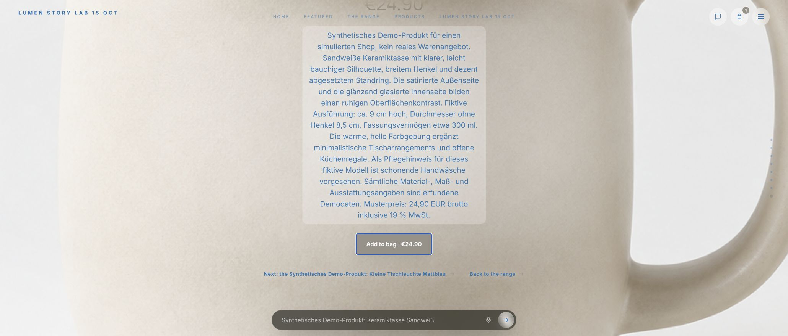
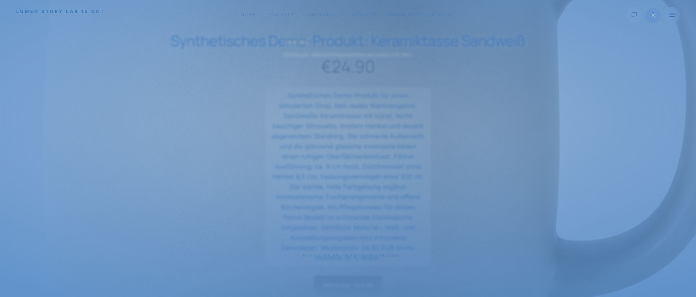
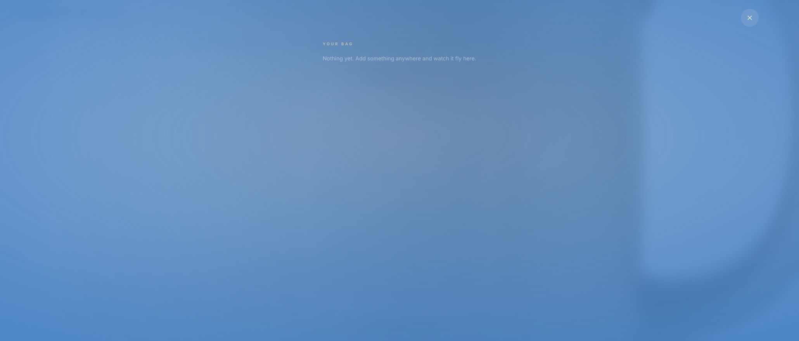
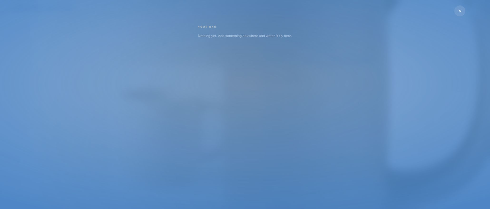
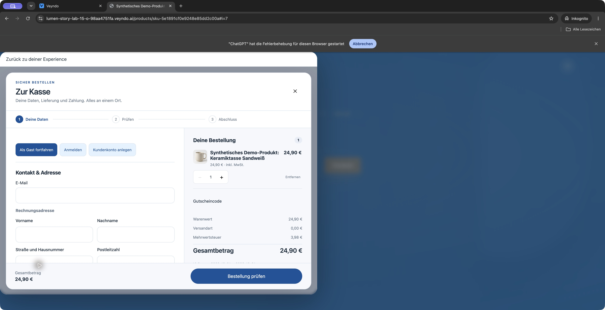
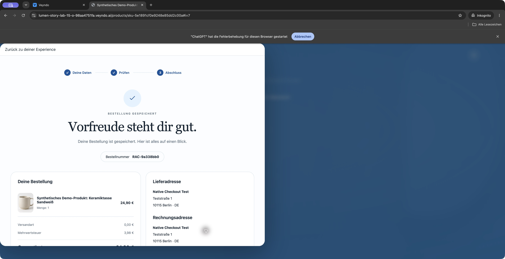
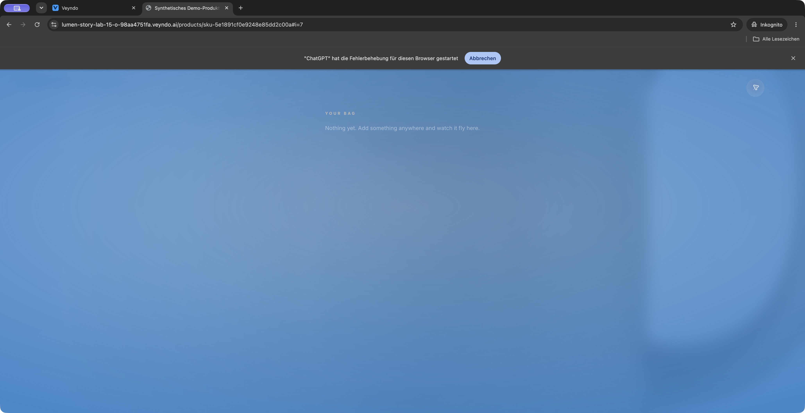
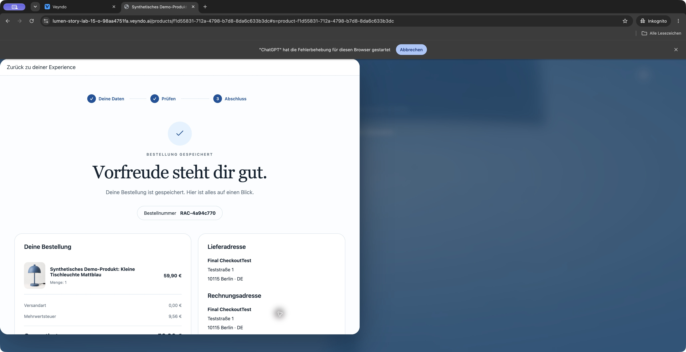
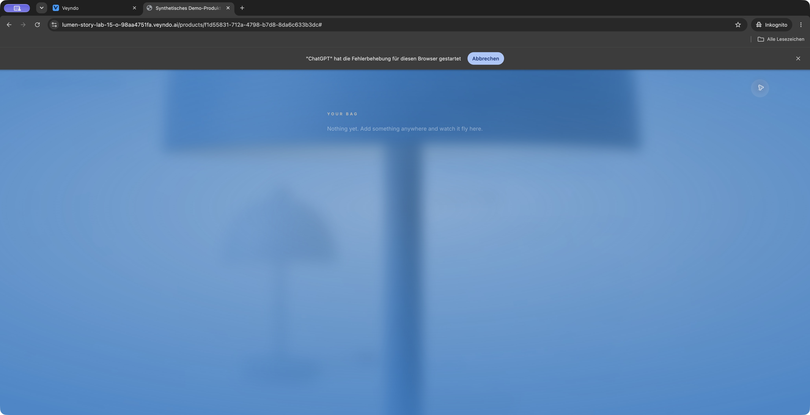

# Original Storyfront embedded checkout: 21 October 2026

Public Core `fa33a003`, image `shallow-place-4222`, was running during this
browser acceptance. The original Lumen Story Lab Experience retained its
separate Storyfront deployment. No local replacement storefront was used.

The browser added one synthetic ceramic cup to the original Storyfront bag,
then opened the native checkout in its iframe. The first navigation remained
paused by browser automation: the diagnostic API explicitly reported a paused
document response. The visible bounded timeout retained the bag and offered
retry. The ordinary retry loaded contact/address fields and the native quote.
This observation is not evidence that every first navigation is reliable.

After rejecting optional tracking, the guest flow used synthetic contact and
address data, pickup and the explicitly simulated payment method. The iframe
completed order `RAC-585cbb53` for EUR 24.90, with EUR 3.98 VAT. Confirmation
retained the German product name, quantity one and simulated authorization.
No real provider was charged.

The confirmation's return action closed the iframe and returned to the original
Experience. Its own bag showed zero items and the order-confirmed message.
Opening the bag showed no purchased position. A full reload and Storyfront
hydration retained bag count zero.

This accepts the complete embedded purchase/return/cart reconciliation path on
the named public version after retry. It does not claim an uninterrupted first
load, real payment acceptance, or independent B2B approval.

## Repeated against Core fb8d54e0

With public Core image `dainty-ray-8892` running, the same original Experience
completed simulated order `RAC-fcaacdc2`: one ceramic cup, German product name,
EUR 24.90 total and EUR 3.98 VAT. Its receipt return closed the iframe, showed
the order-confirmed message and emptied the original bag. Full page reload and
hydration retained bag count zero. Screenshots captured embedded review, receipt
and the empty original bag.

Two earlier opens in the existing controlled tab timed out. The browser's
diagnostic API explicitly reported a paused document response. Closing the
dialog and fully reloading Storyfront preserved its one bag item; the next
ordinary Checkout action loaded the iframe and completed the purchase above.
This records a successful complete journey after a fresh page start, not a
claim that the prior automation-related first-load failures disappeared.

The same test found a separate presentation defect: on the long-description
Purchase scene at a 2060 x 881 viewport, the fixed Ask bar overlaps the add button.
Keyboard activation added exactly one item. That workaround completes this
checkout regression but does not accept pointer usability of the covered button.

## Pointer acceptance on the original scrollable Purchase scene

Public Experience `56ae7b8`, image `sole-shield-9134`, started on 21 October at
15:47:50 CEST with original Storyfront pin `a08a0f5`. Core remained `fb8d54e0`
(image `dainty-ray-8892`). The repair uses the original cinematic renderer's
existing scroll owner; it adds no second checkout, bag or price calculator.

At the same desktop viewport, a native wheel action scrolled the long-description
Purchase scene. A pointer click on the now-visible Add to bag button added exactly
one cup and changed the bag from zero to one. The complete iframe guest purchase
then used synthetic contact/address data, pickup and explicit Demo payment.
Order `RAC-3bce945b` retained the German product name, quantity one, EUR 24.90
total and EUR 3.98 VAT. The receipt explicitly reported simulated authorization.

The receipt return closed the iframe in the original Experience. The original
bag became empty. Full page reload, hydration and reopening the bag retained
zero items and the empty-bag view. No user-side manual test was required.
The first checkout open reached the bounded timeout and required the ordinary
visible retry; this remains a separate reliability issue rather than a claimed
first-load success.

## Provider recovery repair and repeated public purchase

Experience `cbb4d283`, image `alert-light-1076`, started on 21 October at
17:04 CEST with original Storyfront pin `5d5f0e7`. Core remained `fb8d54e0`.
The original provider-receipt reconciliation used an unencoded JavaScript Date
inside raw SQL. The repair uses the database column's typed comparison, retaining
the exact lease token, operation and expiry checks. The actual PostgreSQL driver
reproduced the public error before the repair; the corrected regression and ten
existing tests pass, including expired and stale-worker rejection.

At 17:09 CEST the deployed worker logged `claimed=3`, `pending=3`, `failed=0`.
The preceding deployment had logged three technical failures with the Date-binding
exception. The repaired cycle successfully checked all three receipts; it did not
report provider completion. Their external results remained pending.

The browser then completed embedded simulated order `RAC-386cdc4c`, with one
German-labelled cup, EUR 24.90 total and EUR 3.98 VAT. Returning from its receipt
closed the iframe and emptied the original Storyfront bag. Full reload, hydration
and reopening the bag retained zero items. Synthetic contact/address data and
the explicitly simulated payment method were used; no real payment was made.

The initial controlled iframe navigation again reached its bounded timeout while
the browser diagnostic reported a paused document response. The ordinary retry
after closing and reloading the page completed the journey. This repetition
accepts purchase, return and persistent cart clearing on the repaired deployment;
it does not establish reliable first loading or completion of the pending provider
jobs. No user-side manual verification was needed.

## Regression after reusable work and rule comparison

With Core/Studio `ef093e7a` (`brave-produce-7557`) running on 21 October at
21:29 CEST, the original Lumen Experience completed simulated order
`RAC-14a61722`: one German-labelled ceramic cup, EUR 24.90 total and EUR 3.98
VAT. Contact/address entry, review and the confirmation all appeared inside the
original Storyfront iframe. Its receipt return closed the iframe, displayed the
confirmed-order feedback and cleared the original bag. A full reload and opening
the bag again retained zero items. Only synthetic contact/address data and the
explicitly simulated payment method were used.

The initial controlled-tab attempts, including a fresh tab, again timed out with
an empty document. Browser diagnostics explicitly reported a paused document
response. Opening the exact checkout document normally in a separate diagnostic
tab showed its contact/address form; no order was placed there. After closing
that tab, the next ordinary Storyfront Checkout action loaded the iframe and
completed the purchase above. No interception or browser security setting was
changed. This accepts the complete purchase/return/cart journey after recovery;
the initial-load issue remains unresolved and is not hidden by the successful
repetition.

## Fresh private-session purchase without a retry

At 22:26 CEST, the unchanged public Core `ef093e7a` and original Experience
`cbb4d283` completed a fresh private Chrome session using native accessibility
input. This tab was not attached to the browser extension's tab-control API.
The browser's existing diagnostic banner remained visible; no security setting,
request interception, cookie policy or application code was changed.

The first **Checkout** click loaded the native iframe, its privacy choice and
contact/address fields. There was no timeout, retry, page restart or separate
top-level checkout navigation. Optional tracking was declined. A synthetic guest
used pickup and the explicitly simulated payment method. Order `RAC-9a338bb0`
retained the German ceramic-cup name, quantity one, EUR 24.90 total and EUR 3.98
VAT; its confirmation explicitly reported simulated authorization.

**Back to shop** closed the iframe and emptied the original Storyfront bag.
A full browser reload and reopening the bag retained the empty state. The
complete journey required no user-side manual action.

This is a successful first-load acceptance in one fresh session on the same
deployed code that previously required recovery through extension-controlled
tabs. It narrows the remaining investigation toward the browser-control path;
it does not prove the cause of every earlier blank document or establish a
statistical first-load reliability rate.

### Normal Chrome window countercheck

At 22:33 CEST, a new normal (non-private) Chrome window repeated the same
first-open check through native accessibility input, again without attaching its
tab to the extension's tab-control API. One synthetic cup was added. The first
Checkout click loaded privacy controls and then the contact/address form without
retry or top-level checkout navigation. No second order was placed in this
countercheck. Returning to Storyfront retained the unpurchased item; removing
that test item left the bag empty, and the temporary window was closed.

Both fresh private and normal-window first opens therefore succeeded on the
unchanged public deployment. Earlier extension-controlled blank documents remain
recorded above rather than being reclassified as successful attempts.

## Final combined release: first load, purchase and empty-cart reload

After Core/Studio `7f0d4266` (`offbeat-mind-8124`) became healthy at 22:47 CEST,
the original public Experience `cbb4d283` was tested again through native Chrome
accessibility input. The first iframe open loaded its privacy and address fields
without retry or a separate top-level checkout navigation.

The frequently purchased ceramic-cup fixture had exhausted its stock. Its
purchase was rejected with the explicit message “Diese Menge ist nicht mehr
verfügbar. Wähle eine andere Menge oder Variante.” No order was created by that
attempt. Returning to Storyfront retained the unpurchased cup; only that test
item was removed before choosing the synthetic matt-blue table lamp.

The lamp's first Checkout action also loaded the iframe normally. A synthetic
guest declined optional tracking, selected pickup and the explicitly simulated
payment method, reviewed the quote and completed order **`RAC-4a94c770`**:
one German-labelled lamp, **EUR 59.90 total**, **EUR 9.56 VAT**, zero shipping.
The receipt explicitly reported simulated authorization. No real payment or
external order email was accepted by this test.

The receipt's **Back to shop** action closed the iframe, returned to the original
Experience and displayed the confirmed-order/updated-cart message. A full browser
reload and reopening the original bag retained **zero items**. This complete
journey on the final public runtime needed no user-side testing or checkout retry.
It complements the earlier fresh-session observations; it does not erase the
recorded extension-controlled pauses or establish a statistical reliability rate.

