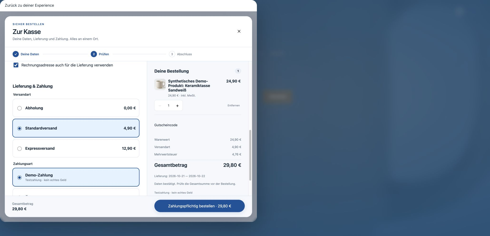
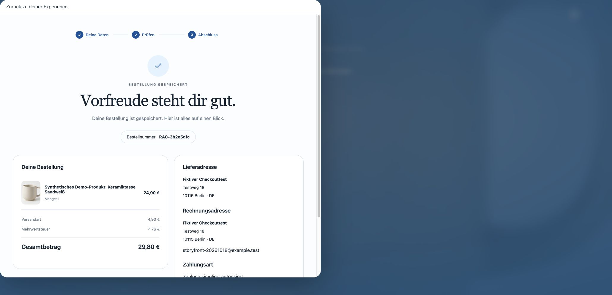
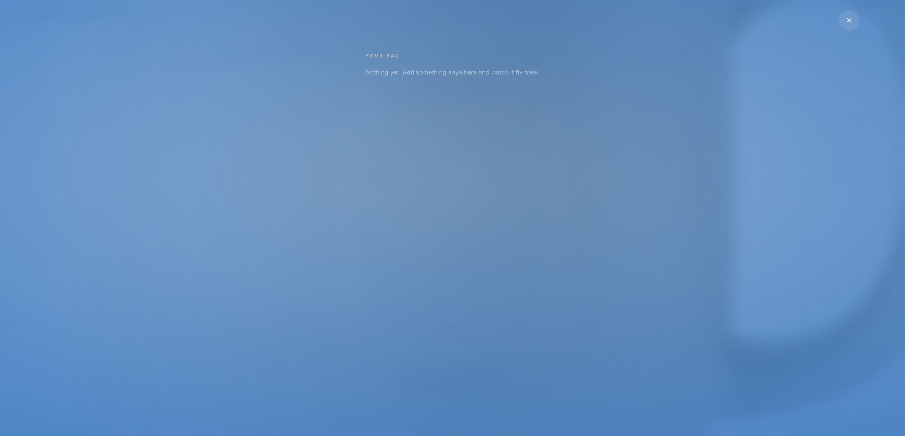

# Original embedded Storyfront checkout: hosted acceptance, 18 October 2026

The complete purchase was performed through the controlled Chrome session on the
existing public original Lumen Story Lab 15 Oct Experience. No manual shopper test,
alternative browser driver, interception bypass or real payment was used.

## Running source and diagnosis

Northflank confirms Core `25b354e3009159c562652fb7963e25f4799ea1ca`,
image `wise-authority-6674`, deployment `vendune-core-56ff5fd887`, one active
instance, 1/1 passing and zero restarts. The private Experience runs `b40b386`,
image `educated-sort-2532`; its original source pin is `4953bb5`. The existing
loading recovery remains part of that release, not a new checkout implementation.

The retained browser tab initially reproduced the empty iframe. Its handoff API
returned HTTP 200; a separate public document check returned HTTP 200 and a
frame-ancestors policy allowing exactly the originating shop. Raw browser diagnosis
reported a paused document response. No security control was changed to proceed.
Closing that attempt preserved the original one-item bag. After an ordinary full
reload of the original Experience, the current embedded document loaded and the
following journey completed using the normal browser and frame controls.

This establishes the outcome below. It does not establish that every historical
empty-frame report had the same cause, or that an HTTP 200 alone proves a working
checkout. No additional runtime change or redundant service deployment was needed.

## Completed journey

1. The original bag retained one synthetic sand-white ceramic mug, EUR 24.90.
2. Checkout opened inside the original Storyfront dialog. Contact, address,
   shipping and payment controls were visible in the native Veyndo iframe.
3. Fictional `.test` contact/address data, standard shipping and the explicitly
   simulated Demo payment were selected. Optional tracking was rejected.
4. Native review confirmed EUR 24.90 goods, EUR 4.90 shipping, EUR 4.76 VAT and
   EUR 29.80 total before submission.
5. The embedded confirmation saved **RAC-3b2e5dfc**, quantity one, German product
   name and the same amounts. Payment states **simulated authorization**.
6. The original Storyfront bag changed to **0** and reported that the order was
   confirmed and its cart updated. The shared bridge validates the completion
   against Core before consuming purchased lines; it does not trust a message alone.
7. The receipt's **Zurück zum Shop** closed the iframe and retained the original
   product URL on the Lumen Experience, without navigating to the standard frontend.
8. A complete page reload and reopening the original bag still showed **0** and
   its empty state. No purchased line reappeared.

## Verification boundary

The native embedded-parent/receipt/return unit suite was rerun: two tests passed,
including invalid-parent and ordinary top-level rejection controls. The existing
full required CI for the deployed Core remains linked in the
[source-bound release receipt](receipt-pdf-hosted-2026-10-17.md); it was not rerun
merely to publish this documentation. The public simulated purchase above is the
acceptance evidence, rather than the test count.

Real payment capture, external PSP redirects/3DS, email delivery and refunds remain
separate provider acceptances. This test does not certify every browser or the
entire platform. All captured buyer/product data is fictional.
