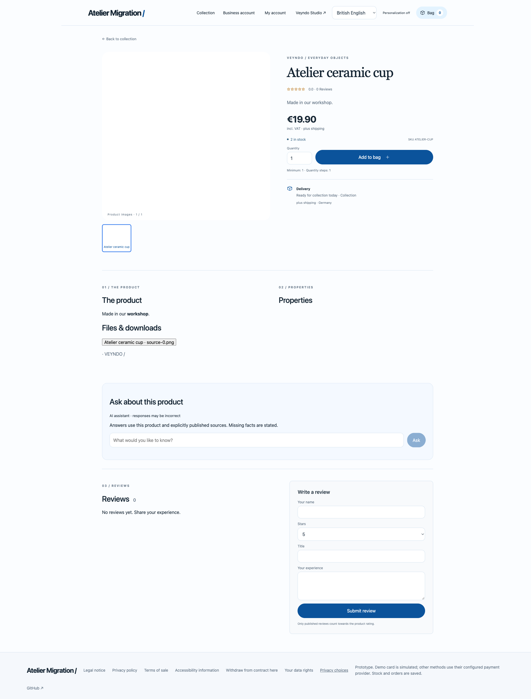
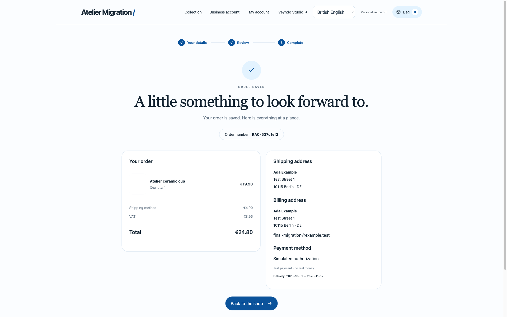
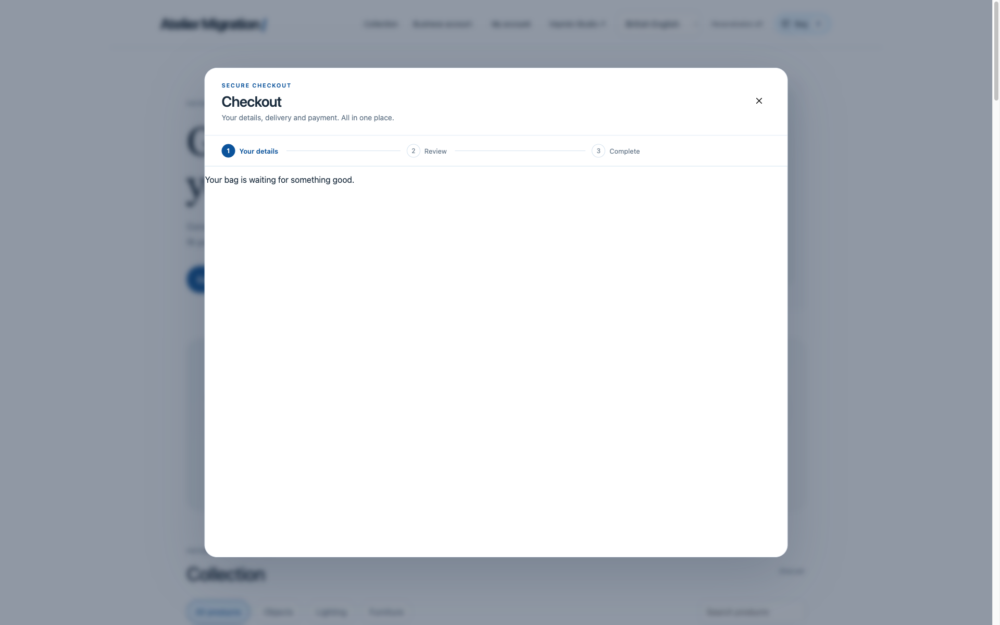

# Actual WooCommerce inward migration: 29 October 2026

Local acceptance used actual WordPress **6.8.3**, WooCommerce **10.3.0** and MariaDB
**11.4** in a separate disposable Compose project. The unchanged independent Rust
migration service called actual WooCommerce/WordPress REST routes and downloaded
original source media. This is local source-service and native browser acceptance,
not hosted migration delivery or production TLS acceptance.

The [source recipe and seed](../../extensions/apps/migration/tests/woocommerce-live/README.md)
are app-owned test fixtures. The loopback fixture models a TLS-terminating ingress
for WooCommerce read-key authentication; local media uses explicit fixture HTTP.
Production source transport retains HTTPS, DNS/address restrictions and no redirects.
No API key, password or raw customer export is included in this evidence.

## Original source and actual target

| Area | Original source | Matching native target |
| --- | --- | --- |
| Categories | Uncategorized and Ceramics | 2 private native categories |
| Products | 22 top-level products, one variable parent with two concrete variants | 24 native products with exact original prices, parent IDs, Colour options and zero initial active stock |
| Media | One original PNG used by parent, simple product and both variants | 4 original-byte/product associations, stable IDs and byte digests |
| Authored pages | Our workshop | 1 editable private native content page |
| Customers | One original customer with addresses | 1 CRM record; no invented login credentials |
| Historical orders | Original completed order with two cups and delivery | 1 historical order, exactly **4,470 EUR minor units**; no new payment or stock effect |
| Reviews | Original five-star review | 1 hidden moderated review, no invented purchase verification |
| Coupons | Ten percent coupon, limit 5 and prior usage 2 | 1 inactive native promotion with 3 remaining uses |

Default WordPress samples and WooCommerce application pages are drafts in this
fixture; they are not represented as migrated checkout/account implementations.
The small PNG is a byte/association fixture, not a product photograph.

All eight areas passed actual current-native-field comparison. Independently
requeueing each reviewed batch returned the same IDs/counts and matching fields.
Native page evidence remained in the existing shared app storage; no table or queue
was introduced. Catalogue, page and original media changes were deliberately
published through a selected release; operational CRM/order/review/coupon data
were not sandbox release selections.

## Actual interruption and recovery

The owned Rust migration process was killed at **4 percent** of the product batch,
after at least one native write. After a fresh process start and ordinary native
lease expiry, an explicit uncertain-outcome retry continued the saved job. No
checkpoint, lease or database clock was edited. All **24** reviewed product records
then compared matching. The other saved page imports and a full independent replay
also completed through the actual Core outbox, callback and domain writers.

## Browser finding and repair

The first browser purchase succeeded but revealed literal `
`/`<strong>` tags in
the imported product description. Source HTML had been stored as the plain native
description. The app now reuses its bounded authored-page parser to prepare a plain
summary and editable native rich document. Generic Core intake maps the optional
native rich description through current language keys; current-field inspection
compares that source-owned rich content too. Source-specific HTML parsing remains
inside the migration app.

Tests first reproduced the normalizer and native-storage failures. They now cover
formatted/entity-decoded content, actual localized storage, manual rich-content
difference detection and restoration. Executable links, scripts, embeds and malformed
rich mapping reject through the parser/native product validator. Existing imports
are not rewritten silently: a changed normalized source snapshot retains the normal
review/conflict behavior. Final acceptance used a new synthetic destination.

The final headed Chromium purchase used that newly migrated product and actual
native contact/address/delivery forms. Order **`RAC-537c1ef2`**, ID
`537c1ef2318a4f4e87947efb9e0d601c`, contains one cup at **EUR 19.90**, delivery
**EUR 4.90**, total **EUR 24.80**, included VAT **EUR 3.96**. Payment is explicitly
simulated, with `realMoneyCharged=false`. Stock decreased once from 3 to 2.

Back to the shop, a full reload and reopening Bag 0 showed the empty basket.
The product's rich emphasis rendered natively and literal source HTML was absent.

## Verification

The complete registered `migration_assistant` suite passed in **106.48 seconds**,
including 29 CLI normalization cases, actual Rust/PostgreSQL import, native rich
mapping/reconciliation, existing five-provider fixtures, current/withdrawn rights,
foreign denial, cancellation, saved evidence, complete variants, original media and
simulated purchase/replay. Full workspace Rust tests and strict Clippy passed.
Fixture protocol checks remain separate from the actual WooCommerce run above.

The independent final review reproduced adjacent block-wrapper text joining and
entity-only HTML bypass. The existing parser now preserves ordinary block
boundaries, separates code/rule blocks in plain summaries and decodes named/numeric
entities once, including encoded literal angle brackets. The expanded CLI and
actual native-import cases assert both the independent expected summary and the
stored native document. Executable-content rejection remains in force.
