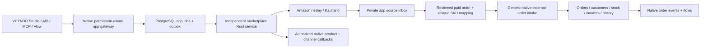

# Marketplace channels

Marketplace Studio connects Amazon, eBay and Kaufland through an independent Rust
app. One VEYNDO catalogue remains authoritative for product identity, native
currency pricing, available stock and orders. Every connection belongs to an
existing `marketplace` sales channel in the same merchant workspace.

## What is implemented

| Area | Actual behavior |
|---|---|
| Channels | Create/edit/pause native marketplace channels; select catalogue, languages and inherited settings. These are authenticated integration channels, not public Store API storefronts. |
| Offers | SKU → native product reference; translated title/description, public HTTPS images, exact-currency price, provider attributes and per-offer category/policy overrides. Empty/missing translation inherits; an explicitly empty description stays empty. |
| Mapping | Automatic standard title/description/image/stock/price projection; explicit data-only source paths for provider attributes. Custom attributes win. Preview records missing minimum requirements before sending. |
| Sync | Explicit listing/update or paginated order-retrieval job through the native job/outbox/app gateway. Native job idempotency, CAS record revisions, worker admission and renewed leases. |
| Orders | Preserve original source in private inbox; suggest unique SKU matches and source address/quantity fields; review payment, complete addresses and exact source gross/tax amounts, then atomically create native order, guest customer snapshot, stock allocation/consumption and events. |
| Documents | Native immutable invoice/PDF flow, order detail/status/history and app/Flow consumers. Marketplace payment is recorded externally; VEYNDO performs no second charge. |
| API/MCP/Flow | Manifest actions are the same contract for Studio, API and permitted MCP tools; `sync` is Flow-enabled. Explicit PII and paid-import permissions apply. Paid intake also requires the calling user’s `payments.manage` and `customers.pii` rights, not merely the service credential. |
| App Studio | Import/version the same package, entities, service/job actions and sales-channel core references. Provider implementations remain app-owned. |



All provider logic lives in `extensions/apps/marketplaces/`. Generic host contracts
are `src/apps/core_exchange.rs`, `src/commerce/external_order_input.rs` and
`src/commerce/external_orders.rs`. The app creates no alternative commerce database,
queue, pricing engine, order ledger or receipt implementation.

## Merchant walkthrough

1. Under **Sales channels**, create a **Marketplace** channel. Select languages,
   catalogue and inherited currency settings. Keep it active/public for synchronization.
   “Public” here enables the external integration; its Store API is still private.
2. Install/approve **Marketplace Studio** under **Apps**. Open its details workspace.
3. **Connect marketplace**: select the native channel, provider, server credential
   alias, destination, enabled content language and currency. No secrets in these fields.
4. **Create offer**: select a native product and unique seller SKU. Keep inherited
   text/images/price or enter channel-specific values. Override category/type/EAN and
   seller policies per offer when the connection defaults do not fit that product.
5. **Preview automatic mapping**. Fix missing provider fields and public HTTPS media.
   **Synchronize offer** confirms the current contents, stock and price before enqueueing.
6. Under **Connections**, **Retrieve orders**. **Sync activity** reports the native
   job status/result; a next-page button preserves the exact original timestamp filter.
7. **Order inbox** → **Review order**. Check source payment, product matches, both
   addresses and exact line/shipping gross and taxes. Unknown amounts remain blank.
   Import opens the regular VEYNDO order; invoice generation uses the usual API/UI.

[Archived capture from the preceding release: Marketplace Studio with synthetic local Amazon and eBay offers](https://github.com/sthamann/veyndo/blob/ced4a3887086e8c6a943d774a78bc8cca5deb5dd/extensions/apps/marketplaces/assets/studio-offers.jpg)

The screenshot shows synthetic local seller fixtures, not live marketplace accounts.

## Operator setup

Two distinct credentials are required: a gateway token for Core → service, and a
current, consent-bound app credential for service → Core. Seller tokens stay only
in the service's secret environment; app records contain aliases.

`APP_MARKETPLACE_TENANTS` is a JSON object keyed by the exact native tenant ID:

```json
{
  "your-workspace": {
    "coreUrl": "https://app.veyndo.ai",
    "callbackToken": "<approved current app key>",
    "accounts": {
      "amazon-eu": {
        "provider": "amazon", "region": "eu", "sellerId": "<seller>",
        "clientId": "<LWA client>", "clientSecret": "<secret>",
        "refreshToken": "<seller-consented refresh token>"
      },
      "ebay-test": {
        "provider": "ebay", "region": "sandbox",
        "clientId": "<client>", "clientSecret": "<secret>",
        "refreshToken": "<seller-consented refresh token>"
      },
      "kaufland": {"provider":"kaufland", "key":"<client key>", "secret":"<secret>"}
    }
  }
}
```

Install `extensions/apps/marketplaces/manifest.json` through normal app consent.
Generate a pinned app credential with `data.read`, `data.write`, `products.read`,
`channels.read`, `orders.read`, `orders.import`, `payments.record`, `customers.pii`
and `jobs.write`. The credential creator needs the corresponding current native
rights. Upgrades change the digest and require fresh consent/key configuration.

Configure `APP_SERVICES.marketplaces` on Core with the deployed service URL,
`APP_TOKEN` and canonical package digest using the existing gateway contract in
[app security](app-security.md). Start service with `APP_BIND_ADDR=0.0.0.0:8799`.
Connections select the configured account aliases above. Never put seller secrets
in a public manifest, product fields, frontend storage, screenshots or Git.

## Provider contracts and important limits

- **Amazon:** Listings Items `2021-08-01` PUT with seller/SKU identity and category
  attributes; Orders **`2026-01-01`**, preserving `pagination.nextToken`. LWA seller
  consent, developer roles and product-type attributes remain mandatory. Minimum
  field checks are not complete category validation; supply required attributes from
  [Product Type Definitions](https://developer-docs.amazon.com/sp-api/lang-en_EN/docs/retrieve-a-product-type-definition).
  See [Listings guide](https://developer-docs.amazon.com/sp-api/lang-en_EN/docs/manage-product-listings-guide)
  and [Orders API](https://developer-docs.amazon.com/sp-api/docs/orders-api).
- **eBay:** inventory-item upsert, offer reconciliation by SKU/marketplace, create or
  update, then publish if necessary. OAuth inventory/fulfillment scopes, category,
  location and payment/return/delivery policies are required. See
  [Inventory API](https://developer.ebay.com/api-docs/sell/inventory/overview.html).
- **Kaufland:** signed product-data and unit APIs, stable `id_offer`; order collection
  plus individual order detail fetch. EAN, VAT indicator and shipping group are
  explicit. See [Seller API](https://sellerapi.kaufland.com/?page=rest-api) and
  [order structure](https://sellerapi.kaufland.com/?page=orders).

A submission is **not** proof that a marketplace published an offer. Provider
category/compliance review can still reject it. A timeout after a write leaves the
listing `uncertain`; automatic replay is blocked. Reconcile in the seller portal
before explicitly resetting the reviewed app record through the generated API.
There is no automatic blind retry of external listing writes.

Current order import is a reviewed **paid, simple line/tax snapshot**, not a complete
replica of every marketplace's accounting. Refunds, cancellations, shipment/tracking
write-back, invoicing uploads, FBA/warehouse reservation reconciliation, automatic
category-schema discovery, tax transformations/deemed-supplier handling, webhook
verification, OAuth onboarding UI and arbitrary further marketplaces are not yet
implemented. Retrieve/update source changes are reported separately; imported
snapshots remain immutable. Maximum 24 distinct mapped lines, 10 retrieved orders
per page, bounded 64 KiB HTTP and 8 KiB source record. Native list UI currently shows
100 records; large-catalog bulk workflows need further pagination/selection UX.

Synchronization is explicit or triggered by a configured Flow. This version does
not promise continuous cross-marketplace stock propagation, automatic schedules
or all-seller oversell prevention. Native checkout reserves stock atomically, but
external marketplace inventory can lag until the next listing synchronization.

## Verification boundary

Native order names are resolved in one bounded query for the entire admitted
order, up to 24 distinct product lines. The requested locale and its short form
precede the shop main locale and its short form. Within each locale, a variant's
own name precedes its parent's name. Missing or blank names retain the existing
fallback to the stored product name. Replayed orders keep their frozen names and
amounts after later catalogue edits; they do not reread translations.

The registered `marketplaces` provider suite starts the real Rust Core/service,
PostgreSQL, two isolated shops and synthetic local seller APIs. It exercises signed
requests, current API paths, native leased jobs, translated offer overrides, unique
SKU review, official numeric Kaufland payloads and repeated-unit merging, exact paid import and native order.placed Flow effects, customer projection, shared invoice/PDF, pause checks,
concurrent replay and cold restart without duplicated stock effects. UI tests cover
job idempotency, reader restrictions, PII errors and zero-scale currencies with a
non-English main/fifth content language. No live seller account or hosted provider
success is asserted by those checks. Native extracted Lean guards remain scoped;
this async/provider integration is explicitly unproved.

Its [native order localization cases](../extensions/apps/marketplaces/tests/order_localization.py)
measure actual SQLx statement traces for 1, 20 and 24 lines. The former path
produced 1, 20 and 24 translation reads; the batched path produces 1, 1 and 1.
The same cases cover Italian and short-locale fallback, variant/parent precedence,
NULL, blank and whitespace names, identical product IDs in another shop, unchanged
stock on a rejected final line and two orders competing for the last unit.
This measures database round trips and transactional correctness, not production
orders per minute. [Dated evidence](evidence/external-order-batching-2026-10-23.md).

## Extracted policy boundary

The native import calls extracted production guards for bounded gross/tax amounts
and positive, paid, exactly reconciled totals. Lean proves these precise admission
properties; compiled Rust/Lean comparisons include the amount caps and their
neighbours. Negative mutations remove each check and must be rejected. These
proofs do not establish tax-law correctness, provider payment authenticity,
PostgreSQL execution or whole-system correctness; real provider fixtures and
tenant/concurrency integration tests cover those adapter boundaries.

[Cross-feature architecture, sandbox and rights audit](feature-integration.md).
