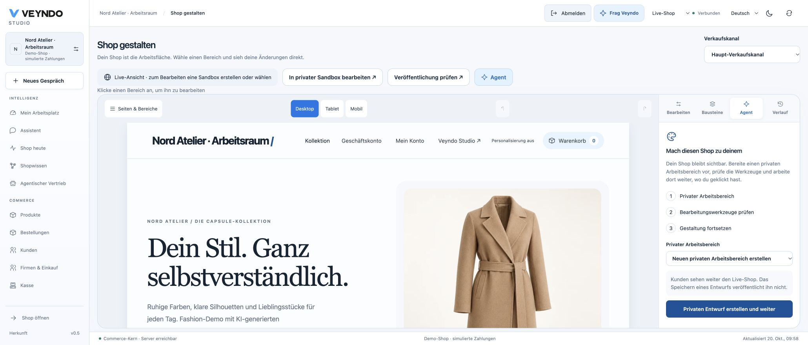

# Your workspace. Your shop. One controlled change path.

Veyndo now has a personal Studio entry and an app-owned visual editor for the
standard storefront. They use existing native identities, operations, app records,
proposal tasks, history, sandbox review and checkout. The private original
Storyfront editor continues to own Storyfront Experiences.

## Start with your work

Open **My workspace** after signing in with a personal merchant account. Select a
suggested starting layout for owner, service, purchasing, content or development.
Add cards, move them by dragging or with the up/down buttons, pin views and save
several named work areas. The shell, shop switch, language and live/sandbox switch
stay in their familiar positions.

Save the workspace before leaving through the sidebar. Opening a workspace card
also saves it first. Concurrent windows use optimistic revisions; a conflict is
shown instead of overwriting the newer version. The last twenty revisions can be
loaded into an editable draft. Preferences belong to the person and live shop;
they do not become shared sandbox/release units. Integration keys cannot impersonate
their creator to read these preferences.

Native product, customer and order grids can pin their current non-personal
filters/sort into this workspace. Free search, customer names/emails and order
search text are deliberately excluded. Opening a pin uses a short-lived in-memory
handoff, not a URL or a second saved-view database. Current server permissions
still govern every resulting query. Column order/density keep the existing grid owner.

An agent-composed pin can reopen a native directory with embedded record editing
and, for products, catalogue intake. It stores the component layout beside the
same private filter preference. [Working views and a concrete example](agentic-workspace.md#open-a-working-view).

## Work with the agent

Add a goal, for example **Prepare the summer collection for our French shop**.
Launch it in the existing assistant, associate an existing proposal, inspect the
proposal's sources/changes, and use the native approval action. A goal's own
status is a personal planning status; marking it stopped does not cancel a
separate provider operation or background job.

Approving a native work sequence first saves it for the existing worker. Its shared
progress card shows waiting, running and completed steps; the workspace reports
completion only after the server confirms the write. Failed or uncertain work
offers the same explicit continue/cancel actions as the assistant. If progress
cannot be loaded, use **Reload** to read its current state without approving it
again. Translation review stays in the selected private workspace. Switching
shop, request context or task discards late responses from the previous view.

**Open Flow Builder** prepares an **inactive** native Flow draft from the goal.
Choose the real trigger, conditions, current authorized actions and language;
review it before saving/activating. This does not create a second autonomous
scheduler or promise that a sentence automatically completes a whole campaign.

## Repeat completed work as a Flow

After a native configuration task finishes, choose **Reuse as a Flow** in
**My workspace → Prepared tasks**. This opens an inactive draft in the existing
Flow Builder:

1. Choose the event and its conditions, for example **Product updated**.
2. Inspect the protected original operations. For each input, keep its saved value
   or explicitly map a product/order/document ID or product revision from the event.
   Product/category creation IDs and matching references start with a shared new
   identifier per event, so a new execution does not reuse the previous create ID.
3. Set the daily proposal limit, review the draft and save it with a name/ID.
   Activation is an explicit setting. Each matching event prepares a fresh task;
   it does not approve or execute it.
4. Open that proposal in Flow history or the personal workspace, inspect the actual
   resolved operations and approve it through the existing personal action.
5. Follow the original task progress. Repeated approval does not duplicate a write;
   changed targets still encounter the native revision/create conflict checks.

The Flow stores only `taskId`, field mappings and a daily limit. Source descriptions,
operation inputs, credentials and execution bindings are not copied into general
Flow configuration, history or release snapshots. Its editor loads the source through
actor-private run status; native save and execution require the same workspace,
original actor and the source task's original permissions. Another actor or reduced
rights cannot turn this reference into access to the private task. Workspace changes
hide previous inputs immediately and discard late responses.

This is a direct Flow action for **private configuration work**. Its source task is
operational evidence and is not a publication unit: moving the Flow to the live shop
or a different workspace fails admission. Use normal selected publication for the
resulting product/page configuration. Arbitrary background execution in live shops
and embedding this template action inside graphical pipeline nodes are not included.
Preparation itself makes no model call; an explicitly approved translation operation
can still invoke the normal configured translation provider. Daily limits are 1–100
per Flow and 100 template proposals per workspace, counted in UTC under the shared
live-shop lock. Missing event fields, unavailable sources and emergency stop produce
explicit failed preparations without a new executable task.

## Design the standard shop

1. Open a Storefront sales channel and choose **Shop design**, or open it from the
   Experiences navigation.
2. Follow **Make this shop yours** beside the actual storefront. Select an existing private workspace or create one. Live view is read-only; missing editing or environment permissions have a named next step.
3. Review the native **Shop design** and **Forms inbox** package consents. Their
   implementations remain in `extensions/apps/site-builder/` and `site-forms/`.
   Each actual package has its own digest/permission consent. Cancel or retry without
   silently installing another package. After setup you return to the Agent, Elements
   or home section you selected; draft content and credentials do not enter the URL.
4. The existing storefront is visible immediately, including the native header, hero, product cards and footer. Saved home pages open automatically. Click the hero or collection to prepare a private home-page document; **New page** remains a separate action for additional pages. No blank CMS form is required before seeing the shop.
   Additional pages use lowercase letters, numbers and dashes for their addresses.
5. Select a section in the real shared preview. Edit its heading inline or use the
   localized inspector; rich text uses the existing Tiptap/Markdown editor.
6. Open **Elements** and drag an illustrated card into the preview. Blue drop gutters show the insertion boundary; release to insert there. Click a card as a keyboard/touch alternative to insert after the selected section. Reorder using the section grip or its up/down controls; remove with the bin button. Undo/redo covers all these gestures. The palette also contains installed apps’ registered public elements; only their app/surface reference enters the page.
7. Pick actual channel products, appearance, spacing, typography and images. Switch
   desktop/tablet/mobile. Preview controls cannot place orders or submit forms.
8. Save, then choose **Review publication**. Select the intended app/page changes
   in the native staging review and publish explicitly.

The global `*` home supplies the inherited appearance. A channel home overrides
selected values; null/missing theme properties inherit. Editing an inherited
page in a writable channel creates a channel-specific copy with a new stable ID.
Non-home page appearance is local to that document. The native header/footer and
product/cart routes retain the channel home theme.

A section has a stable ID. Undo/redo edits the current draft; retained page history
shows revision, time, actor/source and fields. Restore the entire page or a selected
section as a new draft, then save/review. Archiving a page removes it from public
projection after publication; deleting live orders or form responses is not a
page rollback operation.

## References and reviewed alternatives

Open **Agent**, describe the change and choose the whole page or selected section. The agent saves the current private baseline before preparing a proposal; this never publishes the page. Select **Veyndo AI** to use the centrally configured provider. **Start with a design you like** is directly visible in the agent rail: enter up to three public HTTPS URLs, or upload/drop up to two PNG/JPEG/WebP screenshots/designs. The browser accepts files up to 12 MB each, validates dimensions (16 megapixels, 8192 pixels per side), reduces them to a 2000-pixel long edge and encodes a bounded WebP before sending. The API keeps its existing image/payload limits; a failed upload preserves previous references.

Use **Use this design brief** or describe the desired adaptation yourself. Choose style, structure and content separately; copying content starts disabled, keeping your own products and facts. The agent saves only a private baseline, then shows reviewed alternatives. A late result after a manual edit or shop/channel change is discarded. Coding-agent export/import still uses the existing shared Codex/Claude Code handoff, without exporting browser credentials. Visual references are used by the centrally configured Veyndo AI path.

The centrally configured inference provider returns two or three alternatives.
Review its interpretation and the capture status, compare before/after in the
same renderer, then explicitly apply one native task to the sandbox. Applying
one alternative invalidates competing alternatives bound to the old revision.
No model can publish, change prices or run reference HTML/scripts.

The server enforces deselected style/content/structure. A section edit cannot
silently change sibling sections or the global theme. HTML capture is bounded
source evidence, **not** a full rendered browser capture. Private DNS, credentials,
unsafe protocols, redirects and unavailable sources cannot be treated as successful
capture; upload a screenshot when the URL is incomplete. Provider failure preserves
the saved page and returns an actionable error. Vision quality requires a configured
provider/model that actually supports images; synthetic fixtures only test the contract.

See the [16 October local acceptance notes](assets/shop-design-20261016/README.md) for browser and contract evidence.

## Blog and form workflows

A Blog section lists published Article pages of its category. Articles support
localized titles/text/SEO description, author, category and a start time. Page
navigation and article links use `#page/<slug>` in the current SPA. Metadata is
updated by the client; this is not server-rendered per-page SEO or a complete
editorial calendar.

Forms declare stable field IDs, localized labels, type and required state. The
published form requires privacy acknowledgement and a native current cart context.
The Rust public action validates the actual published page, channel and declared
fields, appends a fresh private response and emits **`app.site_forms.submitted`**
through the existing transactional outbox. It cannot overwrite an earlier response.

Use that registered event in the native Flow Builder for a review note or an
explicitly configured app action. Event payloads contain response identifiers,
not answer text. Staff need **both `customers.read` and `customers.pii`** to inspect
answers. Submissions cannot be cloned, published or restored via page/config history.
Current limits are five submissions/cart/minute and sixty/app/shop/minute, alongside
normal native app record/byte quotas. Delivery to email/CRM requires its separately
configured authorized app/Flow; an accepted form is not proof of external delivery.

## Same storefront, same checkout

The published shop reads the same app records, filtered on the server by published
state, start time and current channel. Drafts/future pages never become public
because a caller changes an app filter. Product data/prices still come from native
channel catalogue calculations; Add to cart, customer account and the original
checkout continue through their existing owners.

No payment implementation was added to the page editor. A simulated order verifies
the local integration path; it does not certify real provider settlement.

The published page and checkout were also exercised at a 390-pixel viewport,
without horizontal document overflow. See the [capture notes](assets/workspace-20261015/README.md)
for the exact local journey and the limits of this evidence.

## Native contracts and ownership

| Surface | Existing/shared owner |
| --- | --- |
| Personal preferences | `GET/PUT /api/studio/workspace`; MCP `studio.workspace.read/save`; forced tenant+actor RLS, current personal session, CAS, 20 retained versions |
| Designer products/channels/locales | `GET /api/merchant/site/context`; native channel/catalog/pricing owners |
| Page data | `site_builder` actions `editor_pages`, `save_page`; public action `pages` with native publication projection |
| Design references/plans | `POST /api/merchant/site/plan`, `/task`, `/propose`, `/apply`; MCP `merchant.site.plan/task/propose/apply`; central inference and native tasks |
| Record history | `/api/apps/{app}/entities/{entity}/{id}/history` and `.../{version}/restore`; MCP `merchant.app.history/restore` |
| Form intake | Public `site_forms.submit`; private `responses`; managed records, native cart, outbox, Flow jobs |
| Publication | Existing environment diff/selective release; installed package fence, current domain rights, live baseline and digest conflicts |
| Renderer | One app-owned `Renderer.tsx` for preview and published pages; no duplicated Storyfront renderer |

History is bounded to twenty versions per record and sixteen MiB per app. Reads
retain original read-scope requirements and project only current schema fields.
Restore revalidates current rights/schema/CAS and requires a declared save action;
append-only inboxes have none. SQL, provider/vision quality and UI behavior are not
mathematically proved. The extracted intake predicate proves only its exact
private/live/current-cart conjunction.

## Verification and known boundaries

Run the registered `visual_workspace` suite against an isolated PostgreSQL database.
It covers personal identity/CAS/history, own/foreign tenant/key rejection,
public draft/time/channel filtering, retained app history, selective release,
concurrent native save/release, private form intake/PII/append-only checks and
local synthetic-model alternatives/explicit apply/provider failure. Existing app,
commerce, account, checkout, staging, role and tenant suites remain separate regression
checks. Browser captures above use a disposable local fashion shop and simulated
payments. Public deployment and real-model design quality require their own acceptance.

Current bounded document limits: 24 sections/page, 24 selected products/section,
12 fields/form and the native JSON-field byte limit (8 KiB). Sandbox snapshot/release
retains the existing 1,000 records/entity limit. Product selection uses native
search; explicitly chosen products are resolved in bounded batches even outside
the first catalogue page. Native channel, B2B, language and pricing checks apply.
Full catalogue visual merchandising,
server-rendered page SEO, collaborative cursors, automatic cancellation of every
provider request and continuous whole-business autonomous goals remain further work.

Continue with [staging and releases](app-studio.md), [App platform](app-platform.md),
[localization](localization.md), [native checkout](checkout.md) and the
[original Storyfront integration](storyfront.md).

## Preview-first editor repair — 15 October 2026

The editor now gives the storefront most of the available width. Pages/sections open on demand; the contextual inspector sits beside the canvas. Page metadata and SEO are collapsed while editing a section, and saving stays in the top toolbar. Desktop, tablet and mobile use independent frame widths rather than squeezing desktop CSS into a narrow column.

The preview projects the actual channel catalogue and public company identity through the existing authenticated transport. Header, hero, product cards and footer are shared native presentation components, also used by the storefront. The isolated static document loads owned styles and parent-owned React components; it starts **no shopper controller, cart, analytics, AI request or payment session**. Commerce/account actions are intentionally inactive here. This is a design preview, not a replacement for testing the public checkout or private Storyfront editor; personalized concierge results and third-party interactive widgets require their own acceptance.

Clicking the native home prepares an unsaved `site_builder` document with stable section IDs, genuine main-language/selected-language text and references to native product media. It does not copy an invalid local demo-image URL into the managed image field. Saving, history, AI proposals and selected release still use the existing app contracts. An inherited global page is forked into the selected channel only when edited. The rich editor displays inherited rich content instead of treating a locale code as fallback prose.

Regression coverage includes the real static frame, native product rendering and click selection, no cart/order calls, automatic home selection, locale/channel transport, inherited-page fork and media/translation preservation. The package owns its test cases; thin frontend adapters register them in the shared runner.

The release review opens the currently selected sandbox rather than the first unrelated environment. Local browser acceptance followed native home → section selection → translated heading edit → CAS save → reopen → select only the page → native release → published page with the same heading and catalogue image. Mobile preview was checked at its actual 390 CSS-pixel frame width; this capture is the desktop editor's mobile preview, not a claim of a separate phone-browser checkout test.

The same local acceptance also added an actual product from the published page to the native cart, reviewed delivery/tax totals, and completed a **simulated** EUR 43.90 order (`RAC-33d99e28`) with synthetic contact/address data. The confirmation rendered and the cart count returned to zero. This does not claim a real payment-provider settlement or a hosted rollout.

## Illustrated elements and compact panels

The right rail has four stable modes: **Edit**, **Elements**, **Agent**, **History**.
The left rail shows pages and the selected page’s sections, with keyboard-accessible
up/down controls. **New page** opens illustrated page/landing/blog/article/form
choices. Text formatting uses compact shared Tiptap controls; media and less common
formats live in one menu. EN/DE/FR/ES interface text and selected content-language
inheritance remain separate.

1. Select a private sandbox and open **Elements**.
2. Pick an illustrated hero, text, product list, image, form or article list.
3. The element appears in the shared preview and its properties open for editing.
4. Save the private draft, inspect history and review the selected native release.

### Apps contribute elements through their existing contract

A native app surface with `location: "storefront.block"` appears under **From your
apps**. The Care knowledge example (`extensions/apps/ontology-care/`, version
1.1.0) supplies a working example using its existing public care view and list action.
App Studio’s frontend/combined assistant and placement selector expose this location;
the exported schema and AI/coding-agent contract include it too.

A page block stores only `kind: "app"` and `extension: {app, surface}` plus the
ordinary localized title. It never copies app code or data into the page. Public
native views, data projection, current package grants and declared actions remain
owned by the app and generic runtime. Only active, same-tenant public native
surfaces can be placed; private/service-iframe surfaces cannot become page elements.
Preview grants contain only currently authorized read actions, so changing a request
by hand cannot use that grant to write. App deactivation removes its registry entry;
the editor shows an unavailable notice and the published renderer omits the element.
Re-saving/restoring/publishing validates the active reference again. App data has its
own history and publication rules; publishing a page does not copy private app data.

### One visible agent entry, including Codex and Claude Code

**Veyndo AI** prepares two or three reviewable alternatives. **Codex / Claude Code**
prepares a task containing the current page/revision, enabled languages, at most 64
registered element summaries, the expected result shape and the existing MCP client
configuration. Credentials are placeholders only. This is an explicit local coding-agent
handoff, not an embedded Codex subscription or automatic remote execution.

Copy/download the task into your coding agent, paste its JSON result into **Returned
result**, then choose **Review changes**. `/api/merchant/site/propose` validates only
content/theme changes, selected-section scope, owned references and the current revision.
The returned proposal uses the same native review tasks as built-in AI. **Apply** writes
the approved revision to the private sandbox; public release remains separate. HTTP and
MCP share the same handlers and current `channels.read/manage` + `assistant.use` checks.

The real Rust/PostgreSQL suite `visual_workspace` covers export → validation → explicit
apply, omitted/foreign/current/stale rights/revisions, no secret export, app placement,
read-only grants and selected page publication. The model wire uses a synthetic fixture;
these tests do not certify creative output from a real external model or all third-party
apps. Browser acceptance verified the actual gallery, care-element data, private save,
compact inspector and prepared Codex task. Checkout retains the previous native owner.

### Direct manipulation and the selected agent target

Drag an illustrated element onto the preview and follow the highlighted insertion
position. Existing sections expose a grip, move arrows and deletion; Undo restores
the prior edit. App form canvases also accept palette drags and movable controls.
Selecting a shop section targets the agent at that section automatically. Choose
Whole page explicitly to work on the complete design.

For style-only references, disable Structure and Content. The host keeps the exact
native page document and asks the model only for style alternatives. Review the
interpretation, desktop/mobile preview and proposed differences, then approve in
the sandbox. Save and selected publication retain their existing revision checks.
[Actual browser and reference-model acceptance](evidence/designer-2026-10-29.md).
