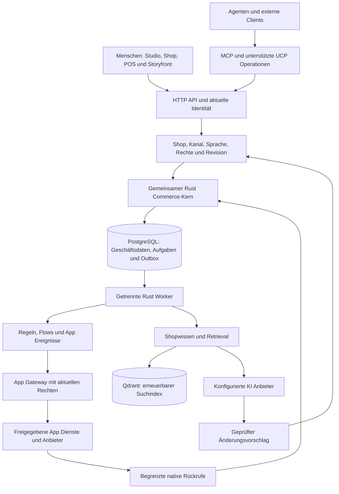

# Veyndo: Architektur, Apps und KI im Zusammenhang

Stand: 29. Oktober 2026. Diese Übersicht beschreibt den Hauptstand des Projekts.
Die [Statusseite](status.md) ordnet Implementierung, öffentliche Auslieferung und
tatsächlich durchgespielte Abläufe ein.

Veyndo verbindet einen Shop, eine Händlerverwaltung, erweiterbare Apps und Agenten
auf einem gemeinsamen Commerce-Kern. Ein Ziel wie „Bereite die Kollektion für
Frankreich vor“ kann dadurch Produkte, Übersetzungen, Kategorien und eine
Landingpage zusammenführen. Preise, Bestand und Bestellungen bleiben bei den
zuständigen Geschäftsoperationen.

## 1. Der Aufbau

Der Commerce-Prozess stellt die nativen Operationen bereit. Separate Rust-Prozesse
übernehmen unter anderem Konnektoren, Migration und Marktplätze. Die privaten
Storyfront- und Payments-Dienste haben eigene Implementierungen. Externe Apps
kommunizieren über die Erweiterungsverträge und können andere Sprachen verwenden.
Python dient im Hauptprojekt der Entwicklung und Prüfung.

Der Cargo-Workspace enthält die Bibliotheken `kernel`, `runtime`, `commerce`,
`apps` und `cognition`. Deren Abhängigkeiten werden geprüft. Die übrigen
Anwendungsabläufe sind weiterhin in Modulen des Hauptpakets organisiert; die
vollständige Extraktion aller Handler ist noch offen.

Quellen: [Produktionsarchitektur](production-architecture.md),
[Rust Dienste](rust-services.md), [Modulverantwortung](source-map.md).

## 2. Shop, Verkaufskanal und Sandbox

Ein unabhängiger Händler ist ein eigener Mandant. Ein Mandant kann mehrere
Verkaufskanäle mit eigenem Sortiment, Sprachen, Währungen und Konfigurationen
haben. Storefront, Headless API, POS und Marktplatz sind unterschiedliche
Verkaufskontexte desselben Händlers.

Ein privater Entwurf besitzt einen eigenen berechtigten Kontext. Ausgewählte
Konfigurationsänderungen lassen sich nach einer Prüfung veröffentlichen.
Bestellungen, Zahlungen, tatsächliche Bestände und andere Laufzeitdaten werden
dabei nicht als Konfiguration zurückgespult. Ein Versionskonflikt verlangt eine
neue Prüfung des aktuellen Stands.

Beim Kauf berechnet der Kern den aktuellen Warenkorb erneut und sperrt die
betroffenen Datensätze. Bestellung, Bestandszuordnung und Ereignis werden
gemeinsam gespeichert. Wiederholte Abschlussanfragen erzeugen über denselben
Kaufschlüssel keine zusätzliche Bestellung. Zahlungsanbieter werden außerhalb
dieser Datenbanksperren über dauerhafte Aufträge angesprochen.

[Verkaufskanäle](channel-management.md), [Arbeitsbereich und Veröffentlichung](workbench.md),
[Checkout](checkout.md), [Währungen](currencies.md).

## 3. Was eine App umfassen kann

Eine App besitzt ein gemeinsames Manifest mit Version und Inhaltsdigest.
Visueller Editor, Coding-Agent, API und Installation arbeiten mit dieser Definition.

| Bestandteil | Möglichkeiten |
| --- | --- |
| Oberfläche | Native Texte, Tabellen, Karten, Formulare, Eingaben, Buttons, Bilder, Tabs, Kennzahlen und Diagramme; alternativ eine freigegebene eigene Oberfläche im isolierten iframe. |
| Einbauorte | Bereiche im Studio, Produkt-, Kunden- und Bestelldetails sowie Shopseiten, Produktdetail, Header, Warenkorb, Checkout und Kundenkonto. Jede Ansicht hat ihren eigenen Kontext und erlaubte Aktionen. |
| Eigene Daten | Typisierte Felder, mehrsprachige Inhalte, Geld mit expliziter Einheit, Medien, Beziehungen, eindeutige Werte und begrenzte indizierte Filter. |
| Erweiterte Kernobjekte | Versionierte Felder an Produkt, Kunde, Bestellung und Firma, mit Anbindung an native Details, Grids, exakte Filter und berechtigte Operationen. |
| Einstellungen | Deklarierte Texte, Zahlen, Schalter und Geheimnisse; installierte Konfiguration ist zentral erreichbar. Geheimnisse bleiben verschlüsselt und werden nur passenden privaten Dienstaktionen aufgelöst. |
| Aktionen | Deklarierte native oder externe Vorgänge über das App Gateway. MCP und Flow erhalten nur ausdrücklich freigegebene Aktionen. |
| Ereignisse | Abonnements und eigene Ereignisse mit stabiler Identität, gefilterten Nutzdaten und dauerhafter Zustellung. |
| Lange Arbeit | Jobs mit Fortschritt, Ergebnis, begrenzten Wiederholungen, Laufzeitgrenzen und privaten Artefakten. |
| Commerce Logik | Begrenzte Wasm-Komponenten für Preis-, Rabatt-, Versand- und Validierungsentscheidungen. Der Kern prüft die Ergebnisse. |
| Zustände | Deklarierte Abläufe für App-Datensätze und unterstützte Bestell- beziehungsweise Angebotszustände mit geprüften Übergängen. |
| Verteilung | Unveränderliche Pakete, Freigabe des genauen Inhalts, signierte Herausgeber, Abhängigkeiten und Versionsprüfung. |

Ein konkretes Beispiel ist der [Möbelkonfigurator](furniture-configurator.md):
Materialien und Maße erzeugen einen geprüften Zuschlag. Die Firma genehmigt den
konkreten Einkauf. Die Bestellung speichert die akzeptierte Auswahl. Eine spätere
Nachbestellung verwendet die aktuellen Regeln, während die alte Bestellung ihren
ursprünglichen Stand behält.

[App Plattform](app-platform.md), [App Studio](app-studio.md),
[Einbauorte und Einstellungen](app-studio-workspace.md),
[Kernobjekte](app-core-extensions.md), [Zustandsabläufe](app-native-lifecycles.md).

## 4. App Daten ohne Tabellenwachstum

Verwaltete Apps verwenden vier gemeinsame physische Tabellen für logische Modelle,
Datensätze, Suchwerte und Beziehungen. Mandant, App und Modell gehören immer zum
Schlüssel. App-Installation erzeugt keine eigenen SQL-Tabellen oder frei gewählten
Datenbankindizes. Die Projektionen werden vom Kern gepflegt.

Die derzeitigen Grenzen betragen unter anderem 12 Modelle je Paket, 16 Felder je
Modell sowie 100.000 gezählte Zeilen und 64 MiB logischen Speicher je Shop und App.
Diese Grenzen sind konfiguriertes Verhalten und keine zugesicherte Lastkapazität.

Schemaänderungen können Felder umbenennen, entfernen, konvertieren und ergänzen.
Der begrenzte Onlinepfad validiert die Daten und speichert einen Wiederherstellungsstand.
Größere Änderungen benötigen einen gesonderten Migrationsplan. Als
`operational: true` deklarierte Daten bleiben von Konfigurationskopien und
Veröffentlichung ausgeschlossen.

[Speichermodell und Grenzen](app-data-storage.md).

## 5. Wie Apps ausgeführt und freigegeben werden

Eine gespeicherte App-Version enthält einen geprüften Inhalt. Installation und
Upgrade verlangen den genauen Digest und die erforderlichen Berechtigungen.
Alte Versionsnummern dürfen nicht mit anderem Inhalt überschrieben werden.
Pakete und einzelne Datensätze sind getrennte Veröffentlichungsentscheidungen.

Native Ansichten verwenden den gemeinsamen Renderer. Eigene HTML-Oberflächen
werden nur aus konfigurierten, mit Hash freigegebenen Quellen geladen. Ihre
Sandbox erhält keine Händleranmeldedaten. Daten und Aktionen laufen über zeitlich
begrenzte, an Akteur und Ansicht gebundene Freigaben.

Wasm-Komponenten erhalten begrenzte, lesbare Ausschnitte des Warenkorbs und
deklarierter Daten. Speicher, Rechenzeit und Zugriffe sind beschränkt. Sie besitzen
keinen allgemeinen SQL-, Netzwerk- oder Dateisystemzugriff. Ein unabhängiger
App-Dienst besitzt wiederum seinen eigenen Prozess und begrenzte Rückrufe in den
Kern. Das Manifest-Build kompiliert noch keinen beliebigen Rust- oder
TypeScript-Quellcode in einer vom Betreiber bereitgestellten isolierten Buildfarm.

[App Sicherheit](app-security.md), [Tatsächlicher Umsetzungsstand](app-system-status.md).

## 6. Wie die KI eingebunden ist

| Ebene | Aufgabe |
| --- | --- |
| Händler-Agent | Kennt den ausgewählten Arbeitskontext, recherchiert berechtigte Daten und bereitet prüfbare Änderungen vor. |
| Dauerhafte Aufgaben | Speichern Gespräch, Fortschritt und abgeschlossene Schritte. Worker können Arbeit fortsetzen, abbrechen und verspätete Ergebnisse verwerfen. |
| Shopwissen | Verknüpft Produkte, Dokumente, Quellen, Beziehungen und zulässige Beobachtungen mit ihrer Herkunft. |
| Retrieval | Kombiniert native Suche und optionale Vektorsuche. PostgreSQL bleibt maßgeblich; Qdrant ist ein erneuerbarer Index. |
| Modellanbindung | Zentrale Konfiguration und Werkzeugprotokolle für OpenAI, Anthropic und Ollama. Modellantworten werden validiert. |
| App Erstellung | Der Assistent bereitet Änderungen an derselben App-Definition vor, die auch der visuelle Editor verwendet. Externe Coding-Agenten verwenden Export und geprüften Import. |
| Shopgestaltung | Text, Referenz-URLs und Bilder können Vorschläge für den bestehenden Seiten- und Gestaltungsentwurf liefern. Manuelle und agentische Änderungen verwenden dasselbe Modell. |
| Einkaufsassistent | Verwendet echte Produkte und Varianten, zeigt eine bearbeitbare Auswahl und führt zum nativen Warenkorb. |
| Kundensimulator | Gespeicherte fiktive Kunden testen native Suche, Budgets, Warenkörbe und simulierte Käufe im privaten Shop. |

Beispiel: Der Händler nennt zwei Produkte und den französischen Kanal. Der Agent
bereitet Übersetzungen, Kategorie und Landingpage als zusammenhängende Aufgabe
vor. Die Vorschau zeigt den tatsächlichen Entwurf. Die Freigabe prüft erneut
Rechte, Ausgangsversion und gewählte Änderungen.

Gespeicherte Quellen und Beobachtungen verändern keine Modellgewichte. Ein
erfolgreicher Kundensimulator prüft seine nativen Kaufhandlungen; er bewertet
damit noch nicht automatisch die Verständlichkeit jeder Browseroberfläche.

[Agentischer Arbeitsbereich](agentic-workspace.md), [Kognition](cognitive-commerce.md),
[Shopwissen](knowledge-workspace.md), [Kundensimulator](customer-scenarios.md).

## 7. Agenten, Rechte und Automatisierung

Ein delegierter Planungsagent besitzt eine eigene widerrufbare Identität, explizite
Leserechte, ein bestimmtes Modell und begrenzte Modellkontingente. Aktuelle
Mitgliedschaft und Rechte werden erneut geprüft. Diese Identität kann keine
eigenen Rechte erhöhen oder Vorschläge selbst freigeben. Der Not-Aus stoppt
zugehörige Aufgaben im Live-Shop und seinen privaten Entwürfen.

Die Modellkontingente rechnen konservativ reservierte Aufrufe. Sie ersetzen keine
Abrechnung des tatsächlichen Anbieterverbrauchs. Persönliche Nutzung und externe
App-Dienste haben ihre eigenen Konfigurationen und Grenzen.

Für bestimmte Preisvorschläge kann der Händler ausdrücklich begrenzte Autonomie
erlauben. Gespeicherte Preisgrenzen, Tagesgrenzen und native Validierung bleiben
wirksam. Das Einschalten einer Grenze startet allein keinen wiederkehrenden Agenten.

Flows verbinden Ereignisse, Bedingungen und freigegebene Aktionen. Wiederverwendete
Agentenarbeit beginnt als inaktiver Flow-Entwurf. Die Outbox besitzt getrennte
Verarbeitungsstände für ihre Verbraucher. Worker beanspruchen Aufgaben über
dauerhafte Leases; unklare externe Wirkungen verlangen eine bewusste Klärung.

[Agentenrechte](agent-authority-controls.md), [dauerhafte Arbeit](durable-agent-runs.md),
[Flows und Regeln](automation.md), [Besucherverhalten](behavior-intelligence.md).

## 8. Was auf diesem Fundament aufsetzt

Standardshop und originale Storyfront-Experiences verwenden den gemeinsamen
Commerce-Vertrag. Der Standardshop wird über die Site-Builder-App gestaltet;
Storyfront behält seinen originalen Editor. Seiten, Formulare und deren private
Antworten behalten die jeweiligen App-Verantwortlichkeiten.

POS verwendet native Warenkörbe, Preise, Bestände, Bestellungen und Belege.
B2B ergänzt Firmen, Einkaufsbereiche, Budgets, Angebote, Freigaben und Listen.
EDI besitzt begrenzte EDIFACT-, UBL- und cXML-Profile in einer eigenen App.
Marktplätze verwenden ein separates Rust-Gateway für Angebote und Bestellübernahme.
Migration übernimmt unterstützte Daten aus bestehenden Shops nach Veyndo.

[POS](pos.md), [B2B](b2b-commerce.md), [EDI](edi.md),
[Marktplätze](marketplaces.md), [Migration](agentic-migration.md),
[Dienstanbindungen](service-integrations.md).

## 9. Betrieb, Schnittstellen und verbleibende Entwicklung

HTTP, MCP und unterstützte UCP-Verträge verwenden dieselben nativen Operationen.
Die Operation-Registry liefert Eingabeverträge; die vollständige Generierung aller
Antworttypen und Domänenmodelle ist noch offen. Exakte Geldprimitive und der
Vergleich mit dem ursprünglichen PHP-Verhalten existieren. Verbleibende
Kompatibilitätsberechnungen enthalten weiterhin `f64`.

Mandantenprüfungen, getrennte eingeschränkte Datenbankrollen, signierter
Datenbankkontext und erzwungene Zeilenregeln schützen den Zugriff. Worker und
Dienste lassen sich als getrennte Prozesse betreiben. Lokale Messungen mit einer
Million Produkten existieren; automatische Mandantenverteilung und Umzüge ohne
Unterbrechung sind noch keine abgenommenen Betriebsabläufe.

Offen sind außerdem vollständige historische Checkout-Neuberechnung, isolierte
Quellcode-Builds, umfassende Kompatibilitätsprüfungen über installierte Apps und
automatisch bereitgestellte Enterprise-Umgebungen. Echte Anbieterzahlungen,
Mailzustellung, Wiederherstellung und einzelne externe Integrationen benötigen
ihre eigenen Abnahmen. Öffentliche Kaufbelege verwenden simulierte Zahlungen.

Shopware-Laufzeitkompatibilität und der native Plugin-Übersetzer sind ausgelagert:
[`experiment/shopware-compatibility`](https://github.com/sthamann/veyndo/tree/experiment/shopware-compatibility).
Shopware als Datenquelle für eine Migration und die PHP-Vergleichstests bleiben
Teil des Hauptprojekts. OpenUI bleibt ein gesonderter lokaler Versuch für
agentisch zusammengestellte Arbeitsansichten.

[Status und Abnahmen](status.md), [Architekturentwicklung](platform-hardening.md),
[Lastmessungen](benchmarks.md), [Verifikation](formal-verification.md).
