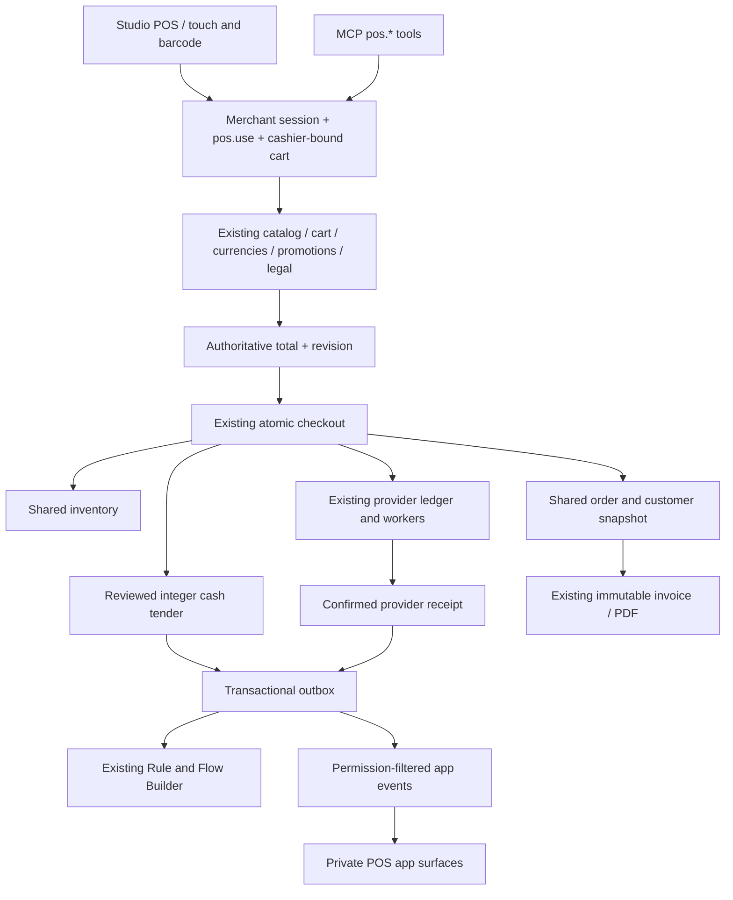

# Native point of sale

[17 October hosted acceptance](evidence/buyer-pos-hosted-2026-10-17.md) records
channel creation, parked/resumed carts, preserved cart across rollout, fictional
cash sales, native invoice/PDF and app-bound guarded completion. No physical
printer, fiscal certification or real provider settlement is inferred.

POS is a **sales-channel type in the existing VEYNDO commerce system**. A register
uses the same products, inventory, prices, taxes, currencies, promotions, orders,
provider ledger and immutable documents as a storefront. It has no second checkout
or register-specific database. The interface is an authenticated Studio workspace.

## Open a register

1. Open **Sales channels → Create channel** and select **Point of sale**.
2. Name the location with the shared content-language editor. Choose the location
   country from the enabled country catalogue and select its languages/products.
3. Choose two to six product columns, optional compact cards and a translated
   receipt footer. Missing translations inherit the shop main language.
4. Save. VEYNDO adds cash and free immediate collection **to this channel's existing
   settings override**, leaving the other channels' payment and delivery settings intact.
5. Open **Point of sale**, choose the register and search or scan a product number/EAN.
   **Open register** on the channel opens the dedicated register mode immediately.
   Product families offer their native variants, including the main variant.

Channel inherited settings use the existing currency, tax, payment and company
editors. The same revision history, pause/resume and dependency-aware deletion apply.
A channel with orders is retained; historical sales cannot be erased by removing a register.

Selective publication of a new staged POS channel validates the final live configuration
and creates its native cash/collection override when none was explicitly selected.
Current settings rights, revision/conflict checks and history still apply; publishing
a product or app alongside it additionally requires that domain's current write rights.
[Cross-feature integration and verification](feature-integration.md).
POS channels do not expose a public storefront or public Store API/UCP checkout.


[View native variant selection](assets/feature-tour/pos-variants-current.png) · [Focused mobile payment view](assets/feature-tour/pos-mobile-current.png)

On smaller screens, **Products / Current sale** switches views while keeping the
cart and its authoritative total. Product cards and payment controls remain touch-sized.

## Cashier mode, customer cards and advice

**Open register mode** hides the Studio navigation and header. The product grid sits
beside the current sale; **Back to Studio** restores the same administration. Optional
fullscreen is a separate browser action. On mobile, Products / Current sale keeps the
same server-owned cart. Press `/` to focus product search and Enter to scan a product
number/EAN; a successful addition displays visible feedback. Product cards use the
native calculated customer price, rather than the raw retail field.

**Customer** opens bounded name/email/customer-number search. Scan a card whose barcode
is the existing `customerNumber`, review the match and select it. The account, customer
group and saved billing address come from the shared customer owner; no customer
password/session is issued. Selecting/removing a customer reprices the current sale.
Current tenant, cashier, revision and PII permissions are checked. Revoking PII access
also denies an already selected cart. Customer activity/group/identity is revalidated
under checkout locks. Cards identify customers; loyalty points, wallets and card issuance
are not implemented by this slice.

**Register discount** supports percentage presets, arbitrary percentages to two decimal
places and fixed amounts in the current currency precision. A reason and `payments.manage`
are required. Percentages are integer basis points; fixed amounts are integer minor units.
The adjustment applies after configured promotions and app adjustments, through the existing
native line allocation/tax calculation in quote and commit. It cannot exceed the goods
value. Reducing goods below a fixed adjustment or changing its currency requires removing
and reapplying it. The cart revision, cashier and reason are retained in transactional
`pos.discount_changed` events. This is not a second promotion or pricing engine.

**Ask VEYNDO** beside the register reuses the existing grounded merchant chat and its
configured provider. The question includes the current item labels, not customer contact
data. This panel displays advice only: it exposes no apply/payment action. Normal model
permissions, quotas and provider configuration apply. It does not claim an automatic
upsell effect or a new model integration.


## A sale

Add products, adjust purchase-step-aware quantities, apply configured coupon codes
and optionally choose another enabled channel currency. All totals are returned by
VEYNDO; the browser does not calculate a discount or tax. The cart's final integer
minor-unit total and revision must match at completion.

For cash, enter the received amount or select **Exact amount**. Change uses integer
currency units with the configured precision, including zero-decimal currencies.
Underpayment is rejected before an order or stock deduction. Customer/contact and
billing data are optional for anonymous cash purchases, but existing provider and
legal requirements remain authoritative for other payments. Explicit digital-content
or legal acknowledgements are retained where required by shop policy.

**Hold sale** parks the current cashier's cart and starts another. Held carts survive
page reload. Another cashier cannot resume them by copying a token. Concurrent repeated
completion uses the same native idempotency key: one order and one stock deduction.
After a lost response the interface reads the existing committed order.

Payment-provider choices use the configured shared provider interface and onboarding.
For a redirect provider, the register waits for preparation, exposes the authorized
provider link and offers **Check payment** through the same durable reconciliation
jobs. Pending/ready is not displayed as paid. A confirmed capture updates the ordinary
order and emits one POS completion event. No terminal driver is included.

After completion, **Create receipt → Open PDF** uses the ordinary immutable invoice
owner and numbering. Seller data comes from shared/channel company settings. The
receipt footer is snapshotted into the order so later edits cannot rewrite it. **Receipt
printer** reads those same issued invoice lines through an authenticated POS command,
renders text safely and opens the operating-system print dialog for 58/80 mm layouts.
Choose an installed printer and its matching paper settings. No cart token or merchant
credential is included in a print URL. Blocked popups produce an actionable message.
The local Chrome acceptance reached print preview and cancelled it; it did not send
paper to a physical receipt printer. Recent
register sales link to the existing order-management screen, including its normal
state transitions, cancellation documents and delivery/customer information.


## How the pieces connect



A POS sale uses immediate **collection**, rather than inventing a parcel shipment.
Location country is fixed by the register. Live channel state/location is rechecked
under the same settings/channel lock order before committing. Staging cannot settle
cash purchases. The current register requires an online server for each completed sale.

## HTTP and MCP

`GET /api/pos/channels` discovers the tenant's register channels without requiring
settings access. All register commands use `POST /api/pos/{channel}/{operation}`.
The same operations are discoverable as MCP tools:

| Operation | Purpose |
| --- | --- |
| `channels` | Discover tenant registers through the same cashier permission |
| `context`, `catalog`, `detail` | Configuration, bounded search/barcode and native variant pages |
| `create`, `cart`, `replace`, `select` | Cashier-owned cart, revision-bound quantities and checkout selection |
| `currency`, `coupons`, `accept` | Existing currency/promotion/explicit legal owners |
| `complete` | Reviewed minor-unit total, stable request key, optional cash tender |
| `payment`, `reconcile` | Owned attempt readiness and existing durable provider reconciliation |
| `held`, `sales` | Cashier's open parked carts and recent channel orders |
| `customers`, `customer` | Bounded CRM/card lookup and revision-checked account selection/removal |
| `discount` | Reasoned cashier adjustment or explicit null removal |
| `receipt` | Issued, channel-owned immutable invoice lines; never creates a second document |

```json
{
  "channelId": "hamburg",
  "cartToken": "<owned cart token>",
  "revision": 3,
  "requestKey": "pos-<cart-id>",
  "totalMinor": "3900",
  "tenderMinor": "5000"
}
```

Give a cashier `pos.use`, `catalog.read` and `orders.write`. Viewing recent orders
also requires `orders.read`; cash settlement/reconciliation requires `payments.manage`.
Customer/card access requires both `customers.read` and `customers.pii`.
Discounts require `orders.write` and `payments.manage`. Receipts use
`documents.create`/`documents.read`, `orders.read` and `customers.pii`. Team/API-key revocation remains
immediate. General merchant headers or a copied POS token cannot substitute for trusted
POS admission, including through generic MCP cart calls.

### Verified acceptance and proof boundary

The isolated `scripts/pos.py` suite exercises customer/card selection, real foreign
identities, immediate PII revocation, missing/stale inputs, exact percentage/fixed
reductions, quote/commit equality, actor recording, native customer/address order
snapshots, immutable invoice text, MCP, concurrent completion and actual Flow execution
for a pre-order discount event. Provider and customer-account suites preserve the existing
checkout paths. Frontend tests cover exact discount submission, read-only advice,
customer-card transport, calculated prices, safe print text and blocked popups.

A local Chrome run selected a customer card, applied a 10% adjustment, completed
`RAC-9ae55d99` for **60.67 EUR** under the existing customer-group pricing, received
**39.33 EUR** change from 100 EUR, and issued `INV-00000002`. Print preview displayed
that invoice; no real provider charge or physical print occurred. Mobile checks and
captures are maintained with this guide.

The extracted Lean policy checks the actor/currency/reason booleans and adjustment
bound. It does not prove SQL authorization, percentage calculation, browser behavior,
provider settlement or fiscal compliance. The real request regressions cover those
implemented boundaries separately. New cashier domain futures are boxed to prevent
an MCP worker stack exhaustion observed and fixed during this acceptance.

## Extend the register with apps

The existing Manifest/visual App Studio/coding-agent schema supports:

| Private surface | Host context |
| --- | --- |
| `admin.pos.catalog` | `salesChannelId` |
| `admin.pos.cart` | `salesChannelId` |
| `admin.pos.receipt` | `orderId` |

Declare a native view and a surface with `permission: "pos.use"`; reuse ordinary
entities, actions, team scopes, `coreReference` and context bindings. A native card
can display gift-wrapping guidance or a private order-bound service record. App
logic/data/assets belong to the app package. These slots grant no implicit customer
access, price override or financial receipt authority.

The shared Flow Builder includes `pos.sale_created` (unpaid/pending) and
`pos.sale_completed` (cash accepted or confirmed provider capture). Standard
`order.placed`, payment and document events remain available. Declarative apps can
expose permitted actions to flows; **service-runtime** apps may subscribe with
`events:pos.*`. Projected POS events contain order/channel/payment/amount/currency,
not cashier identity, tender or customer contact. Ordinary app consent, current
package fencing, event leases and tenant admission still apply.

## Verification and current limits

The registered `pos.py` suite uses real isolated PostgreSQL/HTTP: tenant/cashier
separation, public/forged-token denial, barcode, quantities, currency/coupons, stale
review, underpayment, channel pause, concurrent retries, stock, order, Flow execution
and authenticated PDF. `payment_providers.py` adds onboarding, redirect readiness,
confirmed capture and one completion event through a local provider fixture. No paid
provider call or real card charge is made. Frontend regression tests cover exact
tender precision, cart restore and recovery after a lost completion response.

The local customer/card → 10% adjustment → cash sale → invoice → print-preview acceptance recorded `RAC-9ae55d99` / `INV-00000002` at 60.67 EUR after native business-group repricing. A subsequent English walk-in sale on the final UI recorded `RAC-2688cd17` / `INV-00000003` at 74.90 EUR. Park/resume/reload and the 390px Products/Current sale switch retain the same cart; the mobile document width equals its viewport. At 1024 × 768, the payment button remains inside the visible register; translated/wrapped toolbar heights are measured instead of assumed. All 455 frontend tests in 82 files pass. The extracted POS adjustment predicate has exact authorization/reason/currency/bound properties with compiled Lean conformance; SQL locking, shared tax allocation, UI and printer adapters remain outside that proof.

The production cash-admission predicate has Lean properties for exact admission,
change conservation and unauthorized denial, with compiled conformance and negative
mutation checks. This is a scoped proof, not whole-system or fiscal certification.

This first native register has **no offline sale sync, cash-drawer/shift accounting,
receipt-printer driver, card-terminal SDK or fiscal-hardware certification**. Normal
PDF documents work; jurisdiction-specific fiscal registration remains separate work.

### Native PDF character coverage

The compact native invoice renderer declares Helvetica with WinAnsi encoding.
It preserves Latin-1 accents and the Windows-1252 punctuation repertoire, including
`–`, `—`, `„…“`, `’`, `•`, `…` and `€`. The registered `merchant_operations` journey
issues a real invoice over HTTP and parses its downloaded bytes with the existing
bounded Rust PDF extractor; the renderer regression also checks typographic text.
Escaping of parentheses/backslashes, native snapshot ownership and invoice
idempotency stay unchanged. This is not a general Unicode font renderer: characters
outside that repertoire retain the explicit `?` fallback, while the immutable
snapshot retains their original Unicode text. Historical hosted receipts describe
the exact image they tested; implementation coverage alone does not certify a new
public deployment or physical receipt printer.
