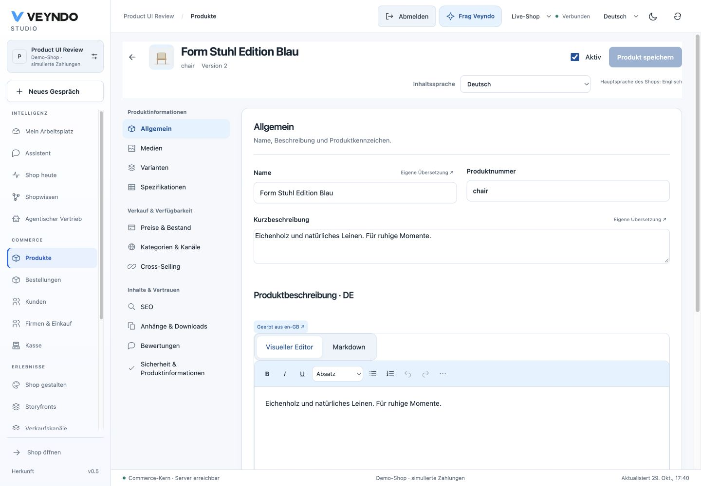
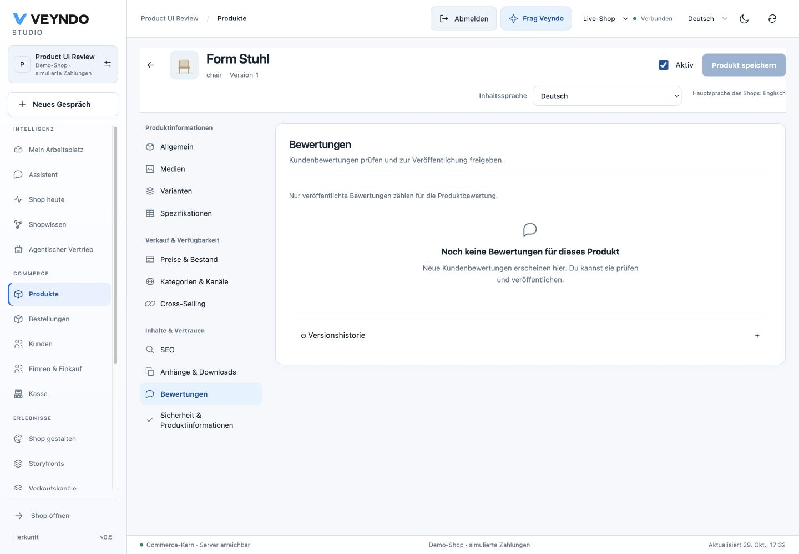

# Product management and category navigation

**Merchant catalogue setup:** [CSV upload, URL extraction, described demo products, private image jobs and native staged review](merchant-catalogue-setup.md).

VEYNDO Studio now owns one **Products** workspace. The **Products** tab provides a server-filtered, cursor-paginated list; **Categories** provides the translated category tree. Select a product to edit the complete native aggregate, or choose **Create product**. A new product starts inactive. Set its number, name, price, stock and assignments, then save. Activation makes it available through the same Store API consumed by the storefront.

The interface supports English, German, French and Spanish. Content editors use every enabled shop content language. Change **Content language** to edit the corresponding name, short description, rich description, specifications and SEO fields. Missing/null fields inherit the shop main language; an explicitly empty description stays empty. Viewing a fallback never saves a fabricated translation. Existing rich descriptions remain language-specific. Changing the Studio interface language keeps the selected product, content language and unsaved draft open; switching shops or environments starts a separate scoped workspace.

## Product detail workspace

The product header keeps the image, name, product number, version, unsaved state,
activation and save action together. The shared **Content language** picker stays
above every section. There is no separate back row or language card pushing the
editor down the screen. The desktop header stays visible while scrolling.

The section navigation groups product information, sales and availability, and
content and trust. Installed product-tab apps appear in their own group and retain
the same product context and permissions. Arrow keys move focus; Enter or Space
opens the focused section. On narrow screens, a grouped **Product section** selector
replaces the sidebar. Both controls retain the same unsaved draft and content locale.

Name and product number share the first row; the short description follows at full
width. Each section explains its purpose, review moderation has an explicit empty
state, and version history remains accessible inside the editing panel. These are
presentation changes: native save/CAS, untouched-stock omission, rich-text buffer
protection, app authorization and field inheritance keep their existing owners.

- **General:** name, unique shop-local product number, short description, visual rich description, manufacturer identity, manufacturer number, EAN/GTIN, digital product and free-shipping flags.
- **Prices & stock:** gross base price, tax rate, stock, quantity minimum/steps/maximum, delivery days, list/regulation price, reference units and rule-bound discount tiers.
- **Media:** ordered gallery, cover image, external HTTPS image URLs and actual PNG/JPEG/WebP uploads for saved products. Uploaded bytes start private and the gallery action explicitly publishes the selected digest.
- **Variants:** list native child SKUs; create a child with its own number, option values, prices and stock; open its independent editor. A reviewable generator creates up to 50 Cartesian combinations per batch; existing combinations are skipped, child option edits are supported, and the server rejects concurrent duplicates.
- **Categories & channels:** multiple category assignments and per-product sales-channel visibility. Existing channel-level explicit product lists can restrict this further; an empty channel-level list means the whole catalog. The persisted default storefront also respects activation and per-product channel visibility.
- **Specifications:** translated specifications, generic product properties and native automation metadata including dimensions/weight.
- **SEO:** translated title, description and slug metadata. This does not implement complete original Shopware SEO URL generation.
- **Cross-selling:** search and select products from this tenant.
- **Attachments & downloads / Reviews:** existing product-scoped asset publication, digital entitlement and review moderation capabilities inside the same workspace.

[Mobile product editor](assets/product-workspace-20261029/general-mobile.png).
These captures show the local isolated test shop, not a hosted deployment.
[Verification details](evidence/product-workspace-2026-10-29.md).

The TipTap editor writes a bounded JSON document, not arbitrary HTML. Supported formatting includes bold, italic, underline, headings, lists, links, images, video and undo/redo. Server admission validates document node types, marks, attributes, URL schemes, depth and size; the public React renderer uses explicit safe elements. Unsupported pasted HTML cannot become executable product content.

One product save atomically writes translations, priced fields, metadata, categories, channel overrides, knowledge-graph synchronization and a `product.created` or `product.updated` outbox event. Revision conflicts retain the browser draft and require a deliberate reload/review. Creation and updates share this operation with MCP. Durable flows can subscribe to the committed product events.

## Editing while orders arrive

The editor returns two clocks. `revision` is the existing aggregate revision,
including purchases and stock releases. `contentRevision` changes with product
content, prices, translations and configuration, but stays stable for a stock-only
purchase or cancellation. They are independent numbers, not interchangeable IDs.

The Studio omits `commerce.stock` when the person has not changed its input. Such
an update may provide the previously read `contentRevision`; a purchase between
opening and saving then does not block a description or image change. The native
operation locks the current row, verifies the content clock and preserves its
current quantity. The response supplies current `revision`, `contentRevision` and
`stock`, so the editor also refreshes the quantity it displays.

An explicit `commerce.stock` requires the current aggregate `revision`, even if a
caller also sends `contentRevision`. A stale absolute quantity cannot restore
units already purchased. Older clients that omit the content clock retain the
original aggregate CAS. Both HTTP and `merchant.product.save` use this same owner;
neither the agent nor an app bypasses the decision. A conflict includes the actual
`currentRevision` and `/revision` or `/contentRevision` pointer identifying its clock.

Migration 098 adds the clock without resetting stock or aggregate revisions. A
database trigger also observes writes from existing replicas during a rolling
release. Versioned translation/FX/proposal owners continue to invalidate content;
their own existing conservative aggregate revision checks are preserved. History
restores omit quantities. Sandbox diffs/publication exclude both revision clocks
and stock; a released content unit advances the live clock without importing a
sandbox quantity. This is not a new inventory ledger or a stock-only edit API.

## Categories: source-faithful bounded port

Category listings can also select products through a **saved confirmed-fact query**.
The editor has one content-language field for a literal fact phrase, a supported
node type and a minimum recorded confidence. This augments manual assignments;
only confirmed current public document-backed claims qualify. Requested-language
phrases use that claim language; absent phrases inherit the shop main language,
while explicit empty phrases add no matches. Source archive/privacy changes remove
graph membership immediately. Active products, channel restrictions and cursor
pagination remain native. Definitions use the same category revision/history and
selective staging release. This is a VEYNDO extension, not original Shopware
dynamic-product-group equivalence. See [connected cognition](cognitive-commerce.md).

Reference: Shopware **6.7.14.2**, commit [`29535190246fcaf0b091d7bdf02dd16358c943c4`](https://github.com/shopware/shopware/blob/29535190246fcaf0b091d7bdf02dd16358c943c4/src/Core/Content/Category/CategoryDefinition.php), and the official [category guide](https://docs.shopware.com/en/shopware-6-en/catalogues/categories) / [product guide](https://docs.shopware.com/en/shopware-6-en/catalogues/products).

| Shopware behavior | Native implementation | Exact scope |
|---|---|---|
| Parent/child category tree, position, translations | `categories/admin.rs`; migration 026; `CategoriesWorkspace.tsx` | Four languages, revision checks, same-tenant parent FK, ancestor/cycle validation and shop-local edit lock |
| Page / folder / external-link category types | Category data and public navigation renderer | `page`, `folder`, HTTPS `link`; legacy `structuring` remains readable |
| Multiple product-category associations | `product_categories`; `categories::assignments` | Tenant-bound many-to-many links, at most 100 assignments per product |
| Parent listing includes descendant assignments | `categories/listing.sql` | Active subtree, enabled by default; `displayNestedProducts=false` limits the listing to direct assignments |
| Active and visible are different | `categories/navigation.rs` | Inactive branches are inaccessible; invisible branches disappear from navigation but active category listings remain directly addressable |
| Sales-channel navigation root | `marketing/channels.rs`, `categories/navigation.rs`, channel settings form | Independent `navigationCategoryId` per storefront/headless channel; default root is `catalog-root` |
| Storefront navigation and category listing | `/store-api/navigation`, `/store-api/product` with `categoryId`; `CatalogNavigation.tsx` | Localized tree and real product filtering before pagination; no hard-coded category names |
| Catalog content staging | `staging/categories.rs`, `clone.rs`, `release.rs` | Category and product units can publish selectively in one transaction; dependency order, staged digest and live baseline checks; live stock stays live-owned |

This is a behavioral port to native APIs and storage, not original DAL/UUID/wire-schema compatibility. Missing upstream features include product streams/dynamic product groups, complete CMS category layouts, breadcrumbs/deep category routes, service/footer navigation roots, arbitrary language/currency context, manufacturer/property-group entities, full inheritance masks, bulk import/export beyond the bounded creation CSV and deletion workflows. Automatic authenticated image previews inside private staging editors are not yet implemented; private source URLs do not become publicly accessible. Category navigation is deliberately bounded to 2,000 nodes per channel; large product catalogs remain cursor-paginated and are not loaded into the browser.

## APIs and MCP

| Operation | HTTP | MCP tool |
|---|---|---|
| Search/filter products | `GET /api/merchant/products?search=...&active=true&categoryId=...&lowStock=true&limit=25&after=...` | `merchant.products` |
| Read one editor aggregate | `GET /api/merchant/products/{id}` | `merchant.product.content` |
| Create | `POST /api/merchant/products` | `merchant.product.create` (`product` object) |
| Update | `PUT /api/merchant/products/{id}` | `merchant.product.save` (`id`, `product`) |
| List category tree | `GET /api/merchant/categories` | `merchant.categories` |
| Create/update category | `POST /api/merchant/categories`; `PUT /api/merchant/categories/{id}` | `merchant.category.create`; `merchant.category.save` |
| Public tree/listing | `POST /store-api/navigation`; `POST /store-api/product` with `{ "categoryId": "..." }` | Public Store API |

Explicit merchandising selections use the same `POST /store-api/product` or MCP
`catalog.search` with `{"ids":["product-id"],"limit":100}`. At most 500 nonempty
IDs are accepted, with at most 100 results per cursor page. The server intersects
these IDs with the current channel/B2B catalogue and retains active/visibility,
language, customer, currency and pricing rules. IDs never select another tenant or
expand a channel's assortment. The visual editor resolves selections in bounded
batches so a chosen product need not be on the initial catalogue page.

Reads require `catalog.read`; writes require `catalog.write`. Native product queries accept limits 1–100 (Studio uses 25), filter before limiting and return `nextCursor`; there is no expensive whole-catalog total. Category search/stock/status filters are server-side. Product numbers have a tenant-specific unique index; translated name/product-number search uses trigram indexes. Asset `?shop=` scope allows ordinary image requests to identify their tenant without authentication headers; private environments still require authorized access. The header tenant wins if explicitly supplied.

## Verification and boundaries

`python3 scripts/catalog_management.py` creates isolated synthetic tenants and runs actual HTTP/PostgreSQL/MCP/worker tests: creation, translations, formatting, duplicate numbers, cursor pages, active/channel admission, parent-category listings, nested listing control, hidden ancestry, cycles, tenant isolation, unsafe document rejection, uploaded byte delivery, event consumption and selective release of new products/categories. Existing commerce, account/marketing, merchant operations, protocol and scalability suites cover shared consumers. `frontend/tests/unit/catalog-management.test.tsx` exercises the actual list/editor, save conflicts and safe rich renderer; the browser check creates and reloads a real synthetic product.

These tests are regressions, not 100% coverage or complete Shopware equivalence. New SQL, asynchronous adapters and editor code are recorded as unproved in the formal manifest; the existing extracted Lean policy contracts remain unchanged.

`production_foundations` additionally exercises purchase → content-only save →
stale content/stock rejection → cancellation → MCP content save across two real
restricted-runtime replicas. The UI regression verifies omitted untouched stock,
refreshed quantities/clocks and an explicit subsequent stock edit. These checks
do not measure large-catalogue throughput or establish fleet scaling limits.

New product pages without uploaded media render an explicit translated empty-image
state, rather than a broken image or a fictitious product photo. Public detail and
purchase views display the merchant's product number; the internal product ID
continues to identify carts, associations and API routes.

## Channel settings and media workspaces (2026-10-05)

See [the settings/media guide](settings-media.md) for the current single-language editor, field-level checkout overrides, dependency-safe method removal, gallery and optional private image jobs. These are native prototype extensions; they do not establish additional full Shopware API/DAL parity, current tax law, paid-provider quality or whole-system formal certification.

For Markdown editing, guided variants, integration keys and channel onboarding, see [the Studio integration guide](studio-api-and-channels.md).

## Category-only product edits

The native product save endpoint and `merchant.product.save` accept an explicit
assignment-only payload: `{"revision":2,"categoryIds":["collection_id"]}`.
Read `merchant.product.content` first and retain its original revision. The list
replaces category assignments; include existing IDs when adding a category. An
optional original `contentRevision` retains content-only concurrency semantics.

This shape cannot contain full-editor fields. The shared native editor expands
it from the current authorized product, preserves translations, metadata, identity
and channel selection, omits commerce/stock writes, and still checks the submitted
clock under the normal product lock. Unknown or foreign categories fail the native
assignment check transactionally. Full product editing and creation retain their
existing metadata contract. Agent plans validate the product shape before review
and receive the same native guidance; approval does not waive current rights or CAS.

## Preparing a catalogue together

**Products → Prepare catalogue** keeps native saved products, explicit translated
names/descriptions, the latest durable image job and current-environment visibility
in one server-paged grid. The optional `preparation=true` projection on
`merchant.products` / `GET /api/merchant/products` fetches only the authorized page;
it does not scan or download all products, create a second import ledger or fetch
image binaries. HTTP and MCP use the same contract and `catalog.read` admission.

Open a text step to enter the existing product editor, or an image step to open
its media workspace. Failed image jobs remain visible after reopening/reloading;
review the provider configuration and explicitly start a new draft there. Successful
or uncertain provider requests are never repeated just by opening this overview.
A UI-language change during job creation re-reads the committed native job and
continues progress display without a second provider POST. Scoped late responses
cannot append media into a different product or sandbox.

The language indicators count explicit non-empty name / description fields in the
shop’s enabled languages. Missing translations may still inherit the configured
main language. These counts are editorial guidance, not an automated content-quality
score. **Active in this environment** is native product visibility; it does not
claim a sandbox change has reached the live shop. Use the linked existing translation
jobs and selected-publication workspace for those steps. Operational image/translation
jobs and private test orders are not configuration release units.
