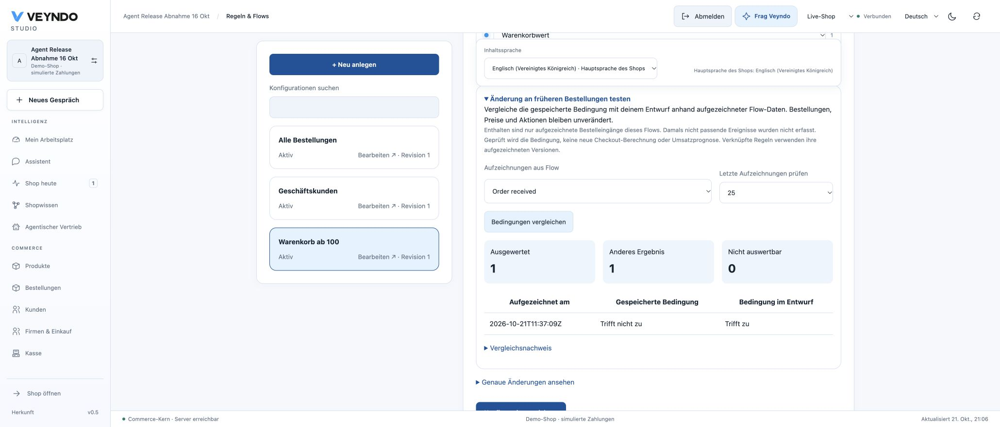
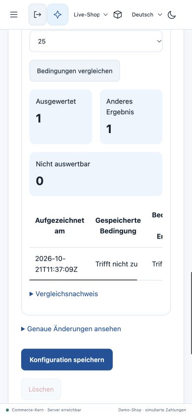
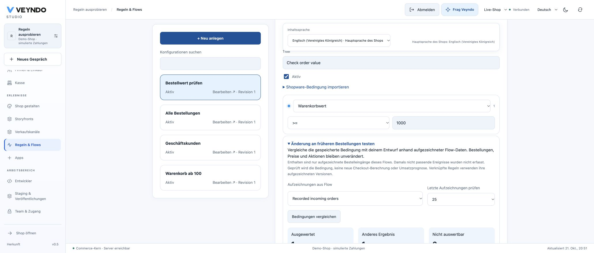
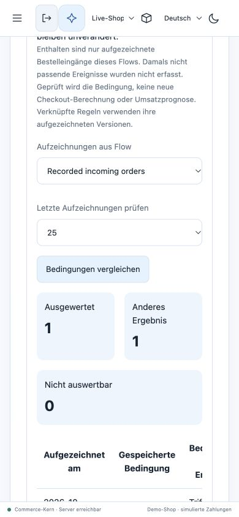

# Compare a rule with recorded order inputs

Before saving a rule change, compare the saved condition with the draft on earlier
order inputs. For example: would changing the minimum basket amount from EUR 100
to EUR 150 change which recorded cases match? The comparison shows both answers
without changing orders, applying discounts or running Flow actions.

## Use it in Studio

1. Open **Rules & Flows**, select **Rules** and open a saved rule.
2. Change its condition in the visual editor without saving it.
3. Expand **Test this change on past orders**, choose a Flow that handled
   `order.placed`, and select up to 50 recorded cases.
4. Start the comparison. Review the saved/draft answers and the number of changed
   cases. Missing inputs appear as **unavailable**, never as a successful test or
   a non-match. No history means that no comparison has been made.
5. Save the rule separately if the change is appropriate. Comparing does not save,
   activate or approve it. An advanced JSON draft must first be loaded into the
   visual editor so that the displayed draft is the one being compared.

Switching shops, rules, revisions or conditions clears the previous result.
Only users with all required current read permissions see the comparison.

## What is recorded

The existing Flow worker freezes cart data, calculated rule context, referenced
rules and its timestamp when it projects an `order.placed` outbox event. This
feature reads that existing record; it adds no history table or background worker.
Both conditions run through the original native rule interpreter against those
same frozen inputs. It never reconstructs them from today's products, customers,
carts or referenced rules.

These are **selected Flow records**, not an unbiased sample of every order: a
record exists only when that Flow matched at projection time. The timestamp is the
projection time, not necessarily the checkout commit time. Other event kinds,
incomplete records, missing referenced rules and oversized snapshots are unavailable.
The comparison evaluates conditions, not a rule's active flag or priority.

This is not historical checkout repricing, a complete business replay or a forecast
of revenue. Shipping, tax, promotion allocation, provider calls and order actions
are not rerun. A complete historical price comparison needs additional frozen
checkout inputs and remains separate work.

## Shared API, MCP and agent operation

`POST /api/automation/rules/compare-history` and
`automation.compare_history` call the same Rust handler. The registered operation
is available to authorized read agents; OpenAPI, TypeScript and WIT input contracts
are generated from that registry.

```json
{
  "ruleId": "high_value",
  "revision": 3,
  "flowId": "order_routing",
  "condition": { "type": "cartCartAmount", "operator": ">=", "amount": 150 },
  "limit": 25
}
```

Use a condition from the native Rule Builder contract; the saved rule revision
must still match. The response includes `comparisonVersion`, saved/draft condition
digests, per-case snapshot digests and counts of evaluated, changed and unavailable
cases. It returns no raw customer, cart, order or private rule facts.

Required current permissions are `automation.read`, `orders.read`, `catalog.read`,
`customers.read`, `customers.pii`, `payments.read`, `documents.read` and `b2b.read`.
The strict conjunction protects private facts that can influence a Boolean result.
HTTP, MCP discovery and execution apply the same requirement. Foreign tenants and
revoked permissions are denied. Results are not stored as release units.

Requests are limited to 32 KiB and 1–50 records, each at most 256 KiB. The existing
tenant/Flow/event index bounds selection. Expanded references are bounded to 2,048
nodes and depth eight before interpretation. Missing facts under negation remain
unavailable; they cannot turn into an affirmative result.

## Acceptance

The real HTTP/PostgreSQL `automation` suite places an order, records its Flow
inputs, changes the saved rule and compares both conditions through HTTP and MCP.
It verifies the original frozen reference, identical digests, unchanged orders,
Flow jobs, outbox and receipt counts, absent/corrupted history, stale revisions,
foreign shops and grant/revocation of personal-data rights. Rendered Studio tests
cover explicit submission, draft/revision changes, late shop-switch responses,
empty history, safe failures and German controls. Rust tests bound expanded
reference fan-out and reject missing references under negation.

This page describes the implemented comparison. Public release and observed
browser acceptance are recorded in [current status](status.md).

### Public browser, 21 October

Core/Studio `6a71d072` (`jubilant-plane-2874`) started at 21:04:50 CEST and
reached one passing replica with zero restarts. In the synthetic shop
`agent-release-abnahm-0054aa7088`, the existing `default_order_received` record
from 11:37:09 UTC was evaluated through the normal Studio. The saved rule
`default_cart_100` was compared with an unsaved threshold of EUR 1: one evaluated
case, one changed result, zero unavailable; saved **does not match**, draft
**matches**.

Changing the draft cleared the result. Selecting **Payment received**, which
had no records, showed the empty-history message. A full reload retained the
original EUR 100 threshold at revision one. The native order list still showed
only `RAC-484bd556` for EUR 49.90. No configuration was saved and no order was
created by this comparison. HTTP/MCP parity and permission revocation are covered
by the separate actual PostgreSQL tests, not inferred from this owner session.



The responsive follow-up `ef093e7a` (`brave-produce-7557`) started at 21:14:41
CEST and reached one passing replica with zero restarts. The same public rule
comparison completed at 390 × 844 pixels: one evaluated case, one changed answer
and zero unavailable. The language selector no longer covers the inputs or
comparison controls. Returning the unsaved threshold to EUR 100 cleared the
result; the test saved no configuration. Temporary browser emulation was removed.



### Local and responsive checks

Local browser acceptance on 21 October used a synthetic native order and completed
Flow. Changing the draft threshold from 1 to 1,000 showed one evaluated case and
one changed result. Editing the draft cleared that result; selecting a Flow with
no records showed the empty-history message. Nothing was saved by comparing.



The 390 × 844 browser check also completes the comparison. The shared content
language card stays in the page flow on narrow screens, so it cannot cover the
condition or result controls. Controls stack vertically and the result table
scrolls inside its own container.


