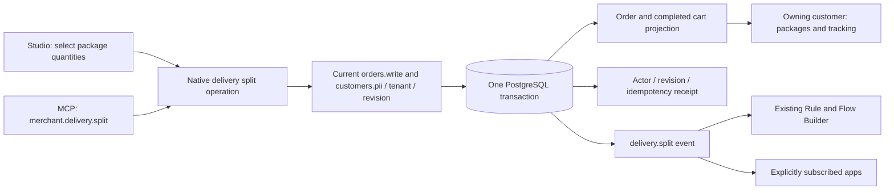
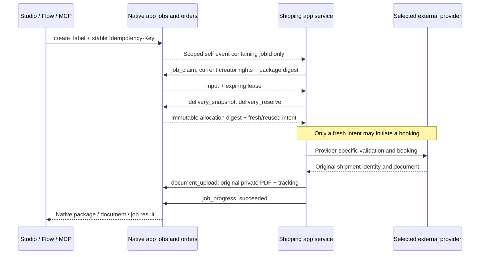

# Shipping, partial packages and direct carriers

An order has one authoritative price, payment and inventory snapshot. Its physical
items can now be allocated to several packages without charging shipping twice or
decrementing stock again. Digital items never join a physical package.



## Use it

Open **Orders → an order → Delivery**. Each package lists its allocated products
and quantities. **Split into another package** opens a quantity editor. Move a
positive subset, leaving at least one item in the original package. The server
owns eligibility: only open packages on nonterminal orders can be split. An
existing carrier label blocks allocation changes. Automatic cancellation/replacement
is not implemented; reconcile it with the carrier before further fulfillment.
At most thirty packages belong to one order.

The original package retains its shipping-charge snapshot. Additional packages
have zero additional customer charge. The order quote, currency, taxes, payment
and inventory allocations stay unchanged. This is operational fulfillment, not
a repricing operation. Each package follows the existing open → shipped → delivered
state machine; completing an order still requires all its packages to be delivered.

`POST /api/merchant/orders/ORDER_ID/deliveries/split` and MCP
`merchant.delivery.split` share these inputs:

```json
{
  "revision": 3,
  "deliveryIndex": 0,
  "positions": [{ "id": "product-id", "quantity": 1 }],
  "requestKey": "a-new-stable-request-key"
}
```

MCP additionally requires `id`. A lost response is retried with the **same** body
and request key. Parallel copies create one package, activity and event. Reusing
a key with changed input fails. A new operation needs the current order revision.
Guest/customer credentials and unrelated tenants cannot invoke this operation;
operational packages cannot be staged or selectively released.

The `delivery.split` Flow event carries the token-redacted order snapshot at that
revision. Existing flow conditions and current action rights still apply. Apps
need explicit event subscriptions and data consent; the event does not give an app
unrestricted order data. Labels and tracking are separate from physical handover:
creating a label must not silently mark goods as shipped. Pending carrier intents
also disable dispatch in that same server-derived action catalogue.

## Provider-neutral shipping app contract

No shipping provider is selected or bundled by this release. App Studio's
[shipping example](../extensions/apps/assistant-examples/shipping.json) declares the
shared contract; an external app implements its chosen carrier. Carrier protocols,
credentials, provider limits, signed booking receipts, recovery and UI belong to
`extensions/apps/<carrier>/` or that app's independent repository. They do not belong
to Commerce system directories. The local fixture is test tooling, not a production
shipping service.



The declared `create_label` action uses `handler: job`, `orders.write` plus
`customers.pii` and `documents.create`. It accepts `orderId`, `deliveryIndex`, a
server-configured account alias and positive integer weight/dimensions. Provider
maximums and address conversion are the app's responsibility. `flowAllowed` enables
the same action in the existing Flow Builder; MCP exposure remains an explicit
manifest opt-in. Neither flag grants rights or installs a service.

The service is pinned using the existing `APP_SERVICES` configuration and approved
package digest. Its callback credential requires explicit `orders.read`,
`customers.pii`, `deliveries.write`, `documents.create` and `jobs.write` consent.
Use server-held secrets, never credential fields in public records or frontend code.

### Callback sequence

All callbacks are under `/api/apps/APP/core/` with the current app credential and
matching `x-tenant`. Use the existing app SDK or the documented HTTP contract:

| Callback | Input / purpose |
| --- | --- |
| `job_claim` | `{id: jobId}`; claims one native job and returns input, lease and deadlines after current creator rights checks |
| `job_progress` | `{id, lease, progress, message, status, result}`; current lease/actor checks, translated bounded messages, cancellation and final result |
| `delivery_snapshot` | `{id: orderId, deliveryIndex}`; current package, owning order shipping address and `allocationDigest` |
| `delivery_reserve` | `{id, deliveryIndex, allocationDigest, requestKey}`; transactionally freezes one open package before external work |
| `delivery_release` | Same intent; release only after a confirmed no-booking outcome, never after an unknown external effect |
| `document_upload` | Multipart `metadata` JSON and `file` PDF; original label acknowledgement through the existing private receipt owner |

A reservation returns `reserved: true` and `reused`. **A reused reservation never
authorizes a fresh booking**, even after an app record was removed or a process
restarted. The same native package cannot be split, dispatched or substituted by
another provider while its booking outcome is unknown. Once the original PDF is
attached, the label fence prevents allocation changes. Creating a label does not
mark dispatch, decrement stock, reprice an order or alter payment state.

The app persists the provider's original identity before document attachment.
Recovery must retrieve that same document, with server-authenticated binding to the
original tenant/order/allocation/account; merchant-editable provider IDs alone must
never authorize another document lookup. A generic native reservation cannot prove
that a carrier accepted a request or that a release is truthful. Those checks belong
to the provider implementation and its acceptance tests.

### Documents, privacy and unknown results

Carrier PDFs are bounded to 2 MiB and counted against the existing 64 MiB aggregate
app storage quota, including retained documents after reinstall. Multipart metadata
contains `orderId`, `deliveryIndex`, `allocationDigest`, a stable `requestKey`,
`kind: shipping_label | return_label` and optional `trackingCode`/HTTPS `trackingUrl`.
Outbound label import must match that app's original reservation. Identical lost-
response retries return the same immutable document; changed payloads fail.

Customer accounts cannot download outbound labels. Return documents are visible
only to the owning registered customer. Importing a return PDF does not implement
return-product booking, inspection, restocking or refunds.

**Delivery notes** can select a package and print only its assigned quantities.
Invoices/cancellation invoices retain their full authoritative fiscal snapshot;
selecting a package for an invoice is rejected. Native and imported documents emit
`document.created` through the existing outbox. Scoped app events expose IDs rather
than private addresses/cart tokens; a separately admitted callback reads details.

Native job status `GET /api/apps/APP/jobs/JOB` is available to its original actor or
an app manager who still holds the action rights and package binding. It omits input
and lease; results appear only after success. Manager lists redact private messages
and results if current rights no longer permit them. Expired jobs show an uncertain
outcome; explicit job retry does **not** remove the package booking fence. Operational
jobs, allocations and receipts cannot be staged or selectively released.

## Ownership and checks

- `commerce/delivery_split.rs`: bounded allocation, native revision and tenant checks.
- `commerce/order_mutation.rs`: the shared transition/split replay ledger, cart
  projection, activity and outbox transaction.
- `commerce/order_workflow.rs`: server admission consumed by Studio and MCP.
- `admin/orders/ShipmentSplit.tsx`: one translated quantity editor, using the parent
  operation fence and preserving failed commands for correction.
- `extensions/apps/assistant-examples/shipping.json`: versioned carrier-neutral job,
  consent and API declaration consumed by the App Studio assistant.
- `operations/delivery_booking.rs`: package-scoped current app admission and
  reserve/release audit; unknown effects block allocation, dispatch and other carriers.
- `operations/order_documents.rs`, migration 092 and `apps/core_documents.rs`: generic
  immutable receipt/PDF admission; `apps/package_fence.rs` shares the existing package
  write fence with native record writes.
- `scripts/shipping_contract.py`: test-only local service driving native jobs, PDFs,
  tracking, explicit no-effect rejection, unknown-effect fences across a native
  restart, current job/PII rights and a real split-to-Flow-to-app job.
- `scripts/shipment_workflows.py`: real PostgreSQL/HTTP/MCP concurrent replay,
  invalid/stale/foreign/current-rights checks, customer visibility, unchanged prices
  and stock, one flow effect and completion of all packages.

Lean checks the extracted open/nonterminal **strict positive subset** and
**unoccupied-or-identical carrier intent** decisions.
Compiled comparison cases and negative mutations exercise its production binding.
It does not prove the surrounding SQL, full allocation algorithm, browser or a
carrier's external effects. Original fulfillment/receipt regressions remain in
`merchant_operations`; no 100% test-coverage or live-carrier acceptance is claimed.

Native order-bound Flow events can supply a declared `orderId` argument automatically
when it is absent. Flow dispatch rehydrates the current personal actor through the
shared access owner and uses a stable flow-execution job key. The provider-neutral fixture covers
`delivery.split → Flow → one app job → original package label`; a saved trigger or
manifest flag alone is not treated as execution evidence. The versioned shipping
assistant example and visual assistant use the same durable-job/callback contract.
