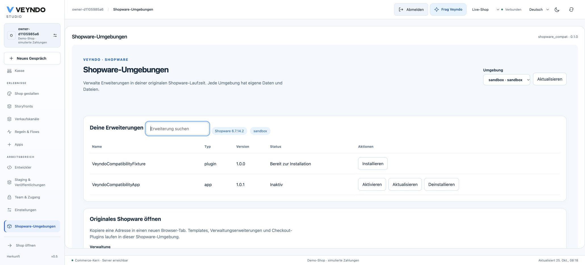
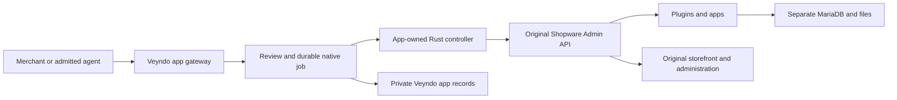

# Use original Shopware extensions

Veyndo can manage a separate original Shopware environment through the optional
**Shopware environments** app. A Rust service connects the native Veyndo app
gateway and durable jobs to Shopware's original extension lifecycle API.

PHP plugins keep their original kernel, dependency injection, data access layer,
database migrations, event subscribers and templates. App Scripts run in the
original Shopware interpreter. Administration and storefront extensions use the
original administration and storefront in that environment.

Actual local Studio session with the plugin and App Script fixtures. The screen
uses the isolated original Shopware environment; the displayed runtime data comes
from its Admin API.

## The two connected environments

Each shop and environment gets a separate database, files and credentials.
The controller never runs plugin PHP inside Veyndo's Rust process. It has no core
database credential or Docker socket. Extension code stays inside the original
Shopware environment; the Veyndo app package owns its controller, UI, deployment
files and tests.

## A merchant's workflow

1. Open **Apps → Shopware environments** and choose the configured environment.
2. Inspect its actual version and extension inventory.
3. Select installation, activation, deactivation, update or uninstall. A review
   shows the exact extension and environment before a job can run.
4. Follow the native job and confirmed change history. Open the original Shopware
   administration or storefront to use that extension's original interface.

Extension packages are first staged through the original Shopware installation
or administration. Composer dependencies are included in a reviewed image build.
The app does not download arbitrary archives or silently accept new permissions.
Uninstall requests retain extension data using Shopware's `keepUserData` contract.

## Roles, versions and private testing

Lifecycle actions require both `apps.manage` and `team.manage`. API, the embedded
app surface and MCP use the same native action contract. The core admits only the
operator-approved manifest and UI digest. Credentials remain on the server.
Flows cannot invoke these lifecycle changes automatically.

A review binds the shop, environment, original Shopware version, configured image
identity and observed extension state. A persistent compare-and-swap lock prevents
two controller jobs from mutating the same environment concurrently. The service
checks current job authority again before issuing the original request.

An interrupted external operation keeps that environment locked until an operator
has inspected and reconciled the result. A restart does not blindly repeat it.
The [operator guide](../extensions/apps/shopware-compat/README.md) explains recovery.

Veyndo records use the existing shared app storage with `operational: true`.
Execution receipts and locks are excluded from sandbox copying and selected
configuration publication. Original Shopware plugin tables belong only to their
separate MariaDB. They never create tables in the Veyndo PostgreSQL database.

## Deployment and verified scope

The package includes a pinned original Shopware **6.7.14.2** image recipe, its
Composer lock, an unprivileged ingress, private MariaDB, web, message worker and
scheduler. PHP and the database use an internal network. The runtime root is read
only; application data uses explicit volumes. External provider connections need
deliberate network configuration. See the [complete setup](../extensions/apps/shopware-compat/README.md).

The local integration test uses the original Shopware container, a real Veyndo
core and PostgreSQL, and the Rust controller. It checks plugin lifecycle,
migration and event execution, an original Twig App Script, an original guest
order with stock deduction and an empty cart, tenant/role/MCP
admission, approved UI bytes and response sandbox, operational-record exclusion
from cloning/publication, and an unfinished-operation fence after restart.
A second run creates the whole environment from scratch, checks retained plugin
data after uninstall and inspects the actual container user, read-only root and
internal network, then removes its own temporary environment. The shared app
regression also passes all 11 cases, including credentials, permissions, MCP,
foreign-tenant rejection and bounded service concurrency.
The order uses original Shopware’s manual invoice method and remains unpaid;
it makes no external payment or email call.
The source fixture and commands live [with the app](../extensions/apps/shopware-compat/tests/integration.py).

This implementation manages original Shopware environments. Automatic catalogue,
inventory and order synchronization with native Veyndo is not included. A plugin
that changes the original Shopware checkout does not thereby change Veyndo's native
checkout. Native transfers use the [migration assistant](agentic-migration.md).
Shopware 5, all Shopware 6 versions, commercial extension licenses and arbitrary
provider-dependent extensions have not been certified. There is no public rollout
claim for this optional service; deployment requires separately configured cells.

[Exact local acceptance](evidence/shopware-compatibility-2026-10-25.md) · [App platform](app-platform.md) · [Shared storage](app-data-storage.md) · [Current status](status.md)
