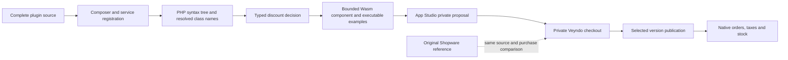

# Translate Shopware plugin logic into a native Veyndo app

Upload a supported Shopware plugin, inspect the translated decision and test the
result in a private Veyndo shop. After a selected release, the native Veyndo
checkout executes the generated component. No original Shopware process is
required for this execution.

The current source profile is `shopware-6.7/cart-percentage-v1`: one registered
cart processor applying a constant percentage discount to the goods subtotal.
This is a working, bounded translation path. General PHP, DAL extensions,
service decorators, events, migrations, Twig and administration code still require
additional translators. An unsupported part blocks the entire source package.

## What happens to a plugin



The compiler reads actual PHP syntax with Mago. It resolves imported class names,
constructor injection and the declared `shopware.cart.processor` service. It
partially evaluates the admitted object operations into a typed decision containing
the percentage, label and original line identity. It does not execute PHP,
Composer scripts, arbitrary network calls or plugin migrations.

The output is an ordinary versioned Manifest with a `commerce.hooks` permission,
a discount component, eight executable examples and the original localized plugin
names from Composer. Missing translations remain missing; the native shop language
fallback applies. The hard-coded discount line label is retained in the report. Source
files, app ID, version, compiler version and profile are bound into a SHA-256
fingerprint embedded in the component. Changing any source changes its package
identity. Retain the original source folder and returned report with that version.

## Use it in Studio or with an agent

1. Install **Shopware extensions** through the usual app review. Its service must
   be configured for this shop as described in the [operator guide](../extensions/apps/shopware-compat/README.md).
2. Open **Translate Shopware plugins**, select the complete plugin folder and choose the target app ID
   and version. Select **Check and translate**.
3. Inspect the translated percentage and label. A refused package shows the file,
   line and missing contract. No plugin is installed by analysis.
4. Copy the returned Manifest into App Studio's native import, or ask the coding
   agent to import the proposal into a private sandbox. The current app surface
   returns the proposal; it does not provide a one-click installation shortcut.
5. Review the private proposal, run its examples and make a test purchase. Publish
   only the reviewed app change using the existing selected-release screen.

Agents use the same registered action, `app.shopware_compat.translate`, with
`appId`, `version` and a `files` map of relative paths to UTF-8 source. HTTP uses
`POST /api/apps/shopware_compat/actions/translate`. Both require current
`developer.manage`, app consent and the existing gateway admission. A successful
analysis grants no installation or publication rights. The translation workspace
requires only `developer.manage`; the separate original-reference workspace retains
`team.manage`, with `apps.manage` also checked for its service actions. Translation
grants contain only `translate` and cannot inspect or mutate reference cells.

The existing `developer.import` and `developer.stage` operations retain their
private-environment, package-digest, review and current-rights checks. Installation
has no separate compatibility registry or database. The generated app uses the
normal app registry, versions and commerce hook owner.

## Exact admitted contract

| Part | Accepted in this profile |
| --- | --- |
| Composer | `shopware-platform-plugin`, Shopware `~6.7.0`, one `src/` PSR-4 namespace, no extra dependencies or executable scripts |
| Bootstrap | Empty class extending the actual Shopware `Plugin`; matching PSR-4 file path |
| Service | One processor, one injected `PercentagePriceCalculator`, priority `4500` |
| PHP | Valid explicit signatures, local assignments, constants, admitted constructor/method calls; optional `declare(strict_types=1)` |
| Discount | One non-removable, non-stackable, non-goods line; negative percentage with up to two decimal places, at most 100% |
| Arithmetic | Integer minor units and half-up percentage rounding; positive subtotals up to 100,000,000 minor units |
| Resource bounds | 64 files, 32 KiB per file, 256 KiB combined source for the local compiler; Studio/HTTP/MCP retain the shared 64 KiB encoded-request limit |
| Source analysis | Bounded PHP syntax and expression traversal; reading cart prices after mutating its lines is refused |
| Runtime | Existing typed WIT host with fuel, memory and response validation; no WASI, database or network capability |

The profile translates the **aggregate discount decision**. Veyndo allocates the
discount across its own native order positions and calculates taxes through its
commerce owner. Original Shopware retains a separate negative discount line.
The current acceptance compares a single product at EUR 24.90 with 19% tax and a
10% discount. Mixed tax allocation, interactions with other promotions, shipping
rules and arbitrary Shopware context combinations are not covered by this
acceptance and must be compared before extending the supported profile.

## Source ownership and checks

`extensions/apps/shopware-compat/` is its own Cargo package,
`veyndo-shopware-native`, with an independent Cargo workspace and lockfile. The core
does not depend on this compiler. Separate dependency resolution prevents parser
schema features, including JSON insertion-order serialization, from changing
Commerce package signatures, approval snapshots or provider schemas. Both builds
have mandatory format, Clippy and execution checks. The package
owns PHP intake, name resolution, partial evaluation, typed decisions, Wasm
emission and hostile-input tests. The adjacent Rust service provides the existing
app HTTP/MCP entry. No plugin implementation is moved into core directories.

```sh
cargo test --locked --manifest-path extensions/apps/shopware-compat/Cargo.toml --target-dir target
cargo build --locked --no-default-features -p veyndo --bin veyndo
cargo build --locked --manifest-path extensions/apps/shopware-compat/Cargo.toml --target-dir target --bins
python3 extensions/apps/shopware-compat/tests/container.py
```

The container test starts isolated PostgreSQL and original Shopware, executes the
same PHP source fixture in Shopware, imports its native translation, publishes
that exact app and completes a native purchase. It compares goods total, stock
and empty active carts. Separate checks cover idempotent order recovery,
permissions, direct gateway rejection, MCP, private/live separation, source
rejection and other-shop isolation. Payments remain unpaid invoice/bank transfer;
this test never charges a provider.

The test plugin was written for this comparison. This does not certify an
unchanged commercial plugin or the complete Shopware extension API. The optional
[original runtime](shopware-compatibility.md) remains a separate reference facility.

[Local acceptance](evidence/shopware-native-2026-10-25.md) · [App platform](app-platform.md) · [Current status](status.md)
